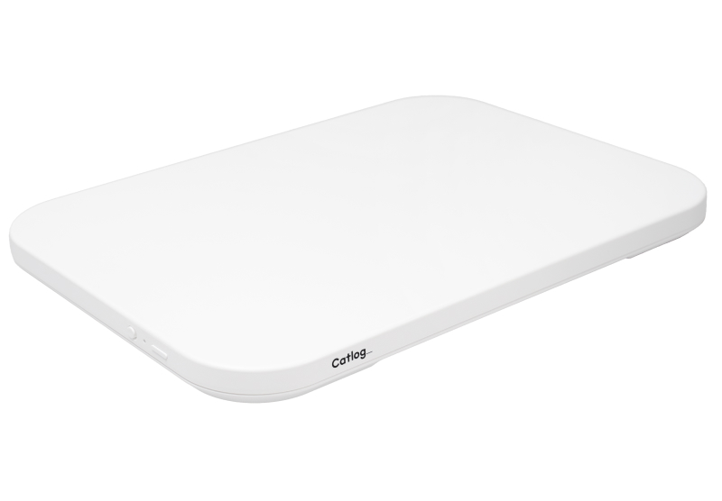
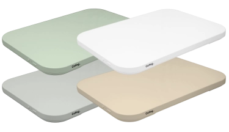
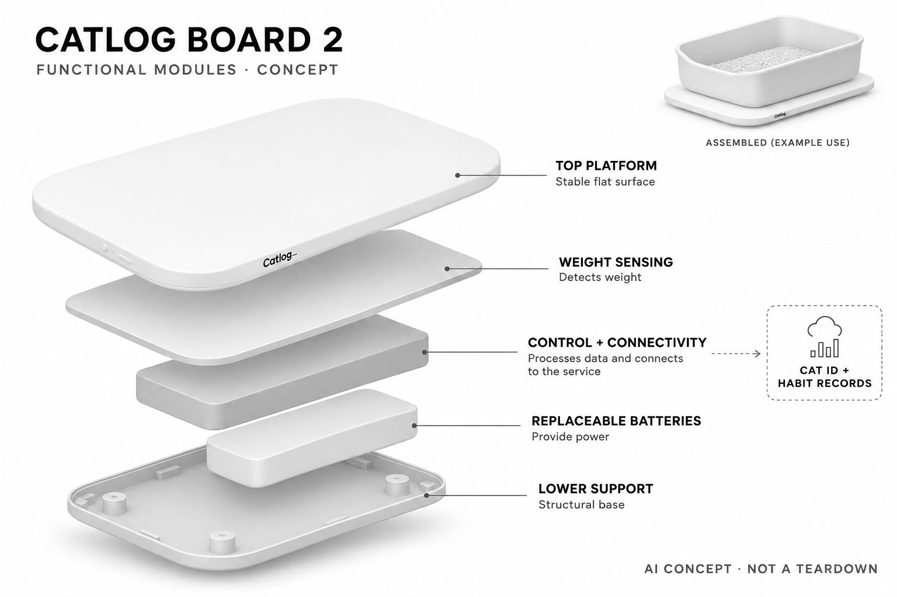

# Catlog Board 2

**RABO / Catlog** · 宠物照护 · 核查 2026-11-04

保留原有猫砂盆，通过重量与行为模式辨认个体的感知底板

消费渠道：个人零售。

## 产品图片与结构参考

### 产品图

官方Board 2白色在售型号 · 来源：[RABO / Catlog · 官方图片](<https://rabo.cat/catlog/product/board2/>) · [原始图片](<https://d11jl4ergbaxva.cloudfront.net/products/8/board2.jpg?v=1>)

### 参考图

官方Board 2配色参考，不另计产品 · 来源：[RABO / Catlog · 官方图片](<https://rabo.cat/catlog/product/board2/>) · [原始图片](<https://rabo.cat/static/8fe7ecadfbe90b112e7a2161d0ba1e6b/41517/Board2KvJP.webp>)

### AI 生成爆炸示意

**AI 生成 · 非实物拆机。** 内部为概念推断，不能作为元件布局、BOM 或维修依据。[生成提示词](../../content/hardware/prompts/catlog-board-2.txt)

> 依据已核验官方外形与公开功能生成；未知内部仅为概念功能块，不代表原机电路板、芯片或实际布局。

> 实际查看并核对对应型号，原图未经改色或语义编辑；厂商标注不等同本研究实测。

> 当前官网混有系列历史场景图，本条只选明确标为Board 2的整机及配色图。

> 分析为基于公开资料的案头研究与 AI 辅助判断，未经用户访谈、销量审计或实物拆机。需求、画像、竞争冷门度、审美及商业机会均为研究假设，不是投资结论。

## 销售与购买

- 状态：在售。2026-11-04实际浏览官方商品页，白色与橄榄色可选且加入购物车按钮可用，显示含税¥19,800；灰色和沙色显示缺货，未下单。

- 地区：日本

- 价格：硬件 JPY 19,800（含税）。新会员优惠硬件JPY13,860附带至少六个月会员条件；会员按每只猫JPY980/月起，设备数量不直接增加会员费，详见当期官方规则。

- 中国大陆：已核实日本官方商店购买入口和日元价格，未确认中国大陆官方配送、应用区域与售后；旧Board已停售信息不混入第二代。

- [官方产品 / 商店](<https://rabo.cat/catlog/product/board2/>)

## AI 的实际作用

重量传感数据结合猫的如厕行为模式学习个体，自动归属体重、时长和排泄记录；无须摄像头或项圈，不能用于疾病诊断。

服务与联网依赖：需家庭Wi-Fi、应用及按猫订阅的分析保存服务；部分算法运行位置未明确，不据硬件感知推断全离线可用。

## 是否冷门

细分专业（研究判断）：依托现有猫砂盆的非摄像、多猫行为记录是明确细分路径，和自动清洁不同；订阅、安装及识别条件限制适用人群。

## 需求与市场

需求假设：多猫家庭或无法时时观察的人，希望保留现有厕所同时记录谁在何时使用。底板解决记录与归属，不负责清洁，应检查漏记、错认和主人查看后的行动，不能以更多数据直接宣称更早诊断或减少治疗费用。

### 产品任务与边界 · 研究判断

需求假设：多猫家庭或无法时时观察的人，希望保留现有厕所同时记录谁在何时使用。底板解决记录与归属，不负责清洁，应检查漏记、错认和主人查看后的行动，不能以更多数据直接宣称更早诊断或减少治疗费用。

依据：[Catlog Board 2官方商品页](<https://rabo.cat/catlog/product/board2/>) · [Catlog官方会员价格](<https://rabo.cat/catlog/price/>)

### 需求判断 · 研究判断

把记录层放到现有厕所下，避免要求猫接受新厕所，是本产品相对整机自动猫砂盆的重要任务取舍。主人需要的不只是一次重量，而是能归属到特定猫的稳定历史；若每天仍需大量手工纠正，低扰动硬件并不自动意味着低维护。

依据：[Catlog Board 2官方商品页](<https://rabo.cat/catlog/product/board2/>) · [Catlog官方会员价格](<https://rabo.cat/catlog/price/>)

### 需求验证 · 待验证

需求验证可在不改变猫自然如厕行为的情况下，对照人工观察与设备记录的个体归属和缺失，记录主人查看后如何复核。不得为测试延迟照护或改变正常排泄条件，也不能用短期健康个案证明设备能够诊断；本研究仅提出有条件的验证方法。

依据：[Catlog Board 2官方商品页](<https://rabo.cat/catlog/product/board2/>) · [Catlog官方会员价格](<https://rabo.cat/catlog/price/>)

## 用户画像

画像推断：猫不接受项圈、主人愿意长期订阅并已有适合放置底板的厕所时较匹配。近似体重、多猫共用和厕所挪动会改变效果，需有人复核记录与换电池，不能把所有养猫家庭或所有健康焦虑都转成合理购买需求。

### 适用行为与条件 · 研究判断

画像推断：猫不接受项圈、主人愿意长期订阅并已有适合放置底板的厕所时较匹配。近似体重、多猫共用和厕所挪动会改变效果，需有人复核记录与换电池，不能把所有养猫家庭或所有健康焦虑都转成合理购买需求。

依据：[Catlog Board 2官方商品页](<https://rabo.cat/catlog/product/board2/>) · [Catlog官方会员价格](<https://rabo.cat/catlog/price/>)

### 人群取舍 · 研究判断

不接受项圈的猫与不愿更换熟悉厕所的主人构成明确画像，但底板仍要求平整受力、合适承重及无线覆盖。多猫体重相近时更依赖行为模式，使用者也需要理解错误归属和订阅计费，因此不能只以多猫数量作为自动成立的购买理由。

依据：[Catlog Board 2官方商品页](<https://rabo.cat/catlog/product/board2/>) · [Catlog官方会员价格](<https://rabo.cat/catlog/price/>)

### 画像验证 · 待验证

画像验证应检查每个厕所的实际尺寸、与墙接触和清理方式，再观察主人能否理解记录并完成纠错。对频繁移动厕所、无法保持受力或不愿订阅的家庭明确标注不匹配，不把对宠物健康的担忧转化为必须购买设备的结论。

依据：[Catlog Board 2官方商品页](<https://rabo.cat/catlog/product/board2/>) · [Catlog官方会员价格](<https://rabo.cat/catlog/price/>)

## 竞争与替代

竞争判断：与人工体重记录、带称重的自动猫砂盆和宠物摄像头竞争，差异是保留原厕所且不拍摄的行为归属。Board 2各颜色不增加产品数，也不混用旧代能力；应比较扰动、维护与识别，而非只比较记录项目数量。

### 比较对象与差异 · 研究判断

竞争判断：与人工体重记录、带称重的自动猫砂盆和宠物摄像头竞争，差异是保留原厕所且不拍摄的行为归属。Board 2各颜色不增加产品数，也不混用旧代能力；应比较扰动、维护与识别，而非只比较记录项目数量。

依据：[Catlog Board 2官方商品页](<https://rabo.cat/catlog/product/board2/>) · [Catlog官方会员价格](<https://rabo.cat/catlog/price/>)

### 竞争判断 · 研究判断

与称重自动厕所相比，底板保留原盆和原砂，却不减少铲砂；与摄像头相比，重量模式不拍摄画面，但也缺少视觉复核。两者处理不同部分的任务，竞争评估不能仅按传感器数量或是否联网排序，也不应把颜色和多台组合当作额外创新。

依据：[Catlog Board 2官方商品页](<https://rabo.cat/catlog/product/board2/>) · [Catlog官方会员价格](<https://rabo.cat/catlog/price/>)

### 竞争验证 · 待验证

竞争验证可分别比较人工记录、底板和原有智能厕所的归属、维护及猫的适应，保持同样家庭条件。旧代Board的历史故事只能作为系列线索，不证明第二代实际表现；当前白色与橄榄色有库存，而其他颜色缺货不应改写成全系列都不可买。

依据：[Catlog Board 2官方商品页](<https://rabo.cat/catlog/product/board2/>) · [Catlog官方会员价格](<https://rabo.cat/catlog/price/>)

## 供应链

供应链分析：承重结构、重量感知、电池供电、无线控制与分析服务共同工作，实际工厂和BOM未披露。地面平整、墙体接触与猫砂总重会影响受力，制造应关注装配一致与长期漂移，不以普通电子秤成本估计全部价值。

### 功能模块拆分 · 研究判断

平台受力、重量信号采集、电池供电、无线连接和按猫整理的分析服务共同构成系统。底板与墙接触或地面不平会绕过预期受力路径，影响数据，因此结构设计和装配一致性与算法同样关键；公开未披露传感器数量和精确内部布局。

依据：[Catlog Board 2官方商品页](<https://rabo.cat/catlog/product/board2/>) · [Catlog官方会员价格](<https://rabo.cat/catlog/price/>)

### 制造与供应约束 · 研究判断

供应链分析：承重结构、重量感知、电池供电、无线控制与分析服务共同工作，实际工厂和BOM未披露。地面平整、墙体接触与猫砂总重会影响受力，制造应关注装配一致与长期漂移，不以普通电子秤成本估计全部价值。

依据：[Catlog Board 2官方商品页](<https://rabo.cat/catlog/product/board2/>) · [Catlog官方会员价格](<https://rabo.cat/catlog/price/>)

### 候选与证据缺口 · 研究判断

广达可作为联网终端工程与制造候选，HLH可验证平台结构和装配可达性，均无本型号实际合作证据。称重一致性、湿区清洁和个体行为模型要另行确认，不能把一般计算硬件制造经验或机械加工能力直接解释为已掌握猫厕所识别方案。

依据：[Catlog Board 2官方商品页](<https://rabo.cat/catlog/product/board2/>) · [Catlog官方会员价格](<https://rabo.cat/catlog/price/>)

## 技术路径

技术判断：官方明确AI从重量及如厕行为学习个体，不要求项圈或摄像头。相近体重、同时靠近与清理动作可能造成歧义，长期趋势和单次记录都需要复核；模型细节未公开，不能把变化提醒写为疾病识别。

### 已披露技术边界 · 研究判断

技术判断：官方明确AI从重量及如厕行为学习个体，不要求项圈或摄像头。相近体重、同时靠近与清理动作可能造成歧义，长期趋势和单次记录都需要复核；模型细节未公开，不能把变化提醒写为疾病识别。

依据：[Catlog Board 2官方商品页](<https://rabo.cat/catlog/product/board2/>) · [Catlog官方会员价格](<https://rabo.cat/catlog/price/>)

### 系统难点判断 · 研究判断

体重与如厕动作形成时间序列，可帮助区分个体，但猫成长、减重、多人靠近和铲砂动作可能改变分布。模型需要允许不确定与主人纠正，而非强制每次分配身份；长期趋势也可能受到系统性偏差影响，不能以看起来连续就推定可靠。

依据：[Catlog Board 2官方商品页](<https://rabo.cat/catlog/product/board2/>) · [Catlog官方会员价格](<https://rabo.cat/catlog/price/>)

### 技术验证 · 待验证

技术验证应标记正常清理、加砂和不同猫使用时的记录，检查模型能否区分环境改变和真实个体差异。记录失网、换电池后的连续性，禁止通过限制饮食或如厕制造测试情境；变化提醒仅是观察入口，不可当作医疗判断或处置依据。

依据：[Catlog Board 2官方商品页](<https://rabo.cat/catlog/product/board2/>) · [Catlog官方会员价格](<https://rabo.cat/catlog/price/>)

## 产品审美

审美判断：低矮圆角底板隐藏在原有猫砂盆下，减少新增装置的视觉负担，也让用户容易忽略摆放约束。边缘清洁、电池可达性和不触墙的要求比颜色重要，不能为了隐蔽收纳把平台卡紧而改变称重状态。

### 外观与交互语言 · 研究判断

审美判断：低矮圆角底板隐藏在原有猫砂盆下，减少新增装置的视觉负担，也让用户容易忽略摆放约束。边缘清洁、电池可达性和不触墙的要求比颜色重要，不能为了隐蔽收纳把平台卡紧而改变称重状态。

依据：[Catlog Board 2官方商品页](<https://rabo.cat/catlog/product/board2/>) · [Catlog官方会员价格](<https://rabo.cat/catlog/price/>)

### 使用中审美判断 · 研究判断

薄型白色圆角平台不抢占猫砂盆本体视觉，适合保留猫熟悉的环境；然而隐蔽也使用户容易忽略墙体接触和清洁残留。第二代照片应保留真实平滑边缘，不使用旧代前部缺口图推导结构，色彩选择只是家居适配而非需求差异。

依据：[Catlog Board 2官方商品页](<https://rabo.cat/catlog/product/board2/>) · [Catlog官方会员价格](<https://rabo.cat/catlog/price/>)

### 设计验证 · 待验证

设计验证可观察铲砂、擦地和换电池时是否必须抬起重盆，以及重新放回后是否容易恢复正确受力。状态提醒需要让主人知道数据缺失而非误认猫没有使用，不能只评价低矮造型，也不把隐藏在盆下当成完全不会改变动物体验的证据。

依据：[Catlog Board 2官方商品页](<https://rabo.cat/catlog/product/board2/>) · [Catlog官方会员价格](<https://rabo.cat/catlog/price/>)

## 关键风险

风险判断：错误个体归属、受力干扰和服务中断会影响记录，用户仍需观察猫的真实行为。厂商明确不是医疗诊断服务，不能因没有提醒就排除问题；会员条件、地区和数据保存需确认，不把旧款用户故事当第二代效果验证。

### 主要失效与依赖 · 研究判断

风险判断：错误个体归属、受力干扰和服务中断会影响记录，用户仍需观察猫的真实行为。厂商明确不是医疗诊断服务，不能因没有提醒就排除问题；会员条件、地区和数据保存需确认，不把旧款用户故事当第二代效果验证。

依据：[Catlog Board 2官方商品页](<https://rabo.cat/catlog/product/board2/>) · [Catlog官方会员价格](<https://rabo.cat/catlog/price/>) · [RABO官方商店指南](<https://rabo.cat/store_guide/>)

### 风险传播判断 · 研究判断

错误身份归属会让一只猫的变化看似出现在另一只猫身上，风险可能比少记一次更难察觉。订阅、网络和电池问题也会产生空白，主人仍需直接观察；厂商明确非诊断服务，不能因没有警报就排除异常或用设备替代兽医评估。

依据：[Catlog Board 2官方商品页](<https://rabo.cat/catlog/product/board2/>) · [Catlog官方会员价格](<https://rabo.cat/catlog/price/>) · [RABO官方商店指南](<https://rabo.cat/store_guide/>)

### 风险验证 · 待验证

风险验证应检查不确定记录、人工修改和数据中断的表达，按说明处理平台承重与清洁，不开展危险超载试验。会员优惠附最低持续条件应清楚列出，大陆售后未确认则保持不确定；不把官网健康故事写成第二代产品实际临床验证。

依据：[Catlog Board 2官方商品页](<https://rabo.cat/catlog/product/board2/>) · [Catlog官方会员价格](<https://rabo.cat/catlog/price/>) · [RABO官方商店指南](<https://rabo.cat/store_guide/>)

## 机会与验证

机会假设：给不愿换猫砂盆和不接受项圈的家庭提供低扰动记录，是比再造整台自动厕所更具体的切口。先验证正常维护中的个体归属和查看价值，再扩展分析；不以猫疾病发生率或担忧程度直接推断付费规模。

### 可能的机会入口 · 研究判断

机会假设：给不愿换猫砂盆和不接受项圈的家庭提供低扰动记录，是比再造整台自动厕所更具体的切口。先验证正常维护中的个体归属和查看价值，再扩展分析；不以猫疾病发生率或担忧程度直接推断付费规模。

依据：[Catlog Board 2官方商品页](<https://rabo.cat/catlog/product/board2/>) · [Catlog官方会员价格](<https://rabo.cat/catlog/price/>)

### 机会成立条件 · 研究判断

机会在于低扰动的日常记录与可信的个体归属，尤其是猫不接受项圈或主人不愿整体换厕所的场景。创业方案可以先验证少量关键记录与纠错流程，再增加健康解释；若维护收益不足，更多评分只会扩大用户误解和服务成本。

依据：[Catlog Board 2官方商品页](<https://rabo.cat/catlog/product/board2/>) · [Catlog官方会员价格](<https://rabo.cat/catlog/price/>)

### 下一步验证 · 待验证

下一步可跟踪多个自然使用与清理周期，记录身份纠错、数据缺失和主人实际查看行为，确认持续订阅对应何种价值。以有条件的家庭观察决定改进方向，不用宠物疾病发生率、猫数量或单个成功故事推导产品适合所有养宠家庭。

依据：[Catlog Board 2官方商品页](<https://rabo.cat/catlog/product/board2/>) · [Catlog官方会员价格](<https://rabo.cat/catlog/price/>)

## 对应供应链公司

能力候选用于选型研究，不代表本产品实际采用；未公开的供货关系不作推断。

- [quanta-computer](../supply-chain/quanta-computer.md) — **能力候选 · 非已采用** / 联网感知终端的工程与制造评估：广达公开终端与联网产品工程制造能力可对应采集控制和无线整合，但重量传感一致性、湿区结构和猫行为模型需专项验证；未见Catlog Board 2点名合作证据，不能称其实际整机供应方。

- [hlh-prototypes](../supply-chain/hlh-prototypes.md) — **能力候选 · 非已采用** / 低矮承重底板与维护结构原型：HLH公开原型及机械制造服务可支持承重平台和维护接口试制，但称重计量、长期漂移及湿区清洁不是加工能力自动保证；没有RABO型号点名供货信息，只作为结构工程候选。

[浏览供应链目录](../supply-chain.md)

## 功能分层示意

这是功能关系，不是实物拆机、真实空间结构或已核实 BOM。

1. **承重平台**：薄型底板承载现有猫砂盆及使用中的猫。（官方披露）

2. **重量感知**：传感器采集载荷变化，实际数量和内部位置未披露。（官方披露）

3. **控制与无线**：采集与无线传输功能层，具体电路未披露。（分析推断）

4. **可更换电池**：官方使用可更换干电池，不画成充电锂电池。（官方披露）

5. **个体学习服务**：结合重量与如厕模式辨认猫并整理长期记录。（官方披露）

## 来源

1. [Catlog Board 2官方商品页](<https://rabo.cat/catlog/product/board2/>) — 实际浏览白色购买区域确认价格和可用按钮；正文明确重量及行为AI，不做疾病诊断。

2. [Catlog官方会员价格](<https://rabo.cat/catlog/price/>) — 实际打开按猫会员、云分析与新用户硬件折扣的最低持续条件。

3. [RABO官方商店指南](<https://rabo.cat/store_guide/>) — 实际打开支付及通常发货说明，不由日本商店推定国际配送。

[返回目录](../hardware-market.md) · [网页分析](https://romanagent.github.io/Roman/#hardware/product/catlog-board-2)
