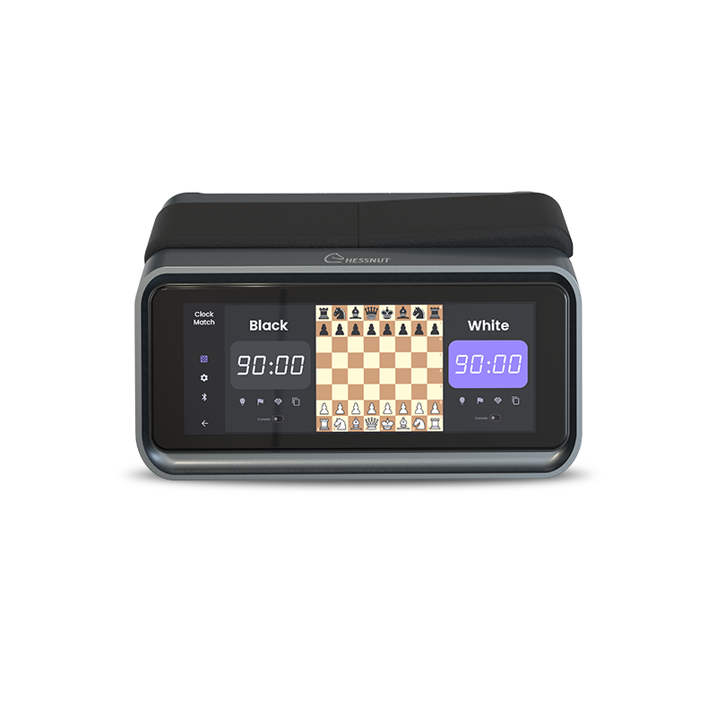
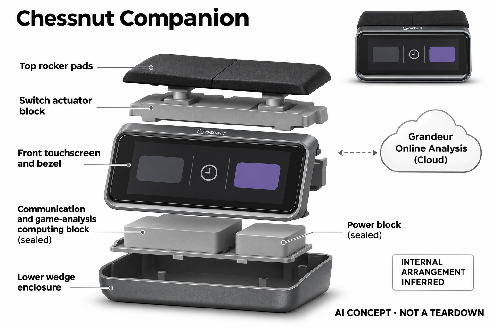

# Chessnut Companion

**Chessnut** · 游戏与桌游 · 核查 2026-11-04

把AI复盘放进专用实体棋钟

消费渠道：个人零售。

## 产品图片与结构参考

### 产品图

Chessnut Companion · 官方产品图 · 来源：[Chessnut · 官方图片](<https://www.chessnutech.com/products/chessnut-companion>) · [原始图片](<https://www.chessnutech.com/cdn/shop/files/Chessnut_Companion_Smart_AI_Chess_Clock.png?v=1781769758&width=1946>)

### 参考图

Chessnut Companion · 官方参考图 · 来源：[Chessnut · 官方图片](<https://www.chessnutech.com/products/chessnut-companion>) · [原始图片](<https://www.chessnutech.com/cdn/shop/files/Chessnut_Companion_Everyday_Chess_Play.png?v=1781769973&width=1946>)

### AI 生成爆炸示意

**AI 生成 · 非实物拆机。** 内部为概念推断，不能作为元件布局、BOM 或维修依据。[生成提示词](../../content/hardware/prompts/chessnut-companion.txt)

> 已目视核对外形、标签与非拆机声明；不代表内部结构经实测验证。

> 分析为基于公开资料的案头研究与 AI 辅助判断，未经用户访谈、销量审计或实物拆机。需求、画像、竞争冷门度、审美及商业机会均为研究假设，不是投资结论。

## 销售与购买

- 状态：在售。官方商品页可加购；结构化Offer标准容量为InStock，较大容量为OutOfStock。只计同一型号，不以容量变体凑数。

- 地区：所列官方国际商店

- 价格：可购标准容量官网 US$459。核查日页面快照；运费、税费、会员和配送区域按官方结算确认，不视为中国到手价。

- 中国大陆：本轮核实所列区域官方商店；未确认中国大陆官方现货、账户及完整服务，不把境外可购等同大陆可用。

- [官方产品 / 商店](<https://www.chessnutech.com/products/chessnut-companion>)

## AI 的实际作用

将棋钟、棋局识别和Grandeur AI棋局分析结合，生成阶段建议与复盘摘要；可识别棋盘或网页棋局，自动按钟模拟对手节奏。

服务与联网依赖：完整实体对局流程需兼容棋盘；Grandeur使用服务器资源，免费积分与Premium权益不同，不能当作所有分析离线无限可用。

## 是否冷门

细分专业（研究判断）：云端分析权益与计时功能分开形成具体使用场景；本轮没有销量与市场份额证据。

## 需求与市场

需求假设：已有电子棋盘的人可能希望在桌边完成计时、记录与复盘，减少手机和电脑切换。应验证独立棋钟是否真正成为常用入口，还是与已有棋类应用重复而增加了设备管理负担。

### 需求假设：桌边计时、记录和复盘少切换设备 · 研究判断

Chessnut Companion把棋钟、局面输入和Grandeur分析组合，针对已有棋盘用户希望在桌边完成更多步骤。需求不是再买一台强引擎，而是减少手机与电脑往返，应观察独立终端是否成为常用入口，不能以功能整合数证明新增价值。

依据：[Chessnut Companion官方商品](<https://www.chessnutech.com/products/chessnut-companion>) · [Chessnut Companion官方能力与会员](<https://www.chessnutech.com/pages/chessnut-companion>)

### 价值判断：计时与分析服务不同阶段 · 研究判断

对局计时需要稳定简单，复盘解释则需要更多信息，两项任务放在一起可能方便，也可能让比赛中分心。研究应分别观察何时使用和怎样切换，不能把自动按钟与AI解释混称一项能力，也不将流畅摘要当作策略绝对正确或学习保证。

依据：[Chessnut Companion官方能力与会员](<https://www.chessnutech.com/pages/chessnut-companion>)

### 验证方案：围绕已有棋盘完成一局和复盘 · 待验证

让实际兼容棋盘用户从设置计时、对弈到查看摘要完成全流程，与普通棋钟加手机比较，记录连接和局面修正。不要把宣传图中的完整棋盘当作棋钟订单内容，也不只测解释生成速度，最终应看是否少步骤且更容易理解。

依据：[Chessnut Companion官方商品](<https://www.chessnutech.com/products/chessnut-companion>) · [Chessnut Companion官方能力与会员](<https://www.chessnutech.com/pages/chessnut-companion>)

## 用户画像

画像推断：经常进行家庭或俱乐部式限时对弈、已有兼容棋盘的个人爱好者较匹配。单独购买前需要确认能获得哪些局面输入，不能把照片中的整套棋盘误认为棋钟订单自带。

### 画像假设：已有棋盘且经常限时对弈的人 · 研究判断

较匹配者在家庭或个人棋会中使用实体棋盘与计时，愿意复盘并管理账户，可能重视桌边独立入口。只想休闲不计时或完全不看分析的人未必需要，画像应包含真实对局与复盘频率，不以棋迷身份推断全部功能都有价值。

依据：[Chessnut Companion官方商品](<https://www.chessnutech.com/products/chessnut-companion>) · [Chessnut Companion官方能力与会员](<https://www.chessnutech.com/pages/chessnut-companion>)

### 购买约束：兼容棋盘与独立输入需先确认 · 研究判断

Companion不是照片中所有设备的总称，完整实体流程需要合适局面来源，部分一体棋机也可能不在兼容范围。用户需要明确单独买到什么和还需什么，研究应把已有设备纳入成本，不能按棋钟外观推断能与任意棋盘即插即用。

依据：[Chessnut Companion官方商品](<https://www.chessnutech.com/products/chessnut-companion>) · [Chessnut Companion官方能力与会员](<https://www.chessnutech.com/pages/chessnut-companion>)

### 访谈重点：为什么不继续使用手机复盘 · 待验证

请用户展示一次限时对局后的记录和分析，说明最麻烦的是连接、录入、解释还是保持桌面简洁，再观察Companion解决哪一步。不能把大屏独立设备当作天然便利，也不将对AI语音的兴趣等同持续愿意为服务器分析付费。

依据：[Chessnut Companion官方能力与会员](<https://www.chessnutech.com/pages/chessnut-companion>)

## 竞争与替代

竞争判断：普通棋钟价格较低，手机与平板也能做棋局分析，组合硬件必须证明流程连贯性。自动按钟和桌边摘要是差异，但小众棋钟市场不等于缺少软件替代或存在确定的增长机会。

### 替代方案：普通棋钟与平板分析组合 · 研究判断

Companion面对低成本棋钟、手机平板和已有电子棋盘应用，核心对手不是另一款发光棋盘，而是组合流程。自动按钟和桌边分析提供差异，但需要证明减少真实操作，不能因为专用棋钟较少曝光就推断竞争低或市场增长确定。

依据：[Chessnut Companion官方商品](<https://www.chessnutech.com/products/chessnut-companion>) · [Chessnut Companion官方能力与会员](<https://www.chessnutech.com/pages/chessnut-companion>)

### 差异判断：实体计时与服务器解释形成组合 · 研究判断

棋钟属于实时本地操作，Grandeur分析消耗服务资源，二者依赖和成本不同，用户可能只需要其中之一。研究应记录免费与高级功能的实际采用，不把首次积分体验当作全部分析无限可用，也不以终端独立外观推断核心解释全部离线。

依据：[Chessnut Companion官方能力与会员](<https://www.chessnutech.com/pages/chessnut-companion>)

### 比较方法：保持同一棋盘与复盘目标 · 待验证

让用户用Companion和原有棋钟手机路径完成相同对局与分析，记录同步、计时、修正局面和阅读解释的时间。不要只比较屏幕大小或回答篇幅，也不将不同引擎评价直接当作好坏，用户能否说明下一次要改什么才是有用线索。

依据：[Chessnut Companion官方商品](<https://www.chessnutech.com/products/chessnut-companion>) · [Chessnut Companion官方能力与会员](<https://www.chessnutech.com/pages/chessnut-companion>)

## 供应链

供应链推断：大屏、按钟机构、连接模块和电池需要支持频繁操作及稳定计时。品牌未在本轮资料中披露该型号具体工厂或物料清单，机械按键维修与兼容固件维护都属于长期成本。

### 功能拆分：局面输入、计时与分析服务 · 研究判断

公开结构结合兼容棋盘或视觉局面输入、显示与语音、实体计时及自动按钟机构，Grandeur在服务层提供分析。不能把机械按钟当作AI推理，也不能将所有分析画在棋钟内部，具体相机、主控、驱动与工厂本轮未披露。

依据：[Chessnut Companion官方商品](<https://www.chessnutech.com/products/chessnut-companion>) · [Chessnut Companion官方能力与会员](<https://www.chessnutech.com/pages/chessnut-companion>)

### 制造判断：计时可靠与频繁操作同样重要 · 研究判断

屏幕、按键或按钟机构、连接和电池需要在多次对局中保持可用，局面同步也影响复盘，不能只看语言服务。供应评估应包含按压耐久、版本和维修，本轮没有实际计时、装配或寿命数据，不能从功能演示估算物料成本。

依据：[Chessnut Companion官方商品](<https://www.chessnutech.com/products/chessnut-companion>)

### 候选选型：显示与小机构分别询证 · 研究判断

Tianma可作为横向触控显示候选，Precision Microdrives可讨论自动按钟执行机构，Sunwoda可研究电源。实际结构、受力与控制需专项确认，候选不提供Grandeur棋力解释，也没有Chessnut点名供货证据，不能用标准件直接替换原机。

依据：[Chessnut Companion官方商品](<https://www.chessnutech.com/products/chessnut-companion>) · [Chessnut Companion官方能力与会员](<https://www.chessnutech.com/pages/chessnut-companion>)

## 技术路径

官方说明Grandeur分析与局面识别，而计时和按钟是另一层功能。技术判断应分别验证视觉录入、棋盘同步和文本解释，生成的策略描述可能与强引擎评分不同，不能当作绝对正确的教练。

### 已披露能力：Grandeur分析与局面识别 · 官方资料

官方说明可从兼容棋盘或相应视觉功能获取局面，并通过Grandeur提供阶段建议和复盘摘要，计时与自动按钟是另一个功能层。AI解释涉及服务器资源与权益，不能写成所有分析离线无限可用，也不把生成文字当作绝对正确的教练。

依据：[Chessnut Companion官方能力与会员](<https://www.chessnutech.com/pages/chessnut-companion>)

### 技术判断：输入局面与文字解释要分别核对 · 研究判断

如果棋盘同步或视觉录入出错，系统可能对错误局面给出流畅说明，用户需要先确认棋谱与位置。研究应把输入、分析和表述分开，不能仅以回答详细判断可信，也不假定策略说明必然与强引擎评分或用户学习目标完全一致。

依据：[Chessnut Companion官方能力与会员](<https://www.chessnutech.com/pages/chessnut-companion>)

### 验证方案：从棋谱到摘要逐步复核 · 待验证

用已知真实对局检查同步、计时和局面输入，再阅读阶段解释，记录用户能否识别不合意建议与修正错误。对服务器、积分和网络条件保留版本记录，不用一次成功生成证明全部可用，本轮没有解释准确率或教学效果测试。

依据：[Chessnut Companion官方商品](<https://www.chessnutech.com/products/chessnut-companion>) · [Chessnut Companion官方能力与会员](<https://www.chessnutech.com/pages/chessnut-companion>)

## 产品审美

审美判断：横向大屏和顶部棋钟按钮把传统竞技器具变成桌面终端，较普通棋钟更加醒目。屏幕信息密度、两侧玩家视角和实体按键手感会影响对弈节奏，需要在真实棋桌上观察。

### 外形判断：横向大屏改变传统棋钟存在感 · 研究判断

顶部按钮与横向显示保留棋钟线索，同时成为更醒目的桌面终端，真实布局要包括棋盘、手机或其他连接物。两侧玩家视角、屏幕亮度和按键手感影响节奏，照片无法说明长局体验，也不应以高级外观证明复盘更容易。

依据：[Chessnut Companion官方商品](<https://www.chessnutech.com/products/chessnut-companion>)

### 交互判断：对局中应与复盘界面分清 · 研究判断

计时阶段用户需要迅速确认状态，复盘阶段才可能阅读长解释，界面若不区分会增加注意负担。研究应观察按钟、暂停、切换分析和账户提示是否清楚，不把更多功能同时可见当作方便，也不让AI入口干扰双方公平对局。

依据：[Chessnut Companion官方能力与会员](<https://www.chessnutech.com/pages/chessnut-companion>)

### 体验验证：在真实棋桌完成双方操作 · 待验证

让两名用户按自己的坐姿摆放设备、开始计时、暂停、结束和复盘，记录视角与操作冲突，另测试已有棋盘连接。不要只由购买者从正面看屏评价，完整对局和后续阅读更能说明独立终端是否比普通棋钟加手机省事。

依据：[Chessnut Companion官方商品](<https://www.chessnutech.com/products/chessnut-companion>) · [Chessnut Companion官方能力与会员](<https://www.chessnutech.com/pages/chessnut-companion>)

## 关键风险

风险判断：免费积分和订阅限制决定AI分析的实际使用量，兼容范围也排除部分一体棋类电脑。比赛场景需要遵守规则，不能在禁止辅助的对局中使用实时分析，也不把复盘摘要当作学习保证。

### 公平与解释边界：训练辅助不能混入禁止场景 · 研究判断

实时分析与复盘需要按实际对局规则使用，不能把AI终端当作在线或正式比赛中的不当优势。策略摘要也不保证正确或带来学习进步，本轮没有独立教学验证，用户应能分清计时、合法训练帮助和需要自主判断的对局。

依据：[Chessnut Companion官方能力与会员](<https://www.chessnutech.com/pages/chessnut-companion>)

### 服务风险：积分与会员决定分析使用范围 · 研究判断

Grandeur消耗服务器资源，免费积分和Premium权益不同，兼容棋盘也有边界，硬件购买不代表所有分析永久无限。用户需核对当前套餐与账户条件，本轮未审核实际订阅，不能由宣传图和功能标题推断整套棋盘或全部服务包含。

依据：[Chessnut Companion官方商品](<https://www.chessnutech.com/products/chessnut-companion>) · [Chessnut Companion官方能力与会员](<https://www.chessnutech.com/pages/chessnut-companion>)

### 验证安排：记录只用计时或改回手机的原因 · 待验证

试用应观察分析不被采用、积分用尽、连接困难或用户偏好普通棋钟的情况，区分硬件与服务价值。不要只统计生成摘要次数，也不将不付费理解为没有学习需求，用户真正愿意持续使用哪一步才是核心证据。

依据：[Chessnut Companion官方能力与会员](<https://www.chessnutech.com/pages/chessnut-companion>)

## 机会与验证

市场观察：验证应从已有棋盘用户开始，记录计时、复盘和语音功能各自的使用频次。比较整套设备准备时间与手机方案，明确购买棋钟后的新增价值，不由功能整合数量推断付费意愿。

### 研究方向：桌边计时到复盘的连贯流程 · 研究判断

Companion可用于研究已有棋盘用户为什么需要额外终端，机会可能在局面同步、清楚解释和计时衔接，而不是简单加入大模型。应先确认手机路径的具体摩擦，再判断独立屏与按钟机构是否值得，避免用功能整合数量代替需求。

依据：[Chessnut Companion官方能力与会员](<https://www.chessnutech.com/pages/chessnut-companion>)

### 执行计划：分别跟踪计时、语音与分析 · 待验证

记录数周对局中各功能使用、连接恢复和付费选择，访谈一次用或不用摘要的决定，比较普通棋钟与手机。将对局娱乐和研究价值分开，不以免费积分消耗、回答长度或品牌评价推断留存，也不冒充已开展真实访谈。

依据：[Chessnut Companion官方商品](<https://www.chessnutech.com/products/chessnut-companion>) · [Chessnut Companion官方能力与会员](<https://www.chessnutech.com/pages/chessnut-companion>)

### 决策边界：棋钟与分析是不同于自动走子的任务 · 研究判断

本款主要组织计时、录入和桌边复盘，不能因同属智能棋具就与机械代走混成一类，也不将每项功能独立算市场。当前没有访谈、销量和供应报价，不以大屏、AI名称或模型评分预测创业成功，应比较完整对局后的实际步骤。

依据：[Chessnut Companion官方商品](<https://www.chessnutech.com/products/chessnut-companion>) · [Chessnut Companion官方能力与会员](<https://www.chessnutech.com/pages/chessnut-companion>)

## 对应供应链公司

能力候选用于选型研究，不代表本产品实际采用；未公开的供货关系不作推断。

- [tianma](../supply-chain/tianma.md) — **能力候选 · 非已采用** / 桌边棋钟与复盘触控显示候选：Tianma公开中小显示与触控定制，可作为Companion横向屏候选，但实际尺寸、双人视角、接口与长局运行需要专项确认，标准工业屏不构成替换件。当前无Chessnut点名供货证据，也不提供Grandeur分析或账户服务。

- [precision-microdrives](../supply-chain/precision-microdrives.md) — **能力候选 · 非已采用** / 自动按钟小型执行机构候选：Precision Microdrives公开微型电机与定制机构，可作为Companion按钟执行的工程候选，但原机采用何种传动未披露，行程、受力、噪声和重复动作需验证。该关联不说明实际采用或可直接替换，也不把机械计时操作当作AI算法。

- [sunwoda](../supply-chain/sunwoda.md) — **能力候选 · 非已采用** / 桌面棋类终端电源候选：Sunwoda消费电池业务可用于讨论Companion显示与执行机构供电，但实际负载、充电保护和空间须核对，不能从容量推算对局时长。当前没有原机电池来源证据，也不保证标准电芯兼容，完整服务还依赖账户与连接。

[浏览供应链目录](../supply-chain.md)

## 功能分层示意

这是功能关系，不是实物拆机、真实空间结构或已核实 BOM。

1. **局面输入**：兼容棋盘连接或视觉功能识别局面。（官方披露）

2. **棋局分析**：Grandeur服务提供策略说明和复盘。（官方披露）

3. **实体计时**：棋钟与自动按钟机构配合。（官方披露）

4. **显示交互**：触屏、语音及账户权益管理。（官方披露）

## 来源

1. [Chessnut Companion官方商品](<https://www.chessnutech.com/products/chessnut-companion>) — 已实际打开官方页面；功能说明不等于独立性能测量。

2. [Chessnut Companion官方能力与会员](<https://www.chessnutech.com/pages/chessnut-companion>) — 已实际打开官方页面；功能说明不等于独立性能测量。

[返回目录](../hardware-market.md) · [网页分析](https://romanagent.github.io/Roman/#hardware/product/chessnut-companion)
