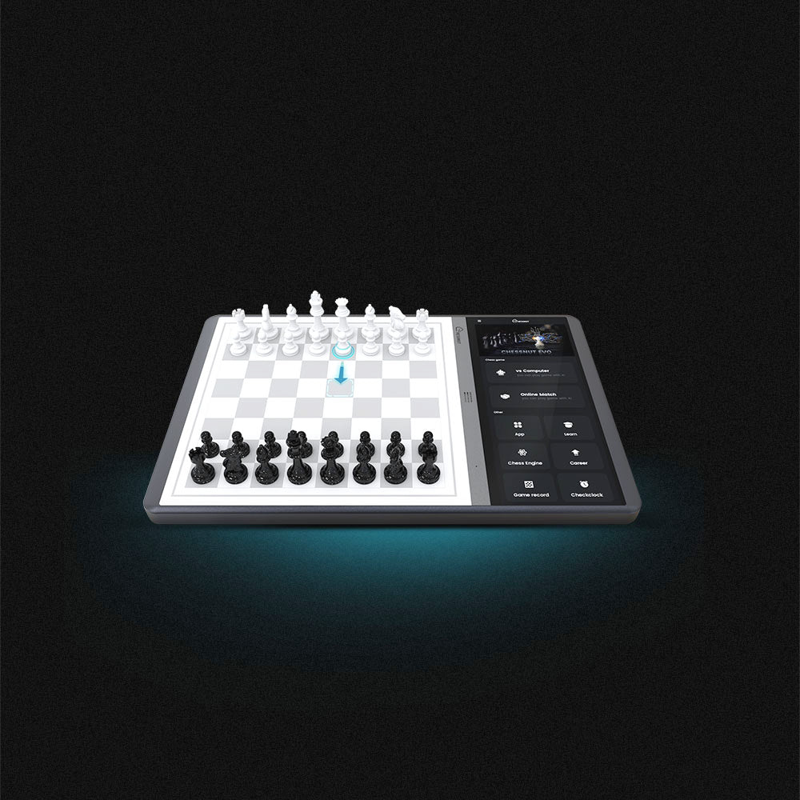
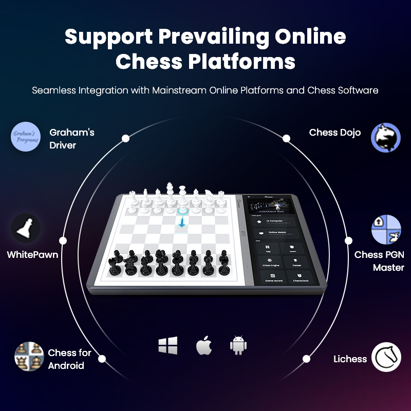
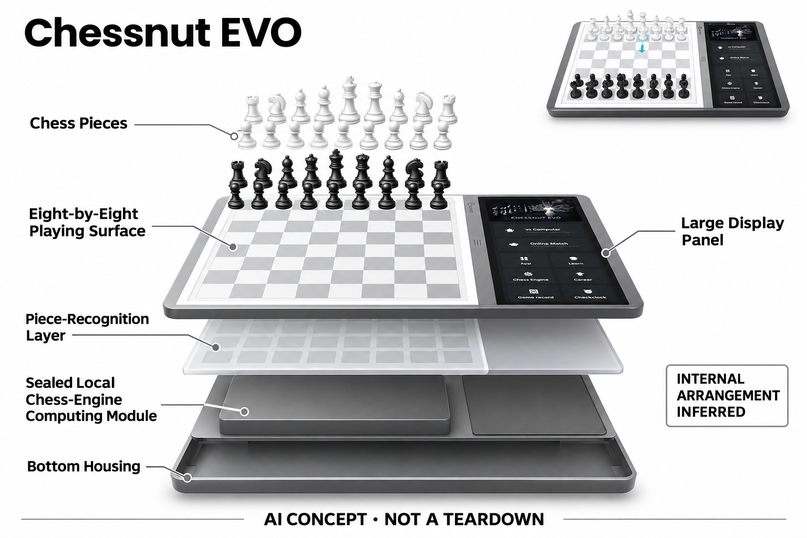

# Chessnut EVO

**Chessnut** · 游戏与桌游 · 核查 2026-11-04

大屏与实体棋盘合为独立棋类终端

消费渠道：个人零售。

## 产品图片与结构参考

### 产品图

Chessnut EVO · 官方产品图 · 来源：[Chessnut · 官方图片](<https://www.chessnutech.com/products/chessnut-evo-the-future-of-ultra-smart-ai-chessboard>) · [原始图片](<https://cdn.shopify.com/s/files/1/0630/9543/9612/files/Chessnut_EVO.jpg?v=1776066358>)

### 参考图

Chessnut EVO · 官方参考图 · 来源：[Chessnut · 官方图片](<https://www.chessnutech.com/products/chessnut-evo-the-future-of-ultra-smart-ai-chessboard>) · [原始图片](<https://cdn.shopify.com/s/files/1/0630/9543/9612/files/Chessnut_EVO_4.png?v=1776066426>)

### AI 生成爆炸示意

**AI 生成 · 非实物拆机。** 内部为概念推断，不能作为元件布局、BOM 或维修依据。[生成提示词](../../content/hardware/prompts/chessnut-evo.txt)

> 已目视核对外形、标签与非拆机声明；不代表内部结构经实测验证。

> 分析为基于公开资料的案头研究与 AI 辅助判断，未经用户访谈、销量审计或实物拆机。需求、画像、竞争冷门度、审美及商业机会均为研究假设，不是投资结论。

## 销售与购买

- 状态：在售。官方商店Add to cart且公开商品数据available=true；棋盘与侧边屏幕作为一台EVO计数，配件不另计。

- 地区：所列官方国际商店

- 价格：官网 US$629.99。核查日页面快照；运费、税费、会员和配送区域按官方结算确认，不视为中国到手价。

- 中国大陆：本轮核实所列区域官方商店；未确认中国大陆官方现货、账户及完整服务，不把境外可购等同大陆可用。

- [官方产品 / 商店](<https://www.chessnutech.com/products/chessnut-evo-the-future-of-ultra-smart-ai-chessboard>)

## AI 的实际作用

完整棋子识别与内置Stockfish、Maia棋力引擎结合，提供不同风格的人机对弈；官方还介绍按历史棋局建立个性化模型的服务。

服务与联网依赖：基本对弈使用设备内置屏幕和引擎；账户、联网平台、模型训练及新增服务的权限需另行核对。

## 是否冷门

细分专业（研究判断）：不必持续占用个人手机形成具体使用场景；本轮没有销量与市场份额证据。

## 需求与市场

需求假设：经常研究棋局的人希望实体触感与数字分析同时存在，并减少手机支架和配对步骤。应观察侧边大屏是否缩短复盘流程，还是让用户最终仍主要盯着屏幕而忽略棋盘。

### 需求假设：实体对局与数字研究在同一桌面完成 · 研究判断

Chessnut EVO将棋盘和侧边大屏整合，针对经常摆局、研究与对弈的人希望减少手机支架和配对。需求应验证是否更快进入复盘，而不是屏幕更大就有价值，也要观察用户是否最终只盯屏幕，实体棋子是否仍承担重要作用。

依据：[EVO官方购买页](<https://www.chessnutech.com/products/chessnut-evo-the-future-of-ultra-smart-ai-chessboard>) · [Chessnut官方支持与手册](<https://www.chessnutech.com/pages/welcome-to-chessnut-support>)

### 价值判断：不同棋风与个性化模型需要实际用途 · 研究判断

多引擎和历史棋局建模提供不同对手体验，但用户可能长期只使用一种模式，功能丰富不等于需求丰富。研究应记录选择棋风的原因，不能把人类风格目标描述成复制真人性格，也不以模型训练完成证明更懂用户或学习更有效。

依据：[EVO官方购买页](<https://www.chessnutech.com/products/chessnut-evo-the-future-of-ultra-smart-ai-chessboard>)

### 验证方案：完成一组真实复盘与对局 · 待验证

让有棋类研究习惯的人从已有棋谱开始摆局、分析并继续对弈，比较EVO与平板加普通棋盘，记录准备和切换。保持研究目标一致，不只演示引擎走棋，也不把一局有趣体验当作长期研究站点价值或棋力提升证据。

依据：[EVO官方购买页](<https://www.chessnutech.com/products/chessnut-evo-the-future-of-ultra-smart-ai-chessboard>) · [Chessnut官方支持与手册](<https://www.chessnutech.com/pages/welcome-to-chessnut-support>)

## 用户画像

画像推断：有固定桌面、愿意花时间研究残局和不同对手风格的家庭棋迷较匹配。大屏增加信息量也占据空间，偏好便携或极简对弈的人可能不需要这种一体化终端。

### 画像假设：有固定棋桌并愿意研究局面的人 · 研究判断

较匹配者经常复盘、摆残局或比较对手风格，愿意为一体终端安排桌面与维护，未必是只想偶尔下棋的家庭。偏好便携和极简用户可能更看重其他方案，画像应按实际研究频率划分，不以较强棋力或高预算推定需要大屏。

依据：[EVO官方购买页](<https://www.chessnutech.com/products/chessnut-evo-the-future-of-ultra-smart-ai-chessboard>)

### 使用约束：一体化信息增加也增加空间 · 研究判断

侧边屏幕让分析集中，却占用桌宽并改变两侧玩家的观看方式，用户需要接受更数字化的棋桌。研究应了解与家庭成员共享时的安排，不能从平面商品图推断所有桌子合适，也不将少一个手机当作总操作必然更少。

依据：[EVO官方购买页](<https://www.chessnutech.com/products/chessnut-evo-the-future-of-ultra-smart-ai-chessboard>) · [Chessnut官方支持与手册](<https://www.chessnutech.com/pages/welcome-to-chessnut-support>)

### 访谈重点：真实使用哪一种引擎与分析 · 待验证

请用户展示最近一次切换Stockfish、Maia或个性化服务的理由，说明是研究、娱乐还是想接近某种对手。这样能区分可用功能和日常价值，不能把引擎列表长当作付费意愿，也不将下载或训练模型的兴趣等同持续使用。

依据：[EVO官方购买页](<https://www.chessnutech.com/products/chessnut-evo-the-future-of-ultra-smart-ai-chessboard>)

## 竞争与替代

竞争判断：普通平板加电子棋盘能够完成类似组合，独立棋类电脑也有长期产品积累。EVO的集成和棋子识别提供差异，但不能因配置更丰富就假定学习效果或付费意愿更高。

### 替代方案：电子棋盘加平板与独立棋机 · 研究判断

EVO与普通平板配电子棋盘、传统独立棋类电脑和软件分析组合竞争，核心在物理棋局与数字研究衔接。比较应看摆局、查看和恢复，而不是硬件配置排名，也不因为一体化就推定学习更好，免费强引擎仍是明确替代。

依据：[EVO官方购买页](<https://www.chessnutech.com/products/chessnut-evo-the-future-of-ultra-smart-ai-chessboard>) · [Chessnut官方支持与手册](<https://www.chessnutech.com/pages/welcome-to-chessnut-support>)

### 差异判断：完整棋子识别与屏幕共同减步骤 · 研究判断

棋子身份和格位识别可支持摆局，大屏则呈现分析，两者组合可能减少映射与查屏，但也可能让用户更依赖数字界面。研究应分别观察识别与信息呈现收益，不能把屏幕占用越多视为更专业，也不从人类风格模型推断真人级交流。

依据：[EVO官方购买页](<https://www.chessnutech.com/products/chessnut-evo-the-future-of-ultra-smart-ai-chessboard>)

### 比较方法：按同一局面研究流程对照 · 待验证

让不同方案打开相同棋谱、摆设位置、比较走法和继续对局，记录配对、识别修正与解释需求，检查研究目标是否完成。不要只比较引擎强度或响应速度，也不把模型评价当作所有棋手都应接受的唯一答案。

依据：[EVO官方购买页](<https://www.chessnutech.com/products/chessnut-evo-the-future-of-ultra-smart-ai-chessboard>) · [Chessnut官方支持与手册](<https://www.chessnutech.com/pages/welcome-to-chessnut-support>)

## 供应链

供应链推断：侧边屏幕、棋盘传感和系统软件形成多模块整机，校准及屏幕维修的成本值得关注。品牌公开提及自有研发制造，但本轮未核实具体工厂、物料清单和供应商，不作延伸猜测。

### 功能拆分：识别棋盘与侧屏计算终端 · 研究判断

公开结构包含完整棋子识别、内置引擎、侧边显示与联网模型服务，基础对弈和高级账户功能需要区分。具体传感技术、主控和工厂本轮未核实，品牌研发制造表述不能延伸为真实供应清单，也不把所有AI分析都默认离线无限可用。

依据：[EVO官方购买页](<https://www.chessnutech.com/products/chessnut-evo-the-future-of-ultra-smart-ai-chessboard>) · [Chessnut官方支持与手册](<https://www.chessnutech.com/pages/welcome-to-chessnut-support>)

### 制造判断：多模块一体化增加维修与校准联系 · 研究判断

棋盘感知、屏幕和系统需要保持局面一致，侧屏损坏或识别偏差都可能影响整套研究流程，丢子与备份也要考虑。供应评估不能只计算显示与处理器，本轮没有装配、公差或维修数据，不推算原机成本与实际代工工厂。

依据：[EVO官方购买页](<https://www.chessnutech.com/products/chessnut-evo-the-future-of-ultra-smart-ai-chessboard>)

### 候选选型：显示与板级系统分开询证 · 研究判断

Tianma可作为侧边触控显示候选，Jabil可讨论电子系统整合，JLCPCB可研究感知板原型。它们不提供Stockfish或Maia服务，具体棋子识别与软件配合需专项设计，也没有Chessnut点名供货证据，不能写成原机BOM或兼容方案。

依据：[EVO官方购买页](<https://www.chessnutech.com/products/chessnut-evo-the-future-of-ultra-smart-ai-chessboard>) · [Chessnut官方支持与手册](<https://www.chessnutech.com/pages/welcome-to-chessnut-support>)

## 技术路径

官方披露不同棋力引擎和完整棋子识别，Maia的人类风格目标不同于单纯追求最强走法。技术判断应分别检查摆局识别、引擎切换和模型服务，不把个性化宣传等同真实人格复制。

### 已披露能力：多引擎与完整身份位置识别 · 官方资料

官方说明完整棋子识别配合Stockfish、Maia等引擎，另有按历史棋局建立模型的服务。强棋力、人类风格和个性化服务是不同目标，不能把经典搜索与学习模型混称，也不把个性化宣传视为复制某个人的真实人格或全部棋风。

依据：[EVO官方购买页](<https://www.chessnutech.com/products/chessnut-evo-the-future-of-ultra-smart-ai-chessboard>)

### 技术判断：摆局可靠性影响分析有效性 · 研究判断

如果系统识别的身份或位置与实体不一致，强引擎也会分析错误局面，用户需要容易纠正和确认。研究应分别测试输入、引擎切换与解释，而不是只看正常落子演示，也不将侧屏评价直接当作用户已经理解局面的证据。

依据：[EVO官方购买页](<https://www.chessnutech.com/products/chessnut-evo-the-future-of-ultra-smart-ai-chessboard>) · [Chessnut官方支持与手册](<https://www.chessnutech.com/pages/welcome-to-chessnut-support>)

### 验证方案：保留局面与服务版本的对应 · 待验证

用真实棋谱检查摆局、换子、悔棋和引擎选择，再记录哪些分析需要联网与权限，观察用户是否理解变化。不要把某次模型服务可用扩展为全部免费离线能力，也不以一盘胜负验证教学效果，本轮没有独立识别与学习结果测试。

依据：[EVO官方购买页](<https://www.chessnutech.com/products/chessnut-evo-the-future-of-ultra-smart-ai-chessboard>) · [Chessnut官方支持与手册](<https://www.chessnutech.com/pages/welcome-to-chessnut-support>)

## 产品审美

审美判断：棋盘旁的大屏明确展示数字学习工具定位，牺牲了一部分传统棋盘的对称感。阅读角度、桌面宽度和长期亮屏会影响使用，不能只凭产品平面图判断家庭空间适配。

### 外形判断：侧屏让棋具成为研究工作台 · 研究判断

棋盘旁的大屏带来清楚数字工具定位，也改变传统棋盘对称感与桌面占用，实际价值取决于研究姿态和双方视角。产品图不能说明长局阅读、反光和亮屏干扰，也不应把外观先进作为用户愿意持续复盘的证据。

依据：[EVO官方购买页](<https://www.chessnutech.com/products/chessnut-evo-the-future-of-ultra-smart-ai-chessboard>)

### 交互判断：视线在棋盘与分析之间需要自然移动 · 研究判断

用户可能为了理解建议不断从实体看向屏幕，一体化能缩短距离却未必减少注意切换。研究应观察信息层级、局面确认和引擎状态是否清楚，不把大屏显示更多变体当作更好，也不让分析界面压过实际棋子操作。

依据：[EVO官方购买页](<https://www.chessnutech.com/products/chessnut-evo-the-future-of-ultra-smart-ai-chessboard>) · [Chessnut官方支持与手册](<https://www.chessnutech.com/pages/welcome-to-chessnut-support>)

### 体验验证：在常用棋桌完成长局与复盘 · 待验证

让用户摆放设备、下棋、暂停、复盘再收纳，记录桌宽、观看角度与其他物品位置，再询问家人是否愿意共用。不要只演示几个识别动作，完整对局与研究更能判断一体终端是否减少准备或只是增加一块屏幕。

依据：[EVO官方购买页](<https://www.chessnutech.com/products/chessnut-evo-the-future-of-ultra-smart-ai-chessboard>) · [Chessnut官方支持与手册](<https://www.chessnutech.com/pages/welcome-to-chessnut-support>)

## 关键风险

风险判断：系统更新、在线账户和模型服务可能改变功能入口；棋子识别错误也会中断摆局。使用者需要保留棋谱及账户迁移方法，不能把引擎评价当作无需解释的唯一学习标准。

### 解释风险：引擎评价不能代替理解与判断 · 研究判断

最优走法或人类风格建议都需要结合研究目标，用户可能直接照做却不知道原因，模型个性化也不保证学习更有效。目录只描述能力，本轮没有教学结果、人格复制或棋风相似度验证，不将服务名称和引擎强度当作学习保证。

依据：[EVO官方购买页](<https://www.chessnutech.com/products/chessnut-evo-the-future-of-ultra-smart-ai-chessboard>)

### 服务风险：系统更新与模型权益影响长期体验 · 研究判断

基础引擎、在线平台和模型训练可能有不同账户与权限，用户应核对当前服务和数据导出，不能把硬件买断等同全部功能永久可用。屏幕与感知维修也增加一体机维护成本，本轮未取得实际合同或长期支持承诺。

依据：[EVO官方购买页](<https://www.chessnutech.com/products/chessnut-evo-the-future-of-ultra-smart-ai-chessboard>) · [Chessnut官方支持与手册](<https://www.chessnutech.com/pages/welcome-to-chessnut-support>)

### 验证安排：记录放弃研究或改用平板的原因 · 待验证

试用应保留摆局识别不一致、信息太多、模型不合意或用户回到原工具的情形，区分硬件与研究偏好。不要只统计屏幕使用和引擎切换，也不将复杂模式未被采用都视为用户不会用，真实功能子集决定购买理由。

依据：[EVO官方购买页](<https://www.chessnutech.com/products/chessnut-evo-the-future-of-ultra-smart-ai-chessboard>) · [Chessnut官方支持与手册](<https://www.chessnutech.com/pages/welcome-to-chessnut-support>)

## 机会与验证

市场观察：比较重点应是独立终端节省的准备步骤与增加的体积和成本。可记录每周复盘次数、真实使用的引擎以及屏幕占用比例，辨别它是常用棋类工作台还是偶尔展示的设备。

### 研究方向：让实体研究比设备组合少一步 · 研究判断

EVO可用于研究独立棋类终端是否减少配对、摆局和分析切换，机会可能在局面一致与解释，而非继续增加引擎。应先确认用户每周实际研究什么，再讨论大屏与个性化模型，避免把配置丰富当作用户价值已经证明。

依据：[EVO官方购买页](<https://www.chessnutech.com/products/chessnut-evo-the-future-of-ultra-smart-ai-chessboard>) · [Chessnut官方支持与手册](<https://www.chessnutech.com/pages/welcome-to-chessnut-support>)

### 执行计划：跟踪复盘频率与实际引擎选择 · 待验证

记录连续几周开局、摆局、复盘和屏幕使用，访谈一次选择或放弃某引擎的原因，比较原平板组合。将研究、娱乐和展示用途分开，不用社区模型数量、品牌评价或一次成功摆局代表留存，也不冒充已经开展的用户调查。

依据：[EVO官方购买页](<https://www.chessnutech.com/products/chessnut-evo-the-future-of-ultra-smart-ai-chessboard>) · [Chessnut官方支持与手册](<https://www.chessnutech.com/pages/welcome-to-chessnut-support>)

### 决策边界：一体研究与普通对弈需按任务比较 · 研究判断

EVO的侧屏与识别为实体分析提供路线，但仍与软件和独立棋机共享部分需求，不能因硬件更复杂就算新市场。当前没有访谈、销量与供应报价，不以屏幕尺寸、引擎数量或模型评分预测创业成功，应以重复研究的真实步骤评价。

依据：[EVO官方购买页](<https://www.chessnutech.com/products/chessnut-evo-the-future-of-ultra-smart-ai-chessboard>) · [Chessnut官方支持与手册](<https://www.chessnutech.com/pages/welcome-to-chessnut-support>)

## 对应供应链公司

能力候选用于选型研究，不代表本产品实际采用；未公开的供货关系不作推断。

- [tianma](../supply-chain/tianma.md) — **能力候选 · 非已采用** / 侧边棋局分析触控屏候选：Tianma公开中小显示与触控定制，可作为EVO侧屏候选，但实际尺寸、阅读视角、主控接口与长局使用需核对，标准工业屏不构成直接替换件。当前没有Chessnut点名供货证据，也不提供棋力引擎、棋谱或模型服务。

- [jabil](../supply-chain/jabil.md) — **能力候选 · 非已采用** / 一体棋类终端电子系统工业化候选：Jabil公开产品工程与电子系统制造，可用于EVO同类棋盘和计算显示集成候选研究，但棋子识别、校准与软件须由项目设计验证，不提供现成智能棋盘。当前无原机BOM或实际代工证据，也不据综合能力推定特定工厂。

- [jlcpcb](../supply-chain/jlcpcb.md) — **能力候选 · 非已采用** / 棋盘识别与控制板原型装配候选：JLCPCB公开PCB及PCBA流程，可作为EVO感知控制板按设计文件制造的候选，但原机识别机制未披露，不能据此猜传感器或提供兼容板。开发者需验证棋子身份、格位和系统一致性，当前没有任何实际采用证据。

[浏览供应链目录](../supply-chain.md)

## 功能分层示意

这是功能关系，不是实物拆机、真实空间结构或已核实 BOM。

1. **棋子识别**：检测完整棋子身份与所在格位。（官方披露）

2. **内置引擎**：Stockfish及Maia等提供对弈。（官方披露）

3. **学习服务**：联网模型与棋谱服务按权限调用。（官方披露）

4. **双重界面**：实体棋盘与侧边大屏显示分析。（官方披露）

## 来源

1. [EVO官方购买页](<https://www.chessnutech.com/products/chessnut-evo-the-future-of-ultra-smart-ai-chessboard>) — 已实际打开官方页面；功能说明不等于独立性能测量。

2. [Chessnut官方支持与手册](<https://www.chessnutech.com/pages/welcome-to-chessnut-support>) — 已实际打开官方页面；功能说明不等于独立性能测量。

[返回目录](../hardware-market.md) · [网页分析](https://romanagent.github.io/Roman/#hardware/product/chessnut-evo)
