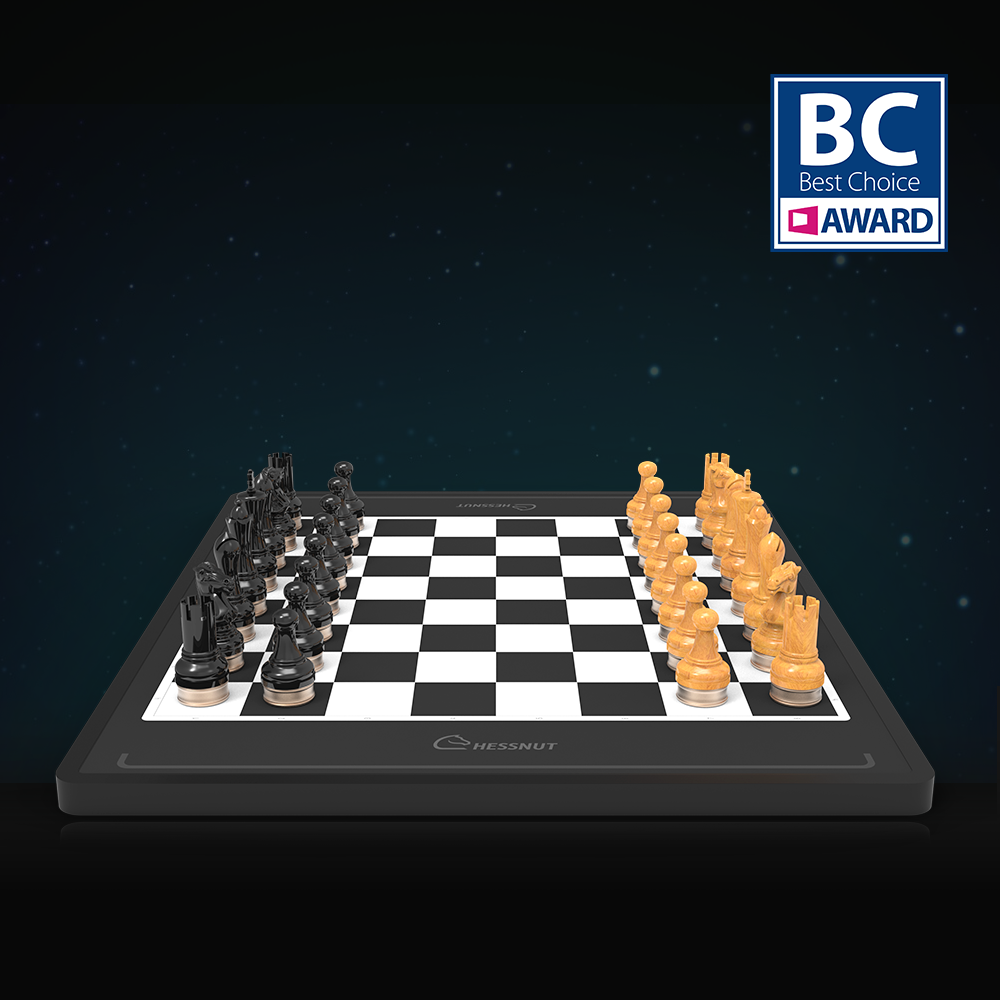
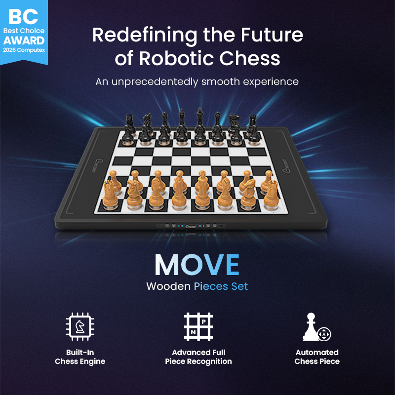
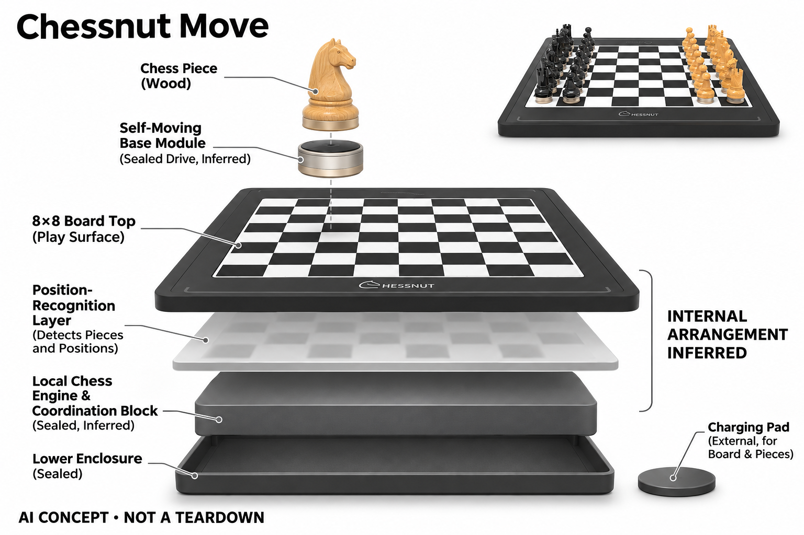

# Chessnut Move

**Chessnut** · 游戏与桌游 · 核查 2026-11-04

让AI走法通过实体棋子自动执行

消费渠道：个人零售。

## 产品图片与结构参考

### 产品图

Chessnut Move · 官方产品图 · 来源：[Chessnut · 官方图片](<https://www.chessnutech.com/products/chessnut-move-advanced-robotic-chessboard-with-wooden-pieces>) · [原始图片](<https://www.chessnutech.com/cdn/shop/files/mutou.png?v=1780041675&width=1946>)

### 参考图

Chessnut Move · 官方参考图 · 来源：[Chessnut · 官方图片](<https://www.chessnutech.com/products/chessnut-move-advanced-robotic-chessboard-with-wooden-pieces>) · [原始图片](<https://www.chessnutech.com/cdn/shop/files/1_5_1f858d20-fe3a-45c9-bedb-f6cbb2b17812.png?v=1787562670&width=1946>)

### AI 生成爆炸示意

**AI 生成 · 非实物拆机。** 内部为概念推断，不能作为元件布局、BOM 或维修依据。[生成提示词](../../content/hardware/prompts/chessnut-move.txt)

> 分析为基于公开资料的案头研究与 AI 辅助判断，未经用户访谈、销量审计或实物拆机。需求、画像、竞争冷门度、审美及商业机会均为研究假设，不是投资结论。

## 销售与购买

- 状态：在售。当前官方商品页Add to cart，结构化Offer明确为InStock；旧落地页仍有Preorder文案，具体交期以当前订单与shipping-update为准。木塑棋子版本只计同一硬件。

- 地区：所列官方国际商店

- 价格：木棋子版官网 US$799。核查日页面快照；运费、税费、会员和配送区域按官方结算确认，不视为中国到手价。

- 中国大陆：本轮核实所列区域官方商店；未确认中国大陆官方现货、账户及完整服务，不把境外可购等同大陆可用。

- [官方产品 / 商店](<https://www.chessnutech.com/products/chessnut-move-advanced-robotic-chessboard-with-wooden-pieces>)

## AI 的实际作用

内置Stockfish等棋类引擎可独立对弈，棋盘识别完整棋子与位置，带自移动底座的棋子执行对手走法和自动摆局；不是只有电机的遥控玩具。

服务与联网依赖：独立引擎可在本地对弈，在线平台需要配套应用；棋盘和棋子均需充电，移动区域必须平整、清洁且无阻挡。

## 是否冷门

细分专业（研究判断）：独立引擎加自动摆局体验形成具体使用场景；本轮没有销量与市场份额证据。

## 需求与市场

需求假设：棋手希望独自对弈时不必替机器移动棋子，并可快速摆出残局研究。应把充电、清理桌面和错误恢复的时间一并计算，确认自动移动是否真的降低准备成本而非只增加观赏性。

### 需求假设：独自下棋不再替机器移动棋子 · 研究判断

Chessnut Move让带自移动底座的棋子执行对手走法，针对想保留实体棋盘却不愿代走的人，自动摆局还可能减少残局准备。需求应分别验证代走和摆局是否经常发生，不能只看棋子自己移动很有趣，也不将观赏性当作长期工具价值。

依据：[Chessnut Move当前官方商品](<https://www.chessnutech.com/products/chessnut-move-advanced-robotic-chessboard-with-wooden-pieces>) · [Chessnut Move官方介绍](<https://www.chessnutech.com/pages/chessnut-move>)

### 价值判断：自动动作要扣除充电与维护 · 研究判断

减少手动移子同时增加多枚棋子的补能、清洁和异常恢复，用户获得的净便利需要完整计算。研究应记录每周自动摆局和人工介入，不把一次整齐摆好等同长期省时，也不由机械复杂度推断更能帮助理解棋局或替代真人交流。

依据：[Chessnut Move官方介绍](<https://www.chessnutech.com/pages/chessnut-move>)

### 验证方案：从真实残局和完整对局开始 · 待验证

让棋迷用自己想研究的局面完成摆设、对弈、悔棋和收纳，与普通电子棋盘比较，记录全部准备与恢复。不要只在开局整齐状态演示移动，应观察拥挤局面和用户手动改变后的流程，但不超出厂商允许条件或强行阻挡运行。

依据：[Chessnut Move当前官方商品](<https://www.chessnutech.com/products/chessnut-move-advanced-robotic-chessboard-with-wooden-pieces>) · [Chessnut Move官方介绍](<https://www.chessnutech.com/pages/chessnut-move>)

## 用户画像

画像推断：有宽裕固定桌面、喜欢实体机械动作且愿意维护多枚棋子的爱好者较匹配。频繁外出或希望随手收纳的人可能不适合，家庭中的儿童和宠物也会影响自动移动空间。

### 画像假设：有固定桌面并接受机械维护的人 · 研究判断

较匹配者喜欢实体棋子和机械动作，经常独自对弈或研究残局，愿意给棋盘和棋子安排充电与保管。频繁外出或只想快速收纳的人可能有不同选择，画像应基于空间和维护意愿，不把喜欢棋类视频的观看者都视为购买者。

依据：[Chessnut Move当前官方商品](<https://www.chessnutech.com/products/chessnut-move-advanced-robotic-chessboard-with-wooden-pieces>) · [Chessnut Move官方介绍](<https://www.chessnutech.com/pages/chessnut-move>)

### 家庭约束：棋子移动区域需要共同管理 · 研究判断

儿童、宠物或其他桌面物品会改变运行环境，用户需要理解何时可以触碰棋子及如何恢复，不只是把机器当普通静态棋具。研究应了解谁负责清理、充电和处理异常，不能仅采访主购买者，也不从木棋子外观推断操作与传统棋盘完全相同。

依据：[Chessnut Move官方介绍](<https://www.chessnutech.com/pages/chessnut-move>)

### 访谈重点：自动摆局是否比代走更重要 · 待验证

请用户展示最近研究的残局，说明手动摆设花费多少时间，再比较机器代走对完整对局的意义。不同任务可能有不同价值，不能把所有自动移动都统计成同一收益，也不将首次见到棋子行走的惊喜视为持续付费需求。

依据：[Chessnut Move当前官方商品](<https://www.chessnutech.com/products/chessnut-move-advanced-robotic-chessboard-with-wooden-pieces>) · [Chessnut Move官方介绍](<https://www.chessnutech.com/pages/chessnut-move>)

## 竞争与替代

竞争判断：自动棋盘较小众，但传统独立棋机和手机引擎仍以低成本提供对弈。Move的区别是实体动作和自动摆局，低品类热度不意味着没有替代，也不能用机械新奇度推算消费市场大小。

### 替代方案：提示棋盘、手机引擎与手动摆局 · 研究判断

Move与其他自动棋盘竞争，也被普通棋盘加软件和用户代走替代，强棋力本身并不稀缺。其差异在物理执行与摆局，比较应看是否值得维护和空间，不能因自动棋盘较小众就推断无竞争，也不把机械新奇等同长期研究需求。

依据：[Chessnut Move当前官方商品](<https://www.chessnutech.com/products/chessnut-move-advanced-robotic-chessboard-with-wooden-pieces>) · [Chessnut Move官方介绍](<https://www.chessnutech.com/pages/chessnut-move>)

### 差异判断：自移动棋子与传统棋盘结构不同 · 研究判断

本款由棋子底座执行移动，不能套用中央磁性机构的想象，多个独立部件会改变补能与维修方式。研究应把动作体验与系统复杂度一起评价，不以某个演示的安静或准确推断全部环境，也不将可自动摆局视为无需任何校准和清理。

依据：[Chessnut Move官方介绍](<https://www.chessnutech.com/pages/chessnut-move>)

### 比较方法：从摆局到恢复计算净操作 · 待验证

让同一用户用Move与手动方案完成相同残局、对弈和悔棋，记录充电、清理、代走和异常处理时间。不要只计省去了多少次手移，也不把机内引擎强度作为机械方案评价，最终需要看用户是否愿意在下一次继续采用。

依据：[Chessnut Move当前官方商品](<https://www.chessnutech.com/products/chessnut-move-advanced-robotic-chessboard-with-wooden-pieces>) · [Chessnut Move官方介绍](<https://www.chessnutech.com/pages/chessnut-move>)

## 供应链

供应链推断：大量自移动棋子底座、定位和同步充电增加一致性与维修要求，单枚故障就可能影响整局。官方列出备用底座安排，但本轮未核实具体工厂和物料表，不猜测内部驱动细节。

### 已披露结构：棋子底座承担自行移动 · 官方资料

官方说明棋盘识别身份与格位，独立棋力计算后协调带自移动底座的棋子，棋盘与棋子各有充电要求。不能把它画成普通亮灯棋盘或猜测中央磁铁拖动结构，具体电机、定位、电池和制造工厂仍未披露，功能图不是拆机。

依据：[Chessnut Move当前官方商品](<https://www.chessnutech.com/products/chessnut-move-advanced-robotic-chessboard-with-wooden-pieces>) · [Chessnut Move官方介绍](<https://www.chessnutech.com/pages/chessnut-move>)

### 制造判断：多枚执行单元增加一致性要求 · 研究判断

棋子底座、定位和补能需要在整套棋具中保持协调，单枚故障也可能影响一局，备用底座与维修路径值得关注。供应评估不能只看一枚移动成功，本轮没有整套寿命、充电一致性或公差数据，不能由宣传精度估算良率和成本。

依据：[Chessnut Move当前官方商品](<https://www.chessnutech.com/products/chessnut-move-advanced-robotic-chessboard-with-wooden-pieces>) · [Chessnut Move官方介绍](<https://www.chessnutech.com/pages/chessnut-move>)

### 候选选型：微型机构与小电源分别验证 · 研究判断

Precision Microdrives可讨论棋子底座的微型运动工程，EVE可作为小型供电候选，JLCPCB可研究控制板装配。原机驱动结构和协议未公开，必须专项设计与验证，这些公司没有Chessnut点名采用证据，也不能提供现成兼容底座。

依据：[Chessnut Move官方介绍](<https://www.chessnutech.com/pages/chessnut-move>)

## 技术路径

官方披露完整棋子位置识别、独立棋力引擎和自动移动。技术判断应把棋力决策、定位和执行三环分别测试，尤其关注拥挤局面、棋子被手移动及低电量时的恢复，而非只看正常演示。

### 已披露能力：棋力、定位和执行分为三环 · 官方资料

Move结合内置Stockfish等引擎、完整棋子识别和自动移动，在线平台另需配套应用。棋力决定走法、定位确认状态、执行完成动作，任何一环正常都不证明整局可靠，也不能把机械行走当作理解用户意图或拥有生成式对话能力。

依据：[Chessnut Move当前官方商品](<https://www.chessnutech.com/products/chessnut-move-advanced-robotic-chessboard-with-wooden-pieces>) · [Chessnut Move官方介绍](<https://www.chessnutech.com/pages/chessnut-move>)

### 技术判断：实际局面需要与计划动作一致 · 研究判断

用户手动移子、悔棋或棋子未到位时，系统需要确认实际状态再继续，否则正确走法也可能执行到不合适位置。研究应观察恢复与可解释性，不只看普通开局演示，也不从自移动设计推断低电量、拥挤和所有障碍条件均能处理。

依据：[Chessnut Move官方介绍](<https://www.chessnutech.com/pages/chessnut-move>)

### 验证方案：逐步记录决定与实际到位 · 待验证

在允许条件下保存棋谱、系统选择和棋子最终位置，测试摆局、悔棋与正常中断恢复，记录人工介入与补能状态。不要强拉运行中棋子或故意制造危险堵塞，也不把一次精确到位外推为长期性能，本轮没有实物测量。

依据：[Chessnut Move官方介绍](<https://www.chessnutech.com/pages/chessnut-move>)

## 产品审美

审美判断：木棋子保留传统对弈形象，自动移动让静态棋具产生明显戏剧感，较大棋盘也需要专门位置。底座比例、动作声音和充电收纳会改变体验，应在真实居家桌面中观察。

### 外形判断：传统木棋子与机械底座形成反差 · 研究判断

木棋子保留熟悉棋具语言，自行移动带来明显戏剧感，底座比例和大棋盘又改变桌面体验。设计评价应看动作声音、拿取和充电收纳，不只看演示视频惊奇，产品照片不能证明长局舒适或所有家庭都能留出固定空间。

依据：[Chessnut Move当前官方商品](<https://www.chessnutech.com/products/chessnut-move-advanced-robotic-chessboard-with-wooden-pieces>) · [Chessnut Move官方介绍](<https://www.chessnutech.com/pages/chessnut-move>)

### 交互判断：什么时候可触碰需要清楚 · 研究判断

传统下棋习惯随时拿起棋子，但自动执行时用户需要理解等待、暂停与接管，状态应清楚而不破坏对弈节奏。研究应观察是否犹豫或误解，不把棋子移动当作自然交互的充分条件，也不让复杂维护隐藏在传统棋具外观后面。

依据：[Chessnut Move官方介绍](<https://www.chessnutech.com/pages/chessnut-move>)

### 体验验证：全套棋具的日常摆放与补能 · 待验证

让用户完成开局、自动摆局、收纳和充电，记录每枚棋子的管理、桌面清理和需要查说明的步骤。不要只在已充满且整洁的展示台评价，也不以少数棋子的安静移动推断整套长期体验，完整循环才体现工业设计取舍。

依据：[Chessnut Move当前官方商品](<https://www.chessnutech.com/products/chessnut-move-advanced-robotic-chessboard-with-wooden-pieces>) · [Chessnut Move官方介绍](<https://www.chessnutech.com/pages/chessnut-move>)

## 关键风险

风险判断：自动动作可能受灰尘、桌面倾斜和阻挡影响，官方要求不要强行拉动运行中的棋子。棋子与棋盘充电、备用底座和交期都需确认，不能把精度宣传直接当作任何环境下的可靠性。

### 执行风险：桌面与阻挡影响自动动作 · 研究判断

官方要求平整清洁且无阻挡的移动区域，并提醒不要强行拉动运行中棋子，用户仍需按说明管理环境。自主走子不是在任意桌面都可靠，本轮没有实机或寿命测试，也不把宣传定位精度转写为无条件保证。

依据：[Chessnut Move官方介绍](<https://www.chessnutech.com/pages/chessnut-move>)

### 拥有风险：棋子补能、备用件与交付条件 · 研究判断

棋盘和棋子均需充电，备用底座与维修会影响持续对局，交期也应按当前型号与地区确认。用户不能只比较棋盘售价和引擎功能，公开交付更新不等于每个订单立即到货，本轮未取得实际合同或售后履约记录。

依据：[Chessnut Move当前官方商品](<https://www.chessnutech.com/products/chessnut-move-advanced-robotic-chessboard-with-wooden-pieces>) · [Chessnut Move官方介绍](<https://www.chessnutech.com/pages/chessnut-move>) · [Chessnut官方交付更新](<https://www.chessnutech.com/pages/shipping-update>)

### 验证安排：记录自动功能闲置和手动恢复 · 待验证

试用应保留因充电、动作、噪声或维护而关闭自动摆局、改为手动对弈的原因，区分机械和棋类偏好。不要只统计成功移动次数，也不把观赏性高视为留存，用户是否愿意承担每次完整准备才决定长期价值。

依据：[Chessnut Move官方介绍](<https://www.chessnutech.com/pages/chessnut-move>)

## 机会与验证

市场观察：最值得验证的是残局摆设和机器代走这两项动作是否形成持续价值。记录每周自动摆局次数、手动介入和维护时间，区分长期棋类工具与一次性展示体验，不以演示视频预测销量。

### 研究方向：机器代走与自动摆局的独立收益 · 研究判断

Move可以帮助研究两种具体动作是否值得自动化，机会可能在补能、恢复和残局准备，而不是更复杂的移动演示。应先确认用户反复做什么，再讨论自研执行机构，避免把机械惊奇感当作已经存在的长期消费需求。

依据：[Chessnut Move官方介绍](<https://www.chessnutech.com/pages/chessnut-move>)

### 执行计划：跟踪自动摆局和完整对局频次 · 待验证

记录数周内开局、残局设置、人工介入、充电和维修请求，访谈一次没有用自动功能的任务，与手动方案比较。将娱乐观看和研究工具价值分开，不以视频热度、引擎评分或少量成功演示推断销量，也不冒充已做实地观察。

依据：[Chessnut Move当前官方商品](<https://www.chessnutech.com/products/chessnut-move-advanced-robotic-chessboard-with-wooden-pieces>) · [Chessnut Move官方介绍](<https://www.chessnutech.com/pages/chessnut-move>)

### 决策边界：物理代走与仅显示提示有真实区别 · 研究判断

本款承担实体移动和摆局，输出不同于普通辅助棋盘，目录可保留这一任务差异，同时不把每种自动结构都算全新市场。当前没有访谈、销量、寿命或报价资料，不以机械复杂度和模型评分预测创业成功。

依据：[Chessnut Move当前官方商品](<https://www.chessnutech.com/products/chessnut-move-advanced-robotic-chessboard-with-wooden-pieces>) · [Chessnut Move官方介绍](<https://www.chessnutech.com/pages/chessnut-move>)

## 对应供应链公司

能力候选用于选型研究，不代表本产品实际采用；未公开的供货关系不作推断。

- [precision-microdrives](../supply-chain/precision-microdrives.md) — **能力候选 · 非已采用** / 自移动棋子底座微型机构工程候选：Precision Microdrives公开微型电机与定制机构，可作为Move棋子底座执行候选，但原机传动、定位和空间未披露，噪声、同步和负载需专项验证，不能推定采用某种驱动。当前没有Chessnut点名供应证据，也不提供现成兼容底座。

- [eve-energy](../supply-chain/eve-energy.md) — **能力候选 · 非已采用** / 多枚移动棋子小型电源候选：EVE公开小型消费与扣式等电芯，可用于讨论Move棋子补能系统，但每枚负载、充电连接、保护与空间须分别验证，不能由耳机应用直接推断适配。当前没有原机电池采用证据，也不保证通用电芯可直接替换或达到运行时间。

- [jlcpcb](../supply-chain/jlcpcb.md) — **能力候选 · 非已采用** / 棋子及棋盘控制板原型装配候选：JLCPCB公开PCB及PCBA流程，可作为Move同类分布式控制板样机制造候选，但定位、通信、充电与电机电路须由项目设计验证，不提供现成自动棋盘方案。当前没有原机BOM或实际代工证据，也不推断内部主控型号。

[浏览供应链目录](../supply-chain.md)

## 功能分层示意

这是功能关系，不是实物拆机、真实空间结构或已核实 BOM。

1. **棋局识别**：棋盘识别棋子身份与位置。（官方披露）

2. **棋力决策**：内置Stockfish等引擎计算走法。（官方披露）

3. **动作控制**：系统协调自移动棋子执行目标位置。（官方披露）

4. **供电维护**：棋盘及棋子通过对应充电方式补能。（官方披露）

## 来源

1. [Chessnut Move当前官方商品](<https://www.chessnutech.com/products/chessnut-move-advanced-robotic-chessboard-with-wooden-pieces>) — 已实际打开官方页面；功能说明不等于独立性能测量。

2. [Chessnut Move官方介绍](<https://www.chessnutech.com/pages/chessnut-move>) — 已实际打开官方页面；功能说明不等于独立性能测量。

3. [Chessnut官方交付更新](<https://www.chessnutech.com/pages/shipping-update>) — 已实际打开官方页面；功能说明不等于独立性能测量。

[返回目录](../hardware-market.md) · [网页分析](https://romanagent.github.io/Roman/#hardware/product/chessnut-move)
