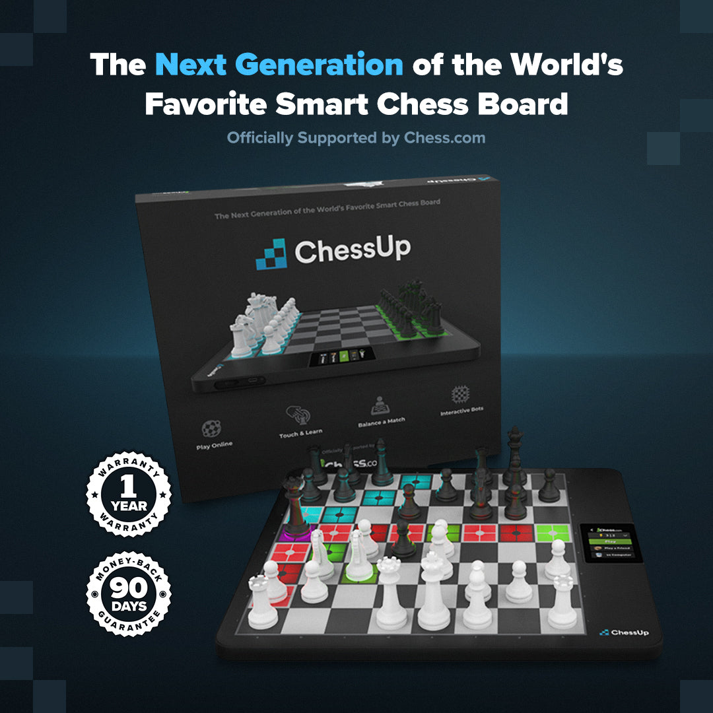
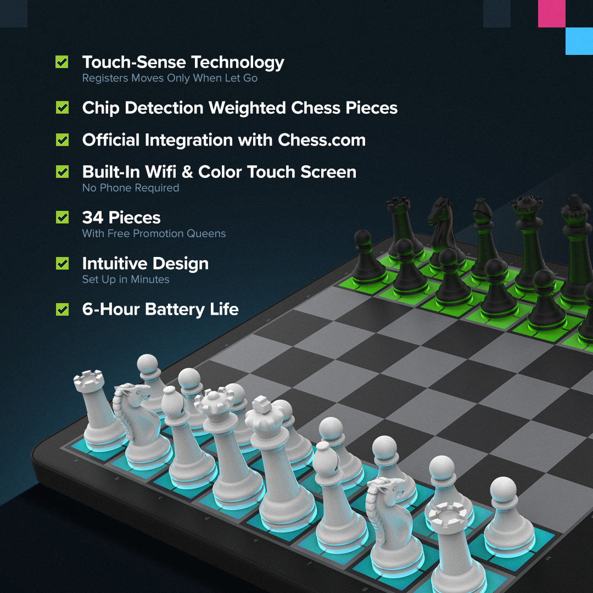
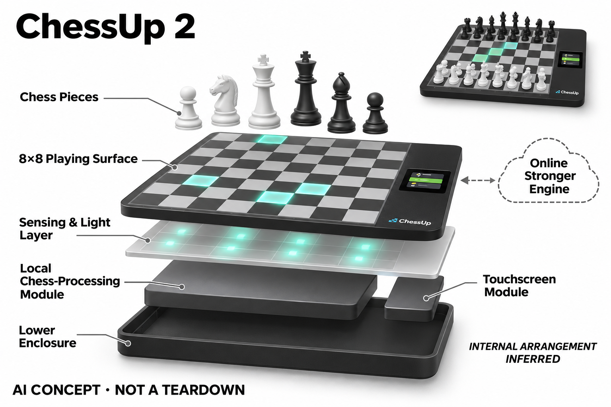

# ChessUp 2

**Bryght Labs / ChessUp** · AI玩具 · 核查 2026-11-06

触碰棋子即可看到灯光走法建议

消费渠道：个人零售。

## 产品图片与结构参考

### 产品图

ChessUp 2 · 官方产品图 · 来源：[Bryght Labs / ChessUp · 官方图片](<https://playchessup.com/products/chessup-2>) · [原始图片](<https://cdn.shopify.com/s/files/1/0589/6703/1989/files/01-01-03.jpg?v=1793474387>)

### 参考图

ChessUp 2 · 官方参考图 · 来源：[Bryght Labs / ChessUp · 官方图片](<https://playchessup.com/products/chessup-2>) · [原始图片](<https://cdn.shopify.com/s/files/1/0589/6703/1989/files/image_27.png?v=1781220003>)

### AI 生成爆炸示意

**AI 生成 · 非实物拆机。** 内部为概念推断，不能作为元件布局、BOM 或维修依据。[生成提示词](../../content/hardware/prompts/chessup-2.txt)

> 已目视核对外形、标签与非拆机声明；不代表内部结构经实测验证。

> 分析为基于公开资料的案头研究与 AI 辅助判断，未经用户访谈、销量审计或实物拆机。需求、画像、竞争冷门度、审美及商业机会均为研究假设，不是投资结论。

## 销售与购买

- 状态：在售。本轮复核官方商品页列US$349.99与Add to cart；颜色与配件不重复计数，库存仍以实际结算地区为准。

- 地区：所列官方国际商店

- 价格：官网 US$349.99。核查日页面快照；运费、税费、会员和配送区域按官方结算确认，不视为中国到手价。

- 中国大陆：本轮核实所列区域官方商店；未确认中国大陆官方现货、账户及完整服务，不把境外可购等同大陆可用。

- [官方产品 / 商店](<https://playchessup.com/products/chessup-2>)

## AI 的实际作用

触摸棋子后以灯光给出合法走法与棋力建议，并提供Stockfish对弈。属于棋类搜索和决策AI，不是通用生成式对话。

服务与联网依赖：基础较低级别AI可本地运行，更高等级Stockfish与部分辅助需联网；竞赛在线模式禁用辅助，不能将训练提示用于作弊。

## 是否冷门

细分专业（研究判断）：面向初学者的实体训练反馈形成具体使用场景；本轮没有销量与市场份额证据。

## 需求与市场

需求假设：初学者容易在记规则和判断好坏之间失去练习动力，棋盘灯光可以把提示放在正在触摸的位置。应观察减少了多少查屏步骤，以及关闭提示后是否仍能理解选择原因。

### 需求假设：提示出现在手指和棋子所在位置 · 研究判断

ChessUp 2让用户触摸棋子后看到合法走法与建议，针对初学者频繁在棋盘和手机之间查找的中断。需求应验证是否更容易理解下一步，而不是灯光是否吸引人，不能把提示减少错误直接等同独立思考或长期棋力提升。

依据：[ChessUp 2官方商店](<https://playchessup.com/products/chessup-2>) · [ChessUp 2官方棋力与局面设置](<https://chessup2-knowledge-base.helpscoutdocs.com/article/183-board-editor>)

### 价值判断：合法走法与好走法需要分开理解 · 研究判断

学习规则和判断局面是不同任务，灯光可以把结果映射到格位，却未必解释为什么值得这样走。研究应观察用户关闭提示后能否说清选择，不把跟着推荐获胜当作学会策略，也不能由引擎棋力强推断适合所有儿童教学。

依据：[ChessUp 2官方商店](<https://playchessup.com/products/chessup-2>) · [ChessUp 2官方棋力与局面设置](<https://chessup2-knowledge-base.helpscoutdocs.com/article/183-board-editor>)

### 验证方案：同一组局面比较实体和手机提示 · 待验证

让初学者与家人完成相同练习，记录查屏、触摸、提问和选择，再关闭帮助讨论理由，比较普通棋盘加应用。不要只统计走对次数，也不以一盘有趣体验证明长期学习效果，本轮没有实际教学和用户留存测试。

依据：[ChessUp 2官方商店](<https://playchessup.com/products/chessup-2>) · [ChessUp 2官方棋力与局面设置](<https://chessup2-knowledge-base.helpscoutdocs.com/article/183-board-editor>)

## 用户画像

画像推断：希望和孩子共同下棋、或独自学习规则的家庭较匹配，触摸即提示也适合不愿反复切换手机的人。更强棋手可能关注棋谱导出和网络公平性，不能只用新手演示代表所有用户。

### 画像假设：希望在实体棋盘上共同学习的家庭 · 研究判断

较匹配者愿意用棋子练规则和判断，可能是家长陪孩子或成人自学，重视减少手机来回查看。较强棋手则可能关注棋谱与网络模式，画像应按任务和辅助需求区分，不能用新手演示代表全部购买者，也不从年龄推断学习方式。

依据：[ChessUp 2官方商店](<https://playchessup.com/products/chessup-2>)

### 使用约束：帮助强度需要与双方目标协调 · 研究判断

家庭对局一方可能想学习，一方想公平挑战，灯光辅助的使用方式需要双方理解，不是所有场合都应相同。研究应观察何时主动降低或关闭帮助，不能把设备提供提示视为默认最合适，也不以获胜比例判断是否带来足够乐趣。

依据：[ChessUp 2官方商店](<https://playchessup.com/products/chessup-2>) · [ChessUp 2官方棋力与局面设置](<https://chessup2-knowledge-base.helpscoutdocs.com/article/183-board-editor>)

### 访谈重点：提示之后用户还需要问什么 · 待验证

请用户解释最近一次灯光建议的意思，说明是帮助记规则还是理解策略，并记录仍需家长或教练解释的地方。这个问题能区分即时动作提示和教学内容，不能把看懂颜色当作理解棋理，也不把视觉互动顺滑当作充分购买证据。

依据：[ChessUp 2官方商店](<https://playchessup.com/products/chessup-2>) · [ChessUp 2官方棋力与局面设置](<https://chessup2-knowledge-base.helpscoutdocs.com/article/183-board-editor>)

## 竞争与替代

竞争判断：免费棋类应用、普通棋盘加教练及其他发光棋盘均是替代，低门槛并不意味着低竞争。ChessUp的差别在即时触摸反馈和内置界面，是否值得硬件溢价需与现有学习流程对比。

### 替代方案：免费应用、普通棋盘与人工指导 · 研究判断

ChessUp 2与棋类应用、普通棋盘加课程和其他发光棋盘竞争，AI对手与合法走法本身并不稀缺。差异是提示位置与独立界面，比较应看减少的切屏和新增的设置，不能因实体交互新颖就推断低竞争或确定教学价值。

依据：[ChessUp 2官方商店](<https://playchessup.com/products/chessup-2>)

### 差异判断：触摸即反馈缩短操作路径 · 研究判断

把建议直接显示在格位可能帮助初学者保持注意，也可能让人依赖提示而少思考，两个方向都需要观察。研究应比较主动询问与自动建议的使用，不以可显示更多颜色视为更好，也不能把联网高级棋力当成独立硬件全部能力。

依据：[ChessUp 2官方商店](<https://playchessup.com/products/chessup-2>) · [ChessUp 2官方棋力与局面设置](<https://chessup2-knowledge-base.helpscoutdocs.com/article/183-board-editor>)

### 比较方法：按理解与开局负担分别评估 · 待验证

让相同用户在两种方案完成一局和一组练习，记录准备、摆错恢复、查屏和解释，再讨论关闭提示后的选择。不要只用引擎胜率或设备评分排名，也不把一次儿童愿意触摸棋子外推为长期兴趣，完整任务才能说明硬件溢价。

依据：[ChessUp 2官方商店](<https://playchessup.com/products/chessup-2>) · [ChessUp 2官方棋力与局面设置](<https://chessup2-knowledge-base.helpscoutdocs.com/article/183-board-editor>)

## 供应链

供应链推断：棋子识别、格位灯光和触控屏需稳定对应，否则一次错误提示就可能打断对弈。官方未披露完整代工工厂和物料表；丢失棋子、校准和软件升级会影响长期维护成本。

### 功能拆分：操作感知、棋力与灯光映射 · 研究判断

公开功能包括触碰与棋子操作输入、本地或联网棋力、格位灯光和屏幕，实体用户仍负责移动棋子。不能把自动亮灯画成自动走子，也不能由传感层推断磁性或芯片型号，完整工厂与BOM未披露，功能图不是实物拆机。

依据：[ChessUp 2官方商店](<https://playchessup.com/products/chessup-2>) · [ChessUp 2官方棋力与局面设置](<https://chessup2-knowledge-base.helpscoutdocs.com/article/183-board-editor>)

### 制造判断：格位与提示必须稳定对应 · 研究判断

棋盘平整、传感位置、灯光和显示需要保持一致，错误映射会直接打断对弈，丢失棋子与校准也影响长期使用。供应评估应关注完整棋具维护，本轮没有装配公差、识别错误率或寿命数据，不能从流畅演示推断量产可靠性。

依据：[ChessUp 2官方商店](<https://playchessup.com/products/chessup-2>)

### 候选选型：显示与感知控制板制造分开 · 研究判断

Raystar可作为小型显示候选，JLCPCB可讨论按设计文件装配棋盘感知与灯光控制板，实际触碰机制需由设计确认。两者不提供Stockfish教学或原机传感方案，也没有ChessUp点名供货证据，标准制造服务不能直接替换整机模块。

依据：[ChessUp 2官方商店](<https://playchessup.com/products/chessup-2>) · [ChessUp 2官方棋力与局面设置](<https://chessup2-knowledge-base.helpscoutdocs.com/article/183-board-editor>)

## 技术路径

官方明确本地AI与更高级联网Stockfish的区别。技术判断应测试提示延迟、摆错棋子后的恢复和断网降级，不把搜索引擎的强棋力直接当成适合儿童解释策略的教学能力。

### 已披露能力：棋类决策与本地联网边界 · 官方资料

官方区分本地基础AI与更高等级Stockfish及部分联网辅助，触摸和灯光将棋力建议映射到实体位置。它属于博弈搜索与决策，不是通用生成式对话，也不能把最强引擎表现理解为对用户情绪或学习阶段的完整判断。

依据：[ChessUp 2官方商店](<https://playchessup.com/products/chessup-2>) · [ChessUp 2官方棋力与局面设置](<https://chessup2-knowledge-base.helpscoutdocs.com/article/183-board-editor>)

### 技术判断：局面一致性先于建议质量 · 研究判断

如果用户摆错、悔棋或移动多个棋子，系统需要与实际棋局重新一致，否则正确引擎也会对错误局面给建议。研究应分别观察操作识别、同步和棋力解释，不能只看正常落子的速度，也不以引擎强度掩盖输入与恢复问题。

依据：[ChessUp 2官方棋力与局面设置](<https://chessup2-knowledge-base.helpscoutdocs.com/article/183-board-editor>)

### 验证方案：检查摆局、断网与提示理解 · 待验证

在支持模式中记录局面设置、摆错恢复、本地与联网切换，比较提示时机及用户是否知道功能变化。不要将训练帮助用于不允许辅助的竞赛情境，也不把一盘棋的结果当作学习证明，本轮没有棋力适配或教学效果实测。

依据：[ChessUp 2官方商店](<https://playchessup.com/products/chessup-2>) · [ChessUp 2官方棋力与局面设置](<https://chessup2-knowledge-base.helpscoutdocs.com/article/183-board-editor>)

## 产品审美

审美判断：棋盘外观保留传统棋类布局，彩色格位把抽象建议变成可见动作，小屏集中显示状态。明亮提示可能有帮助也可能分散注意，需在自然光和长局环境下观察可读性。

### 外形判断：传统格位与彩色信息并置 · 研究判断

ChessUp 2保留传统棋盘布局，灯光与小屏让抽象建议在桌面可见，但亮度和颜色也可能分散注意。设计评价应包含自然光、双方视角和长局体验，不只看开箱效果，产品照片不能说明棋子触感与持续使用舒适。

依据：[ChessUp 2官方商店](<https://playchessup.com/products/chessup-2>)

### 交互判断：颜色含义需要容易记住 · 研究判断

用户触摸后需要知道灯光代表合法、建议还是对手走法，不应只觉得棋盘变亮却不知道如何行动。研究应观察新手解释和误读，不能把即时响应当作自然理解，也不将更多提示等级视为适合全部家庭对局。

依据：[ChessUp 2官方商店](<https://playchessup.com/products/chessup-2>) · [ChessUp 2官方棋力与局面设置](<https://chessup2-knowledge-base.helpscoutdocs.com/article/183-board-editor>)

### 体验验证：从收纳到完整家庭对局 · 待验证

让家庭用户摆棋、设置帮助、下棋、悔棋并收纳，记录需要查说明或手机的步骤，再讨论双方对灯光的感受。不要只演示一枚棋子的可走格，完整棋局与中断恢复更能说明设计是否减少学习和开局负担。

依据：[ChessUp 2官方商店](<https://playchessup.com/products/chessup-2>) · [ChessUp 2官方棋力与局面设置](<https://chessup2-knowledge-base.helpscoutdocs.com/article/183-board-editor>)

## 关键风险

风险判断：辅助提示可能让用户依赖推荐而不进行思考，联网平台和竞赛模式也有使用规则。应明确何时关闭训练帮助，避免把人机练习能力误用为在线比赛优势或学习成果保证。

### 学习风险：依赖提示不等于形成独立判断 · 研究判断

用户可能习惯选择推荐格而不理解原因，赢棋和高分也不能证明规则或策略已掌握。研究应保留关闭帮助后的解释与选择，不将棋力引擎当作无需教学的完整教练，本轮没有学习结果和长期使用数据，不提供教学效果保证。

依据：[ChessUp 2官方商店](<https://playchessup.com/products/chessup-2>) · [ChessUp 2官方棋力与局面设置](<https://chessup2-knowledge-base.helpscoutdocs.com/article/183-board-editor>)

### 模式风险：联网与竞赛辅助边界需要清楚 · 研究判断

不同棋力与辅助可能依赖网络，竞赛在线模式禁用帮助，用户需要理解训练与公平对局的区别。硬件购买不代表任何场景都能启用全部功能，也不能将本地基础AI扩展成离线所有等级，账户与服务条件需按当前说明核对。

依据：[ChessUp 2官方商店](<https://playchessup.com/products/chessup-2>) · [ChessUp 2官方棋力与局面设置](<https://chessup2-knowledge-base.helpscoutdocs.com/article/183-board-editor>)

### 验证安排：记录弃局与不想开灯的原因 · 待验证

试用应纳入用户关闭提示、对颜色不理解、摆局不一致或因设置放弃一局的情况，区分学习偏好与技术问题。不要只统计触摸和走对次数，也不把不愿使用帮助视为功能无用，用户控制辅助强度本身就是重要价值。

依据：[ChessUp 2官方商店](<https://playchessup.com/products/chessup-2>) · [ChessUp 2官方棋力与局面设置](<https://chessup2-knowledge-base.helpscoutdocs.com/article/183-board-editor>)

## 机会与验证

市场观察：可用同一组练习比较实体即时提示与手机提示，记录设置时间、弃局原因和关闭辅助后的理解。设备销量和教学效果未在本轮验证，不能根据互动顺滑程度预测市场成功。

### 研究方向：把提示转成可理解的选择 · 研究判断

ChessUp 2可帮助研究实体即时提示是否减少切屏并支持学习，机会可能在解释和辅助强度，而不是更多发光模式。应先观察用户为什么选择一步，再讨论新的棋盘硬件，避免把互动顺滑和引擎强大当作长期需求已经成立。

依据：[ChessUp 2官方商店](<https://playchessup.com/products/chessup-2>) · [ChessUp 2官方棋力与局面设置](<https://chessup2-knowledge-base.helpscoutdocs.com/article/183-board-editor>)

### 执行计划：跟踪提示开关与理解变化 · 待验证

连续观察家庭对局和练习，记录开局时间、弃局、请求解释与关闭帮助后的选择，访谈具体一局而非抽象兴趣。将共同娱乐和学习目标分开，不用品牌销量、儿童兴奋或单次胜率代表留存，也不冒充已完成用户实验。

依据：[ChessUp 2官方商店](<https://playchessup.com/products/chessup-2>) · [ChessUp 2官方棋力与局面设置](<https://chessup2-knowledge-base.helpscoutdocs.com/article/183-board-editor>)

### 决策边界：与其他提示棋盘共享核心任务 · 研究判断

灯光、屏幕和触摸路线服务实体棋类辅助，其他应用连接棋盘也能满足部分相同需求，不能每种输出都算新市场。当前没有访谈、销量和供应报价，不以提示等级、引擎评分或产品新奇度预测创业成功，应比较真实开局和理解成本。

依据：[ChessUp 2官方商店](<https://playchessup.com/products/chessup-2>) · [ChessUp 2官方棋力与局面设置](<https://chessup2-knowledge-base.helpscoutdocs.com/article/183-board-editor>)

## 对应供应链公司

能力候选用于选型研究，不代表本产品实际采用；未公开的供货关系不作推断。

- [raystar](../supply-chain/raystar.md) — **能力候选 · 非已采用** / 实体棋盘状态与设置屏候选：Raystar公开小型显示和界面集成，可作为ChessUp 2屏幕候选，但尺寸、触控、桌面视角与主控接口需核对，标准模组不是原机替换件。该关联不包含Stockfish、格位识别或教学算法，也没有ChessUp点名供货证据。

- [jlcpcb](../supply-chain/jlcpcb.md) — **能力候选 · 非已采用** / 格位感知与灯光控制板样机候选：JLCPCB公开PCB及PCBA流程，可用于ChessUp同类感知和灯光板按设计文件制造，但具体触碰机制、棋子输入和校准须由开发者设计验证，不提供现成智能棋盘。当前无原机BOM、传感技术或实际代工关系证据。

[浏览供应链目录](../supply-chain.md)

## 功能分层示意

这是功能关系，不是实物拆机、真实空间结构或已核实 BOM。

1. **棋子输入**：触碰与棋子传感获得操作位置。（官方披露）

2. **棋力判断**：本地或联网Stockfish分析走法。（官方披露）

3. **提示映射**：建议映射到棋盘格位灯光。（官方披露）

4. **交互显示**：屏幕、灯光及实体棋子构成训练反馈。（官方披露）

## 来源

1. [ChessUp 2官方商店](<https://playchessup.com/products/chessup-2>) — 本轮复核官方商品页列US$349.99与Add to cart；颜色与配件不重复计数，库存仍以实际结算地区为准。 本轮仅重查销售与标价，技术研究保留各项原始来源。

2. [ChessUp 2官方棋力与局面设置](<https://chessup2-knowledge-base.helpscoutdocs.com/article/183-board-editor>) — 已实际打开官方页面；功能说明不等于独立性能测量。

[返回目录](../hardware-market.md) · [网页分析](https://romanagent.github.io/Roman/#hardware/product/chessup-2)
