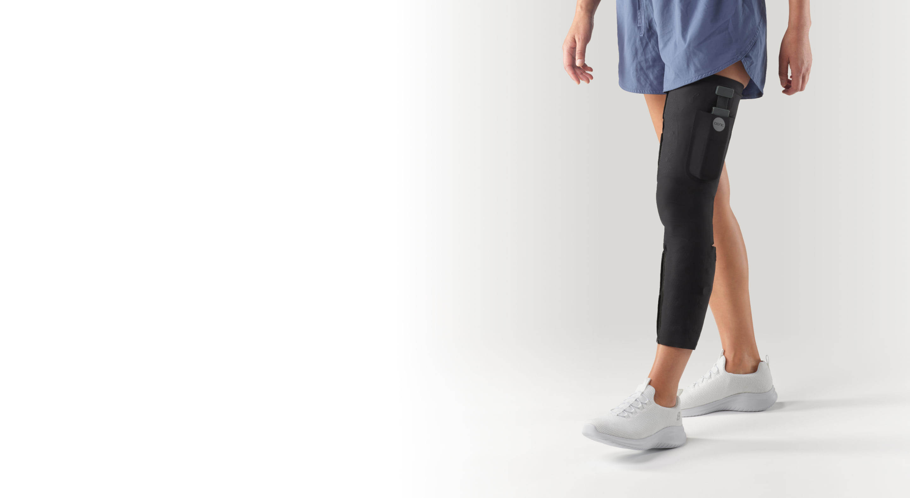
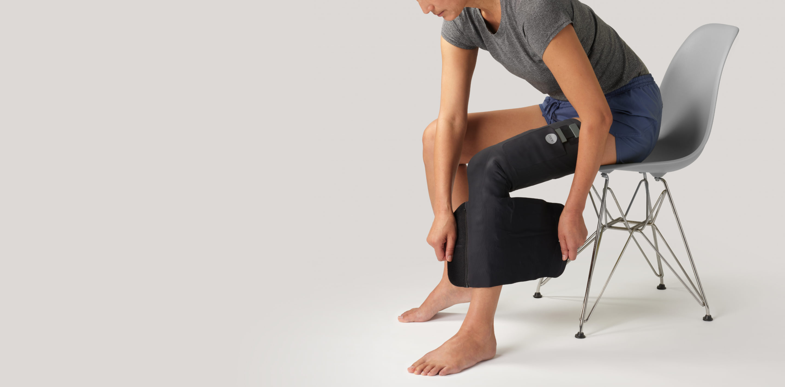
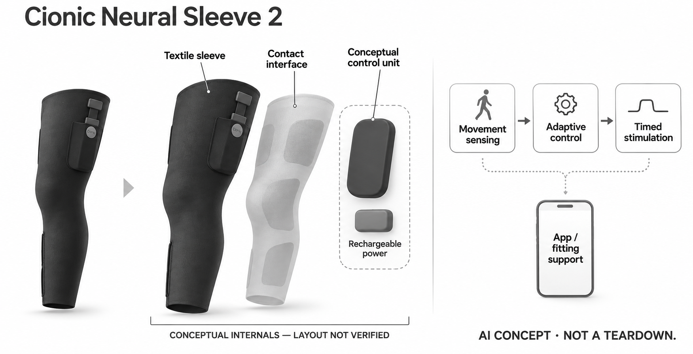

# Cionic Neural Sleeve 2

**Cionic** · 无障碍与辅助沟通 · 核查 2026-11-05

以动作感知和个体化电刺激辅助日常步行的软织物套袖

消费渠道：个人适配 / 验配。

## 产品图片与结构参考

### 产品图

Neural Sleeve 2当前官方站立佩戴图，确认长套袖与控制口袋外形 · 来源：[Cionic · 官方产品图片](<https://www.cionic.com/neuralsleeve>) · [原始图片](<https://www.cionic.com/hubfs/sleeve-hero-optimized.jpg>)

### 参考图

Neural Sleeve 2官方穿戴动作参考；不由人物场景推定辅助效果 · 来源：[Cionic · 官方产品图片](<https://www.cionic.com/neuralsleeve>) · [原始图片](<https://www.cionic.com/hubfs/put-on-sleeve-optimized.jpg>)

### AI 生成爆炸示意

**AI 生成 · 非实物拆机。** 内部为概念推断，不能作为元件布局、BOM 或维修依据。[生成提示词](../../content/hardware/prompts/cionic-neural-sleeve-2.txt)

> 已视觉检查外形、灰阶、标签和功能边界；未知内部采用明确标注的抽象概念块，非真实拆机或已披露BOM。

> 软织物电刺激套袖不画成电机假肢；接触界面、控制与供电为概念功能层，不披露或指导电极布置和刺激参数。

> 已逐张view_image核对当前具体产品外形，原图不改色；展示内容不构成本研究性能或个人效果验证。

> 分析为基于公开资料的案头研究与 AI 辅助判断，未经用户访谈、销量审计或实物拆机。需求、画像、竞争冷门度、审美及商业机会均为研究假设，不是投资结论。

## 销售与购买

- 状态：在售。当前官网明确Neural Sleeve 2及美国个人直接订购流程，实际浏览器核到单袖首付与月付方案；需所在州许可、适配评估、处方、尺寸和培训，不是普通现货自选，也不把缺尺码等待名单计作可买。

- 地区：美国已获配送许可的州；须个人处方及适配

- 价格：单袖 US$300 首付＋US$275/月，前12个月。当前Care Plan包含硬件分期、App、专员及电极等服务。前12次月付期间取消须退回套袖；完成后可保留硬件，第二年服务US$125/月或改按需付费。首付不是整机总价或排队定金，具体退款和服务依当前条款。

- 中国大陆：官网明确美国限定并需美国处方及地址，未核到中国大陆官方购买适配渠道；不以转运推定支持。

- [官方产品 / 商店](<https://www.cionic.com/neuralsleeve>)

## AI 的实际作用

MultiStim以运动传感及自适应算法分析当前动作、预测动作进程，并个体化调整运动与感觉刺激时机。

服务与联网依赖：需要兼容手机App、处方与适配支持；官网未完整披露传感器型号、模型细节及端云计算分工，不推定脑电输入、读心或全部离线。

## 是否冷门

细分专业（研究判断）：在主动步行辅助共同任务中采用刺激自身肌肉的实现路径，区别于替代关节或外部电机助力；本研究未做临床复核、用户访谈或销量调查。

## 需求与市场

需求假设是符合适配条件的人希望在熟悉的生活环境中获得步行支持，减少设备设置与每次活动之间的割裂。是否愿意每天穿戴、能否保持合适接触和获得支持，可能比一次演示更重要；不能仅凭套袖柔软便判断适合所有动作困难或所有身体条件。

### 官方｜将动作观察连接到刺激时序 · 官方资料

Neural Sleeve 2通过穿戴套袖的传感与控制系统观察运动，再由MultiStim调整运动及感觉刺激。它提供的是与步行过程相关的主动输出，而非仅记录步数或报告姿态；厂家将机制描述为预测下一步动作，本目录不把这种预测扩展为读取思想，也不采用改善比例作为个人效果保证。

依据：[Cionic当前Neural Sleeve 2与MultiStim](<https://www.cionic.com/neuralsleeve>)

### 判断｜核心需求是日常动作中的连续辅助 · 研究判断

需求假设是符合适配条件的人希望在熟悉的生活环境中获得步行支持，减少设备设置与每次活动之间的割裂。是否愿意每天穿戴、能否保持合适接触和获得支持，可能比一次演示更重要；不能仅凭套袖柔软便判断适合所有动作困难或所有身体条件。

依据：[Cionic当前Neural Sleeve 2与MultiStim](<https://www.cionic.com/neuralsleeve>) · [Cionic个人订单、取消与维护FAQ](<https://www.cionic.com/faq>)

### 验证｜把穿戴完成和辅助体验分开记录 · 待验证

研究应先在正式适配与专业边界内确认用户能否完成穿戴、连接和开始活动，再讨论本人观察到的体验。动作数据变化不能单独证明长期健康结果，无法完成流程的人也需要纳入反馈；本目录未运行真机或开展临床评估，不建议自行设定刺激参数。

依据：[Cionic当前Neural Sleeve 2与MultiStim](<https://www.cionic.com/neuralsleeve>) · [Cionic个人订单、取消与维护FAQ](<https://www.cionic.com/faq>)

## 用户画像

目标用户是否能够独立穿戴、操作手机或获得身边协助，会影响日常使用可行性；只有购买预算却缺少稳定支持，仍可能遇到困难。目录不能根据疾病名称代替个体适用性判断，也不应把照护者和实际穿戴者视为同一个人，需要分别理解其操作与隐私偏好。

### 官方｜个人订单须满足地区和处方条件 · 官方资料

官网允许许可州内符合评估条件的个人直接订购，随后还需尺寸、处方和培训等环节，并限定二十二岁以上成人。缺少可用尺寸的人只能加入等待名单，这不等于订单已成立；个人可购买与无需专业介入是不同概念，因此本条采用消费者适配渠道分类。

依据：[Cionic当前个人订购与Care Plan](<https://www.cionic.com/ordering>) · [Cionic个人订单、取消与维护FAQ](<https://www.cionic.com/faq>)

### 判断｜支持能力也是使用者条件的一部分 · 研究判断

目标用户是否能够独立穿戴、操作手机或获得身边协助，会影响日常使用可行性；只有购买预算却缺少稳定支持，仍可能遇到困难。目录不能根据疾病名称代替个体适用性判断，也不应把照护者和实际穿戴者视为同一个人，需要分别理解其操作与隐私偏好。

依据：[Cionic当前Neural Sleeve 2与MultiStim](<https://www.cionic.com/neuralsleeve>) · [Cionic个人订单、取消与维护FAQ](<https://www.cionic.com/faq>)

### 验证｜核对服务、尺寸和操作可达性 · 待验证

购买研究可以先确认所在地是否可配送、所需尺寸是否可供应、兼容手机及培训安排，并了解发生问题时的联系渠道。无需为了验证订单而填写虚构健康资料；本轮仅查看公开流程与费用，没有进入个人适配评估，也没有替任何用户判断处方资格。

依据：[Cionic当前个人订购与Care Plan](<https://www.cionic.com/ordering>) · [Cionic个人订单、取消与维护FAQ](<https://www.cionic.com/faq>)

## 竞争与替代

Power Knee等主动假肢膝单元通过机械驱动帮助替代关节，外骨骼则把动力经结构传到身体；本产品主要借电极刺激使用者自身肌肉。共同需求都是主动步行辅助，但身体条件、接触界面与专业适配明显不同，不能在缺少相同任务和使用者条件时做通用优劣排名。

### 官方｜单袖分期与后续服务有明确区分 · 官方资料

当前单袖方案显示三百美元首付和前十二个月每月二百七十五美元，包含硬件分期及相关支持。FAQ说明早期取消需退回套袖，完成十二次月付后可以保留硬件并另选后续服务；因此既不能只写首付款为整机价格，也不能把所有使用阶段统一称为租赁。

依据：[Cionic当前个人订购与Care Plan](<https://www.cionic.com/ordering>) · [Cionic个人订单、取消与维护FAQ](<https://www.cionic.com/faq>)

### 判断｜与机械助力共享需求但实现不同 · 研究判断

Power Knee等主动假肢膝单元通过机械驱动帮助替代关节，外骨骼则把动力经结构传到身体；本产品主要借电极刺激使用者自身肌肉。共同需求都是主动步行辅助，但身体条件、接触界面与专业适配明显不同，不能在缺少相同任务和使用者条件时做通用优劣排名。

依据：[Cionic当前Neural Sleeve 2与MultiStim](<https://www.cionic.com/neuralsleeve>)

### 验证｜比较完整使用成本和退出安排 · 待验证

比较不同方案应纳入初期评估、硬件、耗材、支持、后续月费以及取消时设备如何处理，而不只横比首付。是否可以继续使用App与是否持续获得电极和专员服务也需分别确认；本研究没有价格谈判、保险核准或用户长期支付行为的实证资料。

依据：[Cionic当前个人订购与Care Plan](<https://www.cionic.com/ordering>) · [Cionic个人订单、取消与维护FAQ](<https://www.cionic.com/faq>)

## 供应链

同类新产品的难点可能包括织物伸展后的接触、反复穿脱、汗液环境和不同尺寸下的功能一致性。传感器、控制与耗材不能孤立优化，因为接触状态会影响整个使用过程；供应商候选仅可解释局部能力，不代表买到几个模块便能复现原系统或其适配验证。

### 官方｜控制单元与织物电子整合已公开 · 官方资料

官方产品和条款确认系统包含套袖、控制单元与附件，FAQ说明充电电池位于控制单元内且不由用户拆换。具体传感器、电刺激电路、柔性导线、封装工艺与制造工厂没有完整公开，不能把常见可穿戴零件列表当成实际BOM，也不能由设计合作推定全部制造归属。

依据：[Cionic当前Neural Sleeve 2与MultiStim](<https://www.cionic.com/neuralsleeve>) · [Cionic个人订单、取消与维护FAQ](<https://www.cionic.com/faq>) · [Cionic服务条款](<https://www.cionic.com/legal/terms>)

### 判断｜接触一致性比堆叠芯片更关键 · 研究判断

同类新产品的难点可能包括织物伸展后的接触、反复穿脱、汗液环境和不同尺寸下的功能一致性。传感器、控制与耗材不能孤立优化，因为接触状态会影响整个使用过程；供应商候选仅可解释局部能力，不代表买到几个模块便能复现原系统或其适配验证。

依据：[Cionic当前Neural Sleeve 2与MultiStim](<https://www.cionic.com/neuralsleeve>) · [Cionic个人订单、取消与维护FAQ](<https://www.cionic.com/faq>)

### 验证｜候选要通过具体穿戴条件验证 · 待验证

动作传感候选应结合安装位置和真实运动观察噪声，电源候选则需验证封装、热管理与维护流程，不能直接套用手机部件。未发现点名采用证据的供应商统一记为候选；这些关联面向同类研发研究，不构成消费者自行拆改处方设备或更换电池的指南。

依据：[Cionic当前Neural Sleeve 2与MultiStim](<https://www.cionic.com/neuralsleeve>) · [Cionic个人订单、取消与维护FAQ](<https://www.cionic.com/faq>)

## 技术路径

动作发生变化时，系统输出需要和穿戴条件、个人配置及使用环境保持一致，单独强调算法实时并不足够。技术研究更应关注设置如何建立、如何调整、何时由专员介入，以及用户如何知道设备状态；这些问题比抽象地宣称AI越来越懂身体更可操作。

### 官方｜AI用于动作分析与个体化刺激 · 官方资料

MultiStim页面明确传感器实时分析动作、预测随后运动并调整刺激，App可配置个体训练和查看进展。公开内容支持存在具体感知与自适应控制机制，但没有完整说明全部信号模态、训练数据或计算分工；不能因此增添脑电、肌电读取或某款芯片上运行大模型的说法。

依据：[Cionic当前Neural Sleeve 2与MultiStim](<https://www.cionic.com/neuralsleeve>)

### 判断｜闭环需要解释适配和变化 · 研究判断

动作发生变化时，系统输出需要和穿戴条件、个人配置及使用环境保持一致，单独强调算法实时并不足够。技术研究更应关注设置如何建立、如何调整、何时由专员介入，以及用户如何知道设备状态；这些问题比抽象地宣称AI越来越懂身体更可操作。

依据：[Cionic当前Neural Sleeve 2与MultiStim](<https://www.cionic.com/neuralsleeve>) · [Cionic个人订单、取消与维护FAQ](<https://www.cionic.com/faq>)

### 验证｜只在正式支持下观察控制流程 · 待验证

可依据正式说明核对连接、校准、开始、停止和异常提示的路径，了解哪些设置由用户处理、哪些需要专业协助。不能为了评估算法主动制造危险步态或自行调整电刺激参数；本研究没有执行人体测试，也不凭官方演示推定所有速度或地形下的表现。

依据：[Cionic当前Neural Sleeve 2与MultiStim](<https://www.cionic.com/neuralsleeve>) · [Cionic个人订单、取消与维护FAQ](<https://www.cionic.com/faq>) · [Cionic服务条款](<https://www.cionic.com/legal/terms>)

## 产品审美

套袖可被理解为衣物的一部分，但厚度、边缘、坐下时的折叠和不同衣着搭配仍可能影响接受度。视觉低调不等于触觉舒适，也不等于所有用户都容易穿好；对这一产品，审美评估应与操作动作和穿戴时间相连，避免仅以棚拍照片判断长期可用。

### 官方｜外形是包覆腿部的深色软套袖 · 官方资料

当前二代照片显示从大腿延伸到小腿的深色织物轮廓、侧面开合结构与上部控制单元口袋，没有外露电机或硬质关节架。参考图分别展示站立和穿戴动作，能够确认基本外观，却不能据此知道内部电极精确数量；概念图只用抽象接触层与封装块表达功能。

依据：[Cionic当前Neural Sleeve 2与MultiStim](<https://www.cionic.com/neuralsleeve>)

### 判断｜日常衣着和穿脱决定接受度 · 研究判断

套袖可被理解为衣物的一部分，但厚度、边缘、坐下时的折叠和不同衣着搭配仍可能影响接受度。视觉低调不等于触觉舒适，也不等于所有用户都容易穿好；对这一产品，审美评估应与操作动作和穿戴时间相连，避免仅以棚拍照片判断长期可用。

依据：[Cionic当前Neural Sleeve 2与MultiStim](<https://www.cionic.com/neuralsleeve>) · [Cionic个人订单、取消与维护FAQ](<https://www.cionic.com/faq>)

### 验证｜观察真实衣着与收纳流程 · 待验证

正式适配后可以让使用者说明穿脱、充电、收纳和清洁中最费力的步骤，并区分材料偏好与功能问题。FAQ指出织物整合电子且不适合机洗，不能把普通运动护具的护理习惯直接迁移；本目录没有做材料、耐久或皮肤接触测试，不给出自创清洁方式。

依据：[Cionic当前Neural Sleeve 2与MultiStim](<https://www.cionic.com/neuralsleeve>) · [Cionic个人订单、取消与维护FAQ](<https://www.cionic.com/faq>)

## 关键风险

动作记录、账户和支持沟通可能构成持续服务的一部分，硬件取得并不等于全部数据只在设备内处理。用户还可能低估中断服务后耗材或维护的安排；研究应把数据授权、功能可用与后续支出放在同一使用周期内观察，而不是只强调最初付款可取消。

### 官方｜美国供应和服务不能迁移到国内 · 官方资料

官方明确美国限定，处方、配送许可和适配服务都与当地流程相连；国内没有核到相同型号的正式个人购买与支持路径。厂家同时说明尺码等待不保证开发成功，因此无法供应的尺寸不计入当前可购买范围，也不以能找到跨境运输商证明设备获得完整支持。

依据：[Cionic当前Neural Sleeve 2与MultiStim](<https://www.cionic.com/neuralsleeve>) · [Cionic个人订单、取消与维护FAQ](<https://www.cionic.com/faq>)

### 判断｜数据与服务依赖需要同时理解 · 研究判断

动作记录、账户和支持沟通可能构成持续服务的一部分，硬件取得并不等于全部数据只在设备内处理。用户还可能低估中断服务后耗材或维护的安排；研究应把数据授权、功能可用与后续支出放在同一使用周期内观察，而不是只强调最初付款可取消。

依据：[Cionic个人订单、取消与维护FAQ](<https://www.cionic.com/faq>) · [Cionic服务条款](<https://www.cionic.com/legal/terms>) · [Cionic隐私政策](<https://www.cionic.com/legal/privacy>)

### 验证｜确认退出、维护和数据处理路径 · 待验证

在适配前可以核对首付款退款阶段、取消时返还要求、后续维修以及账户和记录管理的渠道。涉及个人状况时应直接依正式适配服务处理，不由目录作替代判断；本研究只核公开文本，没有收集视频、行走记录或其他个人健康资料，也不保证保险报销。

依据：[Cionic当前个人订购与Care Plan](<https://www.cionic.com/ordering>) · [Cionic个人订单、取消与维护FAQ](<https://www.cionic.com/faq>) · [Cionic隐私政策](<https://www.cionic.com/legal/privacy>)

## 机会与验证

后续市场研究可以关注获得处方、完成培训、形成穿戴习惯和持续获取耗材之间是否顺畅。若用户认可第一次体验但无法把操作融入日常，硬件机制仍未转化为稳定价值；这是假设性的研究方向，不是对采用率、疗效或商业规模的结论。

### 官方｜按主动步行需求归并而非新增大类 · 官方资料

本条沿用主动步行辅助这一核心需求，保留电刺激自身肌肉的物理实现差异，不因软衣物外形另造一个独立市场。当前二代、左侧与右侧套袖或双袖方案也不重复计数；目录关注的是有明确个人交付路径的系统，以及使用所需适配和持续支持条件。

依据：[Cionic当前Neural Sleeve 2与MultiStim](<https://www.cionic.com/neuralsleeve>) · [Cionic个人订单、取消与维护FAQ](<https://www.cionic.com/faq>)

### 判断｜更值得研究支持流程是否形成连续使用 · 研究判断

后续市场研究可以关注获得处方、完成培训、形成穿戴习惯和持续获取耗材之间是否顺畅。若用户认可第一次体验但无法把操作融入日常，硬件机制仍未转化为稳定价值；这是假设性的研究方向，不是对采用率、疗效或商业规模的结论。

依据：[Cionic当前Neural Sleeve 2与MultiStim](<https://www.cionic.com/neuralsleeve>) · [Cionic当前个人订购与Care Plan](<https://www.cionic.com/ordering>) · [Cionic个人订单、取消与维护FAQ](<https://www.cionic.com/faq>)

### 验证｜保留不适配与停止使用的原因 · 待验证

在适当同意和专业边界内，可以访谈无法选到尺寸、未完成培训或后来停止使用的人，区分费用、操作、体验和服务原因。只展示成功个案会遗漏限制；本目录没有用户访谈、销量证据或临床复核，所有判断需通过真实场景及合格研究进一步检验。

依据：[Cionic当前个人订购与Care Plan](<https://www.cionic.com/ordering>) · [Cionic个人订单、取消与维护FAQ](<https://www.cionic.com/faq>)

## 对应供应链公司

能力候选用于选型研究，不代表本产品实际采用；未公开的供货关系不作推断。

- [bosch-sensortec](../supply-chain/bosch-sensortec.md) — **能力候选 · 非已采用** / 同类软套袖的动作输入候选：Bosch Sensortec智能惯性平台可供相近穿戴设计研究动作和姿态输入，但Cionic当前页面未点名具体传感器或全部信号模态，不能据此确认采用。实际安装、织物变形和动作噪声必须验证，候选也不包含MultiStim算法、电刺激安全控制或产品适配资质。

- [sunwoda](../supply-chain/sunwoda.md) — **能力候选 · 非已采用** / 同类控制单元的充电电源候选：欣旺达消费电池业务可供研究相近控制单元的充电供电与封装，实际容量、热管理和维护要求需专项确认。Cionic仅公开控制单元内充电电池不可由用户拆换，未点名供应商；本关联不是实际采用，也不建议用户替换原电池或推定通用消费电池满足处方设备要求。

[浏览供应链目录](../supply-chain.md)

## 功能分层示意

这是功能关系，不是实物拆机、真实空间结构或已核实 BOM。

1. **套袖与接触界面**：软织物套袖内整合电子与电极接触层，必须按正式适配流程使用。（官方披露）

2. **动作感知**：官网说明传感器实时分析运动，未在本页披露具体传感器及布置。（官方披露）

3. **自适应刺激控制**：MultiStim结合运动与感觉刺激，按动作调整时序；不推定公开了全部控制模型。（官方披露）

4. **控制单元与供电**：控制单元内有不可由用户拆换的充电电池，详细电路未知。（官方披露）

5. **App与适配服务**：兼容手机App提供设置、训练和进展信息，专员协助配置及后续调整。（官方披露）

## 来源

1. [Cionic当前Neural Sleeve 2与MultiStim](<https://www.cionic.com/neuralsleeve>) — 已打开当前二代页，明确动作感知、自适应刺激、处方和美国限定；厂商疗效与百分比宣传未作独立结论。

2. [Cionic当前个人订购与Care Plan](<https://www.cionic.com/ordering>) — 已实际浏览器只读核对单袖首付300美元、前一年275美元月费及第二年选项，未填写健康资料、提交评估或付款。

3. [Cionic个人订单、取消与维护FAQ](<https://www.cionic.com/faq>) — 已打开许可州、22岁以上、处方、尺寸、首付及12次月付后保留设备、控制单元电池不可拆换等边界。

4. [Cionic服务条款](<https://www.cionic.com/legal/terms>) — 已打开产品包含套袖与控制单元，软件服务与支持条件；不将硬件取得等同获得算法或源代码所有权。

5. [Cionic隐私政策](<https://www.cionic.com/legal/privacy>) — 已打开公司网站/App及相关服务的数据处理说明；本研究没有收集或提供任何个人健康记录。

[返回目录](../hardware-market.md) · [网页分析](https://romanagent.github.io/Roman/#hardware/product/cionic-neural-sleeve-2)
