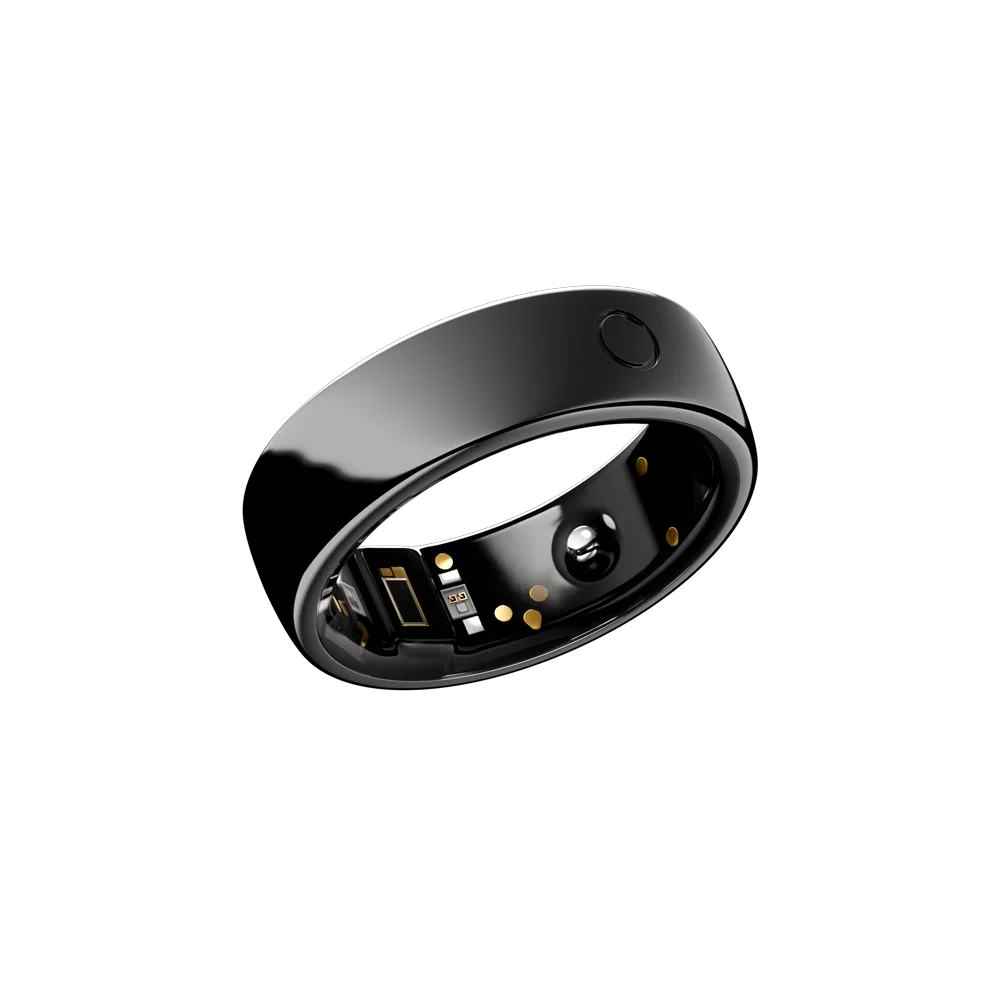
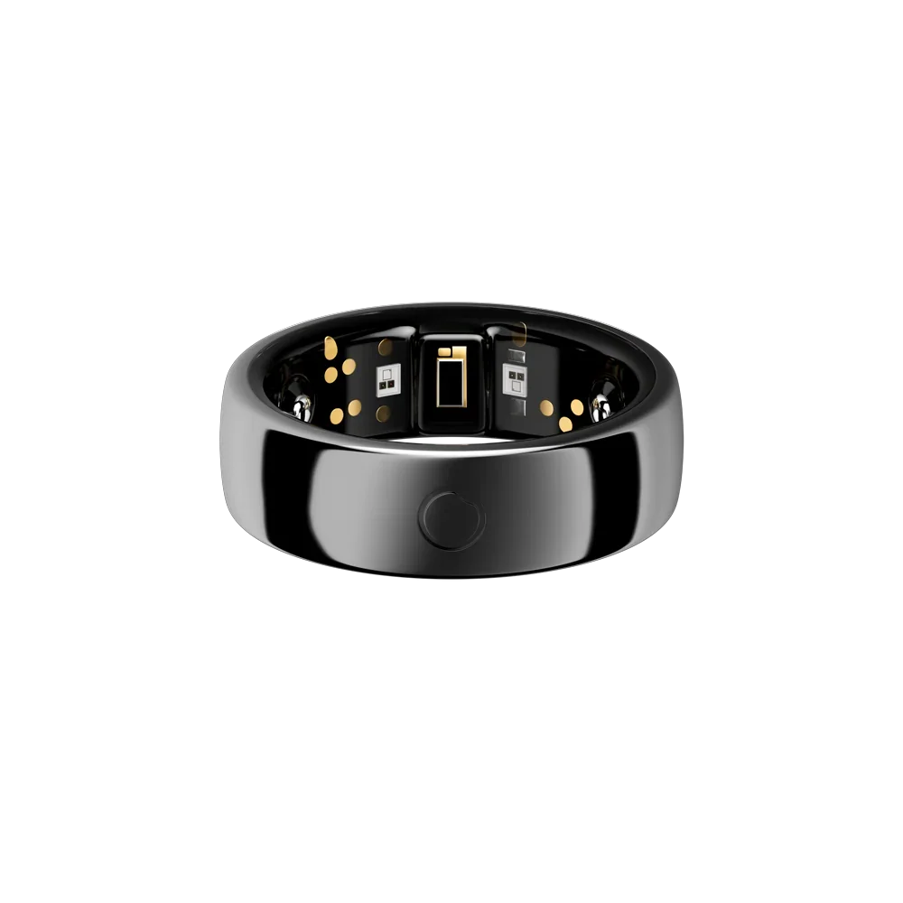
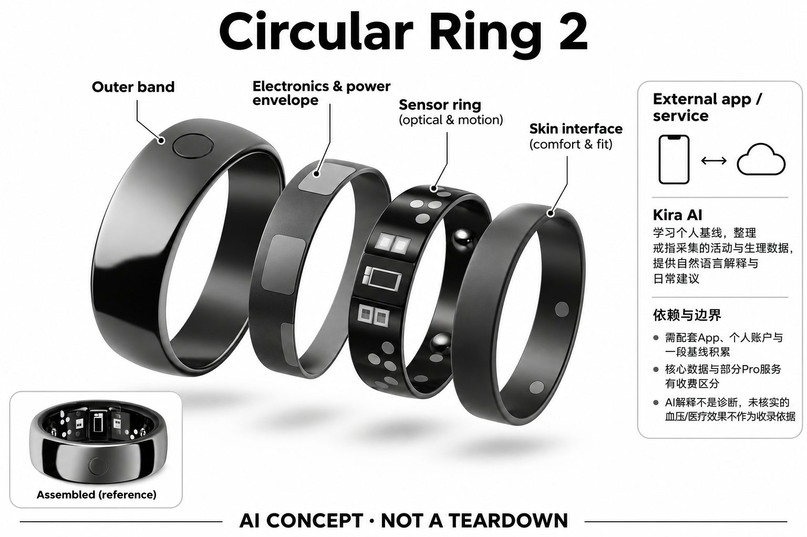

# Circular Ring 2

**Circular** · 健康与穿戴 · 核查 2026-11-04

手指传感数据与Kira AI解释

消费渠道：个人零售。

## 产品图片与结构参考

### 产品图

Circular Ring 2官方产品外形图 · 来源：[Circular · 官方产品图片](<https://shop.circular-ring.com/products/circular-ring-2>) · [原始图片](<https://shop.circular-ring.com/cdn/shop/files/CIRCULAR_PACKSHOT00086419.webp?v=1787367874&width=1400>)

### 参考图

Circular Ring 2官方另一角度或使用场景参考 · 来源：[Circular · 官方产品图片](<https://shop.circular-ring.com/products/circular-ring-2>) · [原始图片](<https://shop.circular-ring.com/cdn/shop/files/CIRCULAR_PACKSHOT00086421.webp?v=1787367873&width=1400>)

### AI 生成爆炸示意

**AI 生成 · 非实物拆机。** 内部为概念推断，不能作为元件布局、BOM 或维修依据。[生成提示词](../../content/hardware/prompts/circular-ring-2.txt)

> 外形依据核验参考图；内部位置、模块形状与装配关系仅作AI概念展示。

> 已逐张查看并核对型号。源图未改色/裁切；场景、界面、附件、优惠及效果文案仅为厂商示意，不作为本目录性能或现价依据。

> 分析为基于公开资料的案头研究与 AI 辅助判断，未经用户访谈、销量审计或实物拆机。需求、画像、竞争冷门度、审美及商业机会均为研究假设，不是投资结论。

## 销售与购买

- 状态：在售。Circular原域circular.xyz已跳转当前circular-ring.com，官方商店具体Ring 2显示价格、尺码和Add to cart；Ring 3仅候补，未计入。

- 地区：所列官方区域或授权零售渠道；配送地址与服务支持需结算确认

- 价格：Obsidian Black US$349 起。核查日所见单机或基本配置价；币种、促销、税费、镜片、附件及服务依地区结算，不把颜色或套装重复计数。

- 中国大陆：本次未核实该具体型号在中国大陆的官方销售和完整服务支持；海外在售不等于国内可直接启用全部功能。

- [官方产品 / 商店](<https://shop.circular-ring.com/products/circular-ring-2>)

## AI 的实际作用

Kira AI学习个人基线，把戒指采集的活动与生理数据整理为自然语言解释和日常建议

服务与联网依赖：需配套App、个人账户与一段基线积累；核心数据与部分Pro服务有收费区分。AI解释不是诊断，未核实的血压/医疗效果不作为收录依据

## 是否冷门

新兴竞争（研究判断）：按任务与形态作案头分类，无访谈、销量或市场份额证据。

## 需求与市场

需求假设：希望以无屏、较少打扰的方式获得连续生活数据，并理解图表可能代表什么。价值应由实际使用频率、任务完成与操作负担验证，不能把AI功能存在或演示流畅当作需求已得到满足。

## 用户画像

画像推断：愿意长期佩戴并校准个人基线，重视无屏外观而非腕上消息操作的用户。个人的语言、操作习惯、环境和预算会改变适配结果，本次只有案头研究，没有用户访谈或长期使用观察。

## 竞争与替代

案头判断：与Oura、RingConn和手表竞争，AI解读的差异需要与数据质量和服务稳定性一起比较。这只是用途与替代品比较，不是市场份额或销量结论；专业细分和较少曝光也不代表没有成熟竞争者。

## 供应链

公开资料可核对金属戒指外壳、内侧光学/温度/运动传感与ECG接触界面，具体整机工厂、关键模块供应商与BOM本次未确认。制造重点可从形态推断，但不能把品牌所在地、外观相似或营销合作等同代工关系。

## 技术路径

Kira AI学习个人基线，把戒指采集的活动与生理数据整理为自然语言解释和日常建议。这是厂商披露的功能机制；模型版本、准确率及内部结构未完整公开。架构只表示输入、处理和输出关系，不作为真实拆机或性能实测。

## 产品审美

图示观察：外表接近宽版首饰戒指，内侧传感窗口及充电方式更接近电子设备。宣传图片只能帮助理解外观和摆放方式，不能证明每个人的舒适度、长时使用体验或实际材料触感。

## 关键风险

戒围、皮肤接触和数据缺失会影响指标，疾病或药物相关建议不能仅凭Kira输出；新旧代宣传功能不可混用。还需核对地区功能、软件更新与售后边界；本目录未进行实机、医学或可靠性测试，不把厂商演示当作结果保证。

## 机会与验证

市场差异主要在于手指传感数据与Kira AI解释。值得进一步验证的购买理由是它能否减少既有任务中的具体步骤，以及硬件、服务与维护的总成本是否符合个人使用频率。

## 功能分层示意

这是功能关系，不是实物拆机、真实空间结构或已核实 BOM。

1. **实体输入**：金属戒指外壳、内侧光学/温度/运动传感与ECG接触界面；仅功能层示意，非拆机。（官方披露）

2. **采集与控制**：设备把输入转为可处理的信息并接收用户操作；具体内部布局未知。（分析推断）

3. **AI功能**：Kira AI学习个人基线，把戒指采集的活动与生理数据整理为自然语言解释和日常建议（官方披露）

4. **服务依赖**：需配套App、个人账户与一段基线积累；核心数据与部分Pro服务有收费区分。AI解释不是诊断，未核实的血压/医疗效果不作为收录依据（官方披露）

5. **用户反馈**：用户通过声音、屏幕或配套应用接收结果，并对重要信息复核。（分析推断）

## 来源

1. [Circular Ring 2官方商店](<https://shop.circular-ring.com/products/circular-ring-2>) — 已打开一手页面；产品能力为厂商披露，未进行实机或效果验证。

2. [Circular官方产品及Kira说明](<https://www.circular-ring.com/>) — 已打开原域重定向后的官方页；只采用Kira与传感功能，不据营销文字断言医疗效用。

[返回目录](../hardware-market.md) · [网页分析](https://romanagent.github.io/Roman/#hardware/product/circular-ring-2)
