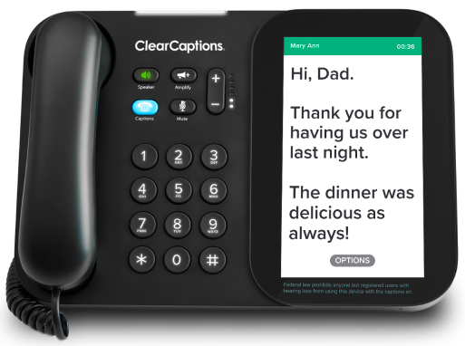
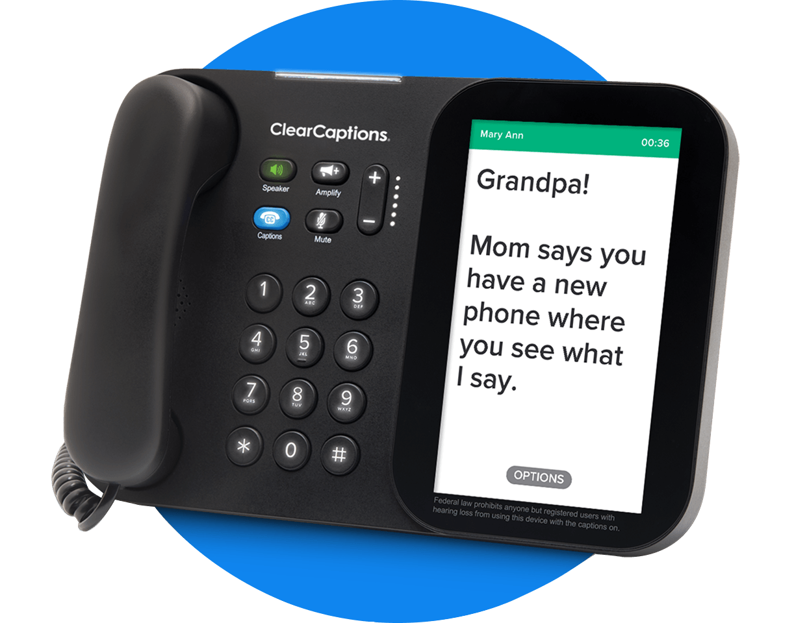
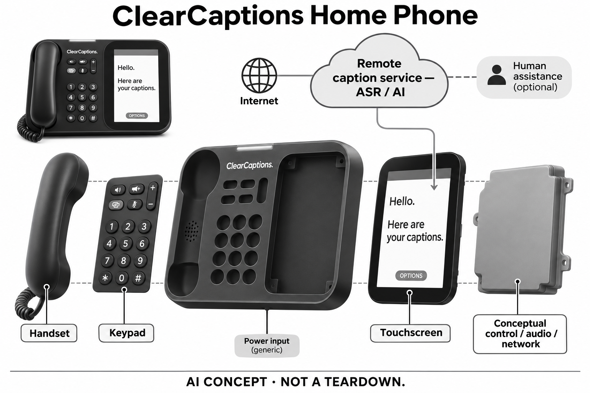

# ClearCaptions Home Phone

**ClearCaptions** · 无障碍与辅助沟通 · 核查 2026-11-05

把家庭电话中对方的话显示为字幕的专用终端

消费渠道：资格申请 · 资助发放。

## 产品图片与结构参考

### 产品图

当前ClearCaptions官方家庭字幕电话正面图 · 来源：[ClearCaptions · 官方产品图片](<https://clearcaptions.com/>) · [原始图片](<https://clearcaptions.com/wp-content/uploads/2026/09/11_ProductShots_CC_KL_13457-3-1.png>)

### 参考图

同款ClearCaptions电话官方斜角与屏幕显示参考 · 来源：[ClearCaptions · 官方产品图片](<https://clearcaptions.com/how-it-works/home-phone/>) · [原始图片](<https://clearcaptions.com/wp-content/uploads/2025/12/grandpa.png>)

### AI 生成爆炸示意

**AI 生成 · 非实物拆机。** 内部为概念推断，不能作为元件布局、BOM 或维修依据。[生成提示词](../../content/hardware/prompts/clearcaptions-home-phone.txt)

> 已视觉检查外形、灰阶、标签和功能边界；未知内部采用明确标注的抽象概念块，非真实拆机或已披露BOM。

> root独立生成并视觉复核，本代理复看通过；远端ASR/AI及可能人工辅助单独标注，没有全本地识别或免费零售承诺。

> 已逐张view_image核对当前具体产品外形，原图不改色；展示内容不构成本研究性能或个人效果验证。

> 分析为基于公开资料的案头研究与 AI 辅助判断，未经用户访谈、销量审计或实物拆机。需求、画像、竞争冷门度、审美及商业机会均为研究假设，不是投资结论。

## 销售与购买

- 状态：资格申请 · 资助发放。当前官网提供资格申请、自我认证、批准后寄送设备及安装培训路径；申请表明确填写不构成订单。记录为资格申请·资助发放，不计零售、预售或可订购产品。

- 地区：美国及其属地；需符合字幕服务资格

- 价格：合资格用户：设备与字幕服务无额外费用，制度资助。并非零元零售。厂家说明字幕服务费用由联邦管理的TRS基金承担，家庭网络费用由用户承担；原通信服务及具体安装安排需另核，申请不代表获批。

- 中国大陆：当前服务限定美国及其属地，且仅支持英语；中国大陆未核到官方设备交付及字幕服务，不以进口话机推定服务可用。

- [官方产品 / 商店](<https://clearcaptions.com/how-it-works/home-phone/>)

## AI 的实际作用

通过服务侧自动语音识别把通话内容转成字幕，官方Odin AI说明包含语言识别与减少识别错误；当前服务仍仅限英语。

服务与联网依赖：需要家庭网络、账户及资格认证；字幕可能包含人工通信辅助，不声称全在话机内计算、全部无人处理或没有识别错误。

## 是否冷门

细分专业（研究判断）：核心是固定家庭电话通话的可读访问，区别于环境字幕眼镜或随身录音摘要；本研究未调查市场份额、用户访谈或识别性能。

## 需求与市场

需求假设是部分听力受限的人在电话上难以持续理解对方，文字可以成为另一条参与路径。价值并不只取决于识别出了多少句，还取决于阅读速度、轮流讲话与澄清是否自然；不能把字幕显示出来等同对所有人都已消除沟通障碍，也不应以家属满意替代本人体验。

### 官方｜让家庭通话有可阅读的同步入口 · 官方资料

ClearCaptions的专用电话把对方语音转成屏幕字幕，同时保留听筒、实体拨号与扬声器。任务集中于家庭电话通信，并非把房间里所有声音连续记录或总结；当前产品还提供字幕语音留言与通话记录，因此信息访问既发生在通话当下，也可能延续到之后查看。

依据：[ClearCaptions当前家庭字幕电话](<https://clearcaptions.com/how-it-works/home-phone/>)

### 判断｜需要的是参与对话而不只是得到文本 · 研究判断

需求假设是部分听力受限的人在电话上难以持续理解对方，文字可以成为另一条参与路径。价值并不只取决于识别出了多少句，还取决于阅读速度、轮流讲话与澄清是否自然；不能把字幕显示出来等同对所有人都已消除沟通障碍，也不应以家属满意替代本人体验。

依据：[ClearCaptions当前家庭字幕电话](<https://clearcaptions.com/how-it-works/home-phone/>) · [ClearCaptions资格与设备交付流程](<https://clearcaptions.com/how-it-works/am-i-eligible/>)

### 验证｜围绕真实通话任务观察理解过程 · 待验证

合适的研究可在明确同意后观察家庭联络、预约或留言等任务，区分字幕阅读、确认和重复询问所需步骤。不要只统计屏幕持续有文字，也要记录错误或延迟怎样影响对话；本目录没有收集真实通话、进行识别测试或评估任何人的听力情况。

依据：[ClearCaptions当前家庭字幕电话](<https://clearcaptions.com/how-it-works/home-phone/>) · [ClearCaptions资格与设备交付流程](<https://clearcaptions.com/how-it-works/am-i-eligible/>)

## 用户画像

这类设备可能更适合习惯在家使用电话、愿意在固定位置阅读屏幕的人，移动场景则存在明显局限。本人视力、阅读偏好和操作习惯都需要考虑，不能因为听力受限就推定适合大屏字幕；照护者可以协助安装，但账户、通话和日常使用仍涉及实际使用者的选择。

### 官方｜资格认证之后才进入设备交付 · 官方资料

当前流程面向美国及属地内需要字幕使用电话的人，并要求家庭网络及英语交流。官方说明通过自我认证核对资格，不要求医生签名，批准后寄送并安排支持；联系表本身明确不构成订单，因此目录记录资助申请状态，不能把填表按钮当作现货购买完成。

依据：[ClearCaptions资格与设备交付流程](<https://clearcaptions.com/how-it-works/am-i-eligible/>) · [ClearCaptions当前申请联系表](<https://clearcaptions.com/sign-me-up/>)

### 判断｜固定家庭位置适合一部分通信习惯 · 研究判断

这类设备可能更适合习惯在家使用电话、愿意在固定位置阅读屏幕的人，移动场景则存在明显局限。本人视力、阅读偏好和操作习惯都需要考虑，不能因为听力受限就推定适合大屏字幕；照护者可以协助安装，但账户、通话和日常使用仍涉及实际使用者的选择。

依据：[ClearCaptions当前家庭字幕电话](<https://clearcaptions.com/how-it-works/home-phone/>) · [ClearCaptions资格与设备交付流程](<https://clearcaptions.com/how-it-works/am-i-eligible/>)

### 验证｜资格与操作能力需要分别确认 · 待验证

申请前可以依官方流程了解地区、语言和网络条件，获得设备后再通过培训观察字号、触屏和实体键是否容易使用。符合资助资格不代表任意环境和对话都合适；本研究未填写申请或提交个人信息，也没有以研究者身份代替用户声明听力状况或接受联系授权。

依据：[ClearCaptions当前家庭字幕电话](<https://clearcaptions.com/how-it-works/home-phone/>) · [ClearCaptions资格与设备交付流程](<https://clearcaptions.com/how-it-works/am-i-eligible/>)

## 竞争与替代

Captify等眼镜关注随身或面对面的环境语音访问，家庭字幕电话则围绕已有电话音频、固定屏幕及服务流程。两者不因都显示字幕就完全相同，也不能因为外形不同便忽略共同的识别和阅读问题；比较应聚焦通话来源、使用地点和支持方式，不以产品数量代替需求数量。

### 官方｜费用由资助路径而非零售促销解释 · 官方资料

厂家说明合资格用户获得电话与字幕服务无额外费用，字幕服务由联邦管理的TRS基金承担，家庭网络费用另由用户负担。这里没有面向所有人的零元商品结算，免费设备文案也附带资格条件；将它与普通消费电子售价直接排序，会抹去项目获得条件与持续服务差异。

依据：[ClearCaptions资格与设备交付流程](<https://clearcaptions.com/how-it-works/am-i-eligible/>) · [ClearCaptions资助与费用说明](<https://clearcaptions.com/how-it-works/why-its-free/>)

### 判断｜与字幕眼镜共享语音访问但任务范围不同 · 研究判断

Captify等眼镜关注随身或面对面的环境语音访问，家庭字幕电话则围绕已有电话音频、固定屏幕及服务流程。两者不因都显示字幕就完全相同，也不能因为外形不同便忽略共同的识别和阅读问题；比较应聚焦通话来源、使用地点和支持方式，不以产品数量代替需求数量。

依据：[ClearCaptions当前家庭字幕电话](<https://clearcaptions.com/how-it-works/home-phone/>)

### 验证｜比较获取、设置与持续支持的成本 · 待验证

需要同时观察申请时间、安装、家庭网络、培训和后续求助，避免把设备无额外费用理解为使用完全没有成本或负担。其他自费方案可能有不同地区和语言范围，不能仅凭资助价格判定优劣；本研究没有用户访谈、实际交付时长或市场份额资料。

依据：[ClearCaptions当前家庭字幕电话](<https://clearcaptions.com/how-it-works/home-phone/>) · [ClearCaptions资助与费用说明](<https://clearcaptions.com/how-it-works/why-its-free/>) · [ClearCaptions当前申请联系表](<https://clearcaptions.com/sign-me-up/>)

## 供应链

同类新设计需要同时考虑屏幕角度、字符可读性、听筒手感和扬声器声音，而不是只换一块大屏。硬件还必须承载稳定的服务连接与清楚的状态反馈；显示与声学供应候选只覆盖局部工程能力，不能代表具备字幕服务资格、完整软件平台或原产品制造关系。

### 官方｜硬件界面公开但内部器件未点名 · 官方资料

当前官方照片和功能表显示听筒、拨号键、右侧竖屏、扬声器与来电灯条，足以确认它是具体电子终端。屏幕供应商、主控、声学器件、网络模块与制造工厂并未在所核页面完整披露；不能拿外壳形似某类安卓电话就补出处理器、操作系统或真实板卡布局。

依据：[ClearCaptions当前家庭字幕电话](<https://clearcaptions.com/how-it-works/home-phone/>) · [ClearCaptions当前官方首页](<https://clearcaptions.com/>)

### 判断｜读屏与语音交互应作为整机问题处理 · 研究判断

同类新设计需要同时考虑屏幕角度、字符可读性、听筒手感和扬声器声音，而不是只换一块大屏。硬件还必须承载稳定的服务连接与清楚的状态反馈；显示与声学供应候选只覆盖局部工程能力，不能代表具备字幕服务资格、完整软件平台或原产品制造关系。

依据：[ClearCaptions当前家庭字幕电话](<https://clearcaptions.com/how-it-works/home-phone/>)

### 验证｜候选要经过实际桌面环境评估 · 待验证

显示候选可研究眩光、可视角与触控操作，声学候选需结合听筒和机身结构验证可理解的通话体验。材料、接口和供电条件都要先取得具体工程要求，不能根据照片推定；本条关联均为同类新设计候选，未发现厂家点名采用证据，也不构成改装现有设备的建议。

依据：[ClearCaptions当前家庭字幕电话](<https://clearcaptions.com/how-it-works/home-phone/>)

## 技术路径

电话音频、语速、专有名词和交替讲话会共同影响阅读体验，界面流畅并不等于每段话都被正确理解。AI可承担自动转写，但仍需让使用者有办法澄清、等待或重新确认；技术评价应关注不确定内容如何进入对话，而不是简单承诺字幕足够快便能取消所有沟通成本。

### 官方｜ASR和AI参与服务侧字幕生成 · 官方资料

官方机制文章说明自动语音识别把通话语音转成字幕，Odin AI用于语言判断及减少识别错误等处理。当前页面同时保留可能由通信辅助人员参与字幕的说明，因此不能画成完全独立离线的话机；二零二一年的说明证明已披露机制，不证明今天所有底层模型都与当时一致。

依据：[ClearCaptions官方ASR与Odin AI说明](<https://clearcaptions.com/blog/news/asr-clearcaptions-technology/>) · [ClearCaptions当前申请联系表](<https://clearcaptions.com/sign-me-up/>)

### 判断｜识别质量应放回电话对话背景 · 研究判断

电话音频、语速、专有名词和交替讲话会共同影响阅读体验，界面流畅并不等于每段话都被正确理解。AI可承担自动转写，但仍需让使用者有办法澄清、等待或重新确认；技术评价应关注不确定内容如何进入对话，而不是简单承诺字幕足够快便能取消所有沟通成本。

依据：[ClearCaptions当前家庭字幕电话](<https://clearcaptions.com/how-it-works/home-phone/>) · [ClearCaptions官方ASR与Odin AI说明](<https://clearcaptions.com/blog/news/asr-clearcaptions-technology/>)

### 验证｜区分网络问题、识别错误和阅读负担 · 待验证

可以在获得适当同意的受控通话中观察字幕延迟、错误和界面操作，并记录出现问题时用户如何恢复交流。当前资格页只提供英语服务，不能把历史机制中的语言检测解释为多语言翻译；本目录未测试通话内容，也没有核定任何厂商宣传的准确率或性能排名。

依据：[ClearCaptions当前家庭字幕电话](<https://clearcaptions.com/how-it-works/home-phone/>) · [ClearCaptions官方ASR与Odin AI说明](<https://clearcaptions.com/blog/news/asr-clearcaptions-technology/>) · [ClearCaptions当前申请联系表](<https://clearcaptions.com/sign-me-up/>)

## 产品审美

传统听筒与实体键能提供熟悉的操作线索，但屏幕、功能键和字幕设置仍需要学习。体积、摆放位置与房间照明会影响是否愿意长期使用，黑色外壳的视觉低调也不能代替可达性；审美评价应以具体居家桌面和操作姿势为背景，而不是仅评价官方渲染是否精致。

### 官方｜实体操作区与竖向字幕屏并置 · 官方资料

照片中的听筒位于左侧，中间偏左保留圆形实体数字键，右侧是竖向触屏，上缘另有来电提示灯。屏幕可调角度与显示设置，这种排列服务于读字与拿起听筒的连续动作；生成图据此保留识别特征，未知内部以封闭概念块表示，没有虚构摄像头或电池规格。

依据：[ClearCaptions当前家庭字幕电话](<https://clearcaptions.com/how-it-works/home-phone/>) · [ClearCaptions当前官方首页](<https://clearcaptions.com/>)

### 判断｜熟悉的电话形态可能降低理解负担 · 研究判断

传统听筒与实体键能提供熟悉的操作线索，但屏幕、功能键和字幕设置仍需要学习。体积、摆放位置与房间照明会影响是否愿意长期使用，黑色外壳的视觉低调也不能代替可达性；审美评价应以具体居家桌面和操作姿势为背景，而不是仅评价官方渲染是否精致。

依据：[ClearCaptions当前家庭字幕电话](<https://clearcaptions.com/how-it-works/home-phone/>)

### 验证｜在常用摆放位置核对阅读操作 · 待验证

安装培训时可以确认坐姿下的屏幕角度、文字大小、灯光反射及听筒是否容易拿放，并让实际用户独立完成几个日常步骤。不能只由安装者判断界面已经清楚，也不以一次成功通话代表长期习惯；本研究没有真机、家庭照明或不同用户可达性测试。

依据：[ClearCaptions当前家庭字幕电话](<https://clearcaptions.com/how-it-works/home-phone/>)

## 关键风险

远端识别与可能的人工参与意味着通话访问不能只理解为屏幕在家中显示文字。用户需要知道服务与记录如何工作，并考虑家庭中他人看到字幕或日志的情况；硬件放在私人空间不自动意味着内容仅在本地处理，AI标签也不能替代对具体数据流程的说明。

### 官方｜地区语言和字幕使用资格有边界 · 官方资料

当前服务明确限定美国及其属地和英语，页面提示只有符合条件的注册用户可以启用字幕。申请联系表还说明提交仅用于联系，不生成订单；中国大陆没有核到官方服务交付路径，因此不能把能获得一部实体电话或能访问官网解释为当地可以开通同样功能。

依据：[ClearCaptions资格与设备交付流程](<https://clearcaptions.com/how-it-works/am-i-eligible/>) · [ClearCaptions当前申请联系表](<https://clearcaptions.com/sign-me-up/>)

### 判断｜对话内容进入服务是重要依赖 · 研究判断

远端识别与可能的人工参与意味着通话访问不能只理解为屏幕在家中显示文字。用户需要知道服务与记录如何工作，并考虑家庭中他人看到字幕或日志的情况；硬件放在私人空间不自动意味着内容仅在本地处理，AI标签也不能替代对具体数据流程的说明。

依据：[ClearCaptions官方ASR与Odin AI说明](<https://clearcaptions.com/blog/news/asr-clearcaptions-technology/>) · [ClearCaptions当前申请联系表](<https://clearcaptions.com/sign-me-up/>)

### 验证｜核对记录访问及服务异常时的安排 · 待验证

使用前可通过官方支持了解通话记录、字幕查看和账户管理方式，以及网络或字幕服务不可用时会怎样提示。涉及重要信息时仍需在实际沟通中确认理解，而非盲信屏幕文字；本研究没有申请账号、转录真实通话或代用户同意电话、短信等联系授权。

依据：[ClearCaptions当前家庭字幕电话](<https://clearcaptions.com/how-it-works/home-phone/>) · [ClearCaptions当前申请联系表](<https://clearcaptions.com/sign-me-up/>)

## 机会与验证

后续可研究人们如何发现服务、理解资格、完成设置并形成稳定沟通习惯，而不只研究字幕模型本身。若获取说明或后续支持不清楚，技术能力未必转化成实际访问；这是案头研究形成的可验证假设，不推定已有服务覆盖所有需要的人，也不据厂商排名断言市场空间。

### 官方｜资助型实体设备保留独立目录状态 · 官方资料

本条保留家庭电话字幕访问这一独立使用任务，同时把获取方式写为资格申请与资助发放。它有具体硬件和当前交付流程，却不属于任何人都能直接下单的零售或预售；目录以不同状态呈现，可观察需求与实现，但不会用这一条抬高可订购产品数量。

依据：[ClearCaptions当前家庭字幕电话](<https://clearcaptions.com/how-it-works/home-phone/>) · [ClearCaptions资格与设备交付流程](<https://clearcaptions.com/how-it-works/am-i-eligible/>) · [ClearCaptions当前申请联系表](<https://clearcaptions.com/sign-me-up/>)

### 判断｜创新研究可以落在完整沟通服务上 · 研究判断

后续可研究人们如何发现服务、理解资格、完成设置并形成稳定沟通习惯，而不只研究字幕模型本身。若获取说明或后续支持不清楚，技术能力未必转化成实际访问；这是案头研究形成的可验证假设，不推定已有服务覆盖所有需要的人，也不据厂商排名断言市场空间。

依据：[ClearCaptions当前家庭字幕电话](<https://clearcaptions.com/how-it-works/home-phone/>) · [ClearCaptions资格与设备交付流程](<https://clearcaptions.com/how-it-works/am-i-eligible/>) · [ClearCaptions资助与费用说明](<https://clearcaptions.com/how-it-works/why-its-free/>)

### 验证｜包括未获批和停止使用的真实原因 · 待验证

在合适同意下，可以了解申请未完成、地区或语言不适配、安装后很少使用等情况，并把流程障碍与功能体验分开。所有用户都不应被假定有同样阅读能力和家庭条件；当前目录未进行访谈、资格审核或销量调查，只将公开交付证据与研究判断明确区分。

依据：[ClearCaptions资格与设备交付流程](<https://clearcaptions.com/how-it-works/am-i-eligible/>) · [ClearCaptions资助与费用说明](<https://clearcaptions.com/how-it-works/why-its-free/>) · [ClearCaptions当前申请联系表](<https://clearcaptions.com/sign-me-up/>)

## 对应供应链公司

能力候选用于选型研究，不代表本产品实际采用；未公开的供货关系不作推断。

- [boe](../supply-chain/boe.md) — **能力候选 · 非已采用** / 同类字幕电话的触控显示候选：京东方公开中尺寸显示与触控整合能力，可供相近家庭字幕终端研究可读性、屏幕角度和触控界面；具体尺寸、面板类型与交付条件需询证。没有ClearCaptions点名采用来源，显示能力也不包含其字幕算法、服务资助资格或完整电话系统，不能据外观认定真实供应关系。

- [aac-technologies](../supply-chain/aac-technologies.md) — **能力候选 · 非已采用** / 同类家庭字幕电话的听筒及扬声器候选：瑞声公开扬声器、耳机单元和声学仿真整机调试能力，可研究相近电话听筒与机身声音设计，但须以真实结构和通话任务验证。未核到ClearCaptions采用证据，候选不代表已经供应，也不提供其ASR服务或保证某类听力条件下的效果，不能从一般声学产品推定原机BOM。

[浏览供应链目录](../supply-chain.md)

## 功能分层示意

这是功能关系，不是实物拆机、真实空间结构或已核实 BOM。

1. **通话音频界面**：实体听筒、扬声器与按键提供家庭电话操作。（官方披露）

2. **网络与服务连接**：家庭网络连接字幕服务，语音识别不推定全部在话机本地执行。（官方披露）

3. **远端字幕生成**：自动语音识别和AI参与字幕处理，服务可能使用人工通信辅助。（官方披露）

4. **显示与访问设置**：彩色触屏显示字幕，可调字体、颜色及屏幕角度，另有来电灯条。（官方披露）

5. **资格与支持流程**：资格认证批准后配送设备、安装及培训，持续服务依项目条件。（官方披露）

## 来源

1. [ClearCaptions当前家庭字幕电话](<https://clearcaptions.com/how-it-works/home-phone/>) — 已打开当前触屏、实体拨号、字幕留言、网络与安装培训说明；不采用“每个字都不会遗漏”等宣传作准确率结论。

2. [ClearCaptions资格与设备交付流程](<https://clearcaptions.com/how-it-works/am-i-eligible/>) — 已打开美国及属地、英语、家庭网络与需要字幕的听力损失条件；自我认证批准后寄送并培训，无需医生签名，不替任何个人判断资格。

3. [ClearCaptions资助与费用说明](<https://clearcaptions.com/how-it-works/why-its-free/>) — 已打开公司对TRS资助与合资格用户费用说明；不是公开零售价格，家庭网络费用另计。

4. [ClearCaptions官方ASR与Odin AI说明](<https://clearcaptions.com/blog/news/asr-clearcaptions-technology/>) — 已打开2021年机制说明，支持自动语音识别与AI辅助；不据历史语言识别描述推定当前提供多语言翻译，亦不假定2026底层模型版本不变。

5. [ClearCaptions当前申请联系表](<https://clearcaptions.com/sign-me-up/>) — 已打开当前表单与“填写不构成订单”提示、字幕可能使用人工辅助的说明；未提交资料或联系厂商。

6. [ClearCaptions当前官方首页](<https://clearcaptions.com/>) — 已打开当前专用话机原图和资格入口；不引用市场领先或排名宣传作为独立证据。

[返回目录](../hardware-market.md) · [网页分析](https://romanagent.github.io/Roman/#hardware/product/clearcaptions-home-phone)
