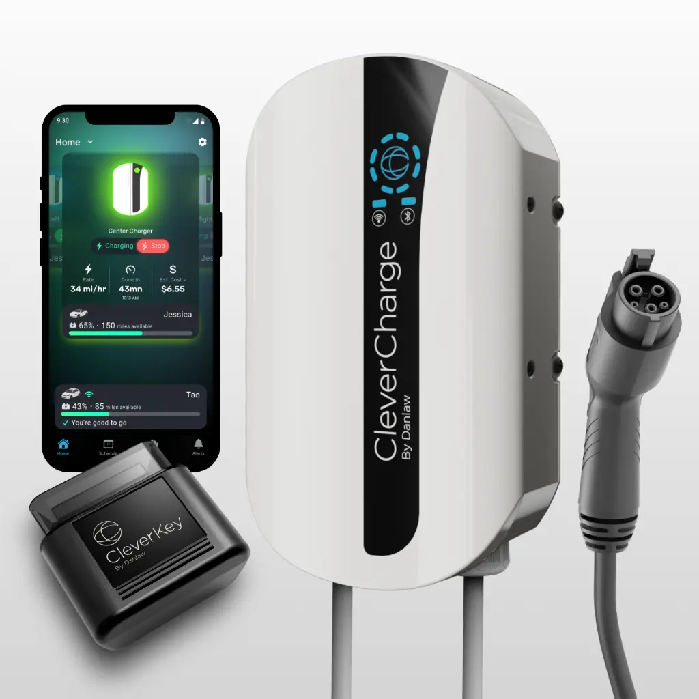
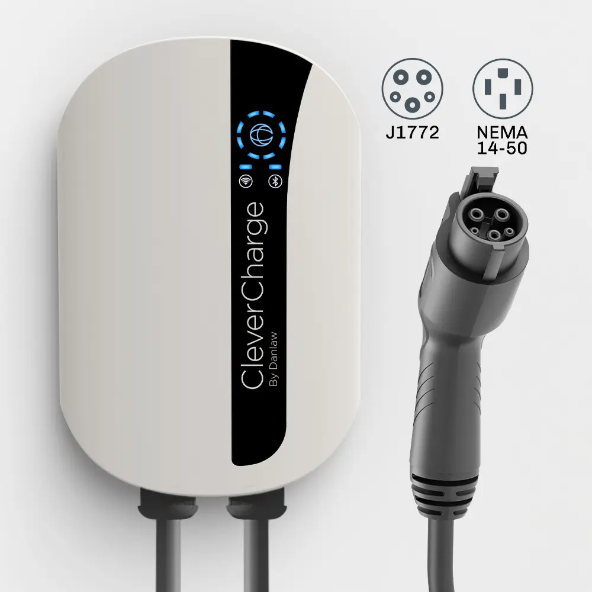
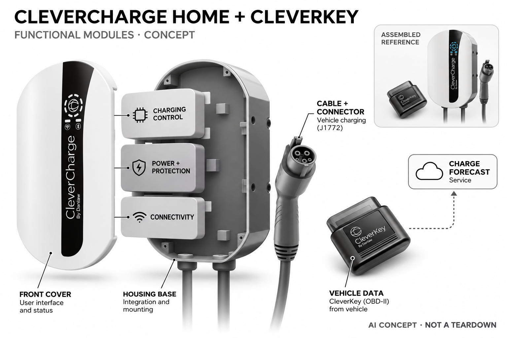

# CleverCharge Home + CleverKey（J1772 NEMA 14-50）

**CleverCharge / Danlaw** · 家庭能源 · 核查 2026-11-04

把车辆行程需求连接到家庭充电提醒

消费渠道：个人零售。

## 产品图片与结构参考

### 产品图

官方充电器、CleverKey与应用展示 · 来源：[CleverCharge / Danlaw · 官方图片](<https://www.clevercharge.com/shop/19-hwvk-qhmy-j1772-nema-14-50-3>) · [原始图片](<https://www.clevercharge.com/web/image/product.product/3/image_1024/%5B19-HWVK-QHMY%5D%20J1772%20NEMA%2014-50?unique=e7f5585>)

### 参考图

官方J1772与NEMA配置参考 · 来源：[CleverCharge / Danlaw · 官方图片](<https://www.clevercharge.com/shop/19-hwvk-qhmy-j1772-nema-14-50-3>) · [原始图片](<https://www.clevercharge.com/web/image/product.image/55/image_1024/J1772%20NEMA%2014-50?unique=e58d987>)

### AI 生成爆炸示意

**AI 生成 · 非实物拆机。** 内部为概念推断，不能作为元件布局、BOM 或维修依据。[生成提示词](../../content/hardware/prompts/clevercharge-home-cleverkey.txt)

> 依据已核验官方外形与公开功能生成；未知内部仅为概念功能块，不代表原机电路板、芯片或实际布局。

> 原图按官方文件保存，未改色或语义编辑；图片中的营销文字不视为本研究独立验证。

> 分析为基于公开资料的案头研究与 AI 辅助判断，未经用户访谈、销量审计或实物拆机。需求、画像、竞争冷门度、审美及商业机会均为研究假设，不是投资结论。

## 销售与购买

- 状态：在售。官方商品页购买按钮可用；读取公开HTML确认不可售占位为隐藏状态，套装明确含CleverKey。仅收一套，不以接口或功率变体重复计数。

- 地区：美国

- 价格：US$449（商品详情）。列表页部分仍列US$399，页面不一致需按订单复核；套装含一枚CleverKey，其他车辆需独立兼容配件。

- 中国大陆：官方电商条款明确只向美国销售配送；该配置为J1772和NEMA接口，未验证大陆车辆、接口、应用及保修，不按国内直接可用处理。

- [官方产品 / 商店](<https://www.clevercharge.com/shop/19-hwvk-qhmy-j1772-nema-14-50-3>)

## AI 的实际作用

CleverKey读取兼容车辆信息，Clever AI按实际日常里程和条件估计续航及次日驾驶需求，形成个车充电提醒；普通远程开关与定时充电不作为AI依据。

服务与联网依赖：AI功能仅在车辆兼容CleverKey时可用，依赖车端接口、应用和连接；基础Level 2充电可不启用应用，未公开模型结构或全部端云分工。

## 是否冷门

新兴竞争（研究判断）：车端使用模式与多车家庭充电协同有较新服务差异，但充电硬件本身成熟，兼容与预测收益必须验证。

## 需求与市场

需求假设：多电动车家庭希望知道今晚哪台车需要补能，而不是只按固定时间开关充电。应记录提醒是否符合真实次日安排及人工协调，不能把预测里程直接当作不会缺电、节省费用或电池健康改善的保证。

### 产品任务与边界 · 研究判断

需求假设：多电动车家庭希望知道今晚哪台车需要补能，而不是只按固定时间开关充电。应记录提醒是否符合真实次日安排及人工协调，不能把预测里程直接当作不会缺电、节省费用或电池健康改善的保证。

依据：[CleverCharge J1772套装官方商店](<https://www.clevercharge.com/shop/19-hwvk-qhmy-j1772-nema-14-50-3>) · [CleverCharge官方AI与兼容FAQ](<https://www.clevercharge.com/faqs>)

### 需求判断 · 研究判断

行程需求预测回答的是今晚是否需要给某台车补能，而不仅是何时电价便宜。多车家庭可能从统一视图获益，单车固定通勤则未必需要额外配件，需求应由遗漏和协调减少证明，不能把预测里程当作未来行程一定准确。

依据：[CleverCharge J1772套装官方商店](<https://www.clevercharge.com/shop/19-hwvk-qhmy-j1772-nema-14-50-3>) · [CleverCharge官方AI与兼容FAQ](<https://www.clevercharge.com/faqs>)

### 需求验证 · 待验证

可记录车辆实际次日使用、预测提醒与主人最终决定，比较普通定时和车厂应用，保留临时出行变化。将安装、兼容和配件维护计入，确认系统是否减少具体遗漏，不能由充电次数或估算费用推断节省或健康收益。

依据：[CleverCharge J1772套装官方商店](<https://www.clevercharge.com/shop/19-hwvk-qhmy-j1772-nema-14-50-3>) · [CleverCharge官方AI与兼容FAQ](<https://www.clevercharge.com/faqs>)

## 用户画像

画像推断：美国有适配家用电源、兼容车辆OBD-II并愿管理应用的车主更合适。单车固定通勤与多车临时行程需求不同，车辆兼容是前提，不能用所有电动车家庭数量推定AI功能都可使用。

### 适用行为与条件 · 研究判断

画像推断：美国有适配家用电源、兼容车辆OBD-II并愿管理应用的车主更合适。单车固定通勤与多车临时行程需求不同，车辆兼容是前提，不能用所有电动车家庭数量推定AI功能都可使用。

依据：[CleverCharge J1772套装官方商店](<https://www.clevercharge.com/shop/19-hwvk-qhmy-j1772-nema-14-50-3>) · [CleverCharge官方AI与兼容FAQ](<https://www.clevercharge.com/faqs>)

### 人群取舍 · 研究判断

车辆是否支持CleverKey决定AI能否启用，同一家庭的不同车可能有不同结果，不能用充电接口兼容推断数据兼容。实际操作者还需理解预测与剩余续航，画像应包含车辆组合、驾驶习惯和家用安装条件。

依据：[CleverCharge J1772套装官方商店](<https://www.clevercharge.com/shop/19-hwvk-qhmy-j1772-nema-14-50-3>) · [CleverCharge官方AI与兼容FAQ](<https://www.clevercharge.com/faqs>)

### 画像验证 · 待验证

画像验证应先核对实际车型和电源条件，再让家人协调一周充电并处理临时行程，记录误解与额外操作。区分需要多车管理的人和简单固定计划即可的人，不以拥有电动车或有车库直接推定愿意购买预测系统。

依据：[CleverCharge J1772套装官方商店](<https://www.clevercharge.com/shop/19-hwvk-qhmy-j1772-nema-14-50-3>) · [CleverCharge官方AI与兼容FAQ](<https://www.clevercharge.com/faqs>)

## 竞争与替代

竞争判断：与普通定时充电器、车厂应用和能源管理系统竞争，车端信息驱动的个车提醒是差异。不同接口和功率不重复计数；应比较完整安装、车辆兼容和维护，而不是仅将AI标签视为普通充电必需升级。

### 比较对象与差异 · 研究判断

竞争判断：与普通定时充电器、车厂应用和能源管理系统竞争，车端信息驱动的个车提醒是差异。不同接口和功率不重复计数；应比较完整安装、车辆兼容和维护，而不是仅将AI标签视为普通充电必需升级。

依据：[CleverCharge J1772套装官方商店](<https://www.clevercharge.com/shop/19-hwvk-qhmy-j1772-nema-14-50-3>) · [CleverCharge官方AI与兼容FAQ](<https://www.clevercharge.com/faqs>)

### 竞争判断 · 研究判断

充电器本身属于成熟品类，CleverKey将车端信息连接到个车需求是具体差异，而不是普通遥控和定时。不同接口或功率不创造独立场景，比较应锁定同样车辆与任务，并把车厂已有功能作为真实替代，而非只对照最基础充电盒。

依据：[CleverCharge J1772套装官方商店](<https://www.clevercharge.com/shop/19-hwvk-qhmy-j1772-nema-14-50-3>) · [CleverCharge官方AI与兼容FAQ](<https://www.clevercharge.com/faqs>)

### 竞争验证 · 待验证

可比较固定时段、车厂应用和需求预测的遗漏、操作与实际补能，明确车型兼容、套装和安装费用。不能拿不兼容车辆的普通充电体验当作AI无效，也不因预测页面更详细就认为比简单方案更值得长期维护。

依据：[CleverCharge J1772套装官方商店](<https://www.clevercharge.com/shop/19-hwvk-qhmy-j1772-nema-14-50-3>) · [CleverCharge官方AI与兼容FAQ](<https://www.clevercharge.com/faqs>)

## 供应链

供应链分析：充电功率模块、电缆连接器、控制无线与车端CleverKey共同构成系统，实际零部件及BOM未披露。车辆协议、户外防护、电气保护和软件持续支持影响交付，不能只按墙盒外观推断成本或制造归属。

### 功能模块拆分 · 研究判断

功能层包括墙装充电与电缆、车端OBD-II CleverKey、无线连接、里程及次日需求推断、家庭车辆管理。电气保护应独立于预测层，公开资料没有实际功率电路或芯片清单，不能把软件功能画成虚构电池或具体高压布线。

依据：[CleverCharge J1772套装官方商店](<https://www.clevercharge.com/shop/19-hwvk-qhmy-j1772-nema-14-50-3>) · [CleverCharge官方AI与兼容FAQ](<https://www.clevercharge.com/faqs>)

### 制造与供应约束 · 研究判断

供应链分析：充电功率模块、电缆连接器、控制无线与车端CleverKey共同构成系统，实际零部件及BOM未披露。车辆协议、户外防护、电气保护和软件持续支持影响交付，不能只按墙盒外观推断成本或制造归属。

依据：[CleverCharge J1772套装官方商店](<https://www.clevercharge.com/shop/19-hwvk-qhmy-j1772-nema-14-50-3>) · [CleverCharge官方AI与兼容FAQ](<https://www.clevercharge.com/faqs>)

### 候选与证据缺口 · 研究判断

Jabil可作为联网电气设备制造导入候选，USI可支持车端与家庭无线电子整合。没有CleverCharge点名合作证据，充电保护、车辆协议与预测需专项工程；通用制造能力不能推定车型兼容、实际工厂或电气认证已经满足。

依据：[CleverCharge J1772套装官方商店](<https://www.clevercharge.com/shop/19-hwvk-qhmy-j1772-nema-14-50-3>) · [CleverCharge官方AI与兼容FAQ](<https://www.clevercharge.com/faqs>)

## 技术路径

技术判断：官网明确Clever AI根据实际日常里程推断续航与明日需求，并强调必须使用兼容CleverKey。预测与普通定时区分，临时出行会改变结果；公开未给模型细节，不应补写训练架构或声称所有车型通用。

### 已披露技术边界 · 研究判断

技术判断：官网明确Clever AI根据实际日常里程推断续航与明日需求，并强调必须使用兼容CleverKey。预测与普通定时区分，临时出行会改变结果；公开未给模型细节，不应补写训练架构或声称所有车型通用。

依据：[CleverCharge J1772套装官方商店](<https://www.clevercharge.com/shop/19-hwvk-qhmy-j1772-nema-14-50-3>) · [CleverCharge官方AI与兼容FAQ](<https://www.clevercharge.com/faqs>)

### 系统难点判断 · 研究判断

实际日常里程与行驶条件可以支持需求估计，但临时远途、家庭轮换和车辆状态会改变结果。系统应清楚表达预测依据和人工覆盖，不能把普通电量读取、故障码或自动授权都混为机器学习，也不补写未公开模型架构。

依据：[CleverCharge J1772套装官方商店](<https://www.clevercharge.com/shop/19-hwvk-qhmy-j1772-nema-14-50-3>) · [CleverCharge官方AI与兼容FAQ](<https://www.clevercharge.com/faqs>)

### 技术验证 · 待验证

验证应比较预测与真实行程，覆盖多车轮换、临时出行和数据中断，再分开检查基础充电与AI提醒。保持车型和版本记录，不能以一次正确提醒推断所有未来需求可靠，也不将车辆故障码提示解释为自动诊断或维修结论。

依据：[CleverCharge J1772套装官方商店](<https://www.clevercharge.com/shop/19-hwvk-qhmy-j1772-nema-14-50-3>) · [CleverCharge官方AI与兼容FAQ](<https://www.clevercharge.com/faqs>)

## 产品审美

审美判断：白色墙盒与线缆挂放适合车库，但接口可达、车辆停放和线缆整理比屏幕或灯效更重要。车端小配件也需要稳定安装，真实车库布置与维护应和充电器正面一起评估，不能只看整洁商品图。

### 外观与交互语言 · 研究判断

审美判断：白色墙盒与线缆挂放适合车库，但接口可达、车辆停放和线缆整理比屏幕或灯效更重要。车端小配件也需要稳定安装，真实车库布置与维护应和充电器正面一起评估，不能只看整洁商品图。

依据：[CleverCharge J1772套装官方商店](<https://www.clevercharge.com/shop/19-hwvk-qhmy-j1772-nema-14-50-3>) · [CleverCharge官方AI与兼容FAQ](<https://www.clevercharge.com/faqs>)

### 使用中审美判断 · 研究判断

白色墙盒和黑色纵向面板符合车库工具形态，线缆挂放与连接器可达性更影响实际便利。车端小配件也属于整体体验，设计应让配对、状态和移除清楚，不能只展示整洁墙面而忽略多车停放和走线路径。

依据：[CleverCharge J1772套装官方商店](<https://www.clevercharge.com/shop/19-hwvk-qhmy-j1772-nema-14-50-3>) · [CleverCharge官方AI与兼容FAQ](<https://www.clevercharge.com/faqs>)

### 设计验证 · 待验证

设计验证应观察不同车辆停位、插拔、线缆收纳和车端配件维护，记录是否妨碍通行或难以辨认状态。还需检查应用中的车辆对应是否直观，避免漂亮界面让家人误认正在充电的车辆或预期剩余里程。

依据：[CleverCharge J1772套装官方商店](<https://www.clevercharge.com/shop/19-hwvk-qhmy-j1772-nema-14-50-3>) · [CleverCharge官方AI与兼容FAQ](<https://www.clevercharge.com/faqs>)

## 关键风险

风险判断：AI依赖车型兼容，行程预测也可能不符实际；基础充电与智能提醒需分开理解。美国电商和接口条件不能外推国内，电气安装与车辆异常需要合适专业处理，算法提示不替代实际续航和出行安排确认。

### 主要失效与依赖 · 研究判断

风险判断：AI依赖车型兼容，行程预测也可能不符实际；基础充电与智能提醒需分开理解。美国电商和接口条件不能外推国内，电气安装与车辆异常需要合适专业处理，算法提示不替代实际续航和出行安排确认。

依据：[CleverCharge J1772套装官方商店](<https://www.clevercharge.com/shop/19-hwvk-qhmy-j1772-nema-14-50-3>) · [CleverCharge官方AI与兼容FAQ](<https://www.clevercharge.com/faqs>) · [CleverCharge官方电商配送条款](<https://www.clevercharge.com/e-commerce-policy>)

### 风险传播判断 · 研究判断

接口可充电与CleverKey可读数据是两种兼容，用户可能买到能充电却没有预期AI的组合。预测错误和服务中断需要可理解恢复，电气安装与车辆问题也不能由算法替代专业处理，地区限定不应被全球展示掩盖。

依据：[CleverCharge J1772套装官方商店](<https://www.clevercharge.com/shop/19-hwvk-qhmy-j1772-nema-14-50-3>) · [CleverCharge官方AI与兼容FAQ](<https://www.clevercharge.com/faqs>) · [CleverCharge官方电商配送条款](<https://www.clevercharge.com/e-commerce-policy>)

### 风险验证 · 待验证

风险验证应核对车型、接口和官方销售地区，演练数据缺失、配件移除、网络中断与临时行程，检查人工覆盖。不要通过危险电气操作测试，不能以AI提醒或估算续航保证不会缺电，也不把美国可购推定为大陆可直接使用。

依据：[CleverCharge J1772套装官方商店](<https://www.clevercharge.com/shop/19-hwvk-qhmy-j1772-nema-14-50-3>) · [CleverCharge官方AI与兼容FAQ](<https://www.clevercharge.com/faqs>) · [CleverCharge官方电商配送条款](<https://www.clevercharge.com/e-commerce-policy>)

## 机会与验证

机会假设：围绕多车家庭的充电协调与可解释提醒测试价值，比较车厂应用和普通定时方案。若用户行程高度固定，简单设置可能足够；应先证明预测减少真实遗漏，再扩大硬件、协议和跨地区支持范围。

### 可能的机会入口 · 研究判断

机会假设：围绕多车家庭的充电协调与可解释提醒测试价值，比较车厂应用和普通定时方案。若用户行程高度固定，简单设置可能足够；应先证明预测减少真实遗漏，再扩大硬件、协议和跨地区支持范围。

依据：[CleverCharge J1772套装官方商店](<https://www.clevercharge.com/shop/19-hwvk-qhmy-j1772-nema-14-50-3>) · [CleverCharge官方AI与兼容FAQ](<https://www.clevercharge.com/faqs>)

### 机会成立条件 · 研究判断

机会在于多车家庭的可解释协调和避免漏充，未必需要更复杂墙盒。新项目可先利用已有车辆数据验证预测价值，如果固定通勤用简单计划已足够，就应收窄场景，而不是把所有充电器都重新包装成AI需求。

依据：[CleverCharge J1772套装官方商店](<https://www.clevercharge.com/shop/19-hwvk-qhmy-j1772-nema-14-50-3>) · [CleverCharge官方AI与兼容FAQ](<https://www.clevercharge.com/faqs>)

### 下一步验证 · 待验证

下一步可追踪一周至多周的预测、实际行程和家庭决定，比较提醒、统一视图和自动计划各自增量。根据真实遗漏与操作减少选择硬件和服务，避免用AI命名、车辆总量或更高功率直接推断商业空间。

依据：[CleverCharge J1772套装官方商店](<https://www.clevercharge.com/shop/19-hwvk-qhmy-j1772-nema-14-50-3>) · [CleverCharge官方AI与兼容FAQ](<https://www.clevercharge.com/faqs>)

## 对应供应链公司

能力候选用于选型研究，不代表本产品实际采用；未公开的供货关系不作推断。

- [jabil](../supply-chain/jabil.md) — **能力候选 · 非已采用** / 联网充电设备整机导入与制造评估：Jabil的工程及电子制造服务可作为充电器控制、结构和测试导入候选，但实际功率保护、认证及车辆协议需专项确认；没有CleverCharge点名供货证据，候选不能解释为实际工厂或已具备该套装全部能力。

- [usi](../supply-chain/usi.md) — **能力候选 · 非已采用** / 车端与家庭端无线电子整合：USI公开无线和系统级电子能力可对应车端数据接口后的连接及控制整合，但OBD兼容、车辆协议和需求模型需独立负责；未见CleverCharge合作披露，不推定其实际模组或算法供应。

[浏览供应链目录](../supply-chain.md)

## 功能分层示意

这是功能关系，不是实物拆机、真实空间结构或已核实 BOM。

1. **充电执行**：墙装充电器、电缆和J1772连接器。（官方披露）

2. **车辆输入**：套装CleverKey接入兼容车辆OBD-II。（官方披露）

3. **需求推断**：Clever AI利用日常里程估计续航及次日需要。（官方披露）

4. **家庭管理**：应用区分车辆、家庭位置与充电状态。（官方披露）

5. **安全与连接**：充电保护与无线为功能层，不代表拆解具体电路。（分析推断）

## 来源

1. [CleverCharge J1772套装官方商店](<https://www.clevercharge.com/shop/19-hwvk-qhmy-j1772-nema-14-50-3>) — 已打开并读取公开HTML，购买按钮可用、不可售占位隐藏；详情与列表价格差异已标明。

2. [CleverCharge官方AI与兼容FAQ](<https://www.clevercharge.com/faqs>) — 已打开，具体说明实际里程、次日需求推断和CleverKey兼容前提，不将普通定时当AI。

3. [CleverCharge官方电商配送条款](<https://www.clevercharge.com/e-commerce-policy>) — 已打开，官方当前销售配送仅美国；不外推跨境安装和服务。

[返回目录](../hardware-market.md) · [网页分析](https://romanagent.github.io/Roman/#hardware/product/clevercharge-home-cleverkey)
