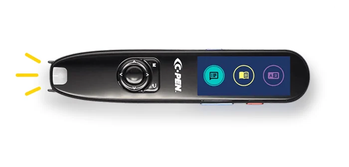
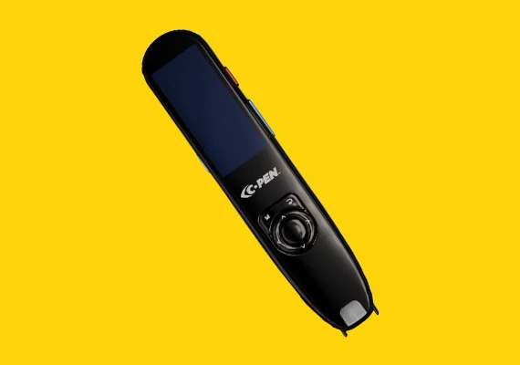
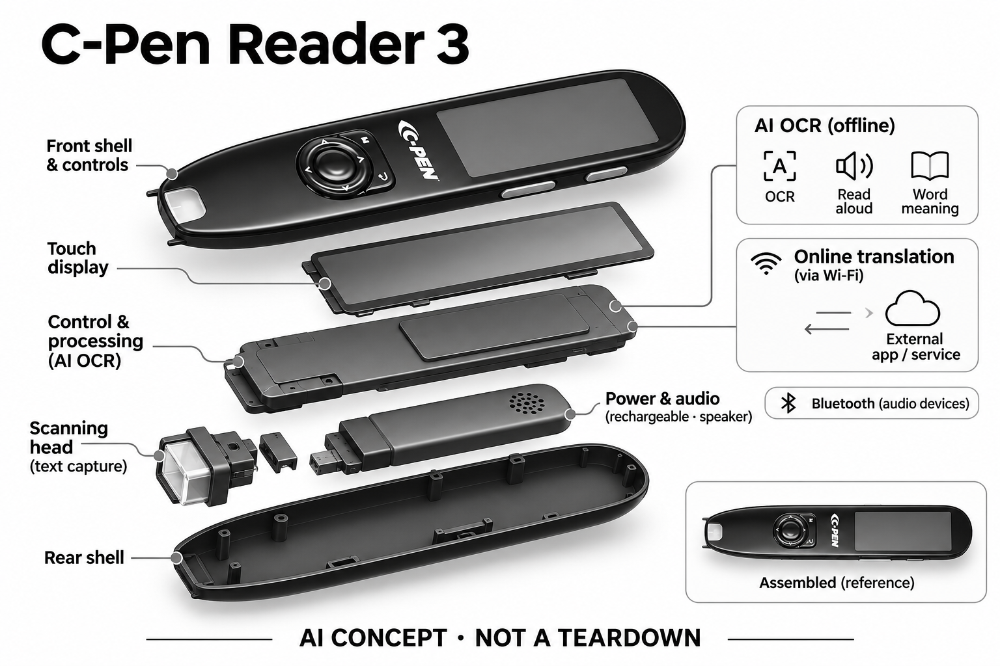

# C-Pen Reader 3

**C-Pen** · 无障碍与辅助沟通 · 核查 2026-11-04

逐行划扫纸面文字的触屏AI阅读笔

消费渠道：个人零售。

## 产品图片与结构参考

### 产品图

C-Pen Reader 3官方产品外形图 · 来源：[C-Pen · 官方产品图片](<https://cpen.com/products/c-pen-reader-3>) · [原始图片](<https://cpen.com/hs-fs/hubfs/Cpen/Reader%203.png?width=700&height=337&name=Reader%203.png>)

### 参考图

C-Pen Reader 3官方另一角度或使用场景参考 · 来源：[C-Pen · 官方产品图片](<https://cpen.com/products/c-pen-reader-3>) · [原始图片](<https://cpen.com/hs-fs/hubfs/Cpen/product%20page/What-is-Lingo-3.jpg?width=570&height=400&name=What-is-Lingo-3.jpg>)

### AI 生成爆炸示意

**AI 生成 · 非实物拆机。** 内部为概念推断，不能作为元件布局、BOM 或维修依据。[生成提示词](../../content/hardware/prompts/cpen-reader-3.txt)

> 外形依据核验参考图；内部位置、模块形状与装配关系仅作AI概念展示。

> 已逐张查看并核对型号。源图未改色/裁切；场景、界面、附件、优惠及效果文案仅为厂商示意，不作为本目录性能或现价依据。

> 分析为基于公开资料的案头研究与 AI 辅助判断，未经用户访谈、销量审计或实物拆机。需求、画像、竞争冷门度、审美及商业机会均为研究假设，不是投资结论。

## 销售与购买

- 状态：在售。已在浏览器打开Scanning Pens同集团官方销售页，单支型号显示明确价格、数量1及启用的Add to Basket；不是班级批量包或学校专用采购。

- 地区：所列官方区域或授权零售渠道；配送地址与服务支持需结算确认

- 价格：US$449，税前。核查日所见单机或基本配置价；币种、促销、税费、镜片、附件及服务依地区结算，不把颜色或套装重复计数。

- 中国大陆：本次未核实该具体型号在中国大陆的官方销售和完整服务支持；海外在售不等于国内可直接启用全部功能。

- [官方产品 / 商店](<https://cpen.com/products/c-pen-reader-3>)

## AI 的实际作用

官方销售FAQ明确OCR与AI识别配合，支持朗读、词义与联网翻译

服务与联网依赖：基础读取可独立离线使用；额外语言翻译需Wi-Fi，蓝牙用于兼容音频设备，不把联网服务描述为完全本机运行

## 是否冷门

细分专业（研究判断）：按任务与形态作案头分类，无访谈、销量或市场份额证据。

## 需求与市场

需求假设：希望把纸本中的难词或句子立即变成可听内容，又不在学习时频繁切换手机。价值应由实际使用频率、任务完成与操作负担验证，不能把AI功能存在或演示流畅当作需求已得到满足。

## 用户画像

画像推断：需要纸面阅读支持的家庭、学生与成人，能够沿文字稳定移动扫描端的人更匹配。个人的语言、操作习惯、环境和预算会改变适配结果，本次只有案头研究，没有用户访谈或长期使用观察。

## 竞争与替代

案头判断：与低价词典笔、手机OCR及阅读软件竞争；Reader 2与Reader 3有触屏和联网硬件差异，未以语言包或十支套装重复计数。这只是用途与替代品比较，不是市场份额或销量结论；专业细分和较少曝光也不代表没有成熟竞争者。

## 供应链

公开资料可核对笔端扫描窗、彩色触屏、物理导航键和扬声器，具体整机工厂、关键模块供应商与BOM本次未确认。制造重点可从形态推断，但不能把品牌所在地、外观相似或营销合作等同代工关系。

## 技术路径

官方销售FAQ明确OCR与AI识别配合，支持朗读、词义与联网翻译。这是厂商披露的功能机制；模型版本、准确率及内部结构未完整公开。架构只表示输入、处理和输出关系，不作为真实拆机或性能实测。

## 产品审美

图示观察：较长触屏便于查看与点选文字，仍保留实体导航键和可定位的扫描端。宣传图片只能帮助理解外观和摆放方式，不能证明每个人的舒适度、长时使用体验或实际材料触感。

## 关键风险

扫描角度、字体、对比度与版式影响识别；不能推断能读手写或所有电子屏，支持语言和考试规则也需单独确认。还需核对地区功能、软件更新与售后边界；本目录未进行实机、医学或可靠性测试，不把厂商演示当作结果保证。

## 机会与验证

市场差异主要在于逐行划扫纸面文字的触屏AI阅读笔。值得进一步验证的购买理由是它能否减少既有任务中的具体步骤，以及硬件、服务与维护的总成本是否符合个人使用频率。

## 功能分层示意

这是功能关系，不是实物拆机、真实空间结构或已核实 BOM。

1. **实体输入**：笔端扫描窗、彩色触屏、物理导航键和扬声器；仅功能层示意，非拆机。（官方披露）

2. **采集与控制**：设备把输入转为可处理的信息并接收用户操作；具体内部布局未知。（分析推断）

3. **AI功能**：官方销售FAQ明确OCR与AI识别配合，支持朗读、词义与联网翻译（官方披露）

4. **服务依赖**：基础读取可独立离线使用；额外语言翻译需Wi-Fi，蓝牙用于兼容音频设备，不把联网服务描述为完全本机运行（官方披露）

5. **用户反馈**：用户通过声音、屏幕或配套应用接收结果，并对重要信息复核。（分析推断）

## 来源

1. [C-Pen Reader 3官方产品页](<https://cpen.com/products/c-pen-reader-3>) — 已打开一手页面；产品能力为厂商披露，未进行实机或效果验证。

2. [Scanning Pens Reader 3官方销售页](<https://www.scanningpens.com/c-pen_reader_3>) — 网页抓取超时后通过实际浏览器打开，确认单支售价、数量及Add to Basket；Reader 3 FAQ明确OCR+AI。

3. [C-Pen官方Reader 3用户手册](<https://www.scanningpens.com.au/site/sca/PDFs/C_Pen_Reader_3_User_Guide.pdf>) — 已打开一手页面；产品能力为厂商披露，未进行实机或效果验证。

[返回目录](../hardware-market.md) · [网页分析](https://romanagent.github.io/Roman/#hardware/product/cpen-reader-3)
