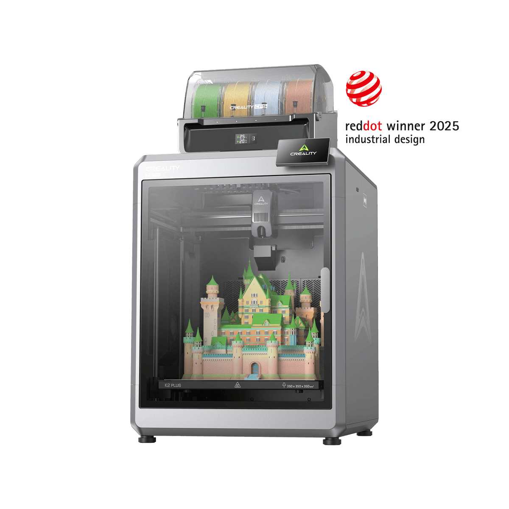
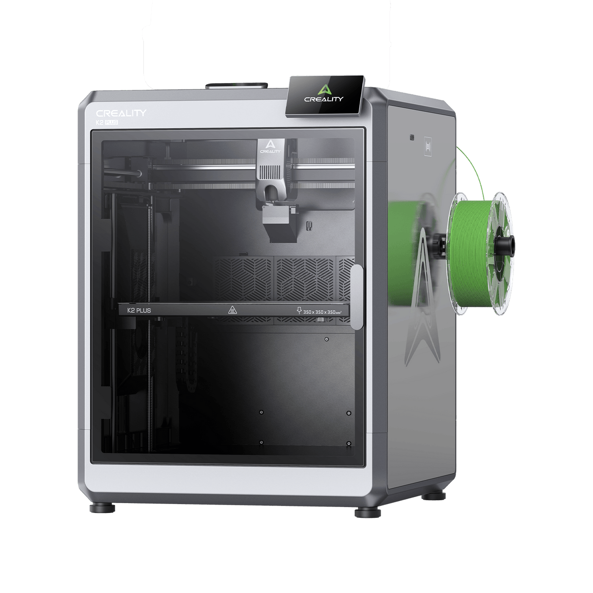
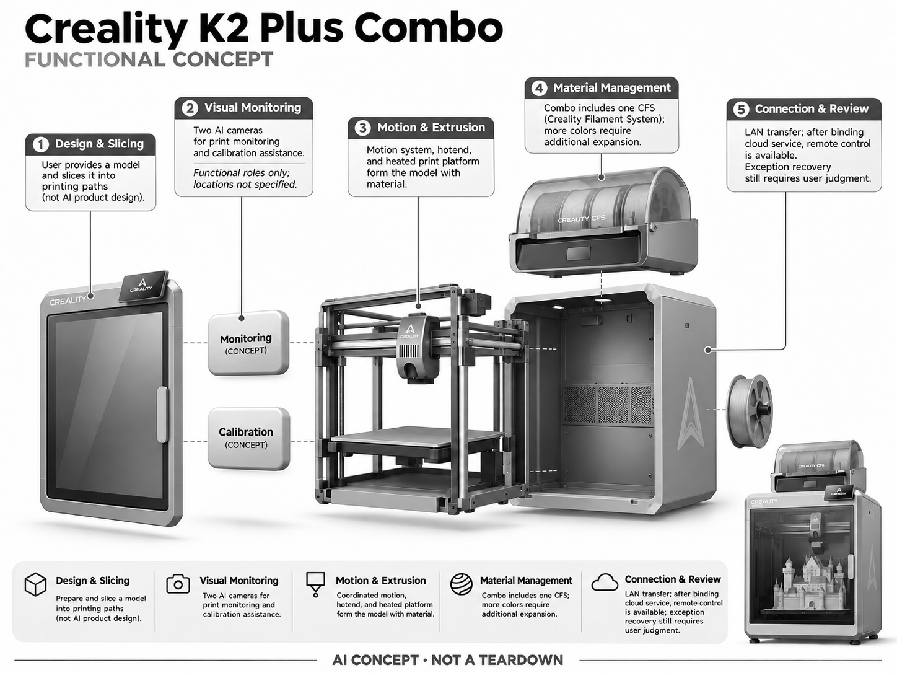

# Creality K2 Plus Combo

**Creality** · 创客与小型制造 · 核查 2026-11-04

用双 AI 相机辅助监控和校准的桌面多色 3D 打印平台

消费渠道：个人零售。

## 产品图片与结构参考

### 产品图

官方商品图：K2 Plus Combo 主机与顶部 CFS · 来源：[Creality · 官方图片](<https://store.creality.com/products/creality-k2-plus-combo-3d-printer>) · [原始图片](<https://cdn.shopify.com/s/files/1/0893/0603/8637/files/output.lin.png?v=1762200442&width=1200>)

### 参考图

官方参考图：K2 Plus 主机侧视（未安装顶部 CFS） · 来源：[Creality · 官方图片](<https://store.creality.com/products/creality-k2-plus-combo-3d-printer>) · [原始图片](<https://cdn.shopify.com/s/files/1/0893/0603/8637/files/K2_plus_45_cfs.png?v=1766129203&width=1200>)

### AI 生成爆炸示意

**AI 生成 · 非实物拆机。** 内部为概念推断，不能作为元件布局、BOM 或维修依据。[生成提示词](../../content/hardware/prompts/creality-k2-plus-combo.txt)

> 依据官方外观参考与公开功能生成；未披露的内部布局只作概念模块，不构成BOM或真实结构证据。

> 经过一次定向修订：将相机安装位置改为抽象概念块，修订提示见 content/hardware/prompts/creality-k2-plus-combo-revision.txt。

> 图片版权归原权利人；用于产品研究并保留出处。未改变图片色彩或内容。

> 主图展示Combo；参考图展示同款K2 Plus主机，未显示顶部CFS，不代表基础套餐缺少CFS。

> 分析为基于公开资料的案头研究与 AI 辅助判断，未经用户访谈、销量审计或实物拆机。需求、画像、竞争冷门度、审美及商业机会均为研究假设，不是投资结论。

## 销售与购买

- 状态：在售。Creality 美国官方商店显示 K2 Plus + CFS×1 套装 US$1,199、Add To Cart 与 Buy Now。页面预计发货日期仍显示过去时间，交付时间须在结账重新确认。

- 地区：美国

- 价格：US$1,199（K2 Plus + CFS×1）。美国官方套餐价格快照；单机、四套 CFS 和激光套装价格不同，勿把扩展宣传中的16色配置视为基础套餐全部包含。

- 中国大陆：本轮核实美国官方套餐，未核实中国大陆同套餐的官方现货、人民币报价和区域固件；品牌来自中国不等于该海外 SKU 可直接在国内购买。

- [官方产品 / 商店](<https://store.creality.com/products/creality-k2-plus-combo-3d-printer>)

## AI 的实际作用

官方列出用于监控及校准的两类 AI 相机；识别打印异常和辅助校准属于机器视觉，并非自动完成产品设计。

服务与联网依赖：可通过局域网传输与控制；绑定 Creality Cloud 后提供远程操作等服务。具体 AI 检测与切片、固件版本之间的兼容性需按当前手册确认。

## 是否冷门

竞争密集（研究判断）：桌面3D打印是成熟制造工具市场，AI监控增加可用性但并未消除强竞争；专业用途可进一步细分。

## 需求与市场

需求假设：长时间打印失败会浪费材料与机时，用户希望更早发现问题。应以同类模型的失败发现时延、误报和报废量验证 AI 价值，而不是把相机存在等同无人值守成功。

## 用户画像

画像假设：创客、小型设计工作室、模型制作人及学校实验室。高频使用者更关注维护、重复性和材料兼容；偶尔打印玩具的用户未必能消化大机身和多材料系统的复杂度。

## 竞争与替代

竞争判断：桌面 FDM 打印已有 Bambu Lab、Prusa 等生态与成熟设备，AI 监控是增强能力。新项目要同时面对机器精度、材料体系、切片软件和售后竞争，不能只围绕算法宣传。

## 供应链

供应链推断：运动框架、导轨、电机、挤出热端、加热平台、温度传感器与相机共同构成系统。具体供应商、代工安排与 BOM 未披露；重复精度、耗材通路、热稳定和维修件是重点。

## 技术路径

官方支持页明确列出监控及校准 AI 相机，并支持局域网控制。技术判断：视觉异常识别有材料颜色和光照边界，检测到问题后的停止与恢复更重要；不能把打印监控视为自动生成可制造设计。

## 产品审美

审美判断：封闭方箱与上置耗材模块更像工作设备，秩序感较强但体积显著。门体开启、换料路径、可见线缆和噪声影响工作台体验；工业设计应服务维修与清洁，不只遮住机械结构。

## 关键风险

风险判断：高温、活动机构和不同材料释放物需要按厂商要求通风与操作，AI 相机不是安全认证。误报停机会影响长时打印；云端模型文件与摄像画面也有保密需求。

## 机会与验证

可验证机会：为打印农场或学校开发透明的异常复核和维护记录，先验证能否节省人工巡检。若用户痛点在切片、材料或售后，不应仅因 AI 检测热度而另造整机。

## 功能分层示意

这是功能关系，不是实物拆机、真实空间结构或已核实 BOM。

1. **设计与切片**：用户提供模型，经切片生成打印路径；AI监控不等于模型设计。（分析推断）

2. **视觉监测**：官方列监控和校准AI相机。（官方披露）

3. **运动与挤出**：运动系统、热端及加热平台执行材料成型。（官方披露）

4. **材料管理**：基础Combo含一套CFS，更多色数需额外扩展。（官方披露）

5. **连接与复核**：局域网传输，绑定云服务后可远程操作；异常恢复仍需用户判断。（官方披露）

## 来源

1. [Creality K2 Plus Combo 美国官方商店](<https://store.creality.com/products/creality-k2-plus-combo-3d-printer>) — 已打开并核实套装、购物入口；旧产品URL跳转到此页，预计发货时间显示过期日期，需重查。

2. [Creality K2 Plus 官方支持及规格](<https://www.creality.com/uk/support/creality-k2-plus-cfs-combo>) — 已打开；明确AI监控/校准相机和LAN控制；云功能表述应按当前固件再核对。

[返回目录](../hardware-market.md) · [网页分析](https://romanagent.github.io/Roman/#hardware/product/creality-k2-plus-combo)
