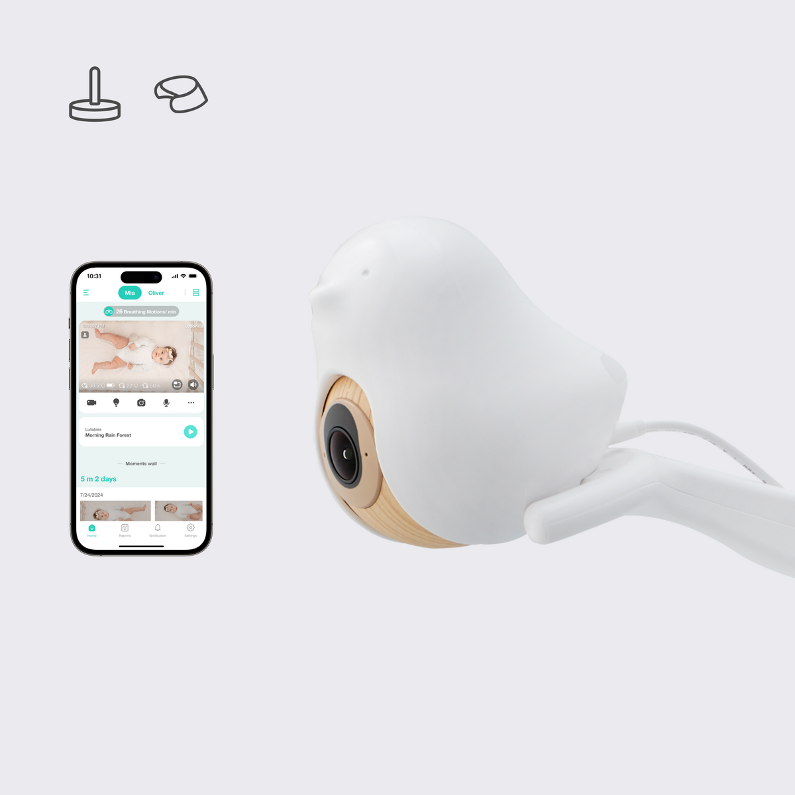
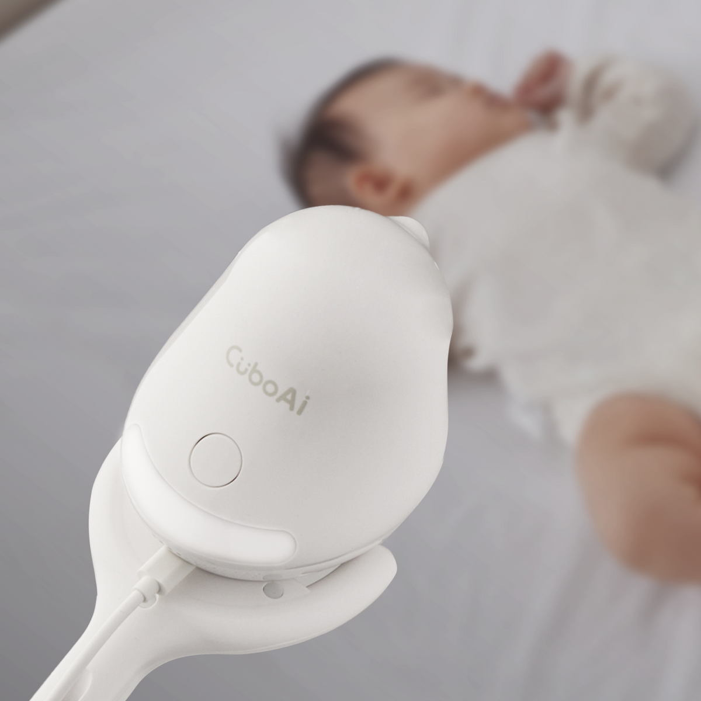
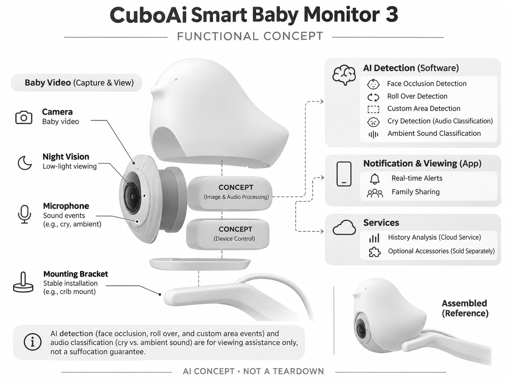

# CuboAi Smart Baby Monitor 3

**CuboAi** · 家庭安防 · 核查 2026-11-04

以视觉与声音提醒辅助家庭婴儿照护

消费渠道：个人零售。

## 产品图片与结构参考

### 产品图

CuboAi Smart Baby Monitor 3 官方产品图 · 来源：[CuboAi · 官方图片](<https://ca.getcubo.com/products/cuboai-smart-baby-monitor>) · [原始图片](<https://cdn.shopify.com/s/files/1/0248/7658/0949/files/EN_product_cam_3S_carousel-1_ab4ebd77-d68b-4b37-b9b0-5658c0c742c8.png?v=1764752074&width=1200>)

### 参考图

CuboAi Smart Baby Monitor 3 官方外观、结构或使用参考 · 来源：[CuboAi · 官方图片](<https://ca.getcubo.com/products/cuboai-smart-baby-monitor>) · [原始图片](<https://cdn.shopify.com/s/files/1/0248/7658/0949/files/product_cam_Gen3_carousel-2.png?v=1764752074&width=1200>)

### AI 生成爆炸示意

**AI 生成 · 非实物拆机。** 内部为概念推断，不能作为元件布局、BOM 或维修依据。[生成提示词](../../content/hardware/prompts/cuboai-monitor-3.txt)

> 保留官方图片原始内容和出处；画面宣传参数不是本轮独立实测。

> 分析为基于公开资料的案头研究与 AI 辅助判断，未经用户访谈、销量审计或实物拆机。需求、画像、竞争冷门度、审美及商业机会均为研究假设，不是投资结论。

## 销售与购买

- 状态：在售。加拿大官网第三代商品页显示Add to Cart与配送、保修说明，按摄像机主体计一款，壁挂及落地支架不分别收录。

- 地区：加拿大官方商店

- 价格：按加拿大官方支架配置结账。核查时官方地区参考价，保留原币种；订阅、税运、附件及优惠以结账为准，预订定金不等于整机价格。

- 中国大陆：本轮核实所列海外官方渠道；中国大陆同型号现货、保修及服务可用性未确认。进口前需核对供电、网络、配件和地区条款。

- [官方产品 / 商店](<https://ca.getcubo.com/products/cuboai-smart-baby-monitor>)

## AI 的实际作用

AI视觉检测脸部遮挡、翻身和设定区域事件，音频分类区分哭声与环境声；功能用于辅助查看，不是防窒息保证。

服务与联网依赖：需要手机App、网络和正确安装角度；高级历史与分析按CuboAi Care方案，呼吸传感垫是另售硬件，本条不将其算作相机内置功能。

## 是否冷门

细分专业（研究判断）：专用婴儿AI监视器是家庭照护细分，品牌竞争已存在，信任、误报与隐私门槛高。

## 需求与市场

需求假设：照护者希望离开房间时仍能及时查看婴儿状态，并少做无效的反复打开视频。应评估通知是否可行动、延迟和漏报，而不能用父母焦虑下降或安全保证替代实际使用研究。

### 产品任务与边界 · 研究判断

CuboAi Monitor 3 将婴儿房画面和声音转换为遮挡、翻身、哭声等提示，任务是帮助照护者决定何时查看。需求应围绕提示是否清楚和可行动分析，不能把父母希望安心直接换算为设备能够保证安全或减少健康风险。

依据：[CuboAi Smart Baby Monitor 3 官方购买页](<https://ca.getcubo.com/products/cuboai-smart-baby-monitor>) · [CuboAi 官方视觉与哭声识别](<https://ca.getcubo.com/pages/cuboai-feature-safety>)

### 需求判断 · 研究判断

通知可能减少反复打开视频，也可能因误报增加查看与焦虑。真正价值在于正确情境下提供有用线索，而不是告警越多越好；还需观察多人照护时是否有人负责确认，避免每个人都以为另一个人会处理。

依据：[CuboAi Smart Baby Monitor 3 官方购买页](<https://ca.getcubo.com/products/cuboai-smart-baby-monitor>) · [CuboAi 官方视觉与哭声识别](<https://ca.getcubo.com/pages/cuboai-feature-safety>)

### 需求验证 · 待验证

可让照护者记录收到提示后查看了什么、采取了什么行动，以及哪些提示被忽略。将这些记录与实际照护日志核对，评估延迟和漏掉的情境，但不把观察研究扩展为预防窒息或其他医疗效果的结论。

依据：[CuboAi Smart Baby Monitor 3 官方购买页](<https://ca.getcubo.com/products/cuboai-smart-baby-monitor>) · [CuboAi 官方视觉与哭声识别](<https://ca.getcubo.com/pages/cuboai-feature-safety>)

## 用户画像

画像推断：家有婴幼儿、多人轮流照护并接受手机查看的家庭；购买者可能是父母或赠礼者。网络条件、夜间作息及不同照护者的技术熟悉度会影响体验，不是所有家庭都需要云分析。

### 适用行为与条件 · 研究判断

较匹配有婴幼儿、愿意采用手机查看并能维护固定网络的家庭，多个照护者可能共享访问。购买者也可能是赠礼者，因此需要确认实际使用者能接受安装、权限和服务费用，不能仅凭婴儿房需求推定适合。

依据：[CuboAi Smart Baby Monitor 3 官方购买页](<https://ca.getcubo.com/products/cuboai-smart-baby-monitor>) · [CuboAi 官方视觉与哭声识别](<https://ca.getcubo.com/pages/cuboai-feature-safety>)

### 人群取舍 · 研究判断

夜间由一人照护和多人轮班的家庭，通知分工及历史查看需求不同；有些家庭只需实时画面，不需要云分析。画像应包含睡眠空间、安装条件和技术熟悉度，而不把所有新手父母都当作同样焦虑的用户。

依据：[CuboAi Smart Baby Monitor 3 官方购买页](<https://ca.getcubo.com/products/cuboai-smart-baby-monitor>) · [CuboAi 官方视觉与哭声识别](<https://ca.getcubo.com/pages/cuboai-feature-safety>)

### 画像验证 · 待验证

画像验证应观察不同照护者独立安装、接收提示和交接的过程，记录谁处理网络与权限。再询问哪些历史信息真正被使用，识别需要协作工具的人与只要简单监视器的人，避免把高级服务默认纳入所有家庭需求。

依据：[CuboAi Smart Baby Monitor 3 官方购买页](<https://ca.getcubo.com/products/cuboai-smart-baby-monitor>) · [CuboAi 官方视觉与哭声识别](<https://ca.getcubo.com/pages/cuboai-feature-safety>)

## 竞争与替代

竞争判断：与Nanit、普通无线婴儿监视器和家庭摄像头竞争。脸部遮挡和哭声分类提供功能差异，但专用支架、订阅与家庭隐私都是购买因素，不能把婴儿安全焦虑直接换算为市场规模。

### 比较对象与差异 · 研究判断

CuboAi 与 Nanit、普通婴儿监视器及家庭摄像头竞争，遮挡、翻身和哭声分类是具体差异。比较应包括安装、通知和家庭协作，而不是只看 AI 标签；专用支架和订阅也会改变完整拥有成本。

依据：[CuboAi Smart Baby Monitor 3 官方购买页](<https://ca.getcubo.com/products/cuboai-smart-baby-monitor>) · [CuboAi 官方视觉与哭声识别](<https://ca.getcubo.com/pages/cuboai-feature-safety>)

### 竞争判断 · 研究判断

婴儿相关提示容易产生强烈购买动机，但信任不能仅由可爱形象和安全措辞建立。竞争优势需要清楚说明检测边界及异常处理，若提醒大量增加无效查看，更多识别功能可能反而削弱用户对设备的信任。还应比较提示到达后是否容易回到对应实时画面。

依据：[CuboAi Smart Baby Monitor 3 官方购买页](<https://ca.getcubo.com/products/cuboai-smart-baby-monitor>) · [CuboAi 官方视觉与哭声识别](<https://ca.getcubo.com/pages/cuboai-feature-safety>)

### 竞争验证 · 待验证

可比较普通实时监视器与 AI 提示方案在照护日志、查看次数和响应分工上的差别。测试需保持真实安装条件，并让用户了解非医疗定位，避免用恐惧或厂商用户故事代替可观察的任务改善。

依据：[CuboAi Smart Baby Monitor 3 官方购买页](<https://ca.getcubo.com/products/cuboai-smart-baby-monitor>) · [CuboAi 官方视觉与哭声识别](<https://ca.getcubo.com/pages/cuboai-feature-safety>)

## 供应链

供应链分析：相机、夜视、麦克风、支架、电源和云端服务共同交付，实际代工和BOM未知。支架稳定、线缆远离婴儿可达区域、长期网络可靠性和售后替换比单个传感器参数更重要。

### 功能模块拆分 · 研究判断

功能层包括固定相机和夜视、麦克风、安装支架与供电、视觉及声音分类、应用通知和历史服务。呼吸传感垫是另售硬件，不能把附件信号写成相机本体直接测量，也没有公开资料支持完整代工或物料清单。

依据：[CuboAi Smart Baby Monitor 3 官方购买页](<https://ca.getcubo.com/products/cuboai-smart-baby-monitor>) · [CuboAi 官方视觉与哭声识别](<https://ca.getcubo.com/pages/cuboai-feature-safety>)

### 制造与供应约束 · 研究判断

制造约束包括支架稳定、镜头视角、电源线管理和长期运行，服务约束包括网络和家庭共享。照护场景要求安装说明与结构一起考虑，不能仅凭相机模组或夜视参数估计交付质量，售后替换流程也影响持续使用。

依据：[CuboAi Smart Baby Monitor 3 官方购买页](<https://ca.getcubo.com/products/cuboai-smart-baby-monitor>) · [CuboAi 官方视觉与哭声识别](<https://ca.getcubo.com/pages/cuboai-feature-safety>)

### 候选与证据缺口 · 研究判断

华勤可作为摄像联网终端工程候选，SGS 可作为材料、电气与结构相关测试候选。两者没有 CuboAi 点名合作证据，检测服务不证明 AI 准确性或医疗效果，实际候选评审需分别界定硬件可靠性和算法验证任务。

依据：[CuboAi Smart Baby Monitor 3 官方购买页](<https://ca.getcubo.com/products/cuboai-smart-baby-monitor>) · [CuboAi 官方视觉与哭声识别](<https://ca.getcubo.com/pages/cuboai-feature-safety>)

## 技术路径

官方说明视觉遮挡与翻身识别及AI哭声分类。技术判断：毯子、光照、体位和安装角度可能影响识别；额外睡眠垫的信号不能误写成摄像机直接测量，任何告警都需要照护者确认。

### 已披露技术边界 · 研究判断

官方说明视觉遮挡、翻身及区域识别，并以声音分类提供哭声提示。它们是辅助观察的感知结果，受安装和环境条件影响；相机与另售附件的测量路径必须分开，不得把识别结果等同对婴儿健康状态的确定判断。

依据：[CuboAi Smart Baby Monitor 3 官方购买页](<https://ca.getcubo.com/products/cuboai-smart-baby-monitor>) · [CuboAi 官方视觉与哭声识别](<https://ca.getcubo.com/pages/cuboai-feature-safety>)

### 系统难点判断 · 研究判断

技术难点是身体姿态、遮挡和光照变化会同时改变图像，而哭声也可能与其他声音混淆。系统需要清楚区分未观察到、无法判断和检测到事件，避免用户把没有提醒误解为已经确认一切正常。

依据：[CuboAi Smart Baby Monitor 3 官方购买页](<https://ca.getcubo.com/products/cuboai-smart-baby-monitor>) · [CuboAi 官方视觉与哭声识别](<https://ca.getcubo.com/pages/cuboai-feature-safety>)

### 技术验证 · 待验证

验证应记录不同安装角度、遮挡与声音环境下的提示，并以人工核对区分误报、漏报和延迟。应采用受控方式，不制造危险情境；测试结果只支持具体条件下的功能理解，不能转化为安全或医疗保证。

依据：[CuboAi Smart Baby Monitor 3 官方购买页](<https://ca.getcubo.com/products/cuboai-smart-baby-monitor>) · [CuboAi 官方视觉与哭声识别](<https://ca.getcubo.com/pages/cuboai-feature-safety>)

## 产品审美

审美判断：小鸟外形降低工具感，适合婴儿房，但外观亲和不应掩盖镜头和运行状态。落地杆、墙支架、夜灯与线缆的整体摆放需要稳定清晰，拆装清洁也应避免给照护者增加负担。

### 外观与交互语言 · 研究判断

小鸟外形使设备较容易融入婴儿房，减少传统监控器材感，但镜头及运行状态仍应明确。整体审美包括落地杆、墙支架、线材和夜间灯光，单独机身可爱并不能代表安装后方便或令人安心。

依据：[CuboAi Smart Baby Monitor 3 官方购买页](<https://ca.getcubo.com/products/cuboai-smart-baby-monitor>) · [CuboAi 官方视觉与哭声识别](<https://ca.getcubo.com/pages/cuboai-feature-safety>)

### 使用中审美判断 · 研究判断

照护者在疲惫时需要快速理解状态，设计不宜让过多动画或图表掩盖实时画面。外观亲和应与清晰安装、易擦拭和稳固结构配合，否则漂亮物件可能增加维护负担，反而影响长期使用意愿。夜间照护时单手操作的可达性也应单独观察。

依据：[CuboAi Smart Baby Monitor 3 官方购买页](<https://ca.getcubo.com/products/cuboai-smart-baby-monitor>) · [CuboAi 官方视觉与哭声识别](<https://ca.getcubo.com/pages/cuboai-feature-safety>)

### 设计验证 · 待验证

设计验证应让不同照护者按说明完成摆放和清洁，观察是否能辨认视野及工作状态。还需在夜间评估灯光和提示声对家庭的影响，避免只根据白天婴儿房场景照判断完整照护体验。

依据：[CuboAi Smart Baby Monitor 3 官方购买页](<https://ca.getcubo.com/products/cuboai-smart-baby-monitor>) · [CuboAi 官方视觉与哭声识别](<https://ca.getcubo.com/pages/cuboai-feature-safety>)

## 关键风险

风险判断：本品不能替代成人照护，也不保证预防窒息或婴儿猝死。误报可能增加焦虑，漏报则可能造成过度信赖；录影、家庭共享权限、服务中断和订阅变动需要保持明确边界。

### 主要失效与依赖 · 研究判断

主要风险是误报造成反复查看、漏报带来过度信赖，以及家庭影像和共享权限管理。设备不能替代成人照护或作为预防窒息的保证，订阅变化和网络故障也会影响可用功能，边界应与核心卖点同样清楚。

依据：[CuboAi Smart Baby Monitor 3 官方购买页](<https://ca.getcubo.com/products/cuboai-smart-baby-monitor>) · [CuboAi 官方视觉与哭声识别](<https://ca.getcubo.com/pages/cuboai-feature-safety>)

### 风险传播判断 · 研究判断

当家庭把告警当作可靠的照护替代，信息缺失可能被误读为正常状态。多人共享又可能导致响应责任不明，因此产品除了识别还需要明确离线、未确认和权限状态，避免把技术限制隐藏在温和的角色界面之后。

依据：[CuboAi Smart Baby Monitor 3 官方购买页](<https://ca.getcubo.com/products/cuboai-smart-baby-monitor>) · [CuboAi 官方视觉与哭声识别](<https://ca.getcubo.com/pages/cuboai-feature-safety>)

### 风险验证 · 待验证

风险验证应演练断网、应用通知关闭、权限变更和服务到期，检查照护者是否知道哪些功能失效。还需核对相机与附件的区别，记录错误提示后的恢复与人工确认路径，不把一次正常运行推断为持续安全保障。

依据：[CuboAi Smart Baby Monitor 3 官方购买页](<https://ca.getcubo.com/products/cuboai-smart-baby-monitor>) · [CuboAi 官方视觉与哭声识别](<https://ca.getcubo.com/pages/cuboai-feature-safety>)

## 机会与验证

机会假设：研究夜间提醒如何影响照护协作，重点看有用提醒比例和多人的响应分工。若提醒只增加查看次数，可优先改善状态解释与本地可用性，而非增加更多未经验证的健康结论。

### 可能的机会入口 · 研究判断

机会在于改善夜间提醒和多人照护协作，让用户少做无效查看且清楚知道谁已确认。新项目可优先提供可解释状态和可靠的记录交接，而不是加入更多未经验证的健康评分或放大父母对遗漏事件的担忧。

依据：[CuboAi Smart Baby Monitor 3 官方购买页](<https://ca.getcubo.com/products/cuboai-smart-baby-monitor>) · [CuboAi 官方视觉与哭声识别](<https://ca.getcubo.com/pages/cuboai-feature-safety>)

### 机会成立条件 · 研究判断

机会成立需要提示减少实际负担，而非仅增加信息量。如果照护者不断查看却没有更清楚的行动依据，算法分类数量没有形成价值；可纠错日志、明确离线提示和简单共享规则可能比更复杂的分析更值得投入。

依据：[CuboAi Smart Baby Monitor 3 官方购买页](<https://ca.getcubo.com/products/cuboai-smart-baby-monitor>) · [CuboAi 官方视觉与哭声识别](<https://ca.getcubo.com/pages/cuboai-feature-safety>)

### 下一步验证 · 待验证

下一步可用真实照护记录比较不同通知与交接设计，重点观察有用提醒比例、响应分工和维护时间。先证明辅助查看流程可理解，再扩展分析服务，并持续保持非医疗和人工确认边界，避免将使用满意度写成健康效果。

依据：[CuboAi Smart Baby Monitor 3 官方购买页](<https://ca.getcubo.com/products/cuboai-smart-baby-monitor>) · [CuboAi 官方视觉与哭声识别](<https://ca.getcubo.com/pages/cuboai-feature-safety>)

## 对应供应链公司

能力候选用于选型研究，不代表本产品实际采用；未公开的供货关系不作推断。

- [huaqin](../supply-chain/huaqin.md) — **能力候选 · 非已采用** / 固定婴儿房摄像终端工程：华勤的摄像、音频和联网终端工程范围可支持相机硬件导入，但婴儿事件算法、支架条件和家庭权限需独立定义；没有 CuboAi 型号合作披露，候选不代表实际制造或算法效果。

- [sgs](../supply-chain/sgs.md) — **能力候选 · 非已采用** / 相机电气、材料及安装结构验证：SGS 的电气、材料和机械测试服务可用于评估监视器与支架的相应要求，但需确认具体实验室和测试范围；没有 CuboAi 点名测试证据，且此类测试不能证明防窒息或 AI 告警准确性。

[浏览供应链目录](../supply-chain.md)

## 功能分层示意

这是功能关系，不是实物拆机、真实空间结构或已核实 BOM。

1. **婴儿影像**：相机、夜视与安装支架。（官方披露）

2. **声音采集**：麦克风获取声音事件。（官方披露）

3. **AI检测**：遮挡、翻身、哭声与区域识别。（官方披露）

4. **通知查看**：App实时提示和家庭共享。（官方披露）

5. **服务分层**：历史分析及另售附件边界。（官方披露）

## 来源

1. [CuboAi Smart Baby Monitor 3 官方购买页](<https://ca.getcubo.com/products/cuboai-smart-baby-monitor>) — 实际打开核查当前购买或预订入口，未实际下单；价格与交付按具体地区。

2. [CuboAi 官方视觉与哭声识别](<https://ca.getcubo.com/pages/cuboai-feature-safety>) — 实际打开的官方技术与使用资料，宣传效果并非本轮独立实测。

[返回目录](../hardware-market.md) · [网页分析](https://romanagent.github.io/Roman/#hardware/product/cuboai-monitor-3)
