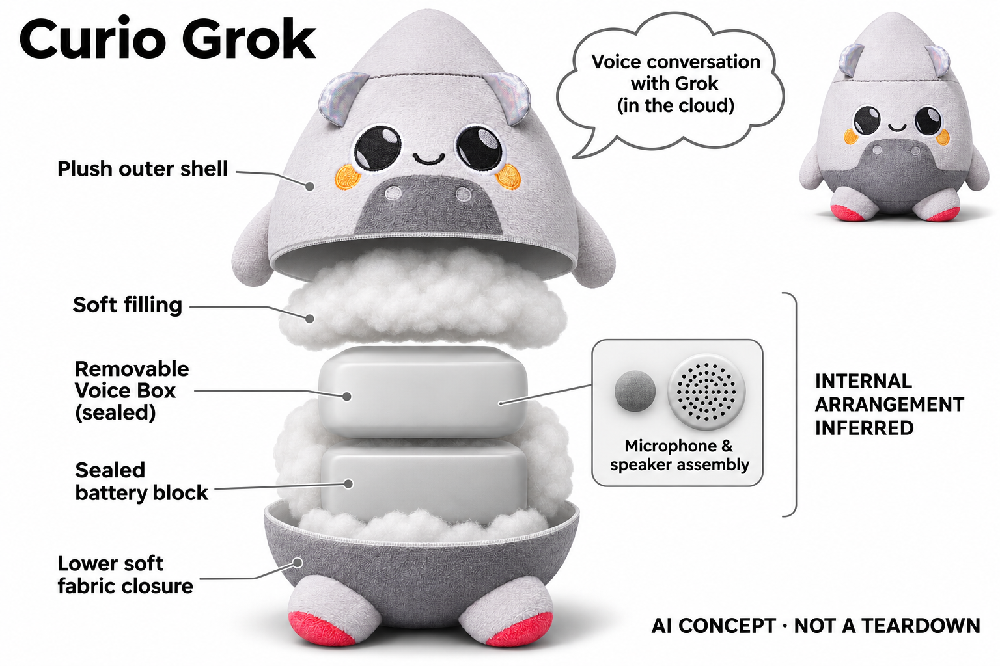

# Curio Grok

**Curio** · AI玩具 · 核查 2026-11-06

将生成式英语会话放入毛绒火箭

消费渠道：消费预订。

## 产品图片与结构参考

### 产品图

Curio Grok · 官方产品图 · 来源：[Curio · 官方图片](<https://heycurio.com/product/grok>) · [原始图片](<https://cdn.shopify.com/s/files/1/0836/7934/7004/files/ProfessionalStudioProductphotographyofasubtlePlushtoycopy-fotor-20231206193526.jpg?v=1702075754>)

### 参考图

Curio Grok · 官方参考图 · 来源：[Curio · 官方图片](<https://heycurio.com/product/grok>) · [原始图片](<https://cdn.shopify.com/s/files/1/0836/7934/7004/files/Grok-Side.jpg?v=1702075754>)

### AI 生成爆炸示意

**AI 生成 · 非实物拆机。** 内部为概念推断，不能作为元件布局、BOM 或维修依据。[生成提示词](../../content/hardware/prompts/curio-grok-repair.txt)

> 已目视核对外形、标签与非拆机声明；不代表内部结构经实测验证。

> 分析为基于公开资料的案头研究与 AI 辅助判断，未经用户访谈、销量审计或实物拆机。需求、画像、竞争冷门度、审美及商业机会均为研究假设，不是投资结论。

## 销售与购买

- 状态：预售 / 接受延期订单。2026-11-06官方Grok商品页明确Pre-Order与约30日内发货，为正式预售 / 延期订单，不当作现货。Grok与Gen2新Voice Box系列保留版本差异，不按颜色或人物皮肤重复计数。

- 地区：美国

- 价格：官网单只促销 US$99。核查日页面划线US$119，单只现价US$99；运税与地区以结算为准，Plus订阅另行核对。

- 中国大陆：本轮官方FAQ仍说明只向美国配送且使用英语与Wi-Fi；未核实中国大陆官方销售及服务，不把跨境转运视为官方可用。

- [官方产品 / 商店](<https://heycurio.com/product/grok>)

## AI 的实际作用

毛绒火箭内的联网Voice Box进行语音识别和生成式角色会话；这里的Grok是Curio玩具角色，不是将xAI应用本身列作硬件。

服务与联网依赖：需要Curio账户、应用和Wi-Fi；FAQ当前主要支持英语。基础聊天与Plus无限会话权益不同，长期权益按当期条款。

## 是否冷门

新兴竞争（研究判断）：亲子共同使用的无屏角色玩具形成具体使用场景；本轮没有销量与市场份额证据。

## 需求与市场

需求假设：家庭可能希望用可以抱起的角色发起英语故事和问答，减少儿童为了聊天而拿起屏幕。应观察共同玩耍的质量和话题变化，不能用无屏外观直接推定学习效果或使用更健康。

### 产品任务与边界 · 研究判断

Curio Grok把联网Voice Box放进毛绒火箭，让儿童可以抱着角色进行英语故事和问答。需求判断应关注家庭是否希望增加这种角色互动，而不是把无屏本身当成教育价值；声音交流仍可能占用大量注意力和家长管理时间。

依据：[Curio Grok官方预订页](<https://heycurio.com/product/grok>) · [Curio官方FAQ](<https://heycurio.com/faq>)

### 需求判断 · 研究判断

它可能在故事延展、角色扮演和好奇提问时提供变化，但固定故事机也能满足部分需求。生成式回应增加的价值必须大于等待、理解错误和家长介入的负担，否则可抱的外壳只是另一种进入云聊天服务的方式。

依据：[Curio Grok官方预订页](<https://heycurio.com/product/grok>) · [Curio官方FAQ](<https://heycurio.com/faq>)

### 需求验证 · 待验证

可让亲子家庭在已有故事活动中试用Grok，记录儿童主动开启的话题、会话中断与家长接管原因，并与固定故事音箱比较。研究应观察共同玩耍质量和后续再次使用，不以问答次数或单次流畅演示证明学习效果。

依据：[Curio Grok官方预订页](<https://heycurio.com/product/grok>) · [Curio官方FAQ](<https://heycurio.com/faq>)

## 用户画像

画像推断：能理解英语、愿意陪同设置并关注会话内容的亲子家庭较匹配。儿童对角色声音和火箭形象的喜好可能不同，购买前应测试真实语速、轮流对话和理解失败时的反应。

### 适用行为与条件 · 研究判断

目前较匹配的是能理解英语、家长愿意配置账号与Wi-Fi，并会关注会话内容的家庭。实际使用条件还包括儿童发音、耐心和对火箭角色的兴趣；不宜把它笼统定位为所有儿童都适合的玩具或语言学习工具。

依据：[Curio Grok官方预订页](<https://heycurio.com/product/grok>) · [Curio官方FAQ](<https://heycurio.com/faq>)

### 人群取舍 · 研究判断

赠礼者可能被造型吸引，家长却要处理联网、订阅和记录管理，儿童则只在意角色是否听懂自己。三方的目标不同会影响留存，画像分析应区分购买决策者、管理员和主要对话者，避免把一次购买等同稳定使用需求。

依据：[Curio Grok官方预订页](<https://heycurio.com/product/grok>) · [Curio官方FAQ](<https://heycurio.com/faq>)

### 画像验证 · 待验证

画像验证可让家长独立完成设置，再观察儿童在无提示条件下发起和结束会话。需要记录英语理解失败、误唤醒和无法联网时的反应，尤其检查家庭是否愿意继续管理设备，而不是只询问孩子喜不喜欢火箭外形。

依据：[Curio Grok官方预订页](<https://heycurio.com/product/grok>) · [Curio官方FAQ](<https://heycurio.com/faq>)

## 竞争与替代

竞争判断：故事音箱、录音毛绒和手机语音角色都能满足部分场景，生成回复带来变化也带来不确定性。品牌角色与内容管理可能比模型标签更影响信任，不能只凭合作人物热度判断需求。

### 比较对象与差异 · 研究判断

可比较对象包括故事音箱、带录音功能的毛绒和手机语音角色，三者分别在内容可控、触感和对话灵活性上形成替代。Grok的产品差异是角色化云端会话与可拆电子盒组合，不应把名称与xAI服务混淆或把应用本身算作硬件。

依据：[Curio Grok官方预订页](<https://heycurio.com/product/grok>) · [Curio官方FAQ](<https://heycurio.com/faq>)

### 竞争判断 · 研究判断

其潜在竞争力在角色声音、内容边界和家长信任，而不是模型名称本身。可拆Voice Box还可能延长软体载体使用寿命，但也会增加换绑、兼容和维护的问题；若这些过程复杂，简单故事机的确定性可能更受家长欢迎。

依据：[Curio Grok官方预订页](<https://heycurio.com/product/grok>) · [Curio官方FAQ](<https://heycurio.com/faq>)

### 竞争验证 · 待验证

竞争验证应将相同故事请求交给Grok与固定内容设备，比较儿童能否继续游戏、家长何时需要纠正和哪些回答被重复使用。还应分别测试只有毛绒造型和实际语音服务的吸引力，避免把合作人物热度当作可持续需求证据。

依据：[Curio Grok官方预订页](<https://heycurio.com/product/grok>) · [Curio官方FAQ](<https://heycurio.com/faq>)

## 供应链

供应链推断：毛绒外壳与可拆电子盒需协调触感、清洁、充电及音频通透性。官方未披露完整代工厂和物料清单；电子盒代次、换绑账户和持续服务支持是拥有体验的重要组成。

### 功能模块拆分 · 研究判断

功能上可分为毛绒火箭、可拆Voice Box、麦克风、扬声器、状态反馈、供电与云端会话服务。现有资料不公开完整代工厂和BOM，因此软体与电子盒的拆分只能作为设计理解，不能据此编造盒内芯片、电池容量或制造成本。

依据：[Curio Grok官方预订页](<https://heycurio.com/product/grok>) · [Curio官方FAQ](<https://heycurio.com/faq>)

### 制造与供应约束 · 研究判断

供应约束包括毛绒清洁与电子安全、声音透过面料的表现，以及盒体取出后能否容易重新安装。云端会话、账号与设备身份又是另一条交付链，硬件供应稳定并不代表订阅和内容服务能在所有家庭所在地区持续可用。

依据：[Curio Grok官方预订页](<https://heycurio.com/product/grok>) · [Curio官方FAQ](<https://heycurio.com/faq>)

### 候选与证据缺口 · 研究判断

歌尔可讨论音频和电子盒整合，华勤的语音终端能力可用于比较Voice Box的系统工程；它们都不是已披露供应商。毛绒安全、可拆结构与儿童语音内容需要另外验证，不能把普通智能音箱平台直接当作已经适合儿童的方案。

依据：[Curio Grok官方预订页](<https://heycurio.com/product/grok>) · [Curio官方FAQ](<https://heycurio.com/faq>)

## 技术路径

官方说明联网处理器、麦克风和角色会话，并公开语音转写及记录处理方式。技术判断应测试儿童发音、打断和故事连续性，不能把持续回复误解为事实正确或具备人类理解能力。

### 已披露技术边界 · 研究判断

原资料说明设备通过Wi-Fi和账户服务进行语音识别与生成式角色会话，FAQ主要支持英语，基础与Plus权益存在差别。公开资料还涉及转写和记录处理；这些信息支持联网会话定位，不支持完全离线或任意语言通用的结论。

依据：[Curio Grok官方预订页](<https://heycurio.com/product/grok>) · [Curio官方FAQ](<https://heycurio.com/faq>)

### 系统难点判断 · 研究判断

技术难点在儿童发音、插话、话题跳转和故事连续性，而不只是是否能输出一句自然语言。角色需要在理解不清时保持可理解的反馈，并避免把模型编造内容包装成确定知识；声学输入与内容策略必须一起考虑。

依据：[Curio Grok官方预订页](<https://heycurio.com/product/grok>) · [Curio官方FAQ](<https://heycurio.com/faq>)

### 技术验证 · 待验证

可准备不同音量、语速和口音的儿童式短句，在安静与家庭背景声下检查转写和回应，再测试打断与恢复话题。记录需区分听错、理解错和事实错误，不用总体聊天成功率掩盖对儿童尤其重要的失败类型。

依据：[Curio Grok官方预订页](<https://heycurio.com/product/grok>) · [Curio官方FAQ](<https://heycurio.com/faq>)

## 产品审美

审美判断：圆润火箭毛绒及角色声音把电子盒隐藏在可拥抱的玩具中，适合以故事建立辨识度。面料清洁、盒体硬点和充电操作可能破坏整体体验，需让实际使用者触摸与操作。

### 外观与交互语言 · 研究判断

火箭毛绒把电子盒隐藏在可抱的角色里，外观和声音共同塑造人格。它与屏幕脸机器人不同，用户无法依赖表情画面判断状态，因此灯光、声音和拿起时的触感必须提供足够明确又不打断故事的反馈。

依据：[Curio Grok官方预订页](<https://heycurio.com/product/grok>) · [Curio官方FAQ](<https://heycurio.com/faq>)

### 使用中审美判断 · 研究判断

盒体硬点、发声位置和充电操作可能破坏柔软玩具的一体感；清洁后装回的位置变化也可能改变声音效果。审美评价应覆盖真实抱持、移动和家庭摆放，不只是桌面产品照里火箭轮廓是否鲜明。

依据：[Curio Grok官方预订页](<https://heycurio.com/product/grok>) · [Curio官方FAQ](<https://heycurio.com/faq>)

### 设计验证 · 待验证

可让家庭在实际游戏中操作电子盒取出、充电和重新安装，并观察儿童如何理解灯光与等待状态。还应让使用者比较不同抱持姿态下的声音清晰度和舒适感，验证隐藏硬件是否真的降低存在感而不是造成操作困惑。

依据：[Curio Grok官方预订页](<https://heycurio.com/product/grok>) · [Curio官方FAQ](<https://heycurio.com/faq>)

## 关键风险

风险判断：儿童话语会经过云端转写，家长应了解记录保留与删除功能。官网预售和发货文案不一致，交付时间需按订单核对；生成内容不能替代成人监督，也不保证教育或情绪效果。

### 主要失效与依赖 · 研究判断

主要风险来自儿童话语的云端处理、记录管理与生成内容不可完全预测，同时存在预售与交付文案不一致的问题。购买时应按具体订单确认交付，而产品研究不能把无屏外壳解释成无需成人监督或天然更安全。

依据：[Curio Grok官方预订页](<https://heycurio.com/product/grok>) · [Curio官方FAQ](<https://heycurio.com/faq>)

### 风险传播判断 · 研究判断

当孩子把角色当作可靠知识来源，模型错误可能被记住；当家长过度依赖设备陪伴，又可能减少必要的共同活动。订阅权益或网络变化会让同一件毛绒的可用能力突然改变，这种服务依赖需要成为拥有体验的一部分。

依据：[Curio Grok官方预订页](<https://heycurio.com/product/grok>) · [Curio官方FAQ](<https://heycurio.com/faq>)

### 风险验证 · 待验证

风险验证应包含家长能否找到并理解记录保留、删除及权限选项，以及儿童面对拒答、错误回应和断网时的行为。需要用明确案例检查产品说明能否纠正过高期待，不应只测试正常聊天并把异常场景留给家庭自行发现。

依据：[Curio Grok官方预订页](<https://heycurio.com/product/grok>) · [Curio官方FAQ](<https://heycurio.com/faq>)

## 机会与验证

市场观察：可执行验证是连续记录角色被主动拿起的次数、家长介入原因和不恰当回答处理。将火箭外形吸引力、语言能力和服务稳定性分别观察，避免用一次流畅演示推断长期陪伴。

### 可能的机会入口 · 研究判断

较具体的机会是把角色故事做成家长与儿童共同延展的活动，让生成内容围绕家庭可理解的边界展开。若只是把通用聊天装入毛绒，外观差异可能很快被复制；稳定角色和清晰管理体验更可能形成持续价值。

依据：[Curio Grok官方预订页](<https://heycurio.com/product/grok>) · [Curio官方FAQ](<https://heycurio.com/faq>)

### 机会成立条件 · 研究判断

机会成立需要儿童愿意反复发起互动、家长愿意持续管理，并且内容服务成本不会让硬件拥有体验变得不可预测。可拆电子盒只有在换绑、升级和清洁足够简单时才构成优势，不能仅因结构可拆就推定生命周期更长。

依据：[Curio Grok官方预订页](<https://heycurio.com/product/grok>) · [Curio官方FAQ](<https://heycurio.com/faq>)

### 下一步验证 · 待验证

下一步可围绕少数英语故事和角色游戏做连续试用，记录家庭真正保留下来的玩法以及停止使用原因。若主要价值来自固定内容而非开放问答，应优先优化可控故事流程，再决定是否增加更广泛生成能力。

依据：[Curio Grok官方预订页](<https://heycurio.com/product/grok>) · [Curio官方FAQ](<https://heycurio.com/faq>)

## 对应供应链公司

能力候选用于选型研究，不代表本产品实际采用；未公开的供货关系不作推断。

- [goertek](../supply-chain/goertek.md) — **能力候选 · 非已采用** / 毛绒载体内Voice Box的音频系统：歌尔公开覆盖AI音箱声学、电子和结构整合，可以作为Curio可拆Voice Box的拾音与发声能力候选。毛绒面料会改变声路，儿童发音和可拆安全并非普通音箱经验自动覆盖；没有资料点名它为Curio供货。

- [huaqin](../supply-chain/huaqin.md) — **能力候选 · 非已采用** / 联网语音盒的系统开发与制造：华勤官网明确智能音箱从概念到研发制造的范围，适合讨论Voice Box的无线、电子和语音接口工程。其公开能力不等于儿童玩具认证或Curio内容服务，更不证明实际合作；必须核实低数量定制和软体载体的集成条件。

[浏览供应链目录](../supply-chain.md)

## 功能分层示意

这是功能关系，不是实物拆机、真实空间结构或已核实 BOM。

1. **软体载体**：毛绒火箭包裹可拆Voice Box。（官方披露）

2. **语音入口**：麦克风与主动启用的会话模式。（官方披露）

3. **云端角色**：联网处理语言并生成角色回应。（官方披露）

4. **声音输出**：扬声器及状态灯反馈。（官方披露）

## 来源

1. [Curio Grok官方预订页](<https://heycurio.com/product/grok>) — 已实际打开官方页面；功能说明不等于独立性能测量。

2. [Curio官方FAQ](<https://heycurio.com/faq>) — 已实际打开官方页面；功能说明不等于独立性能测量。

[返回目录](../hardware-market.md) · [网页分析](https://romanagent.github.io/Roman/#hardware/product/curio-grok)
