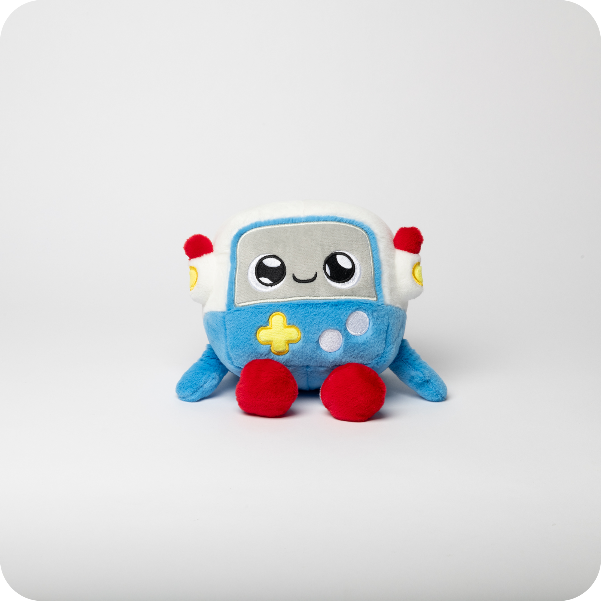
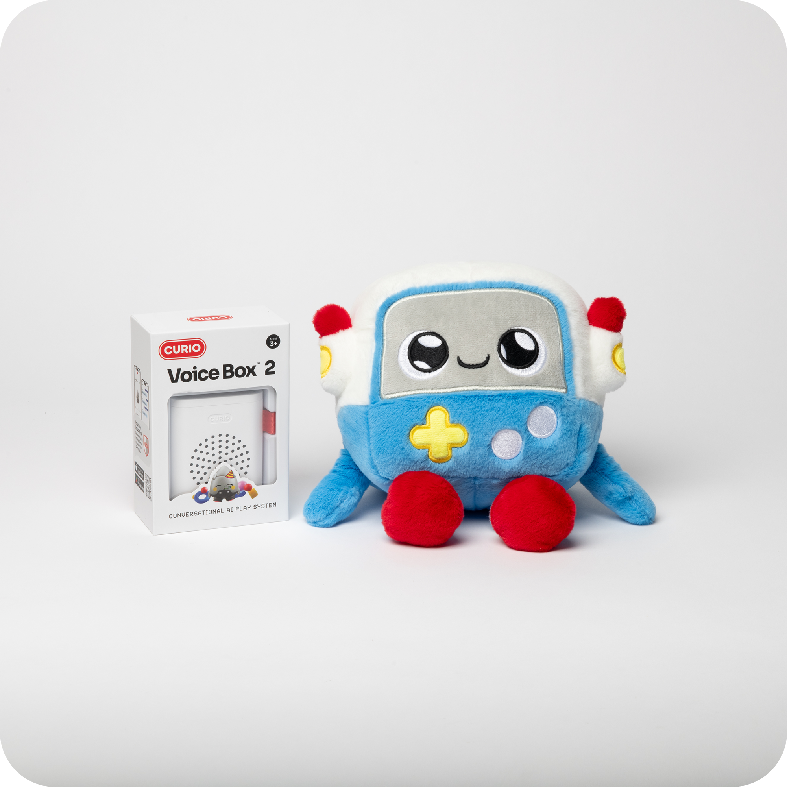
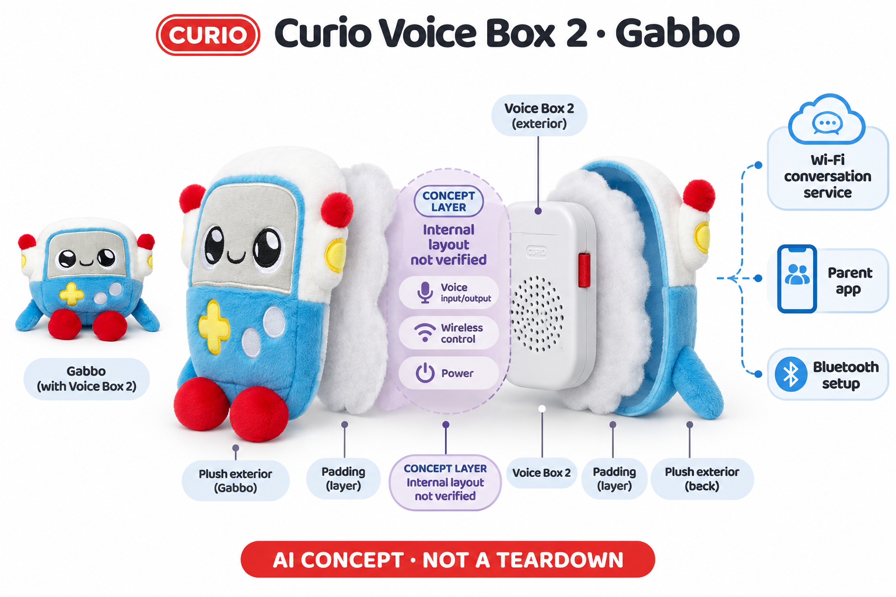

# Curio Voice Box 2 系列（Gabbo 代表）

**Curio** · AI玩具 · 核查 2026-11-06

第二代可分离语音盒与多个角色毛绒共用一套对话平台

消费渠道：个人零售。

## 产品图片与结构参考

### 产品图

官方Gabbo第二代系列代表外观 · 来源：[产品品牌官网](<https://heycurio.com/products/v2/gabbo-gen-2>) · [原始图片](<https://cdn.shopify.com/s/files/1/0836/7934/7004/files/Conroy-Curio11-17-25-30.png?v=1763533003>)

### 参考图

官方Gabbo与Voice Box 2包装参考 · 来源：[产品品牌官网](<https://heycurio.com/products/v2/gabbo-gen-2>) · [原始图片](<https://cdn.shopify.com/s/files/1/0836/7934/7004/files/Conroy-Curio11-17-25-311.png?v=1763533003>)

### AI 生成爆炸示意

**AI 生成 · 非实物拆机。** 内部为概念推断，不能作为元件布局、BOM 或维修依据。[生成提示词](../../content/hardware/prompts/curio-voicebox-2.txt)

> 内置ImageGen按本产品官方参考独立生成；未知内部为概念层，不是BOM或维修依据。

> 图片保留官方原貌；效果、安全与性能宣传不代表本目录独立验证。

> 分析为基于公开资料的案头研究与 AI 辅助判断，未经用户访谈、销量审计或实物拆机。需求、画像、竞争冷门度、审美及商业机会均为研究假设，不是投资结论。

## 销售与购买

- 状态：在售。2026-11-06浏览器在Gabbo第二代页观察到单只US$119及可用Add to cart/Shop Now，明确盒内Voice Box 2。商品页写within30days，FAQ写7天，故只确认接受购买，不承诺即时库存或统一交期。

- 地区：美国

- 价格：US$119（Gabbo单只当前促销）。划线150美元与双角色包不同；基础聊天与可选Curio Plus权益分开，当前统一Plus价格未核实，不能把无限时长默认算入硬件价。

- 中国大陆：当前官方FAQ明确只配送美国，主要支持英语；未核实大陆正式销售、应用和网络条件，转运不代表官方本地渠道。

- [官方产品 / 商店](<https://heycurio.com/products/v2/gabbo-gen-2>)

## AI 的实际作用

语音经云服务转写并形成角色化对话、故事和游戏，多个角色搭配同类Voice Box 2；不同外形和声音不代表各自拥有独立模型，具体当前模型供应与版本未披露。

服务与联网依赖：需家长App、账号和Wi-Fi，Bluetooth用于配对。基础与Plus时长权益不同；文字记录官方称保留90天、原始语音处理后删除，不可描述为全部离线或从不存记录。

## 是否冷门

新兴竞争（研究判断）：角色设计与可分离语音模块构成实现差异，但同系列角色共享儿童对话需求；不按角色数推算独立场景、销量或市场份额。

## 需求与市场

孩子可能因机器人、外星人或其他角色而愿意提问，但最终价值仍取决于对话是否能延续自己的故事。多角色给家庭更多偏好选择，不必然意味着更多独立需求；如果只是换壳和声音，市场比较应将这种创意吸引与核心服务质量分开观察。

### 事实｜同一代语音盒承载多种角色 · 官方资料

当前Gabbo和Grem商品都列Voice Box 2、毛绒及USB-C线，并链接多个其他角色。它们以角色化问答、故事和游戏提供共同玩法，不能把每种外观当成独立AI机制；本条用Gabbo代表第二代系列，保留与旧Grok第一代盒的区别，而不重复计算颜色和组合包。

依据：[Gabbo第二代官方商品](<https://heycurio.com/products/v2/gabbo-gen-2>) · [Grem第二代官方商品](<https://heycurio.com/products/v2/grem-2>)

### 判断｜角色选择可能帮助家庭进入共玩 · 研究判断

孩子可能因机器人、外星人或其他角色而愿意提问，但最终价值仍取决于对话是否能延续自己的故事。多角色给家庭更多偏好选择，不必然意味着更多独立需求；如果只是换壳和声音，市场比较应将这种创意吸引与核心服务质量分开观察。

依据：[Gabbo第二代官方商品](<https://heycurio.com/products/v2/gabbo-gen-2>) · [Grem第二代官方商品](<https://heycurio.com/products/v2/grem-2>)

### 验证｜看角色偏好是否转成持续玩法 · 待验证

后续可记录孩子最初为什么选角色，以及几周后仍主动进行哪些游戏和故事，再观察家长需要多少帮助。不能用购买多个角色或一次兴奋反应证明成长效果；本目录没有家庭访谈、实际订单或销量数据，对需求和长期价值仅提出可验证假设。

依据：[Gabbo第二代官方商品](<https://heycurio.com/products/v2/gabbo-gen-2>) · [Curio当前FAQ](<https://heycurio.com/faq>)

## 用户画像

孩子看到的是角色，成人处理的是网络、绑定和资料控制，二者承担不同工作。多玩具家庭尤其要注意每个角色对应哪个账号和个人信息，礼物或二手转让也会产生额外步骤；用户画像应包括愿意维护服务的成人，而非只看是否有喜欢毛绒的儿童。

### 事实｜年龄和角色定位不是完全相同 · 官方资料

FAQ将主要系列面向三至十二岁，同时提醒部分角色针对更大儿童或青少年，因此不能用系列年龄覆盖所有角色。家长需管理应用和账号，儿童则直接与毛绒交流；目录不把App Store的软件年龄分级当作整套实体玩具的安全年龄认证。

依据：[Curio当前FAQ](<https://heycurio.com/faq>)

### 判断｜购买者还需管理账号与共用关系 · 研究判断

孩子看到的是角色，成人处理的是网络、绑定和资料控制，二者承担不同工作。多玩具家庭尤其要注意每个角色对应哪个账号和个人信息，礼物或二手转让也会产生额外步骤；用户画像应包括愿意维护服务的成人，而非只看是否有喜欢毛绒的儿童。

依据：[Curio当前FAQ](<https://heycurio.com/faq>) · [Curio官方开发者App Store记录](<https://apps.apple.com/us/app/curio-interactive-toys/id6463757554>)

### 验证｜让实际管理者完成配对和换绑 · 待验证

可以测试初次设置、换Wi-Fi和更换家长手机时是否容易理解，核对旧账号移除后新用户能否正常绑定。测试采用虚构档案和公开话题，不依赖儿童私密经历；本研究没有激活设备或创建账号，不能把官方教程存在当成真实操作没有困难。

依据：[Curio当前FAQ](<https://heycurio.com/faq>)

## 竞争与替代

可分离的声音模块可能让毛绒载体与电子维护分开，也可能增加装回方向、绑定和兼容问题。与一体式聊天毛绒及固定故事机比较时，应该观察这些流程是否更方便，而非只把模块化视为优点；不同角色的声学和使用姿势也可能影响体验。

### 事实｜第二代与一代有明确硬件识别 · 官方资料

FAQ将黑色第一代和白色第二代语音盒分开，第二代用一组电量灯表示状态，开发者更新记录也明确支持二代。目录因此可以建立代次比较，但不会把一代售价、续航或配件直接搬到二代；同一代内角色则合并研究，避免用换壳扩大产品数量。

依据：[Curio当前FAQ](<https://heycurio.com/faq>) · [Curio官方开发者App Store记录](<https://apps.apple.com/us/app/curio-interactive-toys/id6463757554>)

### 判断｜模块与内容组合形成不同竞争点 · 研究判断

可分离的声音模块可能让毛绒载体与电子维护分开，也可能增加装回方向、绑定和兼容问题。与一体式聊天毛绒及固定故事机比较时，应该观察这些流程是否更方便，而非只把模块化视为优点；不同角色的声学和使用姿势也可能影响体验。

依据：[Gabbo第二代官方商品](<https://heycurio.com/products/v2/gabbo-gen-2>) · [Grem第二代官方商品](<https://heycurio.com/products/v2/grem-2>)

### 验证｜比较完整服务而非只比促销价 · 待验证

同样时段的使用应同时核对基础聊天、Plus时长、账号管理和可能的配件支出。商品页与FAQ交期有差异，需要以具体订单确认，而不是选择较短数字；本目录没有真实账单或退货数据，不能从低价或角色数量推算市场份额和经营能力。

依据：[Gabbo第二代官方商品](<https://heycurio.com/products/v2/gabbo-gen-2>) · [Curio当前FAQ](<https://heycurio.com/faq>)

## 供应链

同一盒放入不同角色后，填充厚度、声孔方向和孩子抱持姿势可能改变采音与出声。供应设计应在每个实际载体中验证，而不是只测裸盒；模块越通用，越需要清楚装配和维护说明，否则角色选择可能引入不易发现的体验差异。

### 事实｜第二代盒外观已见而内部未知 · 官方资料

官方照片和包装展示白色Voice Box 2及外部扬声器开孔，FAQ说明按键与电量灯等状态。主控、无线器件、电池料号和制造工厂没有完整公开；品牌称自行开发软硬件不等于公开了全部BOM，也不能据美国销售将生产地认定为美国。

依据：[Gabbo第二代官方商品](<https://heycurio.com/products/v2/gabbo-gen-2>) · [Curio当前FAQ](<https://heycurio.com/faq>)

### 判断｜多毛绒共用模块需要声学一致性 · 研究判断

同一盒放入不同角色后，填充厚度、声孔方向和孩子抱持姿势可能改变采音与出声。供应设计应在每个实际载体中验证，而不是只测裸盒；模块越通用，越需要清楚装配和维护说明，否则角色选择可能引入不易发现的体验差异。

依据：[Gabbo第二代官方商品](<https://heycurio.com/products/v2/gabbo-gen-2>) · [Grem第二代官方商品](<https://heycurio.com/products/v2/grem-2>)

### 验证｜器件候选与实物关系必须分开 · 待验证

可研究无线配网及MEMS采音供应商，用于相近语音盒设计，但不能把公开器件能力当作Curio实际采用证据。验证还需要覆盖电源、毛绒包覆和连接恢复，内容服务不由器件自动提供；目录没有点名合作资料，所有供应关联均为研发候选。

依据：[Gabbo第二代官方商品](<https://heycurio.com/products/v2/gabbo-gen-2>) · [Curio当前FAQ](<https://heycurio.com/faq>)

## 技术路径

在自动接续的聆听模式里，孩子和家长需要知道当前仍然可以输入，摇动唤醒也可能在拿放时发生。技术评价应关注误触、多人说话和停止是否清楚，而不是只看角色回答自然；听懂字句与正确理解家庭情境仍是不同问题。

### 事实｜聆听模式由用户动作开启 · 官方资料

FAQ说明按住电源键或足够摇动可开启聆听，并通过声音提示；开启后在说话停顿时自动回应，用户请求关闭、按键或长时间无活动可退出。它与每句都必须按住说话的模式不同，不能把需要主动开启概括成每次收音都由单次按钮严格限定。

依据：[Curio当前FAQ](<https://heycurio.com/faq>)

### 判断｜状态提示比拟人化回应更关键 · 研究判断

在自动接续的聆听模式里，孩子和家长需要知道当前仍然可以输入，摇动唤醒也可能在拿放时发生。技术评价应关注误触、多人说话和停止是否清楚，而不是只看角色回答自然；听懂字句与正确理解家庭情境仍是不同问题。

依据：[Curio当前FAQ](<https://heycurio.com/faq>)

### 验证｜检查不同代次与应用版本配合 · 待验证

后续可固定盒的代次和应用版本，测试开关、配网、升级与长时间闲置后的恢复，避免混用一代灯色说明。再用公开主题检查角色内容与识别错误；本研究未运行模型，不对供应商当前模型组合、对话准确率或长续航作独立验证。

依据：[Curio当前FAQ](<https://heycurio.com/faq>) · [Curio官方开发者App Store记录](<https://apps.apple.com/us/app/curio-interactive-toys/id6463757554>)

## 产品审美

不同角色可能带来不同语气预期，孩子会根据外形解释它说的话。视觉选择可以帮助开始游戏，也可能加强真实朋友的期待；审美研究应看角色行为、声音和停止方式是否协调，而不是只评价毛绒是否讨喜或声音是否像真人。

### 事实｜Gabbo的屏幕样式属于软质图案 · 官方资料

参考照片中的Gabbo有机器人的方形脸和腹部符号，但这些是毛绒与刺绣造型，不能画成真实显示屏或功能按键。电子功能集中在Voice Box，概念图以外观和抽象声音盒表达，不添加摄像头、运动电机或未披露的游戏控制器。

依据：[Gabbo第二代官方商品](<https://heycurio.com/products/v2/gabbo-gen-2>)

### 判断｜角色视觉和声音需要保持一致 · 研究判断

不同角色可能带来不同语气预期，孩子会根据外形解释它说的话。视觉选择可以帮助开始游戏，也可能加强真实朋友的期待；审美研究应看角色行为、声音和停止方式是否协调，而不是只评价毛绒是否讨喜或声音是否像真人。

依据：[Gabbo第二代官方商品](<https://heycurio.com/products/v2/gabbo-gen-2>) · [Grem第二代官方商品](<https://heycurio.com/products/v2/grem-2>)

### 验证｜观察盒与毛绒共同使用的体验 · 待验证

可以检查成人能否按说明放置声音盒、孩子抱持时是否遮住声音，以及日常充电和收纳是否方便。外观照片不能证明清洗和维修方式，目录不据可分离外形自动声称可机洗；真实触感、耐用和长时间使用仍需实物验证。

依据：[Gabbo第二代官方商品](<https://heycurio.com/products/v2/gabbo-gen-2>) · [Curio当前FAQ](<https://heycurio.com/faq>)

## 关键风险

儿童可能把角色回应当作真实承诺，也可能在自由对话中包含家庭信息。家长应理解存储和控制边界，不能因玩具外形柔软就忽略联网服务；内容过滤与认证宣传也不能替代实际错误恢复和成人参与，尤其不应将玩具用于紧急监护。

### 事实｜原始音频与文字记录并不相同 · 官方资料

官方FAQ称声音转写后迅速删除原始音频，文字记录保留九十天用于质量和安全相关工作，家长可请求删除。这个规则不等于没有任何历史，也不等于每项资料都在机内；目录把它作为厂商披露，不作为后台执行已经被独立审计的结论。

依据：[Curio当前FAQ](<https://heycurio.com/faq>)

### 判断｜记忆和角色亲近感需要成人理解 · 研究判断

儿童可能把角色回应当作真实承诺，也可能在自由对话中包含家庭信息。家长应理解存储和控制边界，不能因玩具外形柔软就忽略联网服务；内容过滤与认证宣传也不能替代实际错误恢复和成人参与，尤其不应将玩具用于紧急监护。

依据：[Curio当前FAQ](<https://heycurio.com/faq>)

### 验证｜检查删除和停用的不同层次 · 待验证

后续应核对移除玩具、删除账户与请求清除历史是否分别处理不同资料，并检查会员停止后的能力。不要以制造更多敏感内容来测试个性化，而应使用最少必要样本；本目录没有安全测试或法律判断，不把品牌的绝对安全用语当成普遍保证。

依据：[Curio当前FAQ](<https://heycurio.com/faq>) · [Curio官方开发者App Store记录](<https://apps.apple.com/us/app/curio-interactive-toys/id6463757554>)

## 机会与验证

第二代平台说明企业可以围绕同一电子核心发展角色内容，但是否形成长期市场还取决于可靠的对话、家长信任和维护负担。对创业者而言，增加角色数量只是供给选择，真正需求需要从家庭反复使用的任务和付费理由中确认。

### 事实｜美国与英语仍是公开支持口径 · 官方资料

当前FAQ说明只配送美国，主要语言为英语，扩展语言属于后续计划；基础功能与Curio Plus无限对话权益也有区别。目录不把其他市场可打开官网解释为正式渠道，也不将不同角色声音推成多语言已覆盖或所有服务终身无限包含。

依据：[Curio当前FAQ](<https://heycurio.com/faq>)

### 判断｜机会在角色运营与可维护服务 · 研究判断

第二代平台说明企业可以围绕同一电子核心发展角色内容，但是否形成长期市场还取决于可靠的对话、家长信任和维护负担。对创业者而言，增加角色数量只是供给选择，真正需求需要从家庭反复使用的任务和付费理由中确认。

依据：[Gabbo第二代官方商品](<https://heycurio.com/products/v2/gabbo-gen-2>) · [Grem第二代官方商品](<https://heycurio.com/products/v2/grem-2>) · [Curio当前FAQ](<https://heycurio.com/faq>)

### 验证｜按平台与角色两层观察留存 · 待验证

可以分别记录某个角色是否受欢迎以及整个平台是否稳定，让换角色的新鲜感不掩盖网络或内容问题。若家庭最终只需要固定故事，也应保留这种结果；当前没有独立销量、留存和教育效果证据，本条是市场目录研究，不对商业成功作预测。

依据：[Gabbo第二代官方商品](<https://heycurio.com/products/v2/gabbo-gen-2>) · [Curio当前FAQ](<https://heycurio.com/faq>)

## 对应供应链公司

能力候选用于选型研究，不代表本产品实际采用；未公开的供货关系不作推断。

- [espressif](../supply-chain/espressif.md) — **能力候选 · 非已采用** / 同类可分离语音盒的Wi-Fi及配网候选：Espressif公开Wi-Fi与低功耗蓝牙控制能力可用于类似Voice Box的配网、连接恢复和状态研究，具体音频处理及USB-C电源仍需整机验证。当前没有Curio点名采用证据，不能把候选当白色第二代盒主控，也不包含品牌的角色云服务、数据控制或装配工厂。

- [infineon](../supply-chain/infineon.md) — **能力候选 · 非已采用** / 可换毛绒载体中的语音采集候选：Infineon MEMS麦克风可供同类语音盒采音研究，重点是不同毛绒外皮和放置方向造成的遮挡与回声差异。器件必须配合实际声孔、扬声器和角色装配验证，不能由一个角色效果推到所有外壳；未发现Curio实际供货资料，链接只是能力候选。

[浏览供应链目录](../supply-chain.md)

## 功能分层示意

这是功能关系，不是实物拆机、真实空间结构或已核实 BOM。

1. **角色载体**：本条以Gabbo毛绒为代表，面部和腹部图案是刺绣造型而非电子显示与游戏按键。（官方披露）

2. **Voice Box 2**：当前商品包含白色第二代语音盒、毛绒与USB-C线；与黑色一代盒区分。（官方披露）

3. **开启与连接**：按键或足够摇动可开启聆听，Bluetooth完成配对、Wi-Fi连接对话服务。（官方披露）

4. **外部AI对话**：转写与角色会话经服务完成，模型及精确端云分工未公开，不推定机内大模型。（分析推断）

5. **家长与记录**：应用管理状态、账号和资料，官方FAQ区分原始语音、90天文字及删除请求。（官方披露）

## 来源

1. [Gabbo第二代官方商品](<https://heycurio.com/products/v2/gabbo-gen-2>) — 已打开并浏览器确认119美元、加购和Voice Box 2配置，30天履约表述与FAQ不同，未付款。

2. [Grem第二代官方商品](<https://heycurio.com/products/v2/grem-2>) — 已打开同价同Voice Box 2配置及其他角色链接，按平台系列合并，不拆8角色增加数量。

3. [Curio当前FAQ](<https://heycurio.com/faq>) — 已打开英语/美国、Wi-Fi/Bluetooth、两代盒状态、原始音频和文字记录分工；安全及续航为厂商描述，非实测。

4. [Curio官方开发者App Store记录](<https://apps.apple.com/us/app/curio-interactive-toys/id6463757554>) — 开发者为Curio Interactive，版本记录明确新增第二代设备支持；使用开发者说明而非用户评价作为证据，未下载安装。 当日web工具可读具体应用与版本正文，但部分地区公开GET会转向App Store Today首页；不据该地域差异推定下架。

[返回目录](../hardware-market.md) · [网页分析](https://romanagent.github.io/Roman/#hardware/product/curio-voicebox-2)
