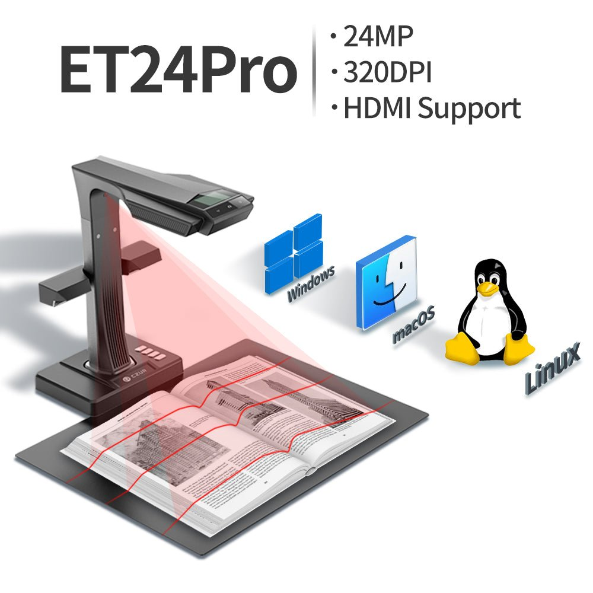
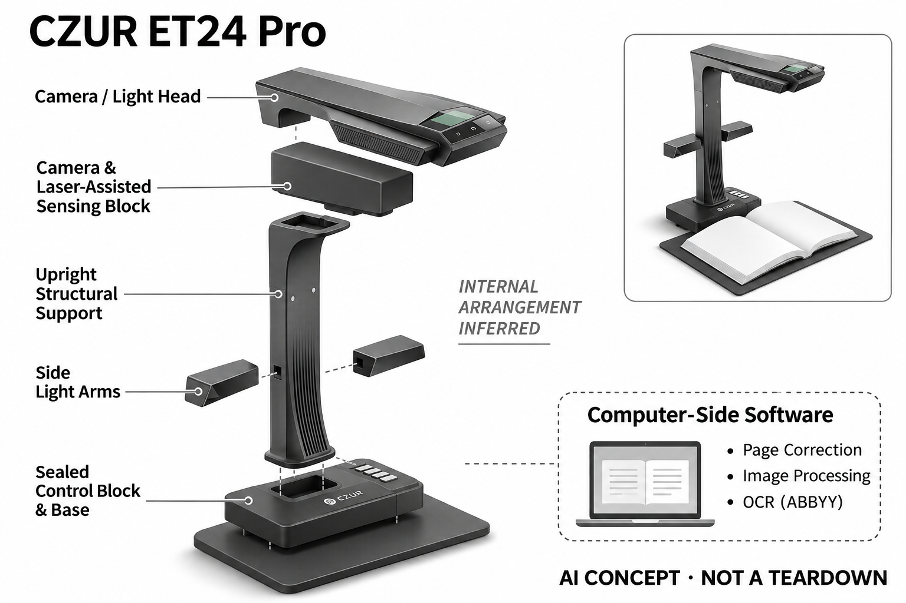

# CZUR ET24 Pro

**CZUR** · 专业兴趣工具 · 核查 2026-11-04

将成册书页转换为可检索数字资料

消费渠道：个人零售。

## 产品图片与结构参考

### 产品图

CZUR ET24 Pro · 官方产品图 · 来源：[CZUR · 官方图片](<https://shop.czur.com/products/etscanner>) · [原始图片](<https://cdn.shopify.com/s/files/1/0249/3140/1776/products/czur-et-scanner-professional-document-scanner-640218.jpg?v=1764921970>)

### 参考图

CZUR ET24 Pro · 官方参考图 · 来源：[CZUR · 官方图片](<https://www.czur.com/detail/news/241>) · [原始图片](<https://abroad.czur.com/news/202204111037431403.png>)

### AI 生成爆炸示意

**AI 生成 · 非实物拆机。** 内部为概念推断，不能作为元件布局、BOM 或维修依据。[生成提示词](../../content/hardware/prompts/czur-et24-pro.txt)

> 已目视核对外形、标签与非拆机声明；不代表内部结构经实测验证。

> 参考图来自ET24 Pro官方历史发布资料，仅用于外观核对，不作为当前销售证据。

> 分析为基于公开资料的案头研究与 AI 辅助判断，未经用户访谈、销量审计或实物拆机。需求、画像、竞争冷门度、审美及商业机会均为研究假设，不是投资结论。

## 销售与购买

- 状态：在售。官方ET系列商店可选ET24 Pro并加购，公开产品数据该变体available=true。ET Max、ET18和ET16仅为同页其他型号，不混用报价或外观。

- 地区：美国及官方配送市场

- 价格：ET24 Pro官方变体 US$579。核查日页面快照；运费、税费、会员和配送区域按官方结算确认，不视为中国到手价。

- 中国大陆：本轮核实所列区域官方商店；未确认中国大陆官方现货、账户及完整服务，不把境外可购等同大陆可用。

- [官方产品 / 商店](<https://shop.czur.com/products/etscanner>)

## AI 的实际作用

官方说明图像算法与AI辅助书页展平、分页和手指移除，配套ABBYY OCR输出可检索文档；不是将顶部相机拍照本身称为生成式AI。

服务与联网依赖：需要兼容电脑与CZUR扫描软件；OCR、版面和图像处理效果受原稿与照明影响，部分新软件仍标Beta，不保证跨平台功能完全相同。

## 是否冷门

新兴竞争（研究判断）：面向个人研究与档案整理形成具体使用场景；本轮没有销量与市场份额证据。

## 需求与市场

需求假设：研究者、家庭档案整理者或创作者希望保存成册资料而不拆装订，自动展平和识别可减少后期处理。应测试真实旧书、照片和混合版面，确认节省的时间超过重扫与文字校对成本。

## 用户画像

画像推断：有较稳定扫描需求、可提供桌面空间并愿意使用电脑处理文件的个人用户较匹配。偶尔扫描收据的人用手机可能足够，不能将专业书刊形态与更高识别效率直接推广到所有家庭。

## 竞争与替代

竞争判断：手机扫描、平板扫描仪和人工数字化服务都能解决部分问题，成册展平形成相对专门的场景。小众工具并不意味着蓝海，需要明确用户一年处理多少页以及为何现有方式不够用。

## 供应链

供应链推断：顶部摄像、激光辅助感知、侧灯和支架需保持几何关系，脚踏与线缆影响连续工作。官方未披露完整工厂和物料清单；软件兼容、灯光维护和桌面环境也属于拥有成本。

## 技术路径

官方将AI图像处理与OCR列为核心辅助能力，技术判断应分开展平几何、手指去除和文字识别。书页边缘、插图和旧字体可能产生错误，不能把自动处理后的整洁页面当成对原稿的忠实保证。

## 产品审美

审美判断：高立柱和横向扫描头明显占据桌面，更接近个人工作台工具而非随身消费电子。侧灯、黑垫和脚踏组成完整使用环境，产品单体照片不能反映实际收纳与摆放需求。

## 关键风险

风险判断：算法可能删去与手指相近的原稿内容或识别错字，扫描有版权的资料也需遵守使用许可。重要档案应保存未处理原图并抽样校对，不能仅以一页速度或支持语言数保证整批质量。

## 机会与验证

市场观察：可让真实用户处理一批既有资料，记录摆放、翻页、重扫与检索全过程。按个人研究、家庭照片和手稿归档分别评估价值，不把企业案例或厂商历史销量宣传当作当前消费需求证据。

## 功能分层示意

这是功能关系，不是实物拆机、真实空间结构或已核实 BOM。

1. **顶部采集**：相机与照明记录成册书页。（官方披露）

2. **形状感知**：激光辅助获得页面弯曲信息。（官方披露）

3. **图像处理**：AI辅助展平、分页与手指移除。（官方披露）

4. **文字输出**：OCR与软件导出可检索文档。（官方披露）

## 来源

1. [CZUR ET系列官方商店与ET24变体](<https://shop.czur.com/products/etscanner>) — 已实际打开官方页面；功能说明不等于独立性能测量。

2. [CZUR官方ET系列AI算法说明](<https://shop.czur.com/blogs/blog/why-and-how-to-choose-czur-et-series-book-scanners>) — 已实际打开官方页面；功能说明不等于独立性能测量。

3. [ET24 Pro官方型号公告](<https://www.czur.com/detail/news/241>) — 历史公告仅支持能力与个人研究用途，不作为当前在售证据。

[返回目录](../hardware-market.md) · [网页分析](https://romanagent.github.io/Roman/#hardware/product/czur-et24-pro)
