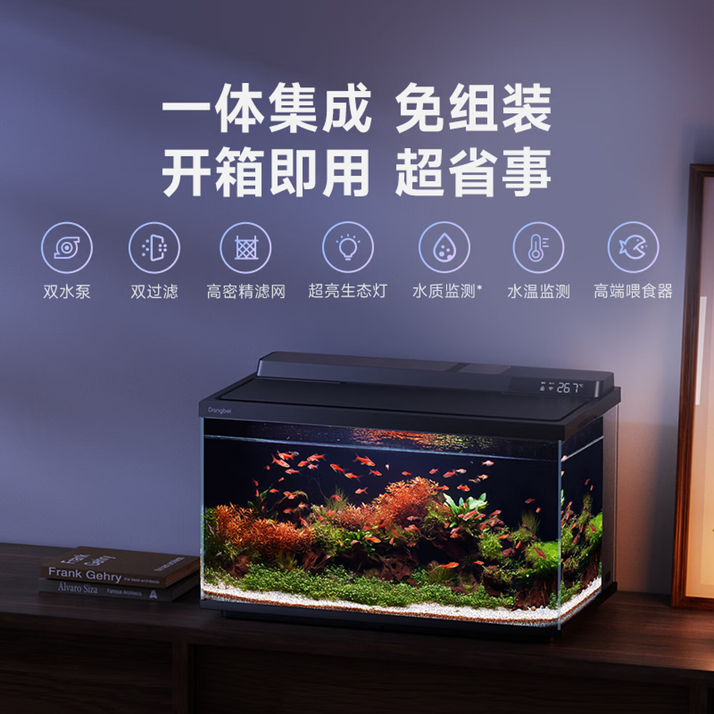
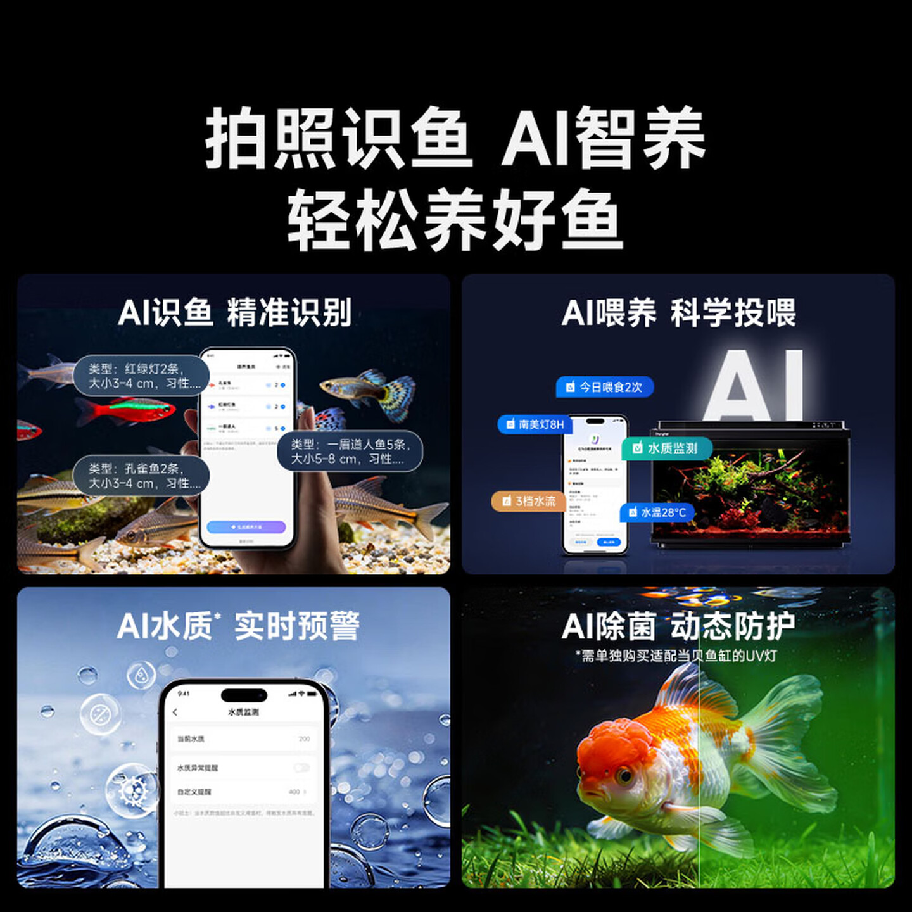
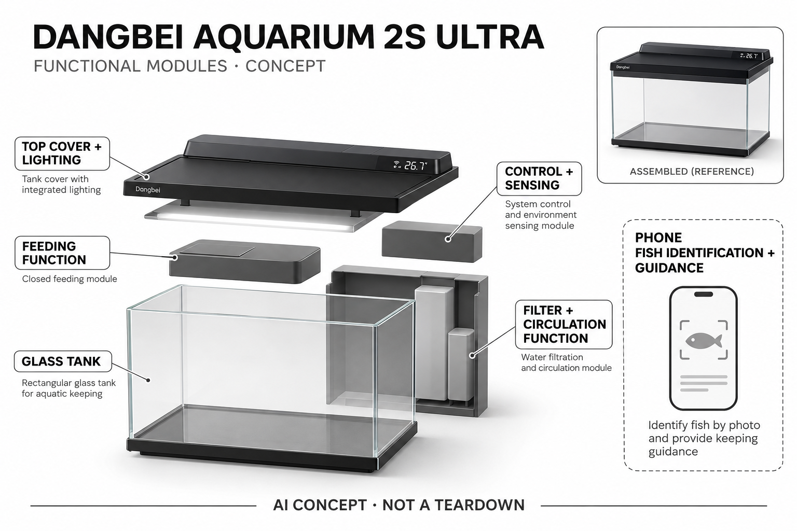

# 当贝智能鱼缸 2S Ultra

**当贝 Dangbei** · 宠物照护 · 核查 2026-11-05

由手机识鱼和养护建议衔接一体鱼缸的喂食、灯光与水流控制

消费渠道：个人零售。

## 产品图片与结构参考

### 产品图

当前2S Ultra官方渠道整机场景（含厂商说明） · 来源：[当贝 Dangbei · 官方图片](<https://item.jd.com/100336614386.html>) · [原始图片](<https://img10.360buyimg.com/pcpubliccms/s1440x1440_jfs/t1/545410/36/9518/104976/6adabb6dFbe361a0c/0083320320750965.jpg>)

### 参考图

当前2S Ultra手机识鱼与设备联动参考 · 来源：[当贝 Dangbei · 官方图片](<https://item.jd.com/100336614386.html>) · [原始图片](<https://img10.360buyimg.com/pcpubliccms/s1440x1440_jfs/t1/537817/32/7400/127944/6adabb49F91b84874/008332032048238b.jpg>)

### AI 生成爆炸示意

**AI 生成 · 非实物拆机。** 内部为概念推断，不能作为元件布局、BOM 或维修依据。[生成提示词](../../content/hardware/prompts/dangbei-aquarium-2s-ultra.txt)

> 依据已核验官方外形与公开功能生成；未知内部仅为概念功能块，不代表原机电路板、芯片或实际布局。

> 目视核对当前型号与规格，官方网页原图未修改；配件、造景、广告效果及参数说明不代表基础包装或独立验证。

> 分析为基于公开资料的案头研究与 AI 辅助判断，未经用户访谈、销量审计或实物拆机。需求、画像、竞争冷门度、审美及商业机会均为研究假设，不是投资结论。

## 销售与购买

- 状态：在售。2026-11-05官网当前2S Ultra栏目购买链接跳转京东自营SKU100336614386；实际浏览确认智能鱼缸2S Ultra选项、可加购与立即购买，页面优惠到手价约568元。旧1 Ultra官网已售罄，不作为本条销售证据。

- 地区：中国大陆

- 价格：京东官方渠道当前优惠到手价约 ¥568。核查日促销展示，页面另列日常价约¥646.38；不保证所有账户同价。采用基础2S Ultra选项，造景、滤材、UV配件及不同礼包不重复计数。

- 中国大陆：已从当贝官网进入品牌京东自营官方渠道并看到当前2S Ultra可购买；配送范围、优惠资格和套装内容以具体地区结算为准，不包含造景与鱼。

- [官方产品 / 商店](<https://www.dangbei.com/>)

## AI 的实际作用

官方配套App已提供AI拍照识鱼并生成喂养方案，设备执行相应喂食、灯光和水流设置。照片输入来自手机，不能虚构缸内摄像头或实时诊断每条鱼。

服务与联网依赖：识别、建议与远程管理依赖手机应用和相应网络服务；过滤与饲喂设备仍须清洁和检查。水质相关读数不等同所有化学指标的专项检测，不能承诺永久免换水。

## 是否冷门

细分专业（研究判断）：桌面观赏水族是一类需要长期照护的兴趣任务，手机识鱼到整缸控制具备流程差异；维护、生物适配和识别边界限制完全托管。

## 需求与市场

需求假设：希望在桌面建立小型观赏水族的家庭，可能需要降低选择过滤、灯光与投喂方案的门槛。手机识鱼能提供养护起点，但真实负担还包括开缸、清洁、补水和判断异常，不能从一体化与AI宣传推断免维护。

### 产品任务与边界 · 研究判断

需求假设：希望在桌面建立小型观赏水族的家庭，可能需要降低选择过滤、灯光与投喂方案的门槛。手机识鱼能提供养护起点，但真实负担还包括开缸、清洁、补水和判断异常，不能从一体化与AI宣传推断免维护。

依据：[当贝官方当前硬件首页](<https://www.dangbei.com/>) · [当贝京东自营当前2S Ultra商品](<https://item.jd.com/100336614386.html>)

### 需求判断 · 研究判断

判断：入门养鱼并不只是购买容器，还要把鱼种、数量、光照、过滤与投喂联系起来，一体设备能减少部分选配步骤。手机识别的增量在帮助形成正确问题和设置起点，若用户因此不再观察生物和维护水体，便利反而可能制造误判。

依据：[当贝官方当前硬件首页](<https://www.dangbei.com/>) · [当贝京东自营当前2S Ultra商品](<https://item.jd.com/100336614386.html>)

### 需求验证 · 待验证

验证：让初次建立桌面水族的家庭描述从选鱼到日常照护的完整流程，再比较设备建议与可靠养护资料是否一致。记录清洁、补水及异常处理的实际劳动，不用短期清澈照片或商家造景证明长期稳定，也不以活体承担不必要测试风险。

依据：[当贝官方当前硬件首页](<https://www.dangbei.com/>) · [当贝京东自营当前2S Ultra商品](<https://item.jd.com/100336614386.html>)

## 用户画像

画像推断：愿意了解鱼种适配、控制养殖密度并定期维护的入门家庭较匹配，已有成熟大缸或专业海水系统的人未必需要整机替换。不能把喜欢观赏画面等同能够持续照护，购买前还需考虑承重、电源和清洁位置。

### 适用行为与条件 · 研究判断

画像推断：愿意了解鱼种适配、控制养殖密度并定期维护的入门家庭较匹配，已有成熟大缸或专业海水系统的人未必需要整机替换。不能把喜欢观赏画面等同能够持续照护，购买前还需考虑承重、电源和清洁位置。

依据：[当贝官方当前硬件首页](<https://www.dangbei.com/>) · [当贝京东自营当前2S Ultra商品](<https://item.jd.com/100336614386.html>)

### 人群取舍 · 研究判断

判断：愿意学习基本水族维护的人更可能持续使用，而只希望拥有漂亮摆件的人仍需了解照护责任。家庭成员轮流投喂可能出现重复，工作日无人时又可能忽略设备状态，具体责任与检查习惯比是否喜欢科技产品更能解释适配性。

依据：[当贝官方当前硬件首页](<https://www.dangbei.com/>) · [当贝京东自营当前2S Ultra商品](<https://item.jd.com/100336614386.html>)

### 画像验证 · 待验证

验证：在购买决策前让家庭分别确认鱼种适配、摆放承重、电源位置和维护负责人，观察是否能理解基础套餐不含造景与鱼。画像研究应区分已有大缸经验、初次小缸和仅想远程喂食的人，不能以养鱼爱好者数量直接代表目标用户。

依据：[当贝官方当前硬件首页](<https://www.dangbei.com/>) · [当贝京东自营当前2S Ultra商品](<https://item.jd.com/100336614386.html>)

## 竞争与替代

竞争判断：与普通缸加独立过滤喂食器、养鱼知识应用和专业水质检测比较，差异在识鱼建议到整缸控制的衔接。旧1 Ultra、配件和造景礼包不拆成新场景，也不以联网本身或营销免换水字样证明AI价值。

### 比较对象与差异 · 研究判断

竞争判断：与普通缸加独立过滤喂食器、养鱼知识应用和专业水质检测比较，差异在识鱼建议到整缸控制的衔接。旧1 Ultra、配件和造景礼包不拆成新场景，也不以联网本身或营销免换水字样证明AI价值。

依据：[当贝官方当前硬件首页](<https://www.dangbei.com/>) · [当贝京东自营当前2S Ultra商品](<https://item.jd.com/100336614386.html>)

### 竞争判断 · 研究判断

判断：独立设备组合更灵活，一体缸则降低选配与布线复杂度，两者没有通用优劣。ReefBot侧重试剂水质检测，本条更强调手机识鱼到养护控制，任务不同；旧1 Ultra和2S Ultra的换代仍属于同一核心场景，不重复计入增长。

依据：[当贝官方当前硬件首页](<https://www.dangbei.com/>) · [当贝京东自营当前2S Ultra商品](<https://item.jd.com/100336614386.html>)

### 竞争验证 · 待验证

验证：围绕一种明确、适配的小型水族需求比较普通缸加设备与当前一体缸，记录设置、维护与更换耗材的步骤。对AI部分单独比较人工识鱼和拍照识鱼后的决策质量，不将一般定时投喂、双泵或灯光数量当成AI优势。

依据：[当贝官方当前硬件首页](<https://www.dangbei.com/>) · [当贝京东自营当前2S Ultra商品](<https://item.jd.com/100336614386.html>)

## 供应链

供应链分析：玻璃密封、上盖结构、照明、喂食、泵路滤材、传感与电控共同组成整机，具体工厂及BOM未披露。滤材可获得性、密封和潮湿环境中的供电可靠性影响长期使用，不能仅用鱼缸容积推算制造成本。

### 功能模块拆分 · 研究判断

模块拆分：玻璃缸与密封结构形成水体，上盖集中照明和投喂，后部过滤循环与感知电控管理运行。照片识别来自手机，不在缸内假设摄像头；可选UV配件、独立造景和水质相关数字也不能在概念图中变成默认全功能配置。

依据：[当贝官方当前硬件首页](<https://www.dangbei.com/>) · [当贝京东自营当前2S Ultra商品](<https://item.jd.com/100336614386.html>)

### 制造与供应约束 · 研究判断

供应链分析：玻璃密封、上盖结构、照明、喂食、泵路滤材、传感与电控共同组成整机，具体工厂及BOM未披露。滤材可获得性、密封和潮湿环境中的供电可靠性影响长期使用，不能仅用鱼缸容积推算制造成本。

依据：[当贝官方当前硬件首页](<https://www.dangbei.com/>) · [当贝京东自营当前2S Ultra商品](<https://item.jd.com/100336614386.html>)

### 候选与证据缺口 · 研究判断

候选判断：Protolabs可评估上盖、后部保护和可维护结构样件，环旭可作为无线电控整合与生产测试候选。没有资料证明它们制造当贝此型号；玻璃密封、水路耐久和活体环境适配仍需专项验证，通用电子能力不能覆盖整套水族风险。

依据：[当贝官方当前硬件首页](<https://www.dangbei.com/>) · [当贝京东自营当前2S Ultra商品](<https://item.jd.com/100336614386.html>)

## 技术路径

技术判断：开发者更新记录明确加入手机AI拍照识鱼和喂养方案，视觉识别与本机执行职责应分开。识别照片可能看不清种类或数量，水质相关读数也不能替代所有化学测试，不能从泛称AI水质推断具备病原或毒素诊断。

### 已披露技术边界 · 研究判断

技术判断：开发者更新记录明确加入手机AI拍照识鱼和喂养方案，视觉识别与本机执行职责应分开。识别照片可能看不清种类或数量，水质相关读数也不能替代所有化学测试，不能从泛称AI水质推断具备病原或毒素诊断。

依据：[当贝官方当前硬件首页](<https://www.dangbei.com/>) · [当贝京东自营当前2S Ultra商品](<https://item.jd.com/100336614386.html>)

### 系统难点判断 · 研究判断

判断：手机照片的角度、遮挡和光照可能影响鱼种与数量识别，建议生成还需要理解水体和饲养背景。设备显示水质相关信息不代表测到了全部有害物质，尤其不能从营销AI水质字样推出病原、氨氮或其他专项分析均已具备。

依据：[当贝官方当前硬件首页](<https://www.dangbei.com/>) · [当贝京东自营当前2S Ultra商品](<https://item.jd.com/100336614386.html>)

### 技术验证 · 待验证

验证：用已确认的鱼种照片在不同光照和遮挡条件下检查识别与人工修改，再核对建议是否说明适用水体和资料不足。设备侧应分别验证断网后的基本运行及错误设置的恢复，案头资料不足以给出准确率、长期免换水或疾病识别结论。

依据：[当贝官方当前硬件首页](<https://www.dangbei.com/>) · [当贝京东自营当前2S Ultra商品](<https://item.jd.com/100336614386.html>)

## 产品审美

审美判断：深色上盖、矩形透明缸与藏于后部的设备形成简洁观赏面，但线缆、藻类、水渍和滤材维护才决定日常观感。营销图中的鱼和造景不是基础包装内容，设计评估不能只看理想布景或暗光展示。

### 外观与交互语言 · 研究判断

审美判断：深色上盖、矩形透明缸与藏于后部的设备形成简洁观赏面，但线缆、藻类、水渍和滤材维护才决定日常观感。营销图中的鱼和造景不是基础包装内容，设计评估不能只看理想布景或暗光展示。

依据：[当贝官方当前硬件首页](<https://www.dangbei.com/>) · [当贝京东自营当前2S Ultra商品](<https://item.jd.com/100336614386.html>)

### 使用中审美判断 · 研究判断

判断：整合后观赏面更整洁，但顶部显示、出线和后部厚度仍会影响桌面布置。水渍、藻类与滤材清洁会逐步改变观感，真实审美体验也包括能否容易取出维护部件，不能把营销中布置成熟的水景当成用户开箱即有的效果。

依据：[当贝官方当前硬件首页](<https://www.dangbei.com/>) · [当贝京东自营当前2S Ultra商品](<https://item.jd.com/100336614386.html>)

### 设计验证 · 待验证

验证：以真实台面测试开盖、换棉、加料和清洁是否需要挪动整缸，比较日间和夜间灯光对共享空间的影响。让新用户指出包装内与另购内容，确认图片不会误导其把海水造景、UV或其他装饰视作当前基础型号的默认能力。

依据：[当贝官方当前硬件首页](<https://www.dangbei.com/>) · [当贝京东自营当前2S Ultra商品](<https://item.jd.com/100336614386.html>)

## 关键风险

风险判断：识鱼错误、过量投喂、过滤失效及用户忽略清洁可能影响水族状态，自动方案不能代替日常观察。不同鱼种与水体的要求不同，不能把图片中的海水场景理解成对所有生物通用；配件功能也不等于整机默认包含。

### 主要失效与依赖 · 研究判断

风险判断：识鱼错误、过量投喂、过滤失效及用户忽略清洁可能影响水族状态，自动方案不能代替日常观察。不同鱼种与水体的要求不同，不能把图片中的海水场景理解成对所有生物通用；配件功能也不等于整机默认包含。

依据：[当贝官方当前硬件首页](<https://www.dangbei.com/>) · [当贝京东自营当前2S Ultra商品](<https://item.jd.com/100336614386.html>)

### 风险传播判断 · 研究判断

判断：识别与设置错误可能沿自动投喂和光照传递，过滤堵塞或断电则会使水体条件改变，因此提醒和人工检查仍关键。营销托管叙事容易弱化照护责任，价格促销与礼包也可能让用户忽略耗材、适配条件和实际长期维护成本。

依据：[当贝官方当前硬件首页](<https://www.dangbei.com/>) · [当贝京东自营当前2S Ultra商品](<https://item.jd.com/100336614386.html>)

### 风险验证 · 待验证

验证：核对饲料不足、滤材到期、网络断开和电源恢复时的行为，观察用户是否知道需要做何种人工检查。对异常水体使用适合的独立测量，不盲从AI建议；购买应按实际鱼种与条件判断，不能把所有官方展示生物都视为通用适养名单。

依据：[当贝官方当前硬件首页](<https://www.dangbei.com/>) · [当贝京东自营当前2S Ultra商品](<https://item.jd.com/100336614386.html>)

## 机会与验证

机会假设：可从让新手更容易理解鱼种与设备设置的关系验证，避免把问题简化为一键托管。若应用只是给泛泛建议，价值可能主要来自整机集成；可追溯的识别、可修改方案和明确维护提示比堆叠AI标签更有意义。

### 可能的机会入口 · 研究判断

机会假设：可从让新手更容易理解鱼种与设备设置的关系验证，避免把问题简化为一键托管。若应用只是给泛泛建议，价值可能主要来自整机集成；可追溯的识别、可修改方案和明确维护提示比堆叠AI标签更有意义。

依据：[当贝官方当前硬件首页](<https://www.dangbei.com/>) · [当贝京东自营当前2S Ultra商品](<https://item.jd.com/100336614386.html>)

### 机会成立条件 · 研究判断

判断：可探索的机会在于把识别结果、建议理由和设备设置对应起来，使新手逐步理解养护。若系统只给笼统结论，真正价值可能仍是过滤与喂食的一体化，产品应承认这一点，而不把每个机械功能重新命名成AI创新。

依据：[当贝官方当前硬件首页](<https://www.dangbei.com/>) · [当贝京东自营当前2S Ultra商品](<https://item.jd.com/100336614386.html>)

### 下一步验证 · 待验证

验证：跟踪一个完整养护周期中的人工修改、错误纠正和维护执行，分别记录学习成本与省下的劳动。比较用户是否能够离开应用也解释基本设置原因，并确认没有因自动化增加不适当饲养；只有净负担下降才能支撑更广市场判断。

依据：[当贝官方当前硬件首页](<https://www.dangbei.com/>) · [当贝京东自营当前2S Ultra商品](<https://item.jd.com/100336614386.html>)

## 对应供应链公司

能力候选用于选型研究，不代表本产品实际采用；未公开的供货关系不作推断。

- [protolabs](../supply-chain/protolabs.md) — **能力候选 · 非已采用** / 上盖与后部维护结构试制：Protolabs公开原型制造能力可对应鱼缸上盖、过滤保护与易维护塑料结构的样件迭代。未发现其与当贝2S Ultra的合作证据；长期潮湿、材料兼容及密封要求需专项验证，不能把通用加工能力当成实际生产披露。

- [usi](../supply-chain/usi.md) — **能力候选 · 非已采用** / 水族设备联网控制与电子整合：环旭公开消费无线与系统整合能力可匹配鱼缸传感、电控和应用连接的工程需求。这里是能力候选，未证实该型号采购关系；水路、生物适配、过滤效果及算法识鱼质量不能由无线模块制造经验直接推出。

[浏览供应链目录](../supply-chain.md)

## 功能分层示意

这是功能关系，不是实物拆机、真实空间结构或已核实 BOM。

1. **缸体与上盖**：透明方形缸、深色顶盖与前部显示区域。（官方披露）

2. **灯光与喂食**：集成照明和颗粒饲料投放功能。（官方披露）

3. **过滤与循环**：公开展示双过滤与循环系统，结构示意不作为独立性能验证。（官方披露）

4. **感知与连接**：温度、水质相关读数以及应用控制。（官方披露）

5. **手机识鱼与建议**：应用照片识别及喂养建议为外部软件输入层。（官方披露）

## 来源

1. [当贝官方当前硬件首页](<https://www.dangbei.com/>) — 实际浏览官网2S Ultra栏目与购买跳转jd.dangbei.com/2sultra.html，非旧1 Ultra页面。

2. [当贝京东自营当前2S Ultra商品](<https://item.jd.com/100336614386.html>) — 实际浏览器核对当前型号、约568元优惠展示与可用加购；读取品牌图册AI识鱼、集成模块与配件说明，未下单。

3. [当贝鱼缸官方开发者App资料](<https://apps.apple.com/us/app/%E5%BD%93%E8%B4%9D%E9%B1%BC%E7%BC%B8/id6736940012>) — 实际打开开发者发布的设备配套与版本记录，明确AI拍照识鱼、喂养方案及AI养鱼助手；未把普通定时或UV阈值控制当独立AI。

[返回目录](../hardware-market.md) · [网页分析](https://romanagent.github.io/Roman/#hardware/product/dangbei-aquarium-2s-ultra)
