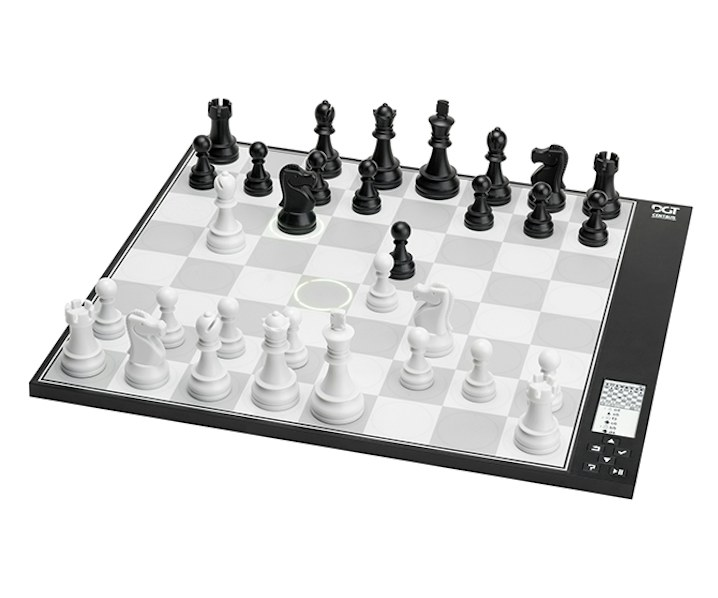
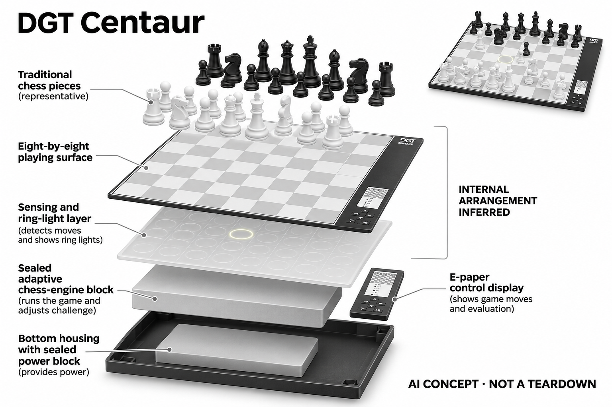

# DGT Centaur

**DGT** · 游戏与桌游 · 核查 2026-11-04

根据对局表现调整棋力

消费渠道：个人零售。

## 产品图片与结构参考

### 产品图

DGT Centaur · 官方产品图 · 来源：[DGT · 官方图片](<https://www.dgtshop.com/products/chess-computers-2/centaur-chess-computer-2>) · [原始图片](<https://digital-game-technology-2021.imgix.net/media/Products/Chess-Computers/DGT-Centaur-Chess-Computer-670x646.jpg?auto=format&crop=focalpoint&domain=digital-game-technology-2021.imgix.net&fit=crop&fp-x=0.5&fp-y=0.5&h=598&ixlib=php-3.3.1&q=82&w=718>)

### 参考图

DGT Centaur · 官方参考图 · 来源：[DGT · 官方图片](<https://www.dgtshop.com/products/chess-computers-2/centaur-chess-computer-2>) · [原始图片](<https://digital-game-technology-2021.imgix.net/media/Products/Chess-Computers/DGT-Centaur-Chess-Computer-4-670x646.jpg?auto=format&crop=focalpoint&domain=digital-game-technology-2021.imgix.net&fit=crop&fp-x=0.5&fp-y=0.5&h=500&ixlib=php-3.3.1&q=82&w=700>)

### AI 生成爆炸示意

**AI 生成 · 非实物拆机。** 内部为概念推断，不能作为元件布局、BOM 或维修依据。[生成提示词](../../content/hardware/prompts/dgt-centaur.txt)

> 分析为基于公开资料的案头研究与 AI 辅助判断，未经用户访谈、销量审计或实物拆机。需求、画像、竞争冷门度、审美及商业机会均为研究假设，不是投资结论。

## 销售与购买

- 状态：在售。DGT官方商店列出价格及Add to cart；只计普通Centaur，不另计透明Crystal外观版本。

- 地区：欧洲官方商店

- 价格：官方商店 €400 含税。核查日页面快照；运费、税费、会员和配送区域按官方结算确认，不视为中国到手价。

- 中国大陆：本轮核实所列区域官方商店；未确认中国大陆官方现货、账户及完整服务，不把境外可购等同大陆可用。

- [官方产品 / 商店](<https://www.dgtshop.com/products/chess-computers-2/centaur-chess-computer-2>)

## AI 的实际作用

棋类引擎在对局中分析玩家表现并调整挑战强度，属于经典博弈决策AI；环形灯光提示落子，电子纸显示棋谱与评价。

服务与联网依赖：独立棋类电脑，无须以手机运行核心对弈；传感棋盘记录操作，不能推断具备摄像识别或自动搬动棋子的机构。

## 是否冷门

细分专业（研究判断）：无需手机的安静实体对弈形成具体使用场景；本轮没有销量与市场份额证据。

## 需求与市场

需求假设：休闲棋手常常缺少水平接近且随时有空的对手，自动调整挑战可以降低反复设定等级的负担。应观察用户是否觉得对局有趣而非刻意放水，不能只以引擎最高棋力衡量价值。

## 用户画像

画像推断：偏好传统棋子触感、希望减少屏幕和账户操作的家庭棋迷较匹配。它更适合固定空间中直接开局，追求网络赛事、复杂课程或自动摆子的人需要确认其功能边界。

## 竞争与替代

竞争判断：经典电子棋类电脑已有成熟替代，免费手机引擎也足够强。Centaur的差别是自适应对手和简化独立体验，传统外观并不代表市场空白，应比较实际开局意愿而非功能数量。

## 供应链

供应链推断：平整棋盘、传感层、环形灯和电子纸需要保持操作与反馈一致，轻薄机身也要应对搬动。官方未公开完整工厂和物料成本；棋子遗失、按压磨损及电池维护会影响寿命。

## 技术路径

官方说明棋力根据玩家在对局中的表现调整，电子纸提供设置与棋局信息。技术判断应观察不同开局和明显失误后的响应，不能把自适应算法描述成理解玩家情绪或拥有生成式语言能力。

## 产品审美

审美判断：低亮度电子纸和传统棋盘比例提供较安静的桌面存在，环形灯只在需要时引导注意。薄机身与棋子重量的搭配需要实物体验，产品照片不能说明按压手感和长局舒适度。

## 关键风险

风险判断：自适应强度可能不符合每位棋手对公平挑战的期待，用户也可能希望固定棋力作比较。它没有替代真人交流的承诺，训练价值应通过对局体验和理解过程评估而非获胜比例。

## 机会与验证

市场观察：该款适合检验少账户、少设置的专用硬件是否仍有消费价值。可以比较开始一盘棋所需时间、被中断后的恢复和四周留存，避免将低屏幕使用与更好学习效果直接关联。

## 功能分层示意

这是功能关系，不是实物拆机、真实空间结构或已核实 BOM。

1. **操作感知**：传感棋盘记录用户落子操作。（官方披露）

2. **棋力适应**：引擎分析对局并调整挑战。（官方披露）

3. **局面反馈**：环形LED提示机器走法。（官方披露）

4. **状态显示**：电子纸显示设置、棋谱与评价。（官方披露）

## 来源

1. [DGT Centaur官方商店](<https://www.dgtshop.com/products/chess-computers-2/centaur-chess-computer-2>) — 已实际打开官方页面；功能说明不等于独立性能测量。

2. [DGT Centaur官方功能](<https://www.digitalgametechnology.com/products/chess-computers/dgt-centaur-chess-computer>) — 已实际打开官方页面；功能说明不等于独立性能测量。

[返回目录](../hardware-market.md) · [网页分析](https://romanagent.github.io/Roman/#hardware/product/dgt-centaur)
