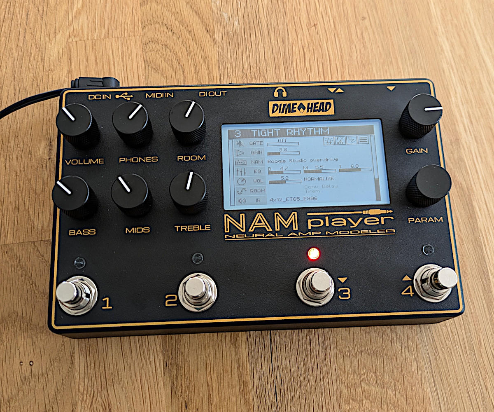
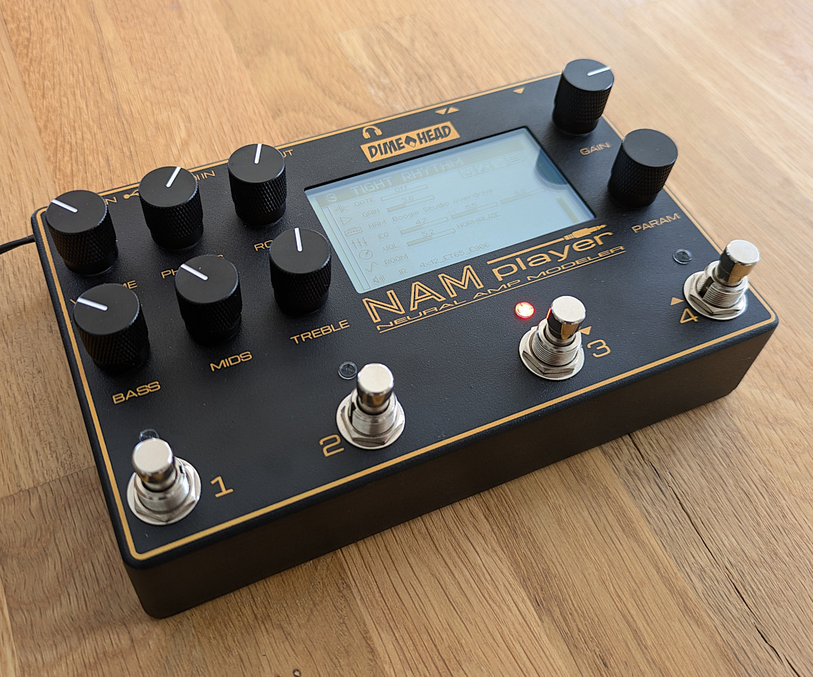
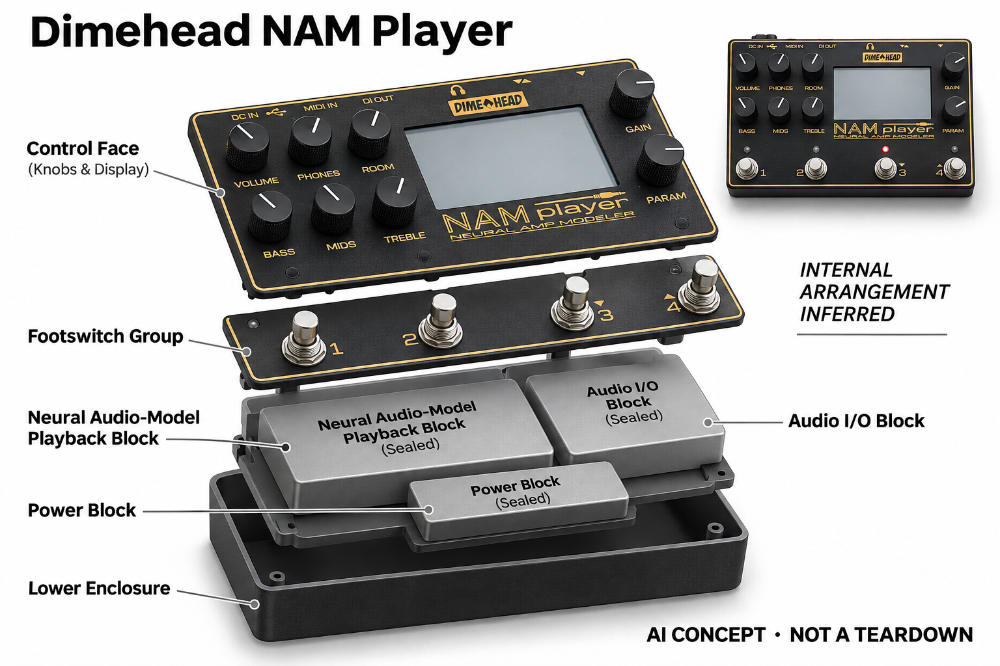

# Dimehead NAM Player

**Dimehead** · 音乐与乐器 · 核查 2026-11-04

专门承载NAM神经音色的实体踏板

消费渠道：个人零售。

## 产品图片与结构参考

### 产品图

Dimehead NAM Player · 官方产品图 · 来源：[Dimehead · 官方图片](<https://www.dimehead.de/product/nam-player/>) · [原始图片](<https://www.dimehead.de/wp-content/uploads/2024/09/Order1.jpg>)

### 参考图

Dimehead NAM Player · 官方参考图 · 来源：[Dimehead · 官方图片](<https://www.dimehead.de/product/nam-player/>) · [原始图片](<https://www.dimehead.de/wp-content/uploads/2024/09/Order2.jpg>)

### AI 生成爆炸示意

**AI 生成 · 非实物拆机。** 内部为概念推断，不能作为元件布局、BOM 或维修依据。[生成提示词](../../content/hardware/prompts/dimehead-nam-player.txt)

> 已目视核对外形、标签与非拆机声明；不代表内部结构经实测验证。

> 分析为基于公开资料的案头研究与 AI 辅助判断，未经用户访谈、销量审计或实物拆机。需求、画像、竞争冷门度、审美及商业机会均为研究假设，不是投资结论。

## 销售与购买

- 状态：在售。制造商官方商店显示Add to cart和具体配送国家；按当前NAM Player本体计数，电源及USB存储介质需求另列。

- 地区：欧盟、英国、美国、日本、加拿大、澳大利亚、新西兰及官网所列市场

- 价格：官网 €535.50 含德国VAT。核查日页面快照；运费、税费、会员和配送区域按官方结算确认，不视为中国到手价。

- 中国大陆：本轮核实所列区域官方商店；未确认中国大陆官方现货、账户及完整服务，不把境外可购等同大陆可用。

- [官方产品 / 商店](<https://www.dimehead.de/product/nam-player/>)

## AI 的实际作用

在实体踏板内播放以深度学习训练的NAM音箱与踏板响应模型，可加载组合模型；模型训练通常在外部完成，不把普通延时或混响都称为AI。

服务与联网依赖：使用USB存储介质导入兼容模型与固件；加载后可独立演奏。输入增益与模型版本会影响效果，单声道限制须按官方FAQ理解。

## 是否冷门

新兴竞争（研究判断）：面向已有模型文件的个人乐手形成具体使用场景；本轮没有销量与市场份额证据。

## 需求与市场

需求假设：已经使用NAM音色的个人乐手可能希望在演出或排练时摆脱电脑，并保留熟悉模型。应比较文件准备、增益校准与现场切换耗时，确认专用踏板解决的是实际流程而非模型数量焦虑。

## 用户画像

画像推断：理解音频信号链、会管理模型和USB文件的吉他或贝斯爱好者较匹配。需要完全自动找音色的新手可能更看重简化入口，不能把硬件可独立运行等同无需前期学习和配置。

## 竞争与替代

竞争判断：大型建模器、低价神经模型踏板和电脑插件都能播放类似内容，专用NAM定位较窄但替代明确。开放格式带来内容自由，也让硬件必须靠控制、可靠性和支持形成区别。

## 供应链

供应链推断：脚控、音频接口、显示和实时处理模块需共同保证反复连接与踩踏稳定。官方未公开完整工厂和物料清单；跨境维修、固件维护及外接电源选择会改变实际拥有成本。

## 技术路径

官方解释NAM模型来自深度学习，并提醒输入增益对模型表现很重要。技术判断应以同一文件和校准输入比较响应，不能把厂家延迟或逼真度形容直接当作本轮测量，也不保证所有新模型兼容。

## 产品审美

审美判断：金属盒体、醒目屏幕和脚开关表达明确舞台工具语言，功能集中而没有大面积装饰。舞台低光、站立视角和线缆插拔空间会影响操作，图片不能替代实际脚控体验。

## 关键风险

风险判断：模型格式变化和输入校准会造成声音差异，单声道设计也不适合所有演出链路。官方配送地区不含所有国家，购买前需确认维修与电源条件，重要演出仍应准备可恢复的预设。

## 机会与验证

市场观察：该款可以检验开放神经音色生态是否带来专用硬件需求。后续记录模型导入成功率、现场换音色次数及电脑替代程度，区分稳定演奏工具与一次性尝鲜，不用社区热度推断销量。

## 功能分层示意

这是功能关系，不是实物拆机、真实空间结构或已核实 BOM。

1. **文件导入**：USB介质导入兼容NAM与IR文件。（官方披露）

2. **神经模型播放**：在设备上运行已训练音频响应模型。（官方披露）

3. **声音链路**：输入输出与普通音频效果配合。（官方披露）

4. **现场操作**：显示、旋钮、脚控和MIDI控制。（官方披露）

## 来源

1. [Dimehead官方商品](<https://www.dimehead.de/product/nam-player/>) — 已实际打开官方页面；功能说明不等于独立性能测量。

2. [Dimehead官方NAM与兼容FAQ](<https://www.dimehead.de/faq/>) — 已实际打开官方页面；功能说明不等于独立性能测量。

[返回目录](../hardware-market.md) · [网页分析](https://romanagent.github.io/Roman/#hardware/product/dimehead-nam-player)
