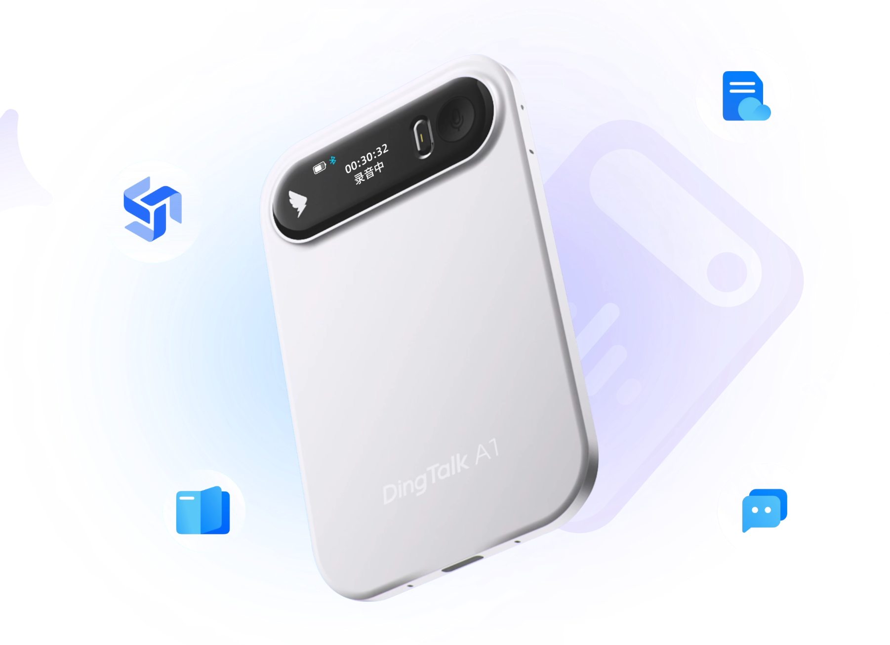
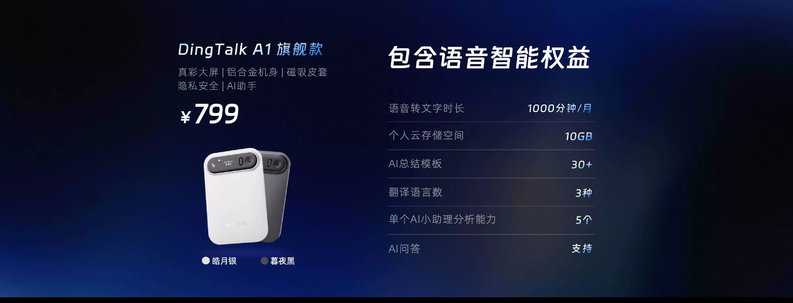
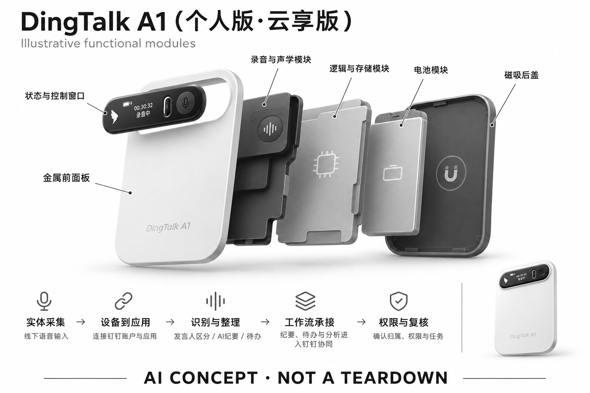

# DingTalk A1（个人版·云享版）

**钉钉** · 录音与记忆 · 核查 2026-11-04

连接钉钉工作流的实体语音记录入口

消费渠道：个人零售。

## 产品图片与结构参考

### 产品图

钉钉官方 A1 旗舰形态银色录音卡宣传图 · 来源：[钉钉 · 官方产品图片](<https://page.dingtalk.com/wow/dingtalk/default/dingtalk/ENSdJDWVpi1L44lqSr3Zz?dd_mini_app_id=5000000004997171>) · [原始图片](<https://gw.alicdn.com/imgextra/i2/O1CN0139M6H11fcsSxbbWId_!!6000000004028-2-tps-1802-1306.png>)

### 参考图

钉钉官方 A1 银黑配色历史宣传图，所示价格和权益不代表当前套餐 · 来源：[钉钉 · 官方产品图片](<https://page.dingtalk.com/wow/dingtalk/default/dingtalk/VWKdjhj4kVMU9YvdgMTy?dd_mini_app_id=5000000004997171>) · [原始图片](<https://gw.alicdn.com/imgextra/i1/O1CN01hjlHg91Sq4rNf8fTv_%21%216000000002297-0-tps-3840-1474.jpg>)

### AI 生成爆炸示意

**AI 生成 · 非实物拆机。** 内部为概念推断，不能作为元件布局、BOM 或维修依据。[生成提示词](../../content/hardware/prompts/dingtalk-a1-personal.txt)

> 外形依据核验参考图；内部位置、模块形状与装配关系仅作AI概念展示。

> 图片按源站提供格式保存，未裁切或改色；厂商渲染/场景示意不代表实机测试。

> A1个人云享版属于服务套餐，参考图用于同款A1硬件形态；历史宣传图价格和权益不用于当前报价。

> 分析为基于公开资料的案头研究与 AI 辅助判断，未经用户访谈、销量审计或实物拆机。需求、画像、竞争冷门度、审美及商业机会均为研究假设，不是投资结论。

## 销售与购买

- 状态：在售。已打开阿里云市场商品，商家标识为钉钉-云市场精选店、自营；列出个人云享版899元/台、硬件颜色、IoT交付和立即购买。与A1 Pro、A2及企业套餐分开记录。

- 地区：中国大陆

- 价格：¥899/台（个人云享版）。当前钉钉自营云市场价；企业版、尊享版和Pro价格不同。页面标有权益有效期，不能把硬件购置理解为所有AI服务永久无限使用。

- 中国大陆：阿里云市场钉钉自营入口可核验，提供实际套餐和购买控件；订单交付地区、包含的软件权益与续费条件以所选版本确认。

- [官方产品 / 商店](<https://market.aliyun.com/detail/cmiot00073017>)

## AI 的实际作用

语音识别、发言人区分、AI纪要与待办整理，依托钉钉应用和工作流。

服务与联网依赖：需要钉钉账户及适用服务；个人版与企业设备管理、部署和权益不同，不能把企业方案能力默认算给个人硬件。

## 是否冷门

竞争密集（研究判断）：录音卡已有多家竞品，钉钉工作流整合是具体差异，而非已验证的低竞争市场。

## 需求与市场

需求假设：已经在钉钉中协作的人，希望线下交流也能进入现有任务与文档流程。设备价值需要用会后跟进是否更完整衡量，而不是只看生成了多少文字，或是否贴上大模型标签。

### 官方｜个人版的线下记录入口 · 官方资料

本条对应钉钉 A1 个人云享版，官方自营商品将实体录音与语音识别、发言人区分、纪要和待办整理结合。需求是让线下交流进入已有应用工作流，而不是单独保存一个音频文件；个人版与企业设备管理和部署权益不同，不能把其他套餐或后续型号的能力移入本条。

依据：[阿里云市场 · 钉钉自营DingTalk A1](<https://market.aliyun.com/detail/cmiot00073017>)

### 判断｜进入已有工作流的价值 · 研究判断

已经在钉钉中处理文档和任务的人，可能希望少一次导出、复制和重新整理，但真正价值要看会后跟进是否更完整。生成文字本身不代表任务已经完成，用户仍需确认责任和条件；购买理由应围绕减少信息断层，而不是因为品牌应用使用频繁就默认需要额外硬件。

依据：[阿里云市场 · 钉钉自营DingTalk A1](<https://market.aliyun.com/detail/cmiot00073017>)

### 验证｜从谈话到跟进的对照 · 待验证

可让个人用户用 A1 和原有手机或会议软件记录同样讨论，比较纪要更正、待办整理和后续查找时间。观察哪些步骤真的减少、哪些仍需人工复制或确认，不能只数生成段落；当前目录没有实机与用户研究，无法证明应用整合必然提高跟进质量或效率。

依据：[阿里云市场 · 钉钉自营DingTalk A1](<https://market.aliyun.com/detail/cmiot00073017>)

## 用户画像

画像推断：日常使用钉钉、会议和客户交流密集的个人更匹配；企业管理员另有设备及数据管理需求。个人与组织的购买决策不同，不能依据企业功能推断每位员工都需要额外硬件。

### 判断｜已有钉钉习惯的人群 · 研究判断

日常使用钉钉并频繁进行面对面交流的个人工作者更值得访谈，因为内容可能进入熟悉环境。偶尔使用应用或主要依赖其他工具的人则可能增加切换成本，不能按所有钉钉用户推算需求；画像应看真实记录与跟进任务，而不是应用安装量或职业标签。

依据：[阿里云市场 · 钉钉自营DingTalk A1](<https://market.aliyun.com/detail/cmiot00073017>)

### 判断｜个人与管理员角色不同 · 研究判断

个人购买者关心自己的记录、权益和使用成本，组织管理员还可能关心权限与设备管理，两类需求不能混合。个人版不能默认获得企业方案能力，也不能依据管理员场景推断每位员工都需要硬件；研究应明确谁使用、谁控制内容和哪些工作仍由用户自行完成。

依据：[阿里云市场 · 钉钉自营DingTalk A1](<https://market.aliyun.com/detail/cmiot00073017>)

### 验证｜账户与共享习惯 · 待验证

首次测试应检查用户能否理解记录存放、查看和分享范围，并在私人记录与工作内容之间做清楚区分。还要观察他们如何确认待办和撤回错误内容，避免只测试生成成功；熟悉应用不等于理解硬件记录的数据边界，长期适配需要完整流程与权限认知。

依据：[阿里云市场 · 钉钉自营DingTalk A1](<https://market.aliyun.com/detail/cmiot00073017>)

## 竞争与替代

案头判断：与Plaud、讯飞录音器、手机和钉钉软件听记本身竞争，硬件录音方向拥挤。生态整合是差异线索，未做访谈、销量或投入产出研究，不能据软件用户规模推算硬件需求。

### 判断｜与独立录音器的差异 · 研究判断

独立录音器可能强调跨平台导出，A1 的差异更接近现有协作环境中的内容整理，但这种结合不自动构成全新需求。比较应看用户是否少了实际复制和管理步骤，以及是否仍需其他工具；不能只按应用品牌或人工智能名称判断竞争优势，任务完成才是共同口径。

依据：[阿里云市场 · 钉钉自营DingTalk A1](<https://market.aliyun.com/detail/cmiot00073017>)

### 判断｜与应用内记录工具比较 · 研究判断

已有软件也可能承接部分会议纪要，额外硬件需要证明线下采集更稳定或启动更方便。官网介绍可帮助理解生态入口，但不能用推广中的效率数字代替对照；如果手机已经满足用户主要任务，硬件可能只增加携带和充电，购买理由需要进一步具体化。

依据：[阿里云市场 · 钉钉自营DingTalk A1](<https://market.aliyun.com/detail/cmiot00073017>) · [钉钉官网 · A1工作流介绍与购买链接](<https://www.dingtalk.com/qidian/page-gNYonOit.html>)

### 验证｜套餐口径必须一致 · 待验证

总成本应按个人云享版的硬件和权益有效期核对，不与企业、尊享、Pro 或其他型号混算。页面自营与购买控件支持当前列售，但不代表所有服务永久无限或每个地区交付相同；当前没有价格弹性、销量和访谈证据，目录不由套餐丰富推断市场需求强度。

依据：[阿里云市场 · 钉钉自营DingTalk A1](<https://market.aliyun.com/detail/cmiot00073017>)

## 供应链

自营商店明确交付硬件与服务，但整机代工厂、元器件采购和良率未披露。公开营销页面的芯片和续航口径未全部交叉核实，因此不补写厂商；推断制造难点仍在小体积拾音与可靠性。

### 官方｜硬件与服务同时交付 · 官方资料

自营商品确认实体硬件及配套服务，能够支持个人购买和工作流范围，但完整主控、声学配置与整机工厂未披露。不能从钉钉或阿里生态关系推断代工厂，也不能借其他型号补齐芯片和电池；目录保留功能层分析，不将营销图或概念爆炸示意当作真实物料证据。

依据：[阿里云市场 · 钉钉自营DingTalk A1](<https://market.aliyun.com/detail/cmiot00073017>)

### 判断｜声音采集与平台交付分开 · 研究判断

小型记录器需要处理拾音、控制、保存和连接，应用侧则管理账户、纪要与任务，两部分都影响交付体验。供应链研究应询问固件和服务维护责任，不能只估算硬件物料；当前没有工厂、良率和长期备件资料，由形态提出的工程问题也不应写成已知制造事实。

依据：[阿里云市场 · 钉钉自营DingTalk A1](<https://market.aliyun.com/detail/cmiot00073017>)

### 判断｜前端平台候选 · 研究判断

炬芯可作为音频采集和本地处理路线候选，英飞凌可作为麦克风输入候选，当前没有本型号采用点名。选择需要确认实际通道、缓存、功耗和应用接口，不能直接替换现有硬件；芯片能力也不等于获得钉钉账号与工作流服务，软件权益必须独立核实。

依据：[阿里云市场 · 钉钉自营DingTalk A1](<https://market.aliyun.com/detail/cmiot00073017>)

## 技术路径

已核查自营页明确声纹相关识别、纪要和钉钉协同。完整芯片、声学及模型部署未在可读规格中披露；另一个官网推广页标为AI生成，未将其夸张效率数字或续航文字作为技术事实。

### 官方｜识别与纪要的已知范围 · 官方资料

已核查自营页支持语音识别、发言人相关区分和纪要整理，但完整模型、声学路径与端云部署没有公开到可重建程度。目录不会根据硬件名称或声纹字样猜测芯片，也不把个人版功能扩展成企业管理；具体数据和权限应以所选套餐的当前说明为准。

依据：[阿里云市场 · 钉钉自营DingTalk A1](<https://market.aliyun.com/detail/cmiot00073017>)

### 判断｜推广来源需要分层 · 研究判断

另一个官网推广入口注明内容由人工智能生成，适合确认链接和生态叙述，不能作为效率、续航或权益数字的独立技术证据。研究应优先采用具体商品与参数说明，并保留来源范围；官网域名本身不意味着每段营销文字都足以证明硬件实现或用户效果。

依据：[钉钉官网 · A1工作流介绍与购买链接](<https://www.dingtalk.com/qidian/page-gNYonOit.html>)

### 验证｜从原音到任务的追溯 · 待验证

测试应检查原音、转写、发言人和待办之间能否对应，加入更正、否定与暂定事项，观察模型是否误把讨论当成承诺。还需在网络或账户条件变化时确认内容保存与处理状态，不能只看最终纪要整齐；当前目录没有独立准确率或稳定性结果，重要信息仍需人工核对。

依据：[阿里云市场 · 钉钉自营DingTalk A1](<https://market.aliyun.com/detail/cmiot00073017>)

## 产品审美

图示与形态观察：录音卡减少传统长条录音笔的存在感，更像办公配件。状态可见性、手机附着和桌面摆放是否方便仍需实测；硬件低调不应削弱对录音状态与参与者告知的重视。

### 判断｜实体设备与工作界面 · 研究判断

用户会同时接触随身录音硬件与应用中的文字，外观和界面需要共同帮助确认状态与内容来源。审美不应只看设备配色或软件截图，而应观察拿取、摆放和回查是否自然；当前可读资料不足以证明手感、长期舒适或所有控制细节，目录不依据图片补出体验结论。

依据：[阿里云市场 · 钉钉自营DingTalk A1](<https://market.aliyun.com/detail/cmiot00073017>)

### 判断｜工作感不等于易用 · 研究判断

与熟悉协作品牌关联可能让设备显得更像工作工具，但用户仍需要理解何时记录、何时处理以及是否已进入共享范围。设计评价应让这些状态可区分，不能用专业外观或应用熟悉度代替学习验证；如果用户频繁打开手机确认，硬件入口的简化价值可能有限。

依据：[阿里云市场 · 钉钉自营DingTalk A1](<https://market.aliyun.com/detail/cmiot00073017>)

### 验证｜真实会议与携带流程 · 待验证

试用应让用户从拿出设备、开始、结束到查看纪要完整操作，并在真实桌面和移动环境中记录状态确认与收纳负担。不同套餐的软件界面也应核对，不能用企业演示代表个人版；静态商品图只能支持外形初筛，无法证明日常使用与长期可靠性。

依据：[阿里云市场 · 钉钉自营DingTalk A1](<https://market.aliyun.com/detail/cmiot00073017>)

## 关键风险

主要风险是版本与软件权益混淆，以及记录进入组织流程后权限边界不清。纪要和行动项仍可能误归属，不能把AI对人员的推断直接用于决策；当前套餐有效期与续费需按订单核对。

### 判断｜版本与权益混淆 · 研究判断

个人云享版、企业方案和其他代次的功能可能不同，最容易出现的风险是把整个系列宣传理解为当前套餐全部包含。权益有效期与续费需要按订单确认，硬件购置并不意味着永久无限服务；目录不混用未核实的芯片、续航或部署说明，避免给个人用户错误预期。

依据：[阿里云市场 · 钉钉自营DingTalk A1](<https://market.aliyun.com/detail/cmiot00073017>)

### 判断｜记录进入工作流后的权限 · 研究判断

线下谈话进入协作应用后，查看、分享和任务归属需要明确，不能默认所有参与者都同意记录或同一账户始终拥有相同权限。发言人识别和纪要可能错误，不能直接用模型对人的推断作判断；平台熟悉度不等于权限边界已经清楚，仍需实际流程验证。

依据：[阿里云市场 · 钉钉自营DingTalk A1](<https://market.aliyun.com/detail/cmiot00073017>)

### 验证｜责任人与条件复核 · 待验证

应测试模型把建议写成决定、把他人事项归给用户或漏掉前提时，是否能够回到原话更正，并检查后续内容是否同步更新。重要任务进入工作流前应由人确认，不能把自动纪要直接当作最终承诺；验证目标是减少跟进遗漏，同时保留可追溯与可撤回的处理。

依据：[阿里云市场 · 钉钉自营DingTalk A1](<https://market.aliyun.com/detail/cmiot00073017>)

## 机会与验证

市场差异是已有协作生态承接录音后的工作成果。尚待验证的购买理由是用户是否愿意把线下记录沉淀在钉钉，以及硬件比手机软件入口是否显著更可靠、更容易在日常工作中坚持使用。

### 判断｜线下到协作的真实收益 · 研究判断

本型号值得研究的是线下信息是否更容易进入用户已使用的文档和待办，而不是仅增加一份新记录。若用户仍需大量复制和重写，生态优势可能不明显；场景分组应围绕会后跟进任务复用，不能因为应用品牌或个人套餐名称不同就制造多个独立需求。

依据：[阿里云市场 · 钉钉自营DingTalk A1](<https://market.aliyun.com/detail/cmiot00073017>)

### 判断｜硬件入口是否必要 · 研究判断

如果应用内已有方便的采集流程，额外设备需要证明在声音、启动或携带方面有实质改善。研究应记录用户何时主动选择 A1、何时仍用手机，以及为什么放弃某种方式；这种行为比对人工智能纪要的泛泛兴趣更有价值，也不能由自营购买入口代替需求验证。

依据：[阿里云市场 · 钉钉自营DingTalk A1](<https://market.aliyun.com/detail/cmiot00073017>)

### 验证｜长期跟进与总成本 · 待验证

后续可跟踪有效录音、纪要更正、待办完成与回查次数，并核算权益续费、维护和管理时间。还需分别看个人与组织使用条件，避免混合评价；当前目录是案头分析，不以品牌生态、自营列售或宣传效率数字宣称产品已被证明能提高工作质量或形成大规模需求。

依据：[阿里云市场 · 钉钉自营DingTalk A1](<https://market.aliyun.com/detail/cmiot00073017>)

## 对应供应链公司

能力候选用于选型研究，不代表本产品实际采用；未公开的供货关系不作推断。

- [actions-technology](../supply-chain/actions-technology.md) — **能力候选 · 非已采用** / 线下记录终端的音频采集与处理候选：A1 个人版需要实体采集并接入纪要服务，炬芯音频平台可作为新设计候选，但官方商品资料未点名主控。需确认通道、存储、功耗与钉钉接口，不能直接替换现有芯片；该候选也不提供账户权益、企业设备管理或完整工作流服务。

- [infineon](../supply-chain/infineon.md) — **能力候选 · 非已采用** / 个人会议记录的麦克风输入候选：本型号的语音识别需要声音输入，英飞凌麦克风可用于前端方案比较。当前具体通道、声孔和器件来源未完整披露，须通过正式资料与声场测试确认，不能认定已供货；器件能力也不能证明发言人归属、纪要或待办正确，更不覆盖软件权限管理。

[浏览供应链目录](../supply-chain.md)

## 功能分层示意

这是功能关系，不是实物拆机、真实空间结构或已核实 BOM。

1. **实体采集**：录音硬件承担线下语音输入；概念功能架构，非拆机图。（官方披露）

2. **设备到应用**：连接钉钉账户与应用，将录音纳入工作内容。（官方披露）

3. **识别与整理**：声纹相关区分、语音识别与AI纪要生成。（官方披露）

4. **工作流承接**：纪要、待办和分析报告进入钉钉协同；企业管理能力按版本提供。（官方披露）

5. **权限与复核**：用户确认归属、权限和任务内容后使用，作为工作流程建议而非自动正确保证。（分析推断）

## 来源

1. [阿里云市场 · 钉钉自营DingTalk A1](<https://market.aliyun.com/detail/cmiot00073017>) — 已打开，钉钉自营标识、IoT交付、¥899个人云享版和立即购买可见；未实际下单。

2. [钉钉官网 · A1工作流介绍与购买链接](<https://www.dingtalk.com/qidian/page-gNYonOit.html>) — 已打开并沿官方链接访问产品页及天猫；该文章注明通义千问生成，仅用作入口和生态说明，不采用其效能、续航或权益数字。

[返回目录](../hardware-market.md) · [网页分析](https://romanagent.github.io/Roman/#hardware/product/dingtalk-a1-personal)
