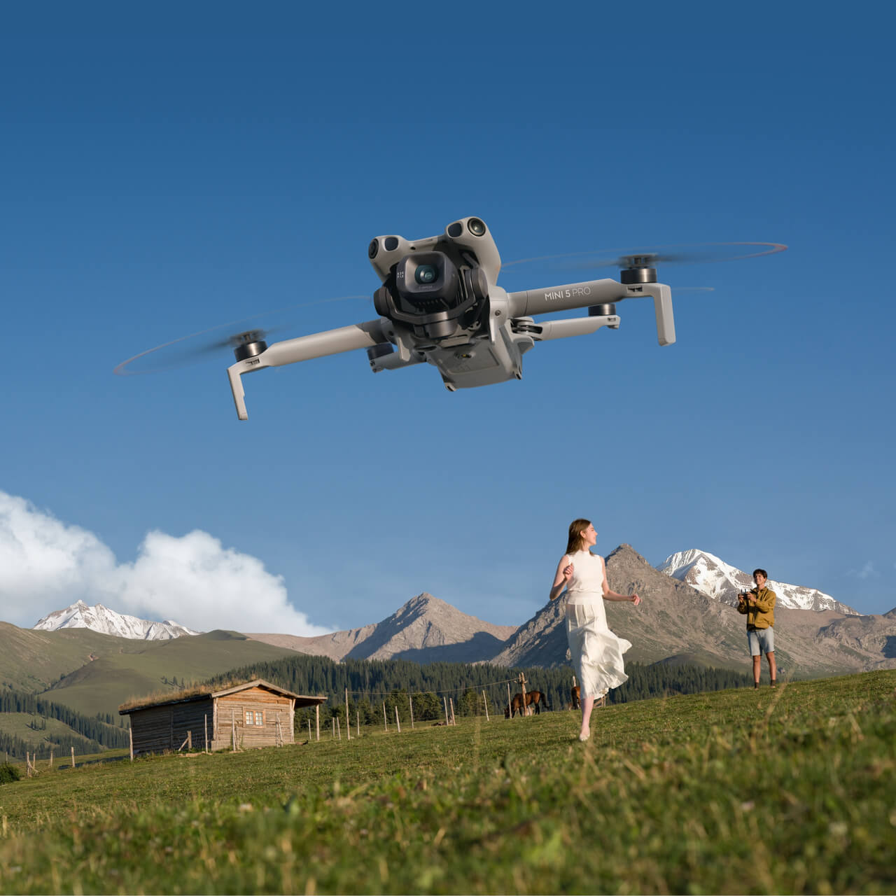
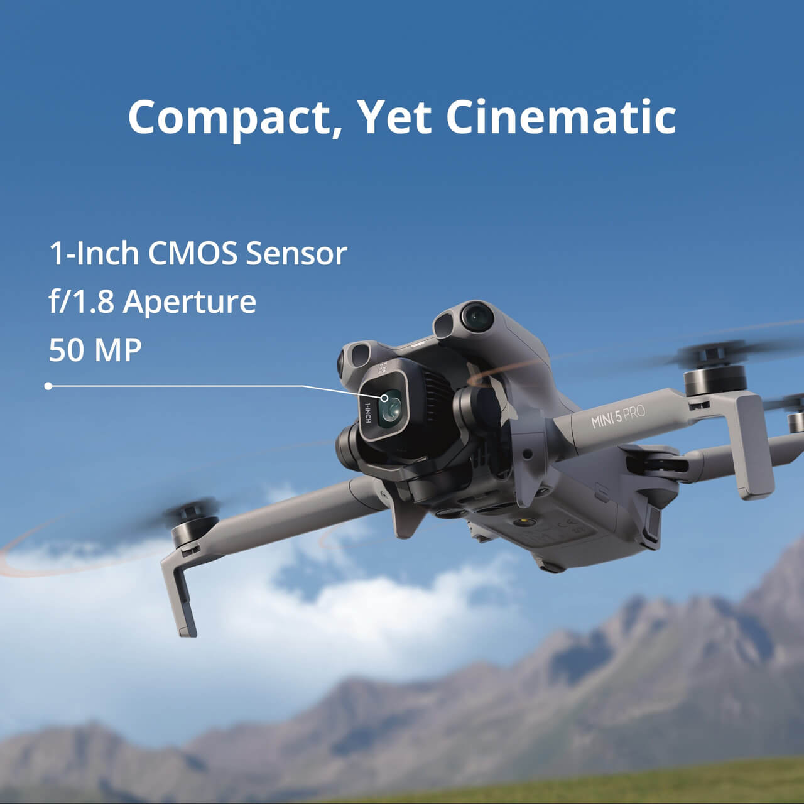
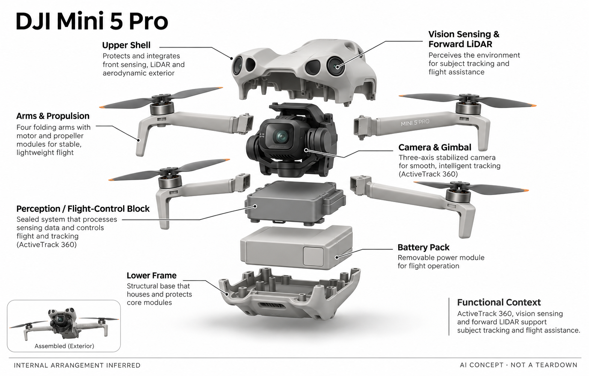

# DJI Mini 5 Pro

**DJI** · 飞行影像 · 核查 2026-11-04

面向个人旅行影像的紧凑视觉跟踪与障碍感知无人机。

消费渠道：个人零售。

## 产品图片与结构参考

### 产品图

DJI Mini 5 Pro 官方产品图 · 来源：[DJI](<https://store.dji.com/au/product/dji-mini-5-pro>) · [原始图片](<https://se-cdn.djiits.com/tpc/uploads/carousel/image/2738b91eed7c870d58218efd2cb93541@ultra.jpg?format=webp>)

### 参考图

DJI Mini 5 Pro 官方外观 / 使用参考图 · 来源：[DJI](<https://store.dji.com/au/product/dji-mini-5-pro>) · [原始图片](<https://se-cdn.djiits.com/tpc/uploads/carousel/image/1c832f9e1bb82fb5df4b0c2281d71412@ultra.jpg?format=webp>)

### AI 生成爆炸示意

**AI 生成 · 非实物拆机。** 内部为概念推断，不能作为元件布局、BOM 或维修依据。[生成提示词](../../content/hardware/prompts/dji-mini-5-pro.txt)

> 分析为基于公开资料的案头研究与 AI 辅助判断，未经用户访谈、销量审计或实物拆机。需求、画像、竞争冷门度、审美及商业机会均为研究假设，不是投资结论。

## 销售与购买

- 状态：在售。澳大利亚官方商品页有Add to Cart与Buy Now，列出不同控制器/电池组合。仅确认所核查地区，不将美国或其他地区库存一概扩展。

- 地区：澳大利亚官方商店、英国目录有购买入口

- 价格：AUD $1,119 起。为所标地区和配置的核查参考；活动、税费、物流及可选服务以实际结算为准，不进行汇率换算或保证最低价。

- 中国大陆：本轮核查海外官方消费渠道，未验证中国大陆结算、型号、保修与全部AI服务可用性；不因品牌来源或支持中文推定国内可购。

- [官方产品 / 商店](<https://store.dji.com/au/product/dji-mini-5-pro>)

## AI 的实际作用

官方列出ActiveTrack 360°、多视觉传感与前向LiDAR等能力，用于目标跟踪、机位控制和感知辅助。

服务与联网依赖：相机、飞行控制与应用配套共同工作，环境和模式限制需要按当前官方说明核对；扩展电池和控制器不是所有包装标配。

## 是否冷门

竞争密集（研究判断）：紧凑消费无人机竞争成熟，视觉AI已成为常见差异维度，需要具体创作任务验证购买理由。

## 需求与市场

需求假设：个人影像爱好者希望在便携范围内获得更高质量的旅行镜头和辅助跟拍。与手机或运动相机相比，使用准备和可用场地更多，因此需要证明飞行视角对真实创作任务的增量。

## 用户画像

画像推断：已有拍摄经验、愿意规划旅行场景的个人创作者和高频户外记录者。首次入门者与升级用户的需求不同，前者更看重学习与售后，后者可能关心镜头、感知和控制的一致性。

## 竞争与替代

竞争判断：紧凑无人机已经是成熟竞争市场，AI跟踪不等于独占能力。它还面对更便宜的旧款、手机工具和更大机型；应按具体携带与成片需求比较，而非以最高参数排序。

## 供应链

公开产品页描述相机、LiDAR、多视觉与电池，完整供应商和BOM未核实。供应链分析应重视云台标定、传感同步、装配公差和售后维修，不能将高集成外观当成低制造难度的证据。

## 技术路径

技术由目标识别、空间感知、飞控及影像处理构成。多传感并不消除所有环境限制，某项返回或跟踪能力还受光照等条件影响；本目录未开展实飞或计算端到端成功率。

## 产品审美

设计观察：可折叠结构和紧凑机身服务旅行携带，云台保护与收纳步骤影响日常使用。细小部件的可靠感、噪声和外观一致性都属于体验，但静态照片不能验证实际飞行稳定。

## 关键风险

风险包括地区库存与使用条件、配件差异、损坏维修及复杂环境中的识别失误。购买更高配置不自动降低全部风险，本轮保留具体条件，不将宣传测试数据理解为无条件使用承诺。

## 机会与验证

市场差异需要通过个人工作流证明，例如同一旅行任务的携带负担、有效镜头和返修成本。用户是否愿意持续带出门，比一次样片更能说明价值，本轮没有用户访谈或销量归因。

## 功能分层示意

这是功能关系，不是实物拆机、真实空间结构或已核实 BOM。

1. **相机与云台**：官方列出影像模块和机械稳定结构。（官方披露）

2. **多传感输入**：视觉传感与前向LiDAR用于环境感知。（官方披露）

3. **识别与跟踪**：ActiveTrack 360°等主体识别能力。（官方披露）

4. **飞行执行**：飞控、推进和机身结构实现相对机位。（分析推断）

5. **电源与遥控**：电池、遥控器与App方案需按组合确认。（官方披露）

## 来源

1. [DJI Mini5Pro 澳洲官方店](<https://store.dji.com/au/product/dji-mini-5-pro>) — 当前购买按钮与感知跟踪能力。

2. [DJI 英国官方消费目录](<https://store.dji.com/uk?set_region=GB>) — 独立列出Mini5Pro消费影像机型。

[返回目录](../hardware-market.md) · [网页分析](https://romanagent.github.io/Roman/#hardware/product/dji-mini-5-pro)
