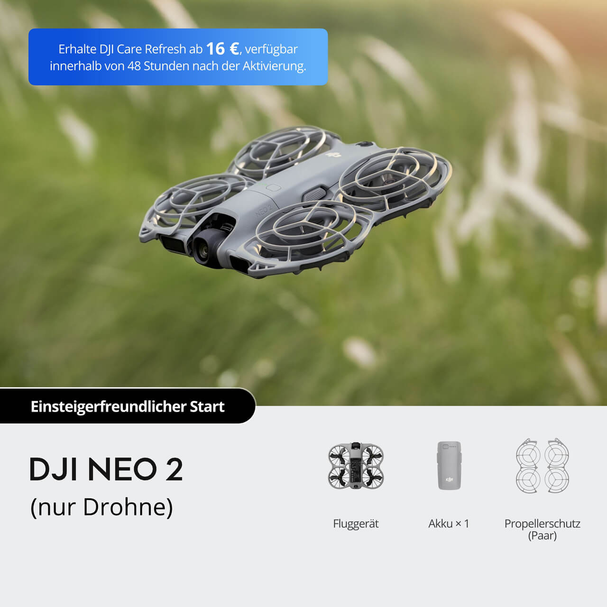
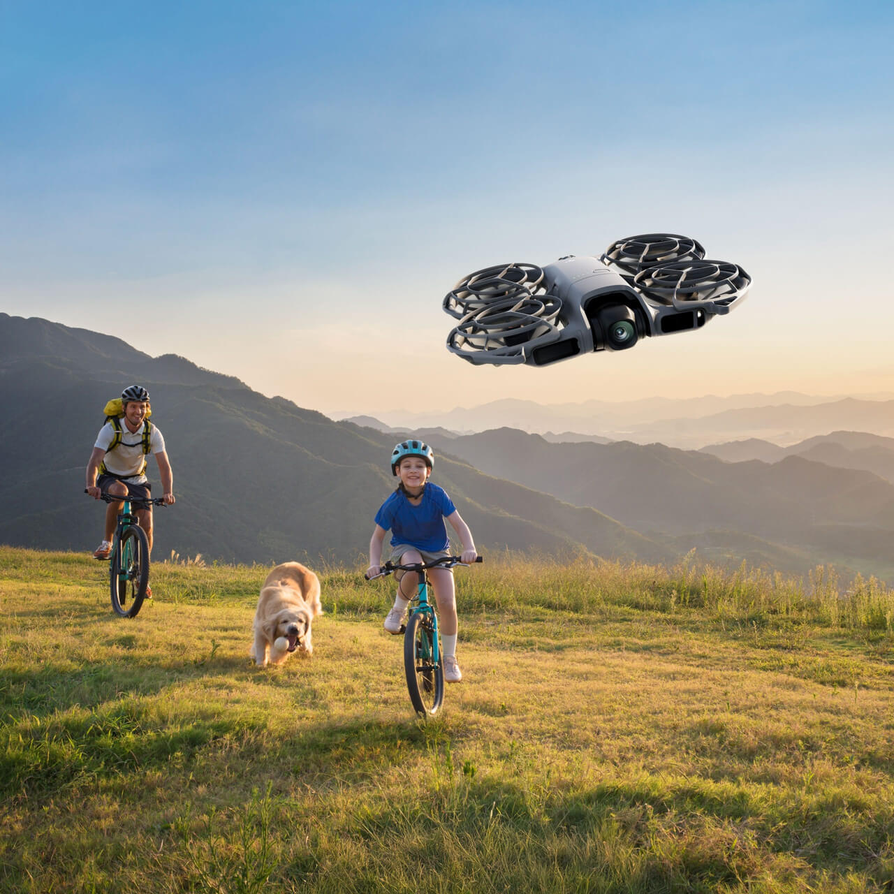
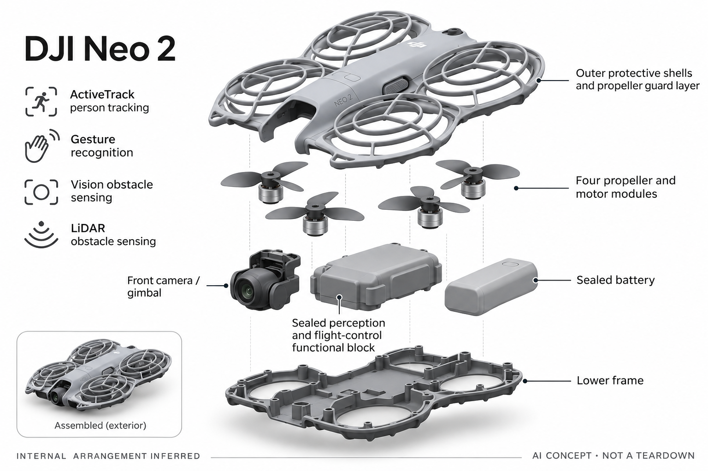

# DJI Neo 2

**DJI** · 飞行影像 · 核查 2026-11-04

围绕人物跟拍、手掌起降与小型机身构建的消费飞行相机。

消费渠道：个人零售。

## 产品图片与结构参考

### 产品图

DJI Neo 2 官方产品图 · 来源：[DJI](<https://store.dji.com/de/product/dji-neo-2>) · [原始图片](<https://se-cdn.djiits.com/tpc/uploads/carousel/image/e13298d62ca4306e571b5d920a830e82@ultra.jpg?format=webp>)

### 参考图

DJI Neo 2 官方外观 / 使用参考图 · 来源：[DJI](<https://store.dji.com/de/product/dji-neo-2>) · [原始图片](<https://se-cdn.djiits.com/tpc/uploads/carousel/image/61dae2255c85099d9fcab59698d6acbf@ultra.jpg?format=webp>)

### AI 生成爆炸示意

**AI 生成 · 非实物拆机。** 内部为概念推断，不能作为元件布局、BOM 或维修依据。[生成提示词](../../content/hardware/prompts/dji-neo-2.txt)

> 分析为基于公开资料的案头研究与 AI 辅助判断，未经用户访谈、销量审计或实物拆机。需求、画像、竞争冷门度、审美及商业机会均为研究假设，不是投资结论。

## 销售与购买

- 状态：在售。德国官方商品页显示In den Warenkorb与Jetzt Bestellen，包含裸机和套装选项。各电池、遥控器组合合并，不把页面可购推定为所有地区现货。

- 地区：德国官方商店、英国目录有销售入口

- 价格：€239 起（德国裸机页）。为所标地区和配置的核查参考；活动、税费、物流及可选服务以实际结算为准，不进行汇率换算或保证最低价。

- 中国大陆：本轮核查海外官方消费渠道，未验证中国大陆结算、型号、保修与全部AI服务可用性；不因品牌来源或支持中文推定国内可购。

- [官方产品 / 商店](<https://store.dji.com/de/product/dji-neo-2>)

## AI 的实际作用

官方描述ActiveTrack人物跟踪、手势识别及视觉与LiDAR结合的障碍感知，属于视觉识别和决策型AI。

服务与联网依赖：跟踪和避障受环境、模式、固件及配件条件影响；不把自动跟拍理解为可在任意场所无人监管飞行。

## 是否冷门

新兴竞争（研究判断）：消费自主跟拍形态仍在变化，但与传统影像工具有明显竞争；特定运动场景不等于普遍需求。

## 需求与市场

需求假设：个人旅行、运动或家庭记录希望让相机离开手臂，获得能跟随自己的视角。真正购买理由是省去掌镜协作，而不是单纯把小型飞机当成AI新奇玩具，使用场地会限制频次。

## 用户画像

画像推断：重视轻量携带和人物记录的个人创作者、旅行者与运动爱好者。是否愿意提前规划场地、维护电池和学习控制，比对参数的兴趣更能决定实际长期使用。

## 竞争与替代

竞争判断：它与其他自主跟拍飞行相机、普通无人机、运动相机和手机云台竞争。轻量和简化操作是差异，但不能把低学习门槛解释为没有操作边界或完全替代传统拍摄技能。

## 供应链

公开信息包括视觉感知、前向LiDAR、云台和保护结构，供应商与完整BOM未知。分析关注电机一致性、轻量外壳、传感器标定、电池和维修件，飞行产品的售后成本不能从零售价简单推算。

## 技术路径

技术链路是识别人物、估计运动、规划相对机位和控制飞行。视觉与其他传感可改善感知覆盖，但具体条件下的可靠性需实测；官方影像演示不代表所有遮挡和环境都可处理。

## 产品审美

设计观察：紧凑机身与保护结构降低外观上的专业设备门槛，也会影响噪声和收纳体积。产品是否自然融入日常记录，取决于启动、携带和回收过程，不只看展开后的照片。

## 关键风险

关键风险是跟踪丢失、环境感知边界、地区使用限制和电池维护。不同遥控或眼镜套装不代表相同体验，本轮没有实飞，也未将厂商条件性续航和传输距离当成普通使用保证。

## 机会与验证

值得验证的市场差异是小型自主跟拍是否成为重复使用的记录方式。应比较单人出行的有效成片、准备时间和闲置原因，而不是根据一次精彩演示或拍摄模式数量推算需求。

## 功能分层示意

这是功能关系，不是实物拆机、真实空间结构或已核实 BOM。

1. **影像输入**：相机与官方描述的视觉感知提供输入。（官方披露）

2. **人物与障碍识别**：ActiveTrack、手势及多传感感知。（官方披露）

3. **飞控与跟拍**：将目标位置转为相对机位与飞行动作。（分析推断）

4. **机身与推进**：轻量结构、云台、推进与保护部件。（官方披露）

5. **电源与控制**：电池和不同控制配件决定使用组合。（官方披露）

## 来源

1. [DJI Neo 2 德国官方商店](<https://store.dji.com/de/product/dji-neo-2>) — 核查到当前购买控件与完整产品描述。

2. [DJI 英国官方在售目录](<https://store.dji.com/uk?set_region=GB>) — 列出Neo2消费跟拍产品；报价按具体地区区分。

[返回目录](../hardware-market.md) · [网页分析](https://romanagent.github.io/Roman/#hardware/product/dji-neo-2)
