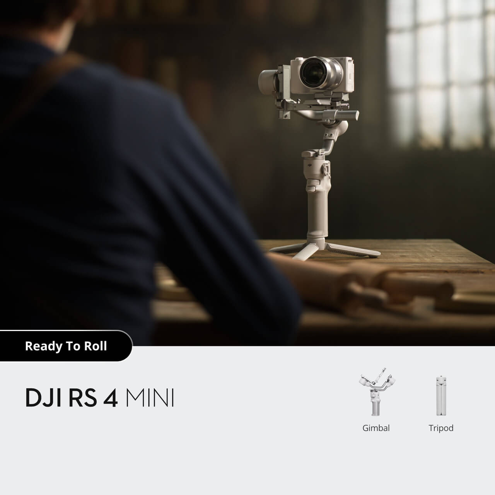
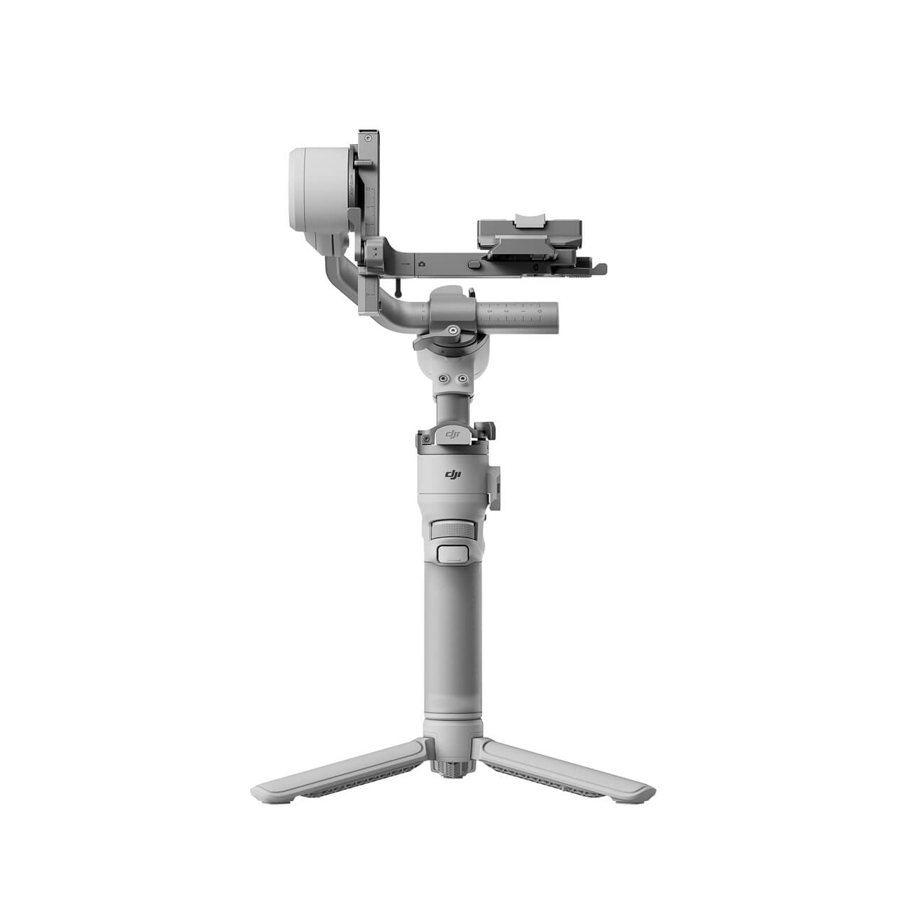
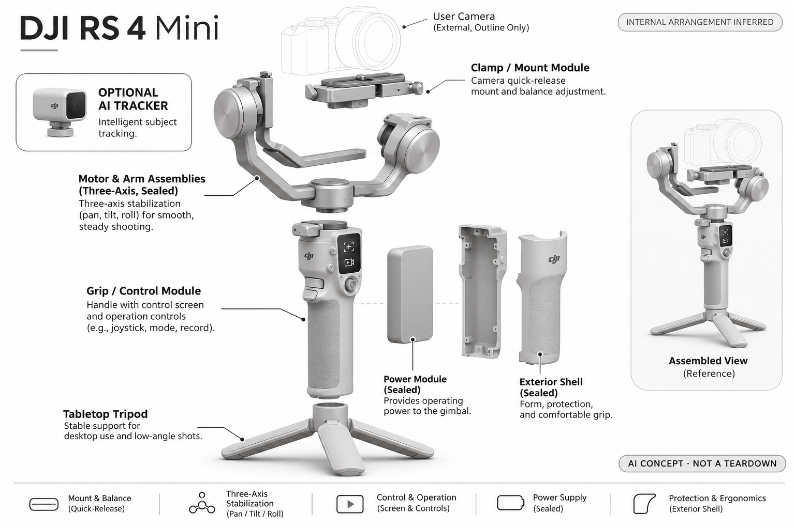

# DJI RS 4 Mini（智能跟随组合）

**DJI** · 智能云台 · 核查 2026-11-04

为个人相机创作增加智能跟随与构图的轻量云台组合。

消费渠道：个人零售。

## 产品图片与结构参考

### 产品图

DJI RS 4 Mini（智能跟随组合） 官方产品图（相机/手机用于展示，非默认随附） · 来源：[DJI](<https://store.dji.com/product/dji-rs-4-mini>) · [原始图片](<https://se-cdn.djiits.com/tpc/uploads/carousel/image/f5adc1d3640456fcce261b4b0250f291@ultra.jpg?format=webp>)

### 参考图

DJI RS 4 Mini（智能跟随组合） 官方外观 / 使用参考图（相机/手机用于展示，非默认随附） · 来源：[DJI](<https://store.dji.com/product/dji-rs-4-mini>) · [原始图片](<https://se-cdn.djiits.com/tpc/uploads/carousel/image/3e7647055a5c3f8fc34fe1c9dbc8dedb@ultra.jpg?format=webp>)

### AI 生成爆炸示意

**AI 生成 · 非实物拆机。** 内部为概念推断，不能作为元件布局、BOM 或维修依据。[生成提示词](../../content/hardware/prompts/dji-rs-4-mini.txt)

> 分析为基于公开资料的案头研究与 AI 辅助判断，未经用户访谈、销量审计或实物拆机。需求、画像、竞争冷门度、审美及商业机会均为研究假设，不是投资结论。

## 销售与购买

- 状态：在售。美国官方页面有购买按钮并区分基础款与Combo。本条按包含智能跟随模块的组合讨论AI能力，附加配件不另计数。

- 地区：美国官方店

- 价格：智能跟随Combo参考US$369；基础款US$309。为所标地区和配置的核查参考；活动、税费、物流及可选服务以实际结算为准，不进行汇率换算或保证最低价。

- 中国大陆：本轮核查海外官方消费渠道，未验证中国大陆结算、型号、保修与全部AI服务可用性；不因品牌来源或支持中文推定国内可购。

- [官方产品 / 商店](<https://store.dji.com/product/dji-rs-4-mini>)

## AI 的实际作用

可配的智能跟随模块用于人物识别和构图，配合三轴云台。普通稳定、轴锁等自动化功能本身不作为AI收录依据。

服务与联网依赖：需要匹配跟随模块、相机和镜头组合；基础包装不应默认包含所有AI能力，相机控制与识别功能也须分开核验。

## 是否冷门

细分专业（研究判断）：个人轻量相机拍摄是专业兴趣场景，已有成熟替代；智能跟随的价值取决于具体任务。

## 需求与市场

需求假设：个人创作者在单人拍摄和出镜讲解时希望维持构图，同时减少携带重量。小型云台的购买理由要看实际镜头组合与使用频次，不能仅因为添加智能模块就视作全新刚需。

### 需求假设：轻量相机系统也能独自维持人物构图 · 研究判断

RS 4 Mini智能跟随组合针对一个人出镜或拍摄时缺少掌镜协助，同时希望控制携带负担的创作者。需求应验证跟随是否减少重新摆机位，而不是只看云台稳定，基础机械防抖和人物识别是两项任务，不能混成同一种AI收益。

依据：[DJI RS4Mini 官方商店](<https://store.dji.com/product/dji-rs-4-mini>) · [DJI RS4Mini 官方能力说明](<https://www.dji.com/au/rs-4-mini>)

### 价值判断：模块化选择增加选购和准备步骤 · 研究判断

外加智能模块让用户按需要配置，但也需要确认安装、供电与套装内容，省下助手操作不等于省下全部准备。研究应记录从拿出设备到完成片段的流程，不能用云台裸机体积判断便利，也不把基础包装价格当作完整跟拍成本。

依据：[DJI RS4Mini 官方商店](<https://store.dji.com/product/dji-rs-4-mini>)

### 验证方案：与固定三脚架完成同一脚本 · 待验证

让个人作者用实际相机与镜头拍摄一段需要移动的讲解，比较智能跟随、普通云台和固定机位，记录配平、重设与补拍。保持脚本目标一致，不只看人物在画面中心，也不以一次演示顺畅证明所有镜头与环境兼容。

依据：[DJI RS4Mini 官方商店](<https://store.dji.com/product/dji-rs-4-mini>) · [DJI RS4Mini 官方能力说明](<https://www.dji.com/au/rs-4-mini>)

## 用户画像

画像推断：使用轻量微单或手机拍摄的个人作者，愿意做基本配平且重视便携。普通家庭偶尔拍摄可能更适合简单支架，重型镜头用户又可能超出这类设备的目标范围。

### 画像假设：愿意配平轻量相机的个人作者 · 研究判断

较匹配者已有合适相机与镜头，能接受基本配平与安装，反复需要独自出镜或跟随构图。偶尔家庭记录可能用手机或支架已足够，重型组合又有不同要求，画像应从实际器材和拍摄频率出发，不以专业外观推定需求。

依据：[DJI RS4Mini 官方商店](<https://store.dji.com/product/dji-rs-4-mini>) · [DJI RS4Mini 官方能力说明](<https://www.dji.com/au/rs-4-mini>)

### 使用约束：相机组合影响完整体验 · 研究判断

镜头长度、附件与控制连接会改变配平和操作，云台能承载不等于所有相机功能可控，用户需理解这些区别。研究应核对完整组合，而不是只比较机身重量，也不把智能模块识别人理解为相机自身自动对焦与曝光都已解决。

依据：[DJI RS4Mini 官方商店](<https://store.dji.com/product/dji-rs-4-mini>) · [DJI RS4Mini 官方能力说明](<https://www.dji.com/au/rs-4-mini>)

### 访谈重点：过去哪段拍摄需要另一个人 · 待验证

请用户回放原有单人拍摄，指出何时需要助手调整方向、何时只是固定机位即可，再观察跟随组合是否减少具体协助。不能将想做视频的未来计划当作频繁需求，也不把更多可移动镜头自动视为更好内容。

依据：[DJI RS4Mini 官方能力说明](<https://www.dji.com/au/rs-4-mini>)

## 竞争与替代

竞争判断：轻量相机云台、手机云台与桌面追踪系统形成重叠市场。模块化跟随提供选择，也增加套装理解成本；只有在具体个人拍摄流程中更省时，才构成可靠的差异化理由。

### 替代方案：相机云台、追踪头与固定机位 · 研究判断

RS 4 Mini面对其他轻量相机云台、自动追踪支架、相机内裁切和人工掌镜，各自改变画面的方式不同。比较应按实际脚本与器材，不能仅因加AI模块就视为新品类，也不将机械防抖、主体识别和对焦归为同一能力。

依据：[DJI RS4Mini 官方商店](<https://store.dji.com/product/dji-rs-4-mini>) · [DJI RS4Mini 官方能力说明](<https://www.dji.com/au/rs-4-mini>)

### 差异判断：可选跟踪让用户决定复杂度 · 研究判断

模块化路线适合只在部分任务需要识别的人，也增加了解套装和保管附件的成本，是否值得需要观察。研究应比较装模块和不装时的实际收益，不把可扩展性当作天然优势，也不认为内置方案一定更简单或外置一定可靠。

依据：[DJI RS4Mini 官方商店](<https://store.dji.com/product/dji-rs-4-mini>)

### 比较方法：从装包到有效片段 · 待验证

让用户用同一相机完成相同讲解或活动记录，统计安装、配平、追踪重设、补拍和收纳，不只比较裸机重量。最终检查哪些镜头被采用，避免以跟踪持续时间代表成片质量，也不忽略拍完后维护与备件的拥有成本。

依据：[DJI RS4Mini 官方商店](<https://store.dji.com/product/dji-rs-4-mini>) · [DJI RS4Mini 官方能力说明](<https://www.dji.com/au/rs-4-mini>)

## 供应链

公开资料展示稳定结构、快装和智能跟随模块，供应商及完整BOM未知。分析重点是马达标定、机械间隙、夹装、供电和接头耐久；售后与镜头兼容比推测芯片品牌更有实际意义。

### 功能拆分：识别模块与三轴执行分开 · 研究判断

公开组合包括智能跟随模块、三轴结构、快装和控制连接，普通轴锁与稳定不单独作为AI依据。识别输出需要与电机和相机配合，具体感知芯片、驱动和工厂未披露，不能从DJI品牌或外壳推断真实BOM，也不默认基础包装含全部模块。

依据：[DJI RS4Mini 官方商店](<https://store.dji.com/product/dji-rs-4-mini>) · [DJI RS4Mini 官方能力说明](<https://www.dji.com/au/rs-4-mini>)

### 制造判断：配平与机械间隙影响实际跟随 · 研究判断

电机标定、关节、快装、线缆和接头需要在不同相机组合中协作，单个追踪模块识别正确也不保证镜头移动平稳。供应评估应看装配与反复使用，本轮没有载荷实测、间隙或寿命数据，不能由小型化推断成本和可靠性。

依据：[DJI RS4Mini 官方能力说明](<https://www.dji.com/au/rs-4-mini>)

### 候选选型：光学运动与模块采集各自核对 · 研究判断

FAULHABER公开相机运动与光学定位能力，可作为三轴执行工程候选，Chicony可讨论跟随模块摄像输入，Sunwoda可研究电源。真实体积、噪声、控制与成本需专项确认，三家均无RS 4 Mini点名供货证据，不能直接替换原机。

依据：[DJI RS4Mini 官方商店](<https://store.dji.com/product/dji-rs-4-mini>) · [DJI RS4Mini 官方能力说明](<https://www.dji.com/au/rs-4-mini>)

## 技术路径

技术应区分视觉跟随、机械防抖、自动轴锁和相机控制。只有前者涉及本条强调的AI识别，普通自动化不能混为AI；兼容性和遮挡下的恢复能力仍需要目标机型实测。

### 已披露能力：智能跟随用于人物与构图 · 官方资料

官方说明可配跟随模块识别人并联动构图，机械稳定、轴锁和相机控制属于不同功能。需要按当前模块与器材组合理解能力，不能把自动对焦或曝光完全归给云台，也不能从系列演示推出任意对象识别与所有相机兼容。

依据：[DJI RS4Mini 官方能力说明](<https://www.dji.com/au/rs-4-mini>)

### 技术判断：跟踪、运动与画面清晰是不同结果 · 研究判断

目标可能被正确识别，但相机对焦、镜头视角或配平仍影响最终片段，研究不能用人物居中替代全部质量。应记录失跟恢复和人工接管是否清楚，不把机械转动顺畅当作算法理解内容，也不推测未公开模型和响应参数。

依据：[DJI RS4Mini 官方能力说明](<https://www.dji.com/au/rs-4-mini>)

### 验证方案：分开观察目标和相机链路 · 待验证

先确认器材配平与基本控制，再启用人物跟随，记录遮挡、离框和重新进入时的行为，检查最终画面是否满足脚本。保持镜头与设置可追溯，不只测试理想空场，也不将本轮未实拍的条件性能力写成成功率保证。

依据：[DJI RS4Mini 官方商店](<https://store.dji.com/product/dji-rs-4-mini>) · [DJI RS4Mini 官方能力说明](<https://www.dji.com/au/rs-4-mini>)

## 产品审美

设计观察：小型化和更少外露附件有助于个人携带，但装上追踪器和相机后才是完整使用形态。外观简洁是否转化为操作简洁，需要观察装配、收纳和拍摄模式切换。

### 外形判断：装好模块和相机才是完整形态 · 研究判断

Mini机身强调携带，但相机、镜头、追踪模块与线缆加上后才体现实际体积和重心，裸机照片会低估这些条件。设计评价应包含展开、快装和收纳，不只看外壳简洁，也不能从少附件的宣传图推断智能组合同样易管理。

依据：[DJI RS4Mini 官方商店](<https://store.dji.com/product/dji-rs-4-mini>)

### 交互判断：拍摄前后切换应容易理解 · 研究判断

用户需要知道什么时候配平完成、模块在跟谁以及相机控制是否连接，状态若不清楚会增加试拍。研究应观察准备和恢复的步骤，不把自动轴锁或触屏当作无需学习，视觉跟随也需要明确开启、暂停与目标选择。

依据：[DJI RS4Mini 官方能力说明](<https://www.dji.com/au/rs-4-mini>)

### 体验验证：用原有器材包完成单人拍摄 · 待验证

让作者使用自己常用镜头、附件与背包完成安装、配平、跟拍、拆卸和收纳，记录需要额外空间与工具的步骤。不要只在展示台体验云台转动，完整负载下的持握和单人操作更能说明小型化是否带来真实便利。

依据：[DJI RS4Mini 官方商店](<https://store.dji.com/product/dji-rs-4-mini>) · [DJI RS4Mini 官方能力说明](<https://www.dji.com/au/rs-4-mini>)

## 关键风险

风险在于基础价格与智能组合混淆、相机控制兼容及误认为AI会负责全部拍摄判断。目标识别、自动对焦和成片质量是不同环节，本目录不以厂商演示替代独立可靠性测试。

### 配置风险：基础与智能组合不能混用 · 研究判断

本条按智能跟随组合分析，基础包装不代表含所有识别附件，实际相机与镜头控制也需核对。用户不能只看最低价格或最大承载判断完整体验，追踪、对焦和画质是不同层，本轮没有全机型兼容与现场可靠性测试。

依据：[DJI RS4Mini 官方商店](<https://store.dji.com/product/dji-rs-4-mini>) · [DJI RS4Mini 官方能力说明](<https://www.dji.com/au/rs-4-mini>)

### 使用风险：误识与机械条件需要接管 · 研究判断

遮挡、对象离框、配平不合适或线缆牵扯可能改变取景，用户仍需对拍摄结果判断，设备不会自动负责全部内容。目录不把厂商演示当作实际成功率，也不将自动稳定理解为任何负载和动作均可靠，维护与电池仍需按说明管理。

依据：[DJI RS4Mini 官方能力说明](<https://www.dji.com/au/rs-4-mini>)

### 验证安排：记录补拍和改回固定机位 · 待验证

试用应保留用户关闭跟随、重新选择目标或改用三脚架的原因，区分识别、机械和内容偏好。不要只统计目标保持时间，也不把用户不用自动功能都解释为操作不熟，真正需要判断的是它是否减少整段拍摄协作。

依据：[DJI RS4Mini 官方能力说明](<https://www.dji.com/au/rs-4-mini>)

## 机会与验证

可验证市场空间是让个人完成原本需要助手维持构图的内容。应对照普通三脚架和其他轻量云台，记录准备、追踪重设及有效片段，本轮没有给出成功概率或虚构销量。

### 研究方向：减轻单人相机拍摄的准备与重设 · 研究判断

RS 4 Mini可以帮助研究轻量相机用户在哪些构图任务需要助手，机会可能在模块状态、兼容说明和恢复，而不是更多模式。应先比较固定机位是否已经足够，再讨论新硬件，避免把添加AI附件当作自动产生新需求。

依据：[DJI RS4Mini 官方能力说明](<https://www.dji.com/au/rs-4-mini>)

### 执行计划：按实际脚本跟踪有效片段 · 待验证

连续记录装配、配平、跟随重设与最终采用镜头，访谈一次放弃自动或没有携带的任务，按实际相机组合分类。不要用一次演示、宣传距离或模式数量推断留存，也不把研究安排冒充已完成的实拍与用户访谈。

依据：[DJI RS4Mini 官方商店](<https://store.dji.com/product/dji-rs-4-mini>) · [DJI RS4Mini 官方能力说明](<https://www.dji.com/au/rs-4-mini>)

### 决策边界：相机自动构图属于共享核心场景 · 研究判断

本款与其他相机云台共享单人追踪和稳定任务，模块化、重量与控制是具体差异，不能按品牌型号重复制造市场。当前没有访谈、销量和供应报价，不以专业外观、AI名称或模型评分预测创业成功，应看重复拍摄中的实际减负。

依据：[DJI RS4Mini 官方商店](<https://store.dji.com/product/dji-rs-4-mini>) · [DJI RS4Mini 官方能力说明](<https://www.dji.com/au/rs-4-mini>)

## 对应供应链公司

能力候选用于选型研究，不代表本产品实际采用；未公开的供货关系不作推断。

- [faulhaber](../supply-chain/faulhaber.md) — **能力候选 · 非已采用** / 轻量相机三轴运动工程候选：FAULHABER公开相机运动、微型驱动与反馈能力，可作为RS 4 Mini执行层候选，但三轴负载、低速平滑、噪声、体积与消费成本须专项验证。公开专业光学案例不证明原机采用，也不能把标准电机直接替换云台关节。

- [chicony](../supply-chain/chicony.md) — **能力候选 · 非已采用** / 智能跟随模块视觉输入候选：Chicony公开摄像模组与图像工程，可作为RS 4 Mini跟随模块输入候选，但尺寸、视场、功耗与跟踪软件配合需确认，普通电脑摄像模组不等于完整识别附件。当前没有DJI点名供货证据，也不涉及相机本体自动对焦。

- [sunwoda](../supply-chain/sunwoda.md) — **能力候选 · 非已采用** / 便携三轴云台电源系统候选：Sunwoda消费电池能力可用于讨论RS 4 Mini运动与跟随模块供电，但电机峰值、安装空间、充电保护和持续工作需专项验证。当前无原机电池采用证据，也不保证通用电芯兼容，完整运行时间取决于实际相机负载与模式。

[浏览供应链目录](../supply-chain.md)

## 功能分层示意

这是功能关系，不是实物拆机、真实空间结构或已核实 BOM。

1. **视觉输入**：AI跟踪模块或应用视觉输入识别目标。（官方披露）

2. **跟踪计算**：将目标位置转换为构图和运动决策。（官方披露）

3. **三轴执行**：电机和关节保持拍摄方向，实际表现需测试。（官方披露）

4. **控制与连接**：屏幕、按键或App提供个人操作入口。（官方披露）

5. **电池与结构**：供电、夹具与配重影响持续拍摄。（分析推断）

## 来源

1. [DJI RS4Mini 官方商店](<https://store.dji.com/product/dji-rs-4-mini>) — 区分基础与智能跟随Combo。

2. [DJI RS4Mini 官方能力说明](<https://www.dji.com/au/rs-4-mini>) — 面向创作者的智能跟随与构图，条件依模块和组合。

[返回目录](../hardware-market.md) · [网页分析](https://romanagent.github.io/Roman/#hardware/product/dji-rs-4-mini)
