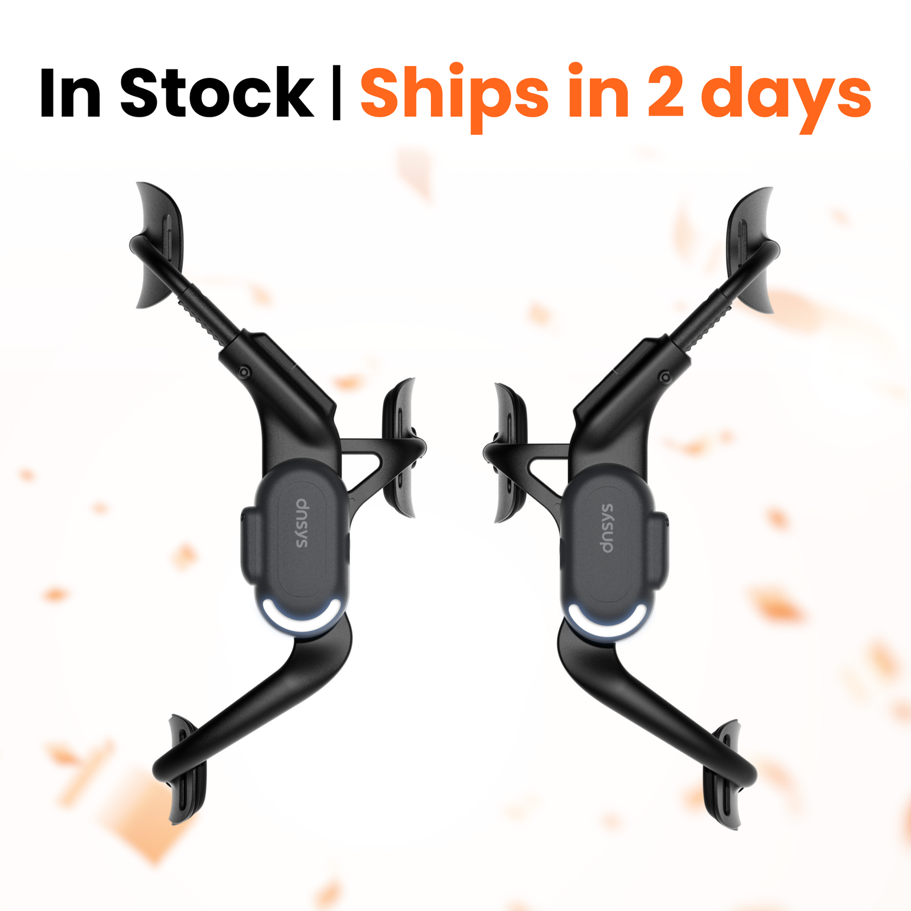
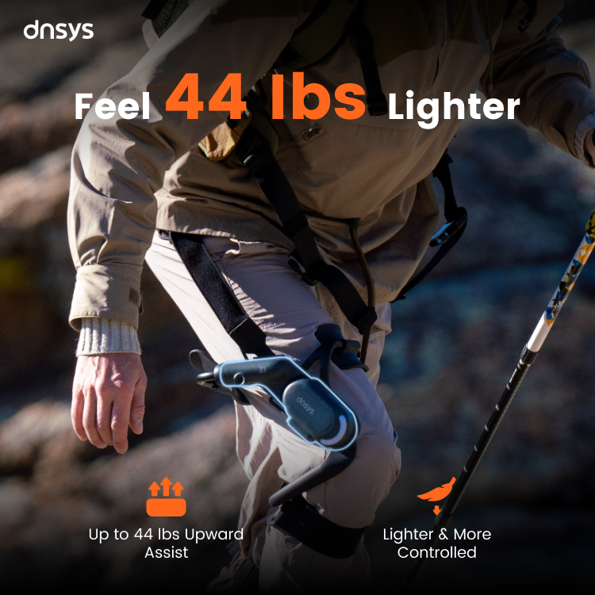
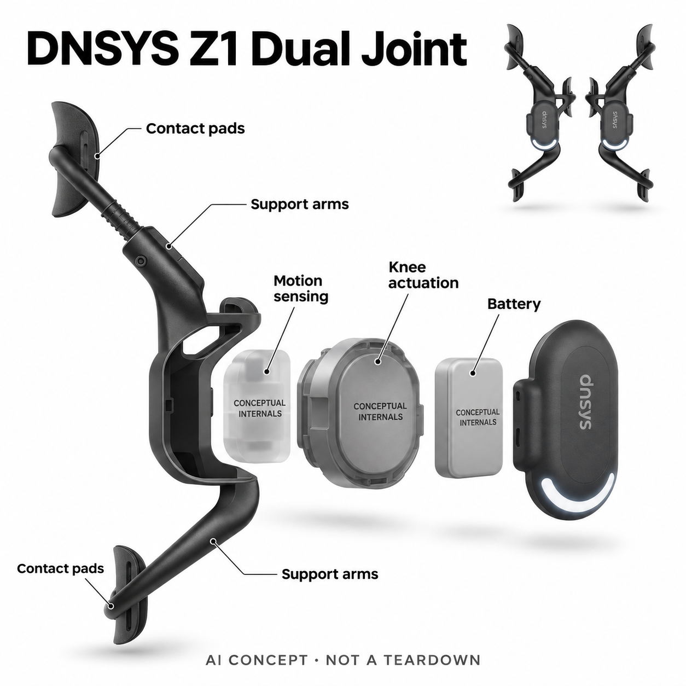

# DNSYS Z1 Dual Joint

**DNSYS** · 个人移动与助力 · 核查 2026-11-04

将动力执行放在膝部的双腿户外助力装置

消费渠道：个人零售。

## 产品图片与结构参考

### 产品图

DNSYS Z1 Dual Joint 官方产品图 · 来源：[DNSYS · 官方资料](<https://dnsys.ai/products/dnsys-z1-exoskeleton-every-step-is-a-leap-forward?variant=43988728447064>) · [原始图片](<https://cdn.shopify.com/s/files/1/0573/1545/9160/files/z1-carbon.png?v=1789873711&width=1600>)

### 参考图

DNSYS Z1 Dual Joint 官方外观与使用参考图（含厂商助力宣传，非本站实测） · 来源：[DNSYS · 官方资料](<https://dnsys.ai/products/dnsys-z1-exoskeleton-every-step-is-a-leap-forward?variant=43988728447064>) · [原始图片](<https://cdn.shopify.com/s/files/1/0573/1545/9160/files/Z1-_3.png?v=1785840773&width=1600>)

### AI 生成爆炸示意

**AI 生成 · 非实物拆机。** 内部为概念推断，不能作为元件布局、BOM 或维修依据。[生成提示词](../../content/hardware/prompts/dnsys-z1-dual-joint.txt)

> 以官方外观图为参照，已目视核对型号、外形、未提供参数与非拆机标记；内部位置仅为功能概念。

> 图片保留官方原貌；其中的宣传数字和效果不作为本站实测结论。

> 分析为基于公开资料的案头研究与 AI 辅助判断，未经用户访谈、销量审计或实物拆机。需求、画像、竞争冷门度、审美及商业机会均为研究假设，不是投资结论。

## 销售与购买

- 状态：在售。核查日官方商品数据Z1 Dual Joint / Basic / Carbon black变体available=true，US$1,299；页面有Add to Cart及现货说明。明确欧盟及美洲可发，亚太文字存在地区及批次差异，不能视作全球现货。

- 地区：欧盟、美洲（按配送地址确认）

- 价格：官方标准双膝版US$1,299。选定Basic标准版；不含X1髋部组合，不套用Pro价格或滑雪能力。

- 中国大陆：本轮未核实中国大陆官方零售与售后渠道。页面亚太交期信息有不同批次表述，跨境购买须另确认目的地与版本。

- [官方产品 / 商店](<https://dnsys.ai/products/dnsys-z1-exoskeleton-every-step-is-a-leap-forward?variant=43988728447064>)

## AI 的实际作用

DNNAS Smart Propulsion结合多维运动传感与深度神经网络，识别运动意图并调整膝部助力。

服务与联网依赖：依赖膝部电机、支撑结构与电池；使用者须可独立行走、抬腿和保持平衡。标准版不包含Pro专属滑雪模式。

## 是否冷门

新兴竞争（研究判断）：膝部消费助力仍需建立适配与安全体验，已有髋部和髋膝竞品；实际体验差异比热度更重要。

## 需求与市场

案头需求是户外行走时对膝关节动作施加有节奏的机械辅助。与腰髋装置相比，接触位置和屈伸体验不同；能否减少长下坡的不适不能由电机参数推出，更不能作医疗结论。

### 事实：任务边界 · 官方资料

Z1 Dual Joint标准版在两侧膝部布置动力单元，并通过大腿和小腿接触结构传力；官方把它用于日常行走、坡道和徒步等消费场景。它仍要求使用者能够独立走路和维持身体平衡，因此任务是辅助原有动作，不是替代人的稳定控制能力。

依据：[DNSYS Z1标准版商品页](<https://dnsys.ai/products/dnsys-z1-exoskeleton-every-step-is-a-leap-forward?variant=43988728447064>) · [DNSYS Z1官方产品说明](<https://dnsys.ai/pages/dnsys-z1-exoskeleton>)

### 判断：真实需求 · 研究判断

对频繁遇到上下坡的人，膝部执行路径可能比腰髋辅助更贴近某些动作的体感，但这种可能性不能直接写成减痛或保护关节的效果。值得验证的是使用者在哪类路段愿意穿、在哪类姿势会受干扰，以及是否愿意承担双腿装置的准备负担。

依据：[DNSYS Z1标准版商品页](<https://dnsys.ai/products/dnsys-z1-exoskeleton-every-step-is-a-leap-forward?variant=43988728447064>) · [DNSYS Z1官方产品说明](<https://dnsys.ai/pages/dnsys-z1-exoskeleton>)

### 验证：任务完成 · 待验证

调研应先问参与者最想改善的是爬升、下行、站起还是长距离行走，再在厂商允许的环境内逐项观察。把每种任务的反馈分别保存，避免用一次平地体验概括全部户外价值，也不要求存在身体不适的人用试验代替专业评估。

依据：[DNSYS Z1标准版商品页](<https://dnsys.ai/products/dnsys-z1-exoskeleton-every-step-is-a-leap-forward?variant=43988728447064>) · [DNSYS Z1官方产品说明](<https://dnsys.ai/pages/dnsys-z1-exoskeleton>)

## 用户画像

潜在人群是能独立行走和稳定控制身体、常有坡道旅行或徒步的人。裤装、腿围及膝部对位影响实际体验；需要先验证穿着和活动范围，不能以高龄或膝痛直接划定适用用户。

### 事实：使用条件 · 官方资料

官方说明的穿戴点分布在膝部附近和大腿、小腿后侧，动作输出通过这些支撑面传递。使用条件不仅是腿围合适，还包括能够主动抬腿、行走和平衡；商品页面中的老年或膝部宣传形象不能自动构成某类疾病人群的适用证明。

依据：[DNSYS Z1标准版商品页](<https://dnsys.ai/products/dnsys-z1-exoskeleton-every-step-is-a-leap-forward?variant=43988728447064>) · [DNSYS Z1官方产品说明](<https://dnsys.ai/pages/dnsys-z1-exoskeleton>)

### 判断：人群筛选 · 研究判断

潜在人群可按坡道频率、已有装备和是否需要频繁坐下划分。经常长途摄影的人可能在意背负状态下的支持，而城市出行者更在意上车和椅子旁是否磕碰；这些不同任务比笼统称为户外爱好者更有助于判断是否需要膝侧执行机构。

依据：[DNSYS Z1标准版商品页](<https://dnsys.ai/products/dnsys-z1-exoskeleton-every-step-is-a-leap-forward?variant=43988728447064>) · [DNSYS Z1官方产品说明](<https://dnsys.ai/pages/dnsys-z1-exoskeleton>)

### 验证：参与者差异 · 待验证

招募时记录真实腿围、常穿裤装和原有运动习惯，让参与者自行完成穿戴并指出左右或松紧是否难以分辨。访谈应问是否因旁人注视而不愿使用、多久需要重新调整绑带，以及从徒步转换到坐姿休息时是否想立即拆下。

依据：[DNSYS Z1标准版商品页](<https://dnsys.ai/products/dnsys-z1-exoskeleton-every-step-is-a-leap-forward?variant=43988728447064>) · [DNSYS Z1官方产品说明](<https://dnsys.ai/pages/dnsys-z1-exoskeleton>)

## 竞争与替代

它与髋部外骨骼有共同的步行需求，但执行关节、绑缚位置和承力路径不同。本轮保留这个明确技术路线代表，不再添加同装置的Pro、配色或X1组合来增加产品数量。

### 事实：方案范围 · 官方资料

标准双膝版、Pro双膝版和附加X1的髋膝组合在同一商店出现，但官方明确滑雪功能只属于Pro且还有启用条件。本目录只保留标准双膝版，核心区分是膝部执行路线，不把配色、材料或将两个现有设备打包当作新增独立场景。

依据：[DNSYS Z1标准版商品页](<https://dnsys.ai/products/dnsys-z1-exoskeleton-every-step-is-a-leap-forward?variant=43988728447064>) · [DNSYS Z1官方产品说明](<https://dnsys.ai/pages/dnsys-z1-exoskeleton>)

### 判断：替代关系 · 研究判断

与髋部装置相比，双膝方案改变执行位置和腿部包覆范围；与登山杖相比，它不依靠双手传力，但需要电池与贴身调整。哪一种更适合某条路线要看使用者的动作和背负，不能只依据厂家对等效减重或动力的不同宣传口径排序。

依据：[DNSYS Z1标准版商品页](<https://dnsys.ai/products/dnsys-z1-exoskeleton-every-step-is-a-leap-forward?variant=43988728447064>) · [DNSYS Z1官方产品说明](<https://dnsys.ai/pages/dnsys-z1-exoskeleton>)

### 验证：比较方法 · 待验证

比较可在同一参与者、同一安全路段和同等背负条件下分别体验几种路线，记录穿脱、关节对位、走动声音和中途调整。对无法统一的参数应保留说明，尤其不把Pro或髋膝组合的演示视频拿来证明标准版达到同样体验。

依据：[DNSYS Z1标准版商品页](<https://dnsys.ai/products/dnsys-z1-exoskeleton-every-step-is-a-leap-forward?variant=43988728447064>) · [DNSYS Z1官方产品说明](<https://dnsys.ai/pages/dnsys-z1-exoskeleton>)

## 供应链

膝部机电总成需和大腿、小腿支撑配合，电池、传感与控制还受运动冲击和接触压力限制。具体工厂未披露；候选电驱厂仅代表能力匹配，不能写成DNSYS已使用某家电机。

### 事实：功能组成 · 官方资料

公开结构包括双膝动力总成、上下支撑臂、软接触垫、运动传感与电池；官方产品说明还列出扭矩、位置和力等多传感输入。其完整电路、量产工厂和上游物料清单没有披露，视觉上的封装相似不能支持和其他品牌共用供应商的推断。

依据：[DNSYS Z1标准版商品页](<https://dnsys.ai/products/dnsys-z1-exoskeleton-every-step-is-a-leap-forward?variant=43988728447064>) · [DNSYS Z1官方产品说明](<https://dnsys.ai/pages/dnsys-z1-exoskeleton>)

### 判断：交付约束 · 研究判断

工程约束集中在执行轴与人体运动的对位，以及长期屈伸时结构、软垫和连接件共同承受的重复载荷。可更换电池也需要兼顾运动冲击和误装，单独采购一个小电机并不能形成可穿戴系统，验证必须覆盖传力路径与整机故障状态。

依据：[DNSYS Z1标准版商品页](<https://dnsys.ai/products/dnsys-z1-exoskeleton-every-step-is-a-leap-forward?variant=43988728447064>) · [DNSYS Z1官方产品说明](<https://dnsys.ai/pages/dnsys-z1-exoskeleton>)

### 验证：选型缺口 · 待验证

可把maxon作为机电驱动工程能力候选、Grepow作为动力电池候选，但需先给出占用空间、真实工作循环和允许的热噪声范围。品牌自有动力名称不等于公开制造来源，若无法获得接口和载荷资料，就应停留在能力目录而不编造BOM。

依据：[DNSYS Z1标准版商品页](<https://dnsys.ai/products/dnsys-z1-exoskeleton-every-step-is-a-leap-forward?variant=43988728447064>) · [DNSYS Z1官方产品说明](<https://dnsys.ai/pages/dnsys-z1-exoskeleton>)

## 技术路径

官方把DNNAS描述为多维感知和深度神经网络的控制系统。关键验证对象是屈伸阶段助力方向与使用者意图是否一致，并记录中途停止、转身和上下台阶，不能只看宣传负担降低比例。

### 事实：AI机制 · 官方资料

官方将DNNAS描述为结合多维传感信息的学习型运动控制，产品页明确关联深度神经网络，用来判断运动状态并调整辅助。这里的AI机制在于感知到助力决策的映射；电池快换、普通机械支撑和单独的电机输出不作为额外AI功能叠加。

依据：[DNSYS Z1标准版商品页](<https://dnsys.ai/products/dnsys-z1-exoskeleton-every-step-is-a-leap-forward?variant=43988728447064>) · [DNSYS Z1官方产品说明](<https://dnsys.ai/pages/dnsys-z1-exoskeleton>)

### 判断：系统边界 · 研究判断

膝部屈伸的相位和使用意图如果不同步，用户可能感到阻碍而非帮助，因此算法与机械适配不能分开评估。公开资料没有给出可独立复核的各动作误判率、控制边界或训练人群分布，不能把训练时长和体验人数转成可靠性保证。

依据：[DNSYS Z1标准版商品页](<https://dnsys.ai/products/dnsys-z1-exoskeleton-every-step-is-a-leap-forward?variant=43988728447064>) · [DNSYS Z1官方产品说明](<https://dnsys.ai/pages/dnsys-z1-exoskeleton>)

### 验证：算法与体验 · 待验证

实测方案应从开始迈步、停住、站起和缓慢屈伸等可控动作入手，记录被识别状态与使用者预期的差别，再结合品牌允许条件扩展坡道。通过逐动作日志判断问题来自绑缚、延迟还是模式切换，本轮没有采集这些数据，暂不下性能结论。

依据：[DNSYS Z1标准版商品页](<https://dnsys.ai/products/dnsys-z1-exoskeleton-every-step-is-a-leap-forward?variant=43988728447064>) · [DNSYS Z1官方产品说明](<https://dnsys.ai/pages/dnsys-z1-exoskeleton>)

## 产品审美

两条独立膝部支架使穿戴结构清晰，圆角黑色外壳弱化裸露机械感。推断上，膝侧体积可能影响狭窄通道、坐姿和裤装；绑带是否滑移比灯光效果更决定日常接受度。

### 事实：外观与交互 · 官方资料

官方标准版主图为两条分离的黑色膝侧装置，椭圆动力外壳与上下弯曲支撑臂构成主要轮廓。商品图库也包含明显写有Pro的图片，本次媒体核验将其排除，保留无Pro标记的标准主图与可辨认的膝部穿戴场景。

依据：[DNSYS Z1标准版商品页](<https://dnsys.ai/products/dnsys-z1-exoskeleton-every-step-is-a-leap-forward?variant=43988728447064>) · [DNSYS Z1官方产品说明](<https://dnsys.ai/pages/dnsys-z1-exoskeleton>)

### 判断：使用中的形态 · 研究判断

两条独立单元让产品看起来比全身机甲克制，但膝外侧厚度和支撑垫会进入坐下、跨步或狭窄通道的活动范围。外壳灯带提供状态表达的可能，也可能在夜间过于显眼；仅凭宣传照片不能判断其操作可读性与穿戴低调程度。

依据：[DNSYS Z1标准版商品页](<https://dnsys.ai/products/dnsys-z1-exoskeleton-every-step-is-a-leap-forward?variant=43988728447064>) · [DNSYS Z1官方产品说明](<https://dnsys.ai/pages/dnsys-z1-exoskeleton>)

### 验证：日常接受度 · 待验证

视觉与体验验证应覆盖有手套时找开关、辨认左右、收纳两条装置和取放电池。让参与者说明哪些部件看上去可按压、哪些实际上不能碰，并记录衣物是否被结构挂住；审美反馈应与这些具体动作结合，避免仅做外形喜好投票。

依据：[DNSYS Z1标准版商品页](<https://dnsys.ai/products/dnsys-z1-exoskeleton-every-step-is-a-leap-forward?variant=43988728447064>) · [DNSYS Z1官方产品说明](<https://dnsys.ai/pages/dnsys-z1-exoskeleton>)

## 关键风险

同一商品页混有标准版、Pro与髋膝套装，图片和功能容易串用。必须按SKU确认；此外个人平衡、助力中断与错误对位风险需要试穿记录，不能把消费助力等同于康复支具。

### 事实：已知限制 · 官方资料

标准版不支持商品页展示的Pro滑雪模式，官方也不是把本品当作医疗康复设备销售。欧盟、美洲和亚太的交付文字存在区域及批次差异；本条只据当前标准变体和明确配送范围记录现售，没有将所有目的地都标成马上可发。

依据：[DNSYS Z1标准版商品页](<https://dnsys.ai/products/dnsys-z1-exoskeleton-every-step-is-a-leap-forward?variant=43988728447064>) · [DNSYS Z1官方产品说明](<https://dnsys.ai/pages/dnsys-z1-exoskeleton>)

### 判断：失效影响 · 研究判断

用户最容易误读的是把等效减重、膝部压力或健康宣传数字当成自己必然获得的效果，以及将不同版本图片视为同一配置。更具体的使用风险还包括接触面滑动、屈伸干涉和助力突然变化，它们的发生率本轮没有实测证据。

依据：[DNSYS Z1标准版商品页](<https://dnsys.ai/products/dnsys-z1-exoskeleton-every-step-is-a-leap-forward?variant=43988728447064>) · [DNSYS Z1官方产品说明](<https://dnsys.ai/pages/dnsys-z1-exoskeleton>)

### 验证：风险处理 · 待验证

采购前应逐项核对标准版SKU、允许运动、目的地服务和电池替换渠道；试穿时保留随时停止并由工作人员协助卸下的流程。若体验者描述疼痛或明显不稳定，应记录并停止该动作，不用继续测试来证明厂商的关节支持宣传。

依据：[DNSYS Z1标准版商品页](<https://dnsys.ai/products/dnsys-z1-exoskeleton-every-step-is-a-leap-forward?variant=43988728447064>) · [DNSYS Z1官方产品说明](<https://dnsys.ai/pages/dnsys-z1-exoskeleton>)

## 机会与验证

可验证机会是对有坡道路线的人提供标准化试穿和适配说明。用同一参与者比较无装置、膝部与髋部方案，记录穿脱、屈伸干涉、信任和携带意愿，而非凭模型评分预测胜出者。

### 判断：可尝试切口 · 研究判断

值得尝试的切口是围绕膝部与髋部执行差异提供真实任务说明，让用户知道哪类动作需要哪种传力路径。若多数抱怨来自对位和绑带，而非动力不足，改善穿戴指引与接触件可能比推出另一个高功率型号更有意义；这仍是分析假设。

依据：[DNSYS Z1标准版商品页](<https://dnsys.ai/products/dnsys-z1-exoskeleton-every-step-is-a-leap-forward?variant=43988728447064>) · [DNSYS Z1官方产品说明](<https://dnsys.ai/pages/dnsys-z1-exoskeleton>)

### 判断：商业边界 · 研究判断

商业判断需要把设备交付和适配服务一起考虑。双腿装置的试穿、清洁、软垫磨损和返修可能影响用户愿付费用，跨境买到硬件也不意味着国内有人能做维护；本轮没有代理访谈或售后成本数据，不能据官网价格估计利润空间。

依据：[DNSYS Z1标准版商品页](<https://dnsys.ai/products/dnsys-z1-exoskeleton-every-step-is-a-leap-forward?variant=43988728447064>) · [DNSYS Z1官方产品说明](<https://dnsys.ai/pages/dnsys-z1-exoskeleton>)

### 验证：下一步调研 · 待验证

下一步可以邀请有固定坡道活动的人连续体验两周，比较第一次与多次穿戴后的耗时、调整次数和再用意愿。询问愿意为什么服务付钱、为何某天没有带出门，并用实际记录决定是否继续研究，不用统一创新评分预测产品成功。

依据：[DNSYS Z1标准版商品页](<https://dnsys.ai/products/dnsys-z1-exoskeleton-every-step-is-a-leap-forward?variant=43988728447064>) · [DNSYS Z1官方产品说明](<https://dnsys.ai/pages/dnsys-z1-exoskeleton>)

## 对应供应链公司

能力候选用于选型研究，不代表本产品实际采用；未公开的供货关系不作推断。

- [maxon](../supply-chain/maxon.md) — **能力候选 · 非已采用** / 膝部驱动与反馈工程候选：双膝助力需要电机、传动、反馈和控制形成系统，maxon公开具有相关机电整合能力。是否符合膝侧空间、负载、安全与噪声限制仍须专项工程验证，本轮没有证据显示DNSYS采用maxon，不能把候选关系写成供应事实。

- [grepow](../supply-chain/grepow.md) — **能力候选 · 非已采用** / 可更换动力电池候选：Grepow公开机器人和定制电池方向，可供膝部装置的空间与运动负载方案研究。快换连接、保护、电压和温升必须与整机验证，现有资料没有DNSYS点名采用或兼容证据，因此这里只表达能力筛选而不推测实际电芯品牌。

[浏览供应链目录](../supply-chain.md)

## 功能分层示意

这是功能关系，不是实物拆机、真实空间结构或已核实 BOM。

1. **接触支撑**：两腿的大腿与小腿接触结构保持膝部执行位置。（官方披露）

2. **膝部执行**：双侧膝部驱动总成施加机械辅助；标准版不作为滑雪设备描述。（官方披露）

3. **DNNAS控制**：多维感知与深度神经网络调节运动助力。（官方披露）

4. **电池与操作**：电池供电与本机交互维持运动过程。（官方披露）

5. **内部概念**：未披露的电路及传动布局仅作功能示意，非拆机。（分析推断）

## 来源

1. [DNSYS Z1标准版商品页](<https://dnsys.ai/products/dnsys-z1-exoskeleton-every-step-is-a-leap-forward?variant=43988728447064>) — 实际打开商品页并读取公开商品JSON；标准黑色Basic现售，分清Pro和X1组合。

2. [DNSYS Z1官方产品说明](<https://dnsys.ai/pages/dnsys-z1-exoskeleton>) — 实际打开；DNNAS、膝部助力及使用者能力限制，区域交付文字需结合当前SKU。

[返回目录](../hardware-market.md) · [网页分析](https://romanagent.github.io/Roman/#hardware/product/dnsys-z1-dual-joint)
