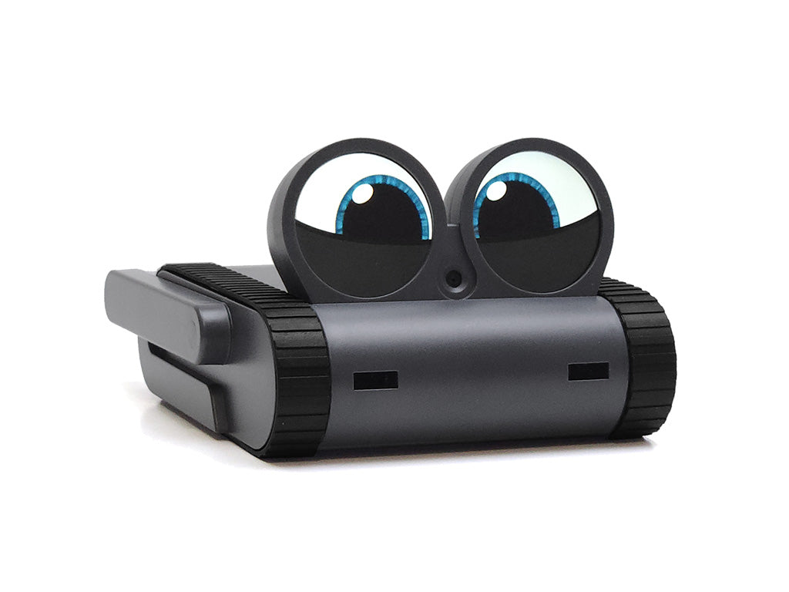
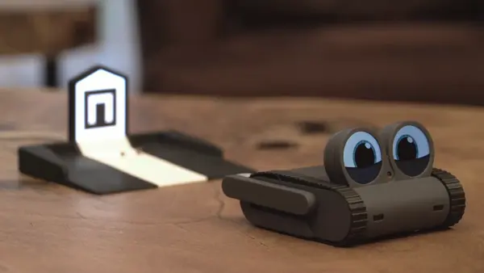
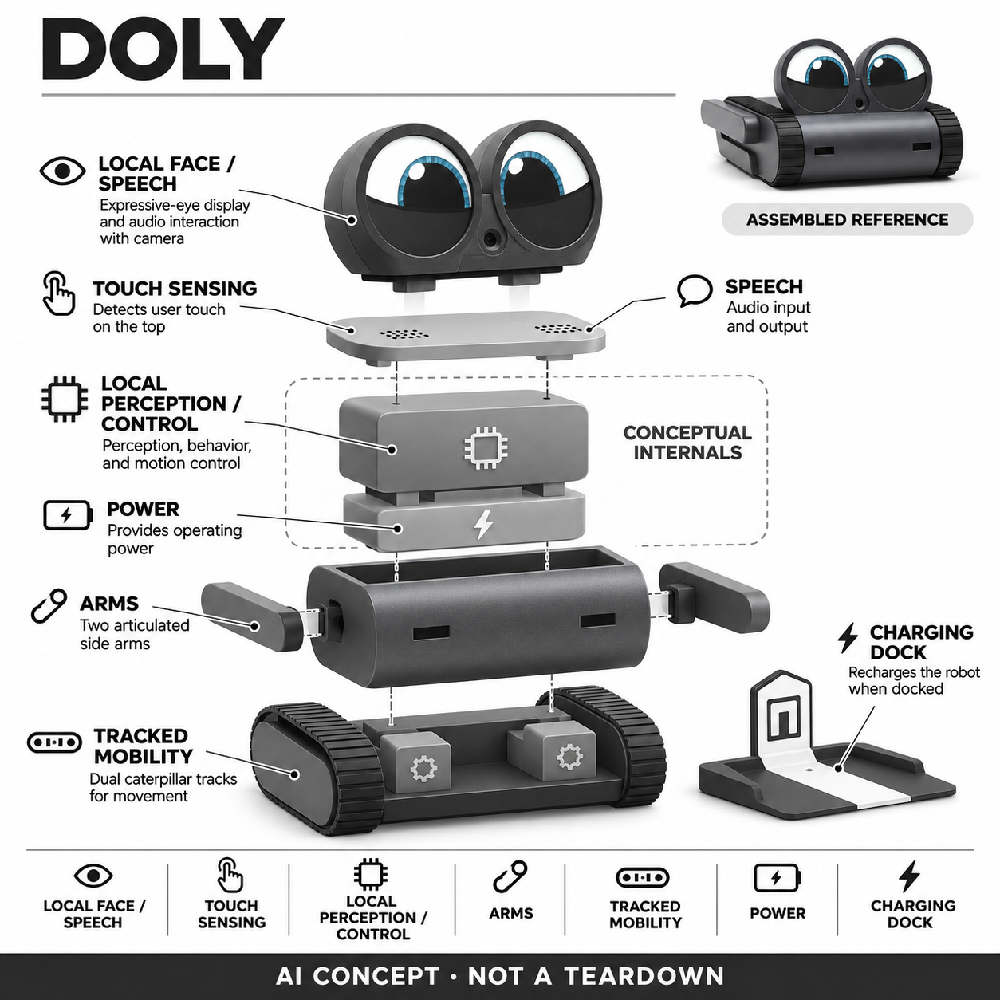

# Doly

**Limitbit / Doly** · AI玩具 · 核查 2026-11-06

本地识别与开放编程结合的成人桌面伙伴

消费渠道：个人零售。

## 产品图片与结构参考

### 产品图

Doly 官方产品图（厂商资料） · 来源：[Limitbit / Doly 官方资料](<https://shop.doly.ai/products/doly>) · [原始图片](<https://cdn.shopify.com/s/files/1/0785/5308/8236/files/doly.jpg?v=1774476099>)

### 参考图

Doly 官方外形或使用参考（厂商资料） · 来源：[Limitbit / Doly 官方资料](<https://doly.ai/companion/>) · [原始图片](<https://doly.ai/wp-content/uploads/2026/03/self_charge.webp>)

### AI 生成爆炸示意

**AI 生成 · 非实物拆机。** 内部为概念推断，不能作为元件布局、BOM 或维修依据。[生成提示词](../../content/hardware/prompts/doly-robot.txt)

> 分析为基于公开资料的案头研究与 AI 辅助判断，未经用户访谈、销量审计或实物拆机。需求、画像、竞争冷门度、审美及商业机会均为研究假设，不是投资结论。

## 销售与购买

- 状态：在售。当前完整Doly含内置计算平台与充电站，Add to cart；公开基础和高内存变体均available=true。商品提示非儿童玩具、当前英语支持。

- 地区：加拿大、美国、其他地区以官方结算为准

- 价格：官网按地区币种显示，当前加拿大视图约C$573。基础与高内存变体价格不同且动态；最终币种、税费及配送以结算为准，不重复计数。

- 中国大陆：官方商城地区列表含中国，但未完成目的地配送验证；未确认中国大陆本地售后及中文语音，当前商品说明为英语。

- [官方产品 / 商店](<https://shop.doly.ai/products/doly>)

## AI 的实际作用

本地语音识别、人脸记忆识别与触摸/运动输入结合，驱动桌面反应、小游戏和移动；开放SDK允许自行扩展。

服务与联网依赖：默认感知识别与行为强调无服务器运行；设置、更新及可选在线信息仍可能需要网络。自定义LLM不是已承诺的成品默认功能。

## 是否冷门

新兴竞争（研究判断）：竞争判断中，它面对封闭式桌面宠物和自组机器人两端的替代。成品减少底层装配门槛，开放软件又允许修改，但维护工具和版本也会消耗时间；封闭产品可能更易开始，自组项目则更自由，哪一种更好取决于用户是否愿意亲手参与。

## 需求与市场

需求判断是把一个会回应的角色留在桌边，同时允许用户逐步修改玩法。只想打开即聊天的人可能觉得设置和英语支持不足，喜欢编程与三维打印的人则可能看重可控性；两类目标不能靠同一功能清单混在一起，也不能把开发热情等同长期使用。

### 事实与范围 · 官方资料

Doly官方商城销售带内置计算平台和充电座的完整机器人，并说明可开箱运行；陪伴页列出本地人脸识别、语音命令、桌面游戏与自主回充。它在此作为成人可编程桌面伙伴收录，而非单独开发板，也不把商店明确的非儿童玩具提示删除。

依据：[Doly官方成品商店](<https://shop.doly.ai/products/doly>) · [Doly官方陪伴功能](<https://doly.ai/companion/>)

### 判断与差异 · 研究判断

需求判断是把一个会回应的角色留在桌边，同时允许用户逐步修改玩法。只想打开即聊天的人可能觉得设置和英语支持不足，喜欢编程与三维打印的人则可能看重可控性；两类目标不能靠同一功能清单混在一起，也不能把开发热情等同长期使用。

依据：[Doly官方成品商店](<https://shop.doly.ai/products/doly>) · [Doly官方陪伴功能](<https://doly.ai/companion/>)

### 验证与限制 · 待验证

验证可先让参与者只使用默认互动一周，再自愿选择修改一个行为或外观，比较两阶段主动使用情况。询问实际想改什么以及遇到错误后是否愿意修复，区分喜欢机器人本身与喜欢制作过程的人，避免将一次成功跑通示例当成稳定需求。

依据：[Doly官方成品商店](<https://shop.doly.ai/products/doly>) · [Doly官方陪伴功能](<https://doly.ai/companion/>)

## 用户画像

用户画像可假设为有固定书桌的成人机器人爱好者、愿意写少量代码的个人创作者及在家做项目的人。若只想陪孩子玩，监护者要承担设备管理和适龄判断，不能从品牌提供教育路线推断所有年龄都适用，也不自动把它当无人陪护装置。

### 事实与范围 · 官方资料

当前商品页称官方软件针对基础内存版本优化，较高内存主要面向运行自定义软件的开发者，同时列出英语支持及建议的联网设置条件。不同容量仍属于一个产品，本条不拆分计数；手机或电脑可用于个性化和更新，但不是替代机器人本体。

依据：[Doly官方成品商店](<https://shop.doly.ai/products/doly>) · [Doly官方陪伴功能](<https://doly.ai/companion/>)

### 判断与差异 · 研究判断

用户画像可假设为有固定书桌的成人机器人爱好者、愿意写少量代码的个人创作者及在家做项目的人。若只想陪孩子玩，监护者要承担设备管理和适龄判断，不能从品牌提供教育路线推断所有年龄都适用，也不自动把它当无人陪护装置。

依据：[Doly官方成品商店](<https://shop.doly.ai/products/doly>) · [Doly官方陪伴功能](<https://doly.ai/companion/>)

### 验证与限制 · 待验证

招募应询问参与者是否愿意安装工具、处理无线设置以及保留充电位置，让其自行完成一个简单定时器或认人任务。记录需要求助的步骤，再问这些步骤是有趣的探索还是阻碍使用，分析时按经验分组，不以工程职业简单代替实际动手能力。

依据：[Doly官方成品商店](<https://shop.doly.ai/products/doly>) · [Doly官方陪伴功能](<https://doly.ai/companion/>)

## 竞争与替代

竞争判断中，它面对封闭式桌面宠物和自组机器人两端的替代。成品减少底层装配门槛，开放软件又允许修改，但维护工具和版本也会消耗时间；封闭产品可能更易开始，自组项目则更自由，哪一种更好取决于用户是否愿意亲手参与。

### 事实与范围 · 官方资料

官方同时提供面向陪伴、教育和开发者的使用路线，完整Doly与打印外壳的Maker版本并列销售。这里仅收完整成品，不把相同电子平台的套装、内存和配件扩成多个需求；其桌面履带与圆眼表达同样服务于可回应的实体角色。

依据：[Doly官方成品商店](<https://shop.doly.ai/products/doly>) · [Doly官方陪伴功能](<https://doly.ai/companion/>)

### 判断与差异 · 研究判断

竞争判断中，它面对封闭式桌面宠物和自组机器人两端的替代。成品减少底层装配门槛，开放软件又允许修改，但维护工具和版本也会消耗时间；封闭产品可能更易开始，自组项目则更自由，哪一种更好取决于用户是否愿意亲手参与。

依据：[Doly官方成品商店](<https://shop.doly.ai/products/doly>) · [Doly官方陪伴功能](<https://doly.ai/companion/>)

### 验证与限制 · 待验证

可让同一用户分别体验默认伙伴、一个官方编程示例与普通手机虚拟宠物，记录完成任务时间和第二天主动回来的原因。比较应包含桌面空间与软件维护，不只计算代码接口数量；没有订单或用户调查证据时不推断这个小众群体的规模。

依据：[Doly官方成品商店](<https://shop.doly.ai/products/doly>) · [Doly官方陪伴功能](<https://doly.ai/companion/>)

## 供应链

工程判断是履带、侧臂和底部传感器需要共同适配桌面摩擦与边缘环境，充电站的视觉定位也受摆放和光照影响。开放外壳允许个性化，却可能让新材料遮挡传感、改变重量和重心，因此可打印文件不能取代修改后重新验证整机行为。

### 事实与范围 · 官方资料

公开商品页确认整机包含计算平台与充电站，陪伴页给出相机、触摸和运动感知、语音及履带移动等类目。供应商清单与具体电路布局并未完整披露；开放设计路径不意味着每一批销售成品的物料都能由外观照片准确还原或保持不变。

依据：[Doly官方成品商店](<https://shop.doly.ai/products/doly>) · [Doly官方陪伴功能](<https://doly.ai/companion/>)

### 判断与差异 · 研究判断

工程判断是履带、侧臂和底部传感器需要共同适配桌面摩擦与边缘环境，充电站的视觉定位也受摆放和光照影响。开放外壳允许个性化，却可能让新材料遮挡传感、改变重量和重心，因此可打印文件不能取代修改后重新验证整机行为。

依据：[Doly官方成品商店](<https://shop.doly.ai/products/doly>) · [Doly官方陪伴功能](<https://doly.ai/companion/>)

### 验证与限制 · 待验证

若寻找供应链能力，可分别联系微型执行与视觉模组公司，提供桌面尺寸、预期动作周期和静音要求。试产需要检查履带磨损、连接器松动和充电对接，开发者附件也应有清楚接口边界；本轮不虚构原厂、成本、良率或起订量信息。

依据：[Doly官方成品商店](<https://shop.doly.ai/products/doly>) · [Doly官方陪伴功能](<https://doly.ai/companion/>)

## 技术路径

技术判断是用户可编程与系统自带能力必须分开。有人能够接入其他模型，并不代表所有购买者已获得相同功能、隐私设置和服务保障；本地处理减少部分云端依赖，却仍需更新和可选在线信息来源，不能被表述为任何任务都完全断网可用。

### 事实与范围 · 官方资料

官方陪伴页明确内置语音识别和可选择设置的人脸记忆识别，强调无需服务器的本地运行；语音输出包含信息回复与应用输入文字的朗读。页面没有承诺默认具备开放式生成对话，因此本条AI类型以感知识别为主，不借开放平台推定预装大模型。

依据：[Doly官方成品商店](<https://shop.doly.ai/products/doly>) · [Doly官方陪伴功能](<https://doly.ai/companion/>)

### 判断与差异 · 研究判断

技术判断是用户可编程与系统自带能力必须分开。有人能够接入其他模型，并不代表所有购买者已获得相同功能、隐私设置和服务保障；本地处理减少部分云端依赖，却仍需更新和可选在线信息来源，不能被表述为任何任务都完全断网可用。

依据：[Doly官方成品商店](<https://shop.doly.ai/products/doly>) · [Doly官方陪伴功能](<https://doly.ai/companion/>)

### 验证与限制 · 待验证

验证可分别测试离线认人、语音命令、定时任务和回充，再记录启用天气等信息时的网络需求。对编程路线要固定官方版本和示例，检查用户修改后是否影响基础行为；没有真实性能数据时，不报告识别准确率或宣称所有桌面边缘都能安全避开。

依据：[Doly官方成品商店](<https://shop.doly.ai/products/doly>) · [Doly官方陪伴功能](<https://doly.ai/companion/>)

## 产品审美

设计判断是外露履带和圆眼让机械玩具感清晰，可能更适合愿意展示技术物件的桌面，而非希望电子产品隐藏起来的空间。低矮身体节省视觉遮挡，但移动时仍会接近线缆和纸张；外壳可改的价值取决于是否保持感知位置清楚和操作可靠。

### 事实与范围 · 官方资料

官方图片显示两只独立圆形眼睛位于低矮机身上方，中间是视觉开口，左右是履带与短侧臂，前壳呈深灰色弧面。充电站带明显定位图案并与身体分离；生成图按这个轮廓拆分功能层，没有把它画成一块常见矩形屏幕或四足宠物。

依据：[Doly官方成品商店](<https://shop.doly.ai/products/doly>) · [Doly官方陪伴功能](<https://doly.ai/companion/>)

### 判断与差异 · 研究判断

设计判断是外露履带和圆眼让机械玩具感清晰，可能更适合愿意展示技术物件的桌面，而非希望电子产品隐藏起来的空间。低矮身体节省视觉遮挡，但移动时仍会接近线缆和纸张；外壳可改的价值取决于是否保持感知位置清楚和操作可靠。

依据：[Doly官方成品商店](<https://shop.doly.ai/products/doly>) · [Doly官方陪伴功能](<https://doly.ai/companion/>)

### 验证与限制 · 待验证

审美验证应在用户实际书桌上观察它绕过键盘、回到充电站以及侧臂动作的存在感，让参与者选择愿意长期保留的摆放点。试用后再询问外壳颜色、动作噪声和充电座是否协调，不以白底产品照的精致程度推断工作环境里的接受度。

依据：[Doly官方成品商店](<https://shop.doly.ai/products/doly>) · [Doly官方陪伴功能](<https://doly.ai/companion/>)

## 关键风险

主要风险判断是用户期待与开放平台责任之间的落差：修改软件可能导致基础行为变化，断网或系统更新也可能影响习惯。摄像头认人涉及同住者同意，本地处理不是自动安全证明；设备在桌边运动更需要防跌落环境，而非假定传感器永不失误。

### 事实与范围 · 官方资料

官方说明桌面行为偶尔可能出错，商城明确非儿童玩具且当前支持英语；这些限制与作为成人创客娱乐设备收录并不矛盾。商店地区选择包含中国，但这只能证明有地区选项，未完成结算验证库存配送与税费，不能当成大陆本地服务承诺。

依据：[Doly官方成品商店](<https://shop.doly.ai/products/doly>) · [Doly官方陪伴功能](<https://doly.ai/companion/>)

### 判断与差异 · 研究判断

主要风险判断是用户期待与开放平台责任之间的落差：修改软件可能导致基础行为变化，断网或系统更新也可能影响习惯。摄像头认人涉及同住者同意，本地处理不是自动安全证明；设备在桌边运动更需要防跌落环境，而非假定传感器永不失误。

依据：[Doly官方成品商店](<https://shop.doly.ai/products/doly>) · [Doly官方陪伴功能](<https://doly.ai/companion/>)

### 验证与限制 · 待验证

试用应在允许条件下留出防跌落余量，先验证默认系统再测试自定义功能，保存恢复步骤和版本记录。购买前确认退货、跨境维修、系统镜像与备件获取方式，询问人脸记录如何删除；研究不应鼓励用户在贵重设备旁或危险边缘冒险证明能力。

依据：[Doly官方成品商店](<https://shop.doly.ai/products/doly>) · [Doly官方陪伴功能](<https://doly.ai/companion/>)

## 机会与验证

商业判断应把成品销售、配件和开发支持的成本分开。小团队如果主要服务成人爱好者，可以先提供清楚可恢复的示例和兼容附件，但不能承诺替每个自定义项目长期维护；依赖社区贡献也需要边界，不把免费用户劳动视作必然持续的资源。

### 事实与范围 · 官方资料

可研究的机会是把默认陪伴体验与一个很小的可修改行为连接起来，让用户不需要先学完整机器人技术就能创造个人玩法。这个判断来自成品与开放接口的结合，仍需验证有多少用户真正完成过修改，而不只是因开放源码标签产生购买兴趣。

依据：[Doly官方成品商店](<https://shop.doly.ai/products/doly>) · [Doly官方陪伴功能](<https://doly.ai/companion/>)

### 判断与差异 · 研究判断

商业判断应把成品销售、配件和开发支持的成本分开。小团队如果主要服务成人爱好者，可以先提供清楚可恢复的示例和兼容附件，但不能承诺替每个自定义项目长期维护；依赖社区贡献也需要边界，不把免费用户劳动视作必然持续的资源。

依据：[Doly官方成品商店](<https://shop.doly.ai/products/doly>) · [Doly官方陪伴功能](<https://doly.ai/companion/>)

### 验证与限制 · 待验证

下一步可招募初学者与已有经验者完成相同的小任务，记录自主解决问题次数、后续复用和对文档支持的付费意愿。结论应呈现放弃原因和所需支持，不以下载量代替活跃机器人数量，也不由模型评分估算教育效果、市场规模或产品成功概率。

依据：[Doly官方成品商店](<https://shop.doly.ai/products/doly>) · [Doly官方陪伴功能](<https://doly.ai/companion/>)

## 对应供应链公司

能力候选用于选型研究，不代表本产品实际采用；未公开的供货关系不作推断。

- [feetech](../supply-chain/feetech.md) — **能力候选 · 非已采用** / 微型动作机构能力候选：FEETECH公开小型执行器与总线技术，可作为侧臂等表达机构选型候选。体积、桌面噪声、负载和控制接口仍需重新验证，既有公开资料没有证明它向Doly供应具体部件。

- [chicony](../supply-chain/chicony.md) — **能力候选 · 非已采用** / 桌面视觉模组能力候选：群光公开相机模组与影像开发能力，与本产品的人脸和桌面视觉输入在功能上相关。实际模组体积、视野和软件适配必须重新确认，本条不将可能匹配当作现有供货关系。

[浏览供应链目录](../supply-chain.md)

## 功能分层示意

这是功能关系，不是实物拆机、真实空间结构或已核实 BOM。

1. **角色界面**：两只圆形表情眼睛、侧臂及语音输出形成互动。（官方披露）

2. **感知**：前置相机、人脸记忆、语音识别、触摸和运动输入。（官方披露）

3. **本地控制**：内置计算平台运行默认软件，支持开放编程扩展。（官方披露）

4. **履带与回充**：履带移动、桌边感知及独立充电站组成桌面活动回路。（官方披露）

5. **内部层次**：模块布局与供电形状为示意推断，不是物料清单或实物拆机。（分析推断）

## 来源

1. [Doly官方成品商店](<https://shop.doly.ai/products/doly>) — 当前完整Doly含内置计算平台与充电站，Add to cart；公开基础和高内存变体均available=true。商品提示非儿童玩具、当前英语支持。

2. [Doly官方陪伴功能](<https://doly.ai/companion/>) — 核本地人脸和语音识别、履带互动、回充及无需服务器/订阅；不等同预装生成式聊天。

3. [Doly官方使用路径](<https://doly.ai/>) — 核成人陪伴、个人创客和教育路线，以及开放SDK与可定制外观。

[返回目录](../hardware-market.md) · [网页分析](https://romanagent.github.io/Roman/#hardware/product/doly-robot)
