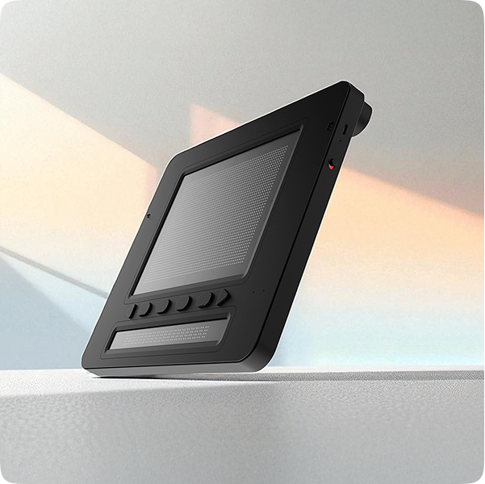
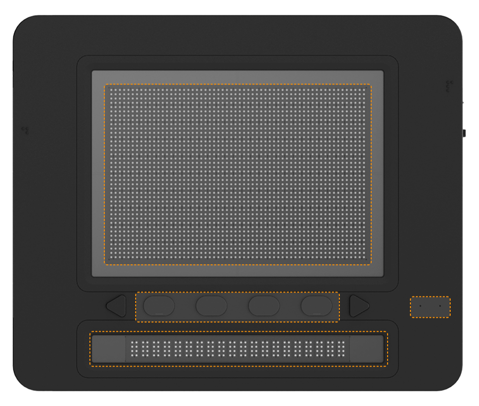
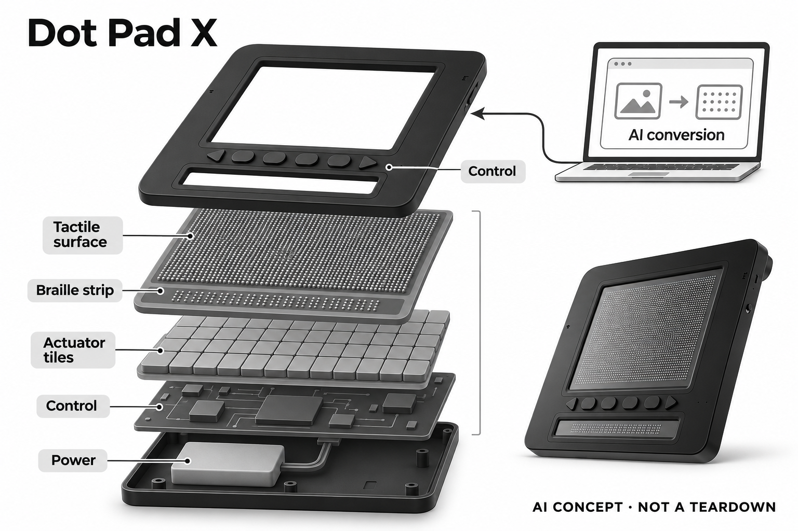

# Dot Pad X（Dot Vista AI工作流）

**Dot** · 无障碍与辅助沟通 · 核查 2026-11-05

把文档和图形转成可刷新的触觉与盲文输出

消费渠道：个人零售。

## 产品图片与结构参考

### 产品图

Dot Pad X官方斜向全机图，显示触觉图形区与盲文行 · 来源：[Dot · 官方产品图片](<https://www.dotincorp.com/en/product/dotpadx>) · [原始图片](<https://www.dotincorp.com/image/product/dotpadx__section1-img.png>)

### 官方结构参考

Dot Pad X官方正面控制区域标识；非内部拆机 · 来源：[Dot · 官方产品图片](<https://www.dotincorp.com/en/product/dotpadx>) · [原始图片](<https://www.dotincorp.com/image/product/dotpadx__section5-device.png>)

### AI 生成爆炸示意

**AI 生成 · 非实物拆机。** 内部为概念推断，不能作为元件布局、BOM 或维修依据。[生成提示词](../../content/hardware/prompts/dot-pad-x.txt)

> 已视觉检查准确外形、灰阶、标题与概念声明；未知内部模块仅为功能示意，不代表拆机、完整BOM或参数。

> 来源图片已逐张实际查看，确认具体型号；保留原图，不改色裁切。图片不能证明内部BOM、疗效或所有配置可售。

> 网页内容经官方页面读取核验，静态图片公开下载成功；橙色控制区域框为厂家原图标识。

> 分析为基于公开资料的案头研究与 AI 辅助判断，未经用户访谈、销量审计或实物拆机。需求、画像、竞争冷门度、审美及商业机会均为研究假设，不是投资结论。

## 销售与购买

- 状态：在售。当前Dot Pad X官网提供经销入口，官方FAQ明确个人也可联系购买；按个人询价零售登记，不把演示申请或软件商店当作硬件订单。

- 地区：官方个人询价与经销商网络；交付地区需报价确认

- 价格：个人询价，未公开统一价格。不借用旧Dot Pad报价；配套Copilot+ PC及软件条件需分别核算。

- 中国大陆：未核到中国大陆正式购买与支持条件；经销名单的Republic of China不能直接写作中国大陆。

- [官方产品 / 商店](<https://www.dotincorp.com/en/product/dotpadx>)

## AI 的实际作用

配套Dot Vista通过Windows AI能力把视觉文档转成触觉、盲文和音频；官方服务说明包括视觉识别与语言模型摘要。

服务与联网依赖：AI工作流依赖兼容Copilot+ PC、Windows软件和相应接口；触觉显示器本身不等于内置完整AI模型，部分其他Dot应用仍未开放。

## 是否冷门

细分专业（研究判断）：解决图表空间关系的触觉访问，区别于单纯语音OCR；设备、电脑和内容适配共同决定价值，无用户访谈或销量证据。

## 需求与市场

需求假设是使用者希望主动探索图表、形状和页面中元素的相对位置，而不只听取一串文字。触觉输出可能提供另一种阅读入口，但二维材料压缩到有限点阵时会丢失细节；它是否比语音描述更有帮助，取决于原内容、转换质量及使用者的触觉阅读习惯。

### 官方｜空间信息进入触觉输出 · 官方资料

Dot Pad X提供可刷新的图形触觉区和下方盲文行，配套Dot Vista把视觉文档转换为触觉、盲文和音频。AI依据来自电脑上的视觉识别与语言模型工作流，而不是机械点阵自己理解内容；当前软件发布与硬件销售分别有官方来源，不能仅凭展示视频合并推定。

依据：[Dot Pad X官方产品页](<https://www.dotincorp.com/en/product/dotpadx>) · [Dot AI服务说明](<https://www.dotincorp.com/en/service/ai>) · [Dot Vista Windows发布，2025-10-31](<https://blog.dotincorp.com/dot-vista-launches-for-windows>)

### 判断｜图表的相对位置难由朗读完全表达 · 研究判断

需求假设是使用者希望主动探索图表、形状和页面中元素的相对位置，而不只听取一串文字。触觉输出可能提供另一种阅读入口，但二维材料压缩到有限点阵时会丢失细节；它是否比语音描述更有帮助，取决于原内容、转换质量及使用者的触觉阅读习惯。

依据：[Dot Pad X官方产品页](<https://www.dotincorp.com/en/product/dotpadx>) · [Dot AI服务说明](<https://www.dotincorp.com/en/service/ai>)

### 验证｜选真实文档检查信息保留 · 待验证

可选使用者经常遇到的简单图表和演示页，分别记录原内容、AI转换结果与本人理解，检查标题、轴线和关系是否保留。应把转换错误与触觉辨识困难分开，避免只用为演示优化的图案；本研究没有教学或工作效果试验，不能承诺理解能力提升。

依据：[Dot AI服务说明](<https://www.dotincorp.com/en/service/ai>) · [Dot Vista Windows发布，2025-10-31](<https://blog.dotincorp.com/dot-vista-launches-for-windows>)

## 用户画像

目标使用者除了愿意通过触觉探索，还需要能获得兼容电脑、安装支持及适合的内容。已有盲文或触觉图经验可能影响学习方式，但不能据此排除不同背景的人；是否适用应围绕本人任务评估，不能由“无障碍”标签推定所有视觉条件和计算环境均能直接使用。

### 官方｜个人购买与机构采购都存在 · 官方资料

官方FAQ明确个人可以联系购买，机构另有采购流程，因此本条不把产品限制为学校设备。当前型号页面提供经销与演示入口，但统一个人价格、交付地区和支持费用未公开；目录按个人询价渠道记录，不把申请演示或软件站点下载按钮写成硬件零售结算。

依据：[Dot Pad X官方产品页](<https://www.dotincorp.com/en/product/dotpadx>) · [Dot官方FAQ：个人购买](<https://www.dotincorp.com/en/faq>)

### 判断｜配套电脑和阅读经验影响适配 · 研究判断

目标使用者除了愿意通过触觉探索，还需要能获得兼容电脑、安装支持及适合的内容。已有盲文或触觉图经验可能影响学习方式，但不能据此排除不同背景的人；是否适用应围绕本人任务评估，不能由“无障碍”标签推定所有视觉条件和计算环境均能直接使用。

依据：[Dot AI服务说明](<https://www.dotincorp.com/en/service/ai>) · [Dot Vista Windows发布，2025-10-31](<https://blog.dotincorp.com/dot-vista-launches-for-windows>) · [Dot Pad X当前资源与应用](<https://www.dotincorp.com/en/resources/dotpadx>)

### 验证｜确认个人配置后再计算投入 · 待验证

询价时需要写明显示器、保修、交付、安装和培训包含哪些内容，并核对现有电脑是否满足Dot Vista要求。软件许可、更新及语言支持也应单独确认；中国大陆没有核到完整正式渠道，国外经销名称中的地区表述不能代替实际地址可交付与售后证明。

依据：[Dot Pad X官方产品页](<https://www.dotincorp.com/en/product/dotpadx>) · [Dot官方FAQ：个人购买](<https://www.dotincorp.com/en/faq>) · [Dot Vista Windows发布，2025-10-31](<https://blog.dotincorp.com/dot-vista-launches-for-windows>)

## 竞争与替代

与语音OCR相比，触觉图形可以让使用者探索空间关系；与单行盲文相比，它增加图形区域，但仍受分辨率和刷新交互限制。两种差异不等于全面替代已有工具，复杂表格、照片和长文可能各需不同入口；应按信息类型比较，而不是以点数多少排序辅助价值。

### 官方｜当前X与旧款及未来软件分开 · 官方资料

本条对应Dot Pad X，不沿用旧Dot Pad的历史售价作为现价。Dot Vista已有官方发布说明，而资源页中部分应用仍标示即将推出；硬件能连接电脑不代表每种文档软件和功能已开放，也不能把可下载的其他AI代理程序当作已经核实与本型号兼容的功能。

依据：[Dot Pad X官方产品页](<https://www.dotincorp.com/en/product/dotpadx>) · [Dot Vista Windows发布，2025-10-31](<https://blog.dotincorp.com/dot-vista-launches-for-windows>) · [Dot Pad X当前资源与应用](<https://www.dotincorp.com/en/resources/dotpadx>)

### 判断｜与朗读和单行盲文形成不同取舍 · 研究判断

与语音OCR相比，触觉图形可以让使用者探索空间关系；与单行盲文相比，它增加图形区域，但仍受分辨率和刷新交互限制。两种差异不等于全面替代已有工具，复杂表格、照片和长文可能各需不同入口；应按信息类型比较，而不是以点数多少排序辅助价值。

依据：[Dot Pad X官方产品页](<https://www.dotincorp.com/en/product/dotpadx>) · [Dot AI服务说明](<https://www.dotincorp.com/en/service/ai>)

### 验证｜按信息类型而非设备名称对照 · 待验证

可让使用者用原有朗读或盲文工具与本系统查看相同内容，记录找出指定信息所需步骤、误解和求助情况。比较应计入转换准备与修正时间，而不只计算触摸阶段；缺少访谈和长期使用证据时，不把较新的多行结构推断为更大的普遍需求或更高市场接受度。

依据：[Dot Pad X官方产品页](<https://www.dotincorp.com/en/product/dotpadx>) · [Dot AI服务说明](<https://www.dotincorp.com/en/service/ai>) · [Dot Vista Windows发布，2025-10-31](<https://blog.dotincorp.com/dot-vista-launches-for-windows>)

## 供应链

同类新设计需要在重复刷新、手指接触、执行器一致性和电源预算之间协同，同时保证文档到点阵的映射可理解。控制芯片具备分类能力并不解决触觉机构寿命，也不会自动得到Dot软件接口；供应链比较必须把自有执行器和外部通用电子层分开。

### 官方｜点阵执行器与AI计算分属不同层 · 官方资料

官方公开Dot Actuator技术、图形区和盲文行布局，以及USB-C和BLE连接。AI文档处理主要在兼容电脑的软件流程中完成，内部控制器、驱动细节与代工厂没有完整披露；不能把电脑的处理平台写成显示器芯片，也不能由可见点阵猜测专利机构或完整BOM。

依据：[Dot Pad X官方产品页](<https://www.dotincorp.com/en/product/dotpadx>) · [Dot AI服务说明](<https://www.dotincorp.com/en/service/ai>) · [Dot Vista Windows发布，2025-10-31](<https://blog.dotincorp.com/dot-vista-launches-for-windows>)

### 判断｜稳定触感和内容接口都不可缺少 · 研究判断

同类新设计需要在重复刷新、手指接触、执行器一致性和电源预算之间协同，同时保证文档到点阵的映射可理解。控制芯片具备分类能力并不解决触觉机构寿命，也不会自动得到Dot软件接口；供应链比较必须把自有执行器和外部通用电子层分开。

依据：[Dot Pad X官方产品页](<https://www.dotincorp.com/en/product/dotpadx>) · [Dot AI服务说明](<https://www.dotincorp.com/en/service/ai>)

### 验证｜候选只覆盖控制与连接研究 · 待验证

可从公开微控制器和低功耗无线平台研究状态控制、缓存与连接，但需要核对专用驱动电气要求、刷新时序和SDK边界。所列候选没有Dot点名采用证据，不包含其针阵机构或AI转换许可；工程验证应先以实际接口为依据，而不是把通用开发板当作整机替代。

依据：[Dot Pad X官方产品页](<https://www.dotincorp.com/en/product/dotpadx>) · [Dot AI服务说明](<https://www.dotincorp.com/en/service/ai>) · [Dot Pad X当前资源与应用](<https://www.dotincorp.com/en/resources/dotpadx>)

## 技术路径

从原图到简化触觉表示时，识别、摘要和布局重排都可能改变用户最终接收的信息。系统价值不仅是生成可触摸图案，还在于能否说明它对应原文哪里、哪些内容被省略；若无法回到来源核对，用户可能难以区分原文歧义和AI引入的解释。

### 官方｜Windows AI工作流有电脑要求 · 官方资料

Dot Vista发布说明明确采用Windows AI能力，并要求Copilot+ PC；Dot AI服务还描述视觉分析与语言模型摘要等过程。硬件通过点阵输出结果，不能因此推断它在离开电脑后独立运行相同模型，也不能把所有文档格式、语言和系统版本视为已经验证兼容。

依据：[Dot AI服务说明](<https://www.dotincorp.com/en/service/ai>) · [Dot Vista Windows发布，2025-10-31](<https://blog.dotincorp.com/dot-vista-launches-for-windows>)

### 判断｜转换需要保留可追溯关系 · 研究判断

从原图到简化触觉表示时，识别、摘要和布局重排都可能改变用户最终接收的信息。系统价值不仅是生成可触摸图案，还在于能否说明它对应原文哪里、哪些内容被省略；若无法回到来源核对，用户可能难以区分原文歧义和AI引入的解释。

依据：[Dot AI服务说明](<https://www.dotincorp.com/en/service/ai>) · [Dot Vista Windows发布，2025-10-31](<https://blog.dotincorp.com/dot-vista-launches-for-windows>)

### 验证｜分层检查识别与触觉呈现 · 待验证

可保留原页面、软件生成的文字描述和最终点阵输出，逐层标记遗漏或错误，再判断是识别、总结还是显示映射的问题。测试还应包含断开重连和不支持文件的提示，确认不会默默保留旧内容；目录没有算法准确率实测，不用厂家效果图代表任意文档表现。

依据：[Dot AI服务说明](<https://www.dotincorp.com/en/service/ai>) · [Dot Vista Windows发布，2025-10-31](<https://blog.dotincorp.com/dot-vista-launches-for-windows>) · [Dot Pad X当前资源与应用](<https://www.dotincorp.com/en/resources/dotpadx>)

## 产品审美

使用者需要稳定找到图形区、盲文行和按键，并在触摸时保持设备位置；外观简洁不能替代这些操作要求。桌面空间、线缆走向和携带安排可能影响是否经常拿出来使用，尤其与键盘或另一种盲文设备共用时，整体布置比单机厚度更值得观察。

### 官方｜实体图形区保留明确控制位置 · 官方资料

官方图显示黑色薄型矩形机身，上部为大面积触觉图形区，下方有盲文行和一组实体控制键。它不是普通平板显示器，照片中的点阵也不代表实际触感或所有针点都处于同一高度；结构参考图突出控制区域，不能作为内部执行器排列的拆机证据。

依据：[Dot Pad X官方产品页](<https://www.dotincorp.com/en/product/dotpadx>)

### 判断｜桌面占用与操作定位要一起考虑 · 研究判断

使用者需要稳定找到图形区、盲文行和按键，并在触摸时保持设备位置；外观简洁不能替代这些操作要求。桌面空间、线缆走向和携带安排可能影响是否经常拿出来使用，尤其与键盘或另一种盲文设备共用时，整体布置比单机厚度更值得观察。

依据：[Dot Pad X官方产品页](<https://www.dotincorp.com/en/product/dotpadx>) · [Dot Pad X当前资源与应用](<https://www.dotincorp.com/en/resources/dotpadx>)

### 验证｜观察阅读姿势和设备摆放 · 待验证

试用可以记录触摸过程中是否经常寻找控制键、是否需要移动其他设备，以及清洁和收纳是否容易完成。将外观喜好、触觉清晰度和疲劳分别询问，避免把照片观感当作人机适配结论；本轮仅检查官方图片，未进行真实触摸、噪声或耐久测试。

依据：[Dot Pad X官方产品页](<https://www.dotincorp.com/en/product/dotpadx>) · [Dot Pad X当前资源与应用](<https://www.dotincorp.com/en/resources/dotpadx>)

## 关键风险

使用者接收到的是经过转换的内容，如果原图识别或摘要遗漏重要关系，清晰的触觉呈现也可能让错误更难被察觉。对重要信息，应保留其他可核对形式和人工支持；AI生成的图示不应被当作原始文件本身，也不能据一次正确转换推定长期可靠。

### 官方｜现售渠道不等于全部服务可用 · 官方资料

官网提供个人购买路径，但Dot Vista对电脑和软件环境有具体要求，其他应用也存在尚未发布的状态。硬件售后、培训、区域语言与配送条件仍须报价确认；不能把国际经销网络概括成中国大陆官方支持，更不能用旧型号价格承诺整套可用系统的成本。

依据：[Dot Pad X官方产品页](<https://www.dotincorp.com/en/product/dotpadx>) · [Dot官方FAQ：个人购买](<https://www.dotincorp.com/en/faq>) · [Dot Vista Windows发布，2025-10-31](<https://blog.dotincorp.com/dot-vista-launches-for-windows>) · [Dot Pad X当前资源与应用](<https://www.dotincorp.com/en/resources/dotpadx>)

### 判断｜错误摘要可能在触觉层被信任 · 研究判断

使用者接收到的是经过转换的内容，如果原图识别或摘要遗漏重要关系，清晰的触觉呈现也可能让错误更难被察觉。对重要信息，应保留其他可核对形式和人工支持；AI生成的图示不应被当作原始文件本身，也不能据一次正确转换推定长期可靠。

依据：[Dot AI服务说明](<https://www.dotincorp.com/en/service/ai>) · [Dot Vista Windows发布，2025-10-31](<https://blog.dotincorp.com/dot-vista-launches-for-windows>)

### 验证｜确认错误提示与支持路径 · 待验证

可核对不支持文件、电脑性能不足、连接中断和转换失败时的提示方式，并确认用户能区分新结果与旧显示。服务方还应说明更新和故障处理责任，以及个人可获得的培训；这些验证针对工具可用性，不承诺特定教育成绩、工作能力或视力相关效果。

依据：[Dot官方FAQ：个人购买](<https://www.dotincorp.com/en/faq>) · [Dot AI服务说明](<https://www.dotincorp.com/en/service/ai>) · [Dot Pad X当前资源与应用](<https://www.dotincorp.com/en/resources/dotpadx>)

## 机会与验证

较有价值的研究起点是使用者反复需要的一类图表，而不是宣称任何视觉材料都能顺利转为触觉。若某类转换能保持关键关系，再观察是否减少寻找和解释负担；复杂照片或密集页面可能仍需人工描述，保留这些限制比单纯扩大支持格式更有判断价值。

### 官方｜触觉读图保留为单独核心任务 · 官方资料

Dot Pad X的研究价值在可刷新图形触觉与AI文档转换的结合，核心任务是访问空间化视觉信息。颜色、不同经销套装和旧型号不另算新场景，配套软件也不单独计为硬件；这一划分有助于把实际使用任务与设备数量区分，避免用同类品牌堆出创新规模。

依据：[Dot Pad X官方产品页](<https://www.dotincorp.com/en/product/dotpadx>) · [Dot AI服务说明](<https://www.dotincorp.com/en/service/ai>)

### 判断｜先验证内容链再扩展复杂材料 · 研究判断

较有价值的研究起点是使用者反复需要的一类图表，而不是宣称任何视觉材料都能顺利转为触觉。若某类转换能保持关键关系，再观察是否减少寻找和解释负担；复杂照片或密集页面可能仍需人工描述，保留这些限制比单纯扩大支持格式更有判断价值。

依据：[Dot AI服务说明](<https://www.dotincorp.com/en/service/ai>) · [Dot Vista Windows发布，2025-10-31](<https://blog.dotincorp.com/dot-vista-launches-for-windows>)

### 验证｜记录长期保留的阅读任务 · 待验证

后续可以跟踪用户实际愿意继续使用的文档类型、需要修正的转换和回到其他工具的原因，并将软件更新与学习投入计入。没有用户研究和销量数据，本目录只提供可复核的产品与工作流证据；是否形成稳定个人需求，应由持续任务记录而非展示次数判断。

依据：[Dot Pad X官方产品页](<https://www.dotincorp.com/en/product/dotpadx>) · [Dot官方FAQ：个人购买](<https://www.dotincorp.com/en/faq>) · [Dot AI服务说明](<https://www.dotincorp.com/en/service/ai>) · [Dot Vista Windows发布，2025-10-31](<https://blog.dotincorp.com/dot-vista-launches-for-windows>)

## 对应供应链公司

能力候选用于选型研究，不代表本产品实际采用；未公开的供货关系不作推断。

- [microchip](../supply-chain/microchip.md) — **能力候选 · 非已采用** / 同类触觉显示设备的控制与缓存平台候选：Microchip公开嵌入式控制器和开发工具，可研究同类触觉设备的输入、状态控制和内容缓存；具体执行器驱动接口及刷新需求仍需确认。其机器学习工具不等于Dot Vista模型或Dot针阵技术，未发现本型号采用证据，候选只对应重新设计的通用控制层。

- [nordic-semiconductor](../supply-chain/nordic-semiconductor.md) — **能力候选 · 非已采用** / 同类触觉显示设备的BLE连接候选：Nordic低功耗无线平台可用于比较本类设备的BLE连接、状态同步和功耗管理，但需要验证点阵内容传输、重连和主机兼容。它不能提供Dot专有执行器或文档转换软件，也无本产品点名采用证据；连接方案可行不等于已经完成可用的触觉阅读系统。

[浏览供应链目录](../supply-chain.md)

## 功能分层示意

这是功能关系，不是实物拆机、真实空间结构或已核实 BOM。

1. **文档输入**：兼容电脑载入视觉文档，保留原内容用于核对。（官方披露）

2. **AI转换**：Dot Vista利用Windows AI能力生成触觉、盲文及音频表示。（官方披露）

3. **通信控制**：USB-C或BLE连接显示硬件，具体软件兼容范围需确认。（官方披露）

4. **触觉执行**：上方图形区与下方盲文行通过刷新点阵输出。（官方披露）

5. **阅读操作**：实体按键配合触摸阅读，错误转换需回到原内容检查。（分析推断）

## 来源

1. [Dot Pad X官方产品页](<https://www.dotincorp.com/en/product/dotpadx>) — 已打开：300单元图形区、20单元盲文行、控制键、USB-C/BLE和经销入口；非LCD屏幕。

2. [Dot官方FAQ：个人购买](<https://www.dotincorp.com/en/faq>) — 已打开：个人可通过官方联系购买，机构采购另有流程；不把联系行为当作已经下单。

3. [Dot AI服务说明](<https://www.dotincorp.com/en/service/ai>) — 已打开：视觉识别、语言模型与触觉转换工作流；能力属于配套计算，不归为针阵内部模型。

4. [Dot Vista Windows发布，2025-10-31](<https://blog.dotincorp.com/dot-vista-launches-for-windows>) — 已打开：软件已在Microsoft Store提供，使用Windows AI APIs并要求Copilot+ PC；不把未来应用当已发布。

5. [Dot Pad X当前资源与应用](<https://www.dotincorp.com/en/resources/dotpadx>) — 已打开当前资源；Dot Book等仍有Coming soon，不能把整个应用生态都写成已可用。

[返回目录](../hardware-market.md) · [网页分析](https://romanagent.github.io/Roman/#hardware/product/dot-pad-x)
