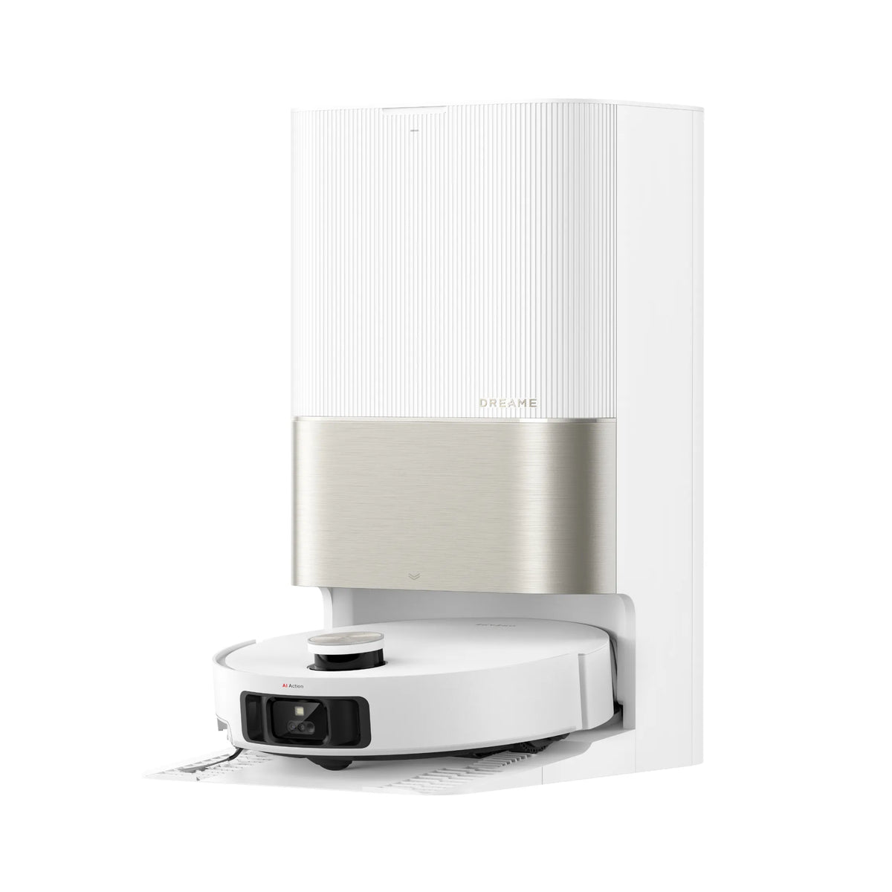
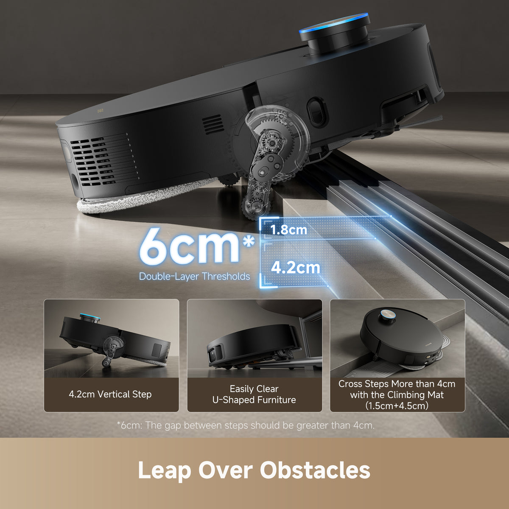
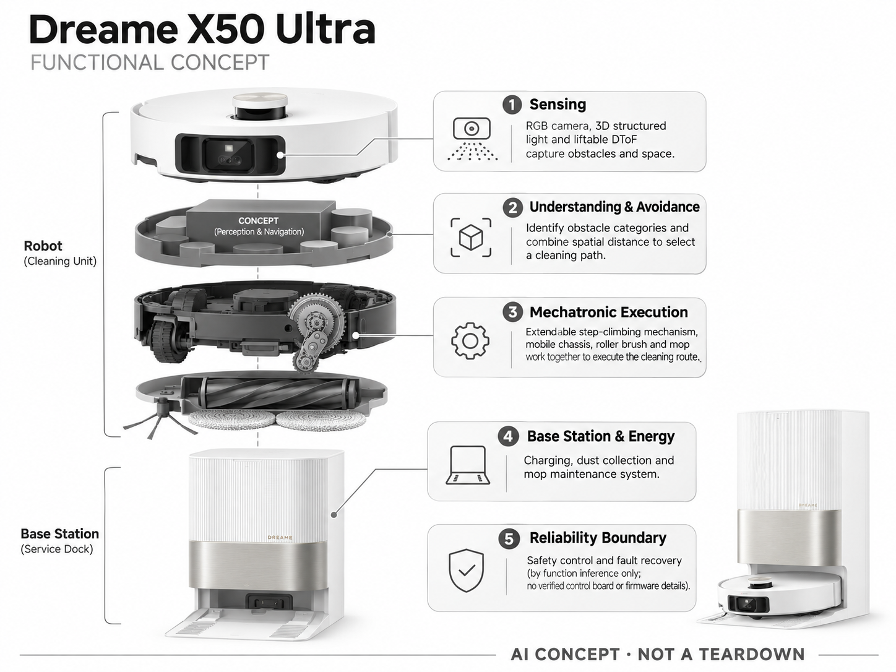

# Dreame X50 Ultra

**Dreame** · 清洁机器人 · 核查 2026-11-04

把视觉避障与机械越障结合的高端扫拖机器人

## 产品图片与结构参考

### 产品图

官方商品图：X50 Ultra 白色主机与基站 · 来源：[Dreame · 官方图片](<https://www.dreametech.com/products/x50-ultra-robot-vacuum>) · [原始图片](<https://cdn.shopify.com/s/files/1/0553/1320/3405/files/X50-W_1.webp?v=1767170718&width=1200>)

### 参考图

官方越障机构与门槛条件示意，性能数字为厂商声明 · 来源：[Dreame · 官方图片](<https://www.dreametech.com/products/x50-ultra-robot-vacuum>) · [原始图片](<https://cdn.shopify.com/s/files/1/0553/1320/3405/files/2-ProLeapSystem6cm_08c02e40-02e4-49ce-87fe-0ebe0776dfaa.jpg?v=1772789393&width=1200>)

### AI 生成爆炸示意

**AI 生成 · 非实物拆机。** 内部为概念推断，不能作为元件布局、BOM 或维修依据。[生成提示词](../../content/hardware/prompts/dreame-x50-ultra.txt)

> 依据官方外观参考与公开功能生成；未披露的内部布局只作概念模块，不构成BOM或真实结构证据。

> 图片版权归原权利人；用于产品研究并保留出处。未改变图片色彩或内容。

> 分析为基于公开资料的案头研究与 AI 辅助判断，未经用户访谈、销量审计或实物拆机。需求、画像、竞争冷门度、审美及商业机会均为研究假设，不是投资结论。

## 销售与购买

- 状态：在售。美国官方产品页提供 X50 Ultra 选项、加入购物车与购买按钮，并列 2—5 个工作日配送说明；优惠券和套装价格不同。

- 地区：美国

- 价格：US$999.99。页面基础价快照，另有优惠券及套装；不将会员价或券后价当作人人适用成交价。

- 中国大陆：本条核查美国 X50 Ultra 型号；中国大陆相近产品的名称、固件、保修和配件一致性未核实。

- [官方产品 / 商店](<https://www.dreametech.com/products/x50-ultra-robot-vacuum>)

## AI 的实际作用

AI RGB 摄像头与 3D 结构光识别障碍，配合升降传感器与运动机构完成清洁路线。

服务与联网依赖：基础导航和动作由整机执行；远程地图、设置与语音生态依赖 App 或网络。

## 是否冷门

竞争密集（研究判断）：高端扫拖已有成熟品牌及快速更新，越障是细分功能竞争而非无人覆盖的新市场。

## 需求与市场

需求假设：有门槛、地毯和低柜的家庭更容易遇到机器人卡住或漏扫。需求重点是不同房间能否自主通行。应测量每天救援次数与漏扫面积，而不是直接把实验室越障高度等同家庭可用性。

## 用户画像

画像假设：愿购买旗舰清洁设备的养宠家庭、多房间住户和重视自动化的双职工家庭。安装者、日常维护者与付款者可能不同，需要分别验证基站操作、异常恢复及维护成本。

## 竞争与替代

竞争判断：机械越障与高端扫拖已被多品牌追逐，上市时间和更新频率都压缩单一功能优势。若新团队进入，应比较全寿命维护、底盘通过性和故障恢复，而非复刻旗舰参数清单。

## 供应链

供应链推断：伸缩机构会增加电机、减速结构、位置检测与结构可靠性要求；水路和热洗系统另有寿命测试。具体零部件供应商、代工厂和采购价未披露，不能据宣传图推算真实 BOM。

## 技术路径

官网披露 RGB 视觉、结构光和升降 DToF。技术判断：AI 决策必须与机械安全约束协同，尤其面对衣物、电线与宠物排泄物。应验证识别失败后的停止策略，不能只复述识别类别数量。

## 产品审美

审美判断：圆形主体和较统一的基站轮廓便于融入家居，机械创新主要隐藏在底部。体量、配件收纳和污水维护仍会决定生活中的整洁感，外壳精致不代表维护过程同样体面。

## 关键风险

风险判断：复杂机构的磨损、积灰与毛发缠绕会影响长期通过能力；家庭相机隐私和不同地区云服务也需评估。购买前应确认具体版本、门槛条件、耗材供货和售后覆盖。

## 机会与验证

可验证机会：在复杂门槛家庭建立自动化程度基准，提供场景适配与维护服务。对于创业者，先证明用户愿为可靠通过与低维护付费，再决定机械复杂度是否值得增加。

## 功能分层示意

这是功能关系，不是实物拆机、真实空间结构或已核实 BOM。

1. **感知**：RGB 相机、3D 结构光与升降 DToF。（官方披露）

2. **理解与避障**：识别障碍类别并结合空间距离选择路径。（官方披露）

3. **机电执行**：伸缩越障机构、移动底盘、滚刷和拖布。（官方披露）

4. **基站与能源**：充电、集尘与拖布维护系统。（官方披露）

5. **可靠性边界**：安全控制和故障恢复按功能推断；未取得控制板或固件拆解。（分析推断）

## 来源

1. [Dreame X50 Ultra 美国官方商店](<https://www.dreametech.com/products/x50-ultra-robot-vacuum>) — 已打开并定位购物按钮和 AI RGB / 3D structured light 说明；参数为厂商声明。

[返回目录](../hardware-market.md) · [网页分析](https://romanagent.github.io/Roman/#hardware/product/dreame-x50-ultra)
