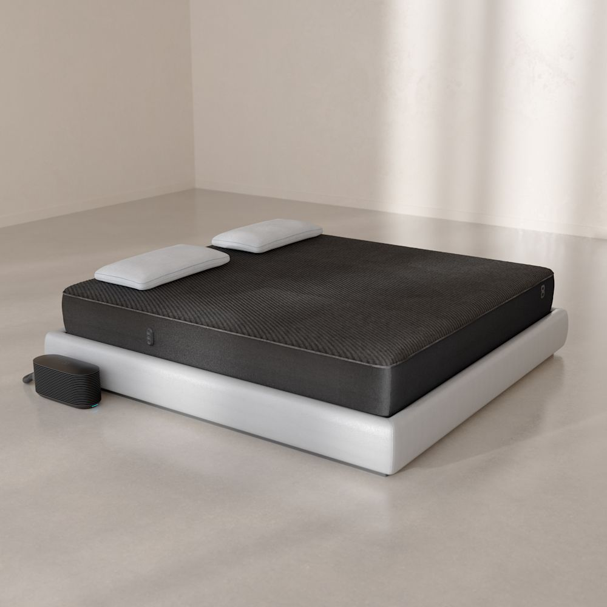
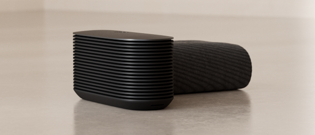
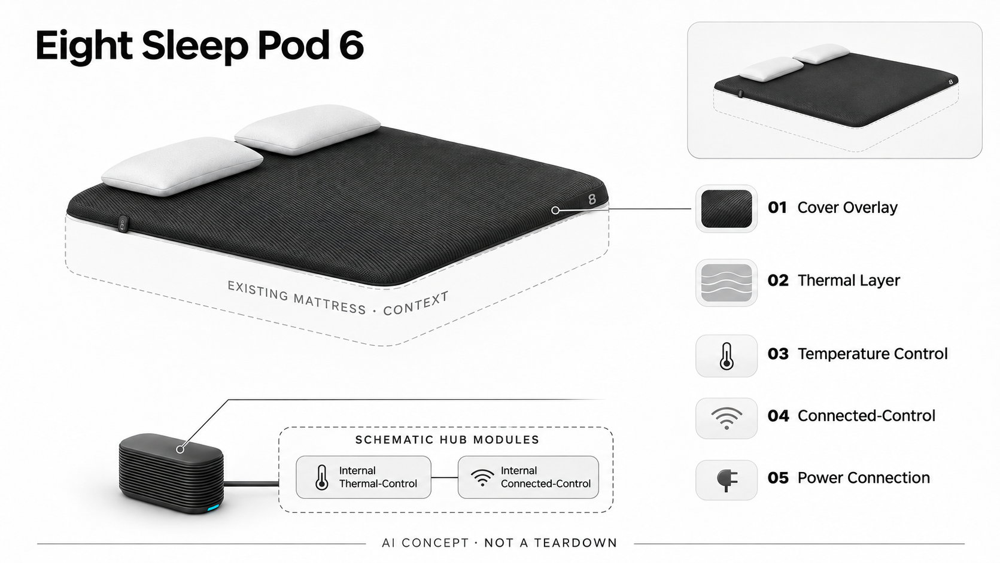

# Eight Sleep Pod 6

**Eight Sleep** · 睡眠与放松 · 核查 2026-11-04

在现有床垫上增加按个人状态适配的双侧温控系统。

消费渠道：个人零售。

## 产品图片与结构参考

### 产品图

Eight Sleep Pod 6 官方产品图 · 来源：[Eight Sleep](<https://www.eightsleep.com/product/pod-cover/>) · [原始图片](<https://res.cloudinary.com/eightsleep/image/upload/c_fill,g_auto,f_auto,dpr_1.0,h_1000,q_80/v1790086327/pod6-shop-dual-cover-lead-plate-white-pillows.jpg>)

### 参考图

Eight Sleep Pod 6 官方外观 / 使用参考图 · 来源：[Eight Sleep](<https://www.eightsleep.com/product/pod-cover/>) · [原始图片](<https://res.cloudinary.com/eightsleep/image/upload/c_crop,w_2824,h_1215,x_0,y_124/c_fill,g_auto,f_auto,dpr_1.0,w_632,h_272,q_80/v1789596959/pod6-intro-card-header-v2.png>)

### AI 生成爆炸示意

**AI 生成 · 非实物拆机。** 内部为概念推断，不能作为元件布局、BOM 或维修依据。[生成提示词](../../content/hardware/prompts/eight-sleep-pod-6.txt)

> 分析为基于公开资料的案头研究与 AI 辅助判断，未经用户访谈、销量审计或实物拆机。需求、画像、竞争冷门度、审美及商业机会均为研究假设，不是投资结论。

## 销售与购买

- 状态：在售。当前美国官方购买页为Pod 6，提供尺寸选择与结算方案。未把仍出现Pod 5的地区缓存或旧宣传价格混入本条。

- 地区：美国官网、其他地区型号与方案另查

- 价格：US$2,899 起，Autopilot方案另计。为所标地区和配置的核查参考；活动、税费、物流及可选服务以实际结算为准，不进行汇率换算或保证最低价。

- 中国大陆：本轮核查海外官方消费渠道，未验证中国大陆结算、型号、保修与全部AI服务可用性；不因品牌来源或支持中文推定国内可购。

- [官方产品 / 商店](<https://www.eightsleep.com/product/pod-cover/>)

## AI 的实际作用

Autopilot依据个体偏好、睡眠相关感知和环境数据调整床面温控；可选底座功能需另核具体组合。厂商改善睡眠的描述未经本目录独立验证。

服务与联网依赖：联网、App和Autopilot方案是系统交付的重要部分；初始会员要求与续费条件需按结算页核对。不同床宽和配件不重复计数。

## 是否冷门

细分专业（研究判断）：高价温控寝具面向较窄的家庭问题，但已有成熟替代和持续服务竞争。

## 需求与市场

需求假设：对冷热敏感、伴侣温度偏好不同的家庭，可能愿意为不用频繁手动调节的床面温控付费。实际价值应与普通空调、床品和简单温控垫对照，不能单凭“智能睡眠”概念推导需求。

### 需求假设：夜间冷热变化不再反复手动处理 · 研究判断

Pod 6覆盖现有床垫并自动调节温度，针对对冷热敏感或伴侣温度偏好不同的家庭。需求应具体到何时被冷热打扰、目前怎样处理，而不是笼统关注睡眠健康；自动调节存在不能证明每个人都需要，也不等于整床支撑发生改变。

依据：[Pod 6 官方购买页](<https://www.eightsleep.com/product/pod-cover/>) · [Eight Sleep Autopilot](<https://www.eightsleep.com/au/autopilot/>)

### 价值判断：温控舒适与睡眠报告分开 · 研究判断

用户可能愿意为床面温度付费，却很少看报告，也可能只是喜欢了解数据，两个动机不应合并。研究应观察自动设置是否减少夜间操作，以及报告是否被理解，不能用应用分数或调整次数代替舒适体验，也不把温控收益扩展成医学效果。

依据：[Eight Sleep Autopilot](<https://www.eightsleep.com/au/autopilot/>)

### 验证方案：比较完整卧室的冷热处理 · 待验证

让实际用户记录原有空调、床品和温控设备的使用，再在支持条件下观察Pod的自动与手动设置，分别询问伴侣感受。保持生活安排可追溯，不以单晚分数或厂商指标判断效果，也不忽略维护、声音与床边空间。

依据：[Pod 6 官方购买页](<https://www.eightsleep.com/product/pod-cover/>) · [Eight Sleep Autopilot](<https://www.eightsleep.com/au/autopilot/>)

## 用户画像

画像推断：有稳定卧室环境、较高预算并愿意接受联网寝具的个人或伴侣。租房搬迁、维护意愿和双人温差会影响采用；不宜将所有关注睡眠的人都归为同一价格敏感度群体。

### 画像假设：明确温差问题且愿意维护联网寝具 · 研究判断

较匹配者有稳定卧室和反复出现的床面冷热不合意，愿意管理Hub、应用与服务费用。不是所有睡眠不满意都与温度有关，画像应包括具体温差、伴侣偏好和维护意愿，不能按收入或喜欢健康数据直接推定购买需求。

依据：[Pod 6 官方购买页](<https://www.eightsleep.com/product/pod-cover/>) · [Eight Sleep Autopilot](<https://www.eightsleep.com/au/autopilot/>)

### 使用约束：现有床仍需与系统共同布置 · 研究判断

覆盖现有床垫减少更换整床的门槛，但床宽、床边设备、连接和维护入口仍要安排，租房或频繁搬家者承担不同负担。研究应了解谁负责布置和处理问题，不能把兼容床垫的宣传理解为任何房间和床架都不需要检查。

依据：[Pod 6 官方购买页](<https://www.eightsleep.com/product/pod-cover/>)

### 访谈重点：双方如何表达和调整偏好 · 待验证

请伴侣分别说明理想温度与不舒服时的处理方式，观察是否愿意让算法学习，以及何时仍想手动控制。双方对声音、报告和服务可能有不同态度，不能用付款者或一位使用者的满意度代表完整双人体验，也不预设分区必然消除分歧。

依据：[Eight Sleep Autopilot](<https://www.eightsleep.com/au/autopilot/>)

## 竞争与替代

竞争判断：温控寝具与智能床已有多种方案，竞争涉及体验、维护、订阅和售后。软件自适应可能是差异，但硬件温控的基本舒适性仍是前提，不能用应用分数掩盖实体使用问题。

### 替代方案：空调、床品与简单温控垫 · 研究判断

Pod 6与普通空调、不同被褥和其他温控寝具竞争，传统床垫主要支撑体验是另一任务。比较应围绕床面冷热与操作负担，不能把所有智能床都视为同类，也不因Autopilot具备数据分析就默认优于更简单的手动方案。

依据：[Pod 6 官方购买页](<https://www.eightsleep.com/product/pod-cover/>) · [Eight Sleep Autopilot](<https://www.eightsleep.com/au/autopilot/>)

### 差异判断：自动适配需超过基础温控收益 · 研究判断

如果用户只需要固定温度，普通温控可能已经足够，Autopilot的新增价值在是否减少调节并适应变化。研究应将硬件制冷加热与自动策略分别评价，不把温控本身的便利全部归于AI，也不将服务会员视为不影响选择的附加项。

依据：[Eight Sleep Autopilot](<https://www.eightsleep.com/au/autopilot/>) · [首年Autopilot要求](<https://help.eightsleep.com/en_us/can-i-buy-the-pod-without-autopilot-S1BzQo5rn>)

### 比较方法：以同一卧室的持有周期观察 · 待验证

记录不同方案在真实卧室里的设置、维护、声音和停用原因，比较用户愿意维持什么条件。不能只测一次表面温度，也不将某个促销价格或试用夜数推广为全部地区成本，附加底座与基础覆盖层必须按实际配置区分。

依据：[Pod 6 官方购买页](<https://www.eightsleep.com/product/pod-cover/>) · [首年Autopilot要求](<https://help.eightsleep.com/en_us/can-i-buy-the-pod-without-autopilot-S1BzQo5rn>)

## 供应链

公开结构包含覆盖层与Hub，完整泵、传感器和控制板供应链未披露。分析关键点是液路或热管理、柔性材料、噪声、密封、清洁及大件物流，单机成本无法由营销图片可靠计算。

### 功能拆分：覆盖层与Hub共同执行温控 · 研究判断

原目录确认床面覆盖层、状态输入、Autopilot和实体Hub构成系统，应用与会员另决定完整交互。具体热管理部件、泵、传感器和控制板未披露，不能把营销图当作内部布局，也不将选配底座的升降机构默认包含在基础Pod组合。

依据：[Pod 6 官方购买页](<https://www.eightsleep.com/product/pod-cover/>) · [Eight Sleep Autopilot](<https://www.eightsleep.com/au/autopilot/>)

### 制造判断：柔性连接与夜间运行都要可靠 · 研究判断

覆盖层长期承载、热管理连接、密封、清洁和Hub声音会共同影响体验，维护入口也必须适合卧室。供应评估应看完整使用条件，而不是只关注智能算法，本轮没有流路结构、耐久数据或维修记录，不能推算良率和单机制造成本。

依据：[Pod 6 官方购买页](<https://www.eightsleep.com/product/pod-cover/>)

### 候选选型：温度输入与系统制造分别询证 · 研究判断

Sensirion可作为温度和环境输入候选，Jabil可讨论Hub电子与机电系统工程，具体热管理、柔性部件和床面条件需另行验证。两者未被点名为Pod供应商，环境传感器也不等于医学体温测量，候选关联不能成为真实BOM。

依据：[Pod 6 官方购买页](<https://www.eightsleep.com/product/pod-cover/>) · [Eight Sleep Autopilot](<https://www.eightsleep.com/au/autopilot/>)

## 技术路径

技术链路包括感知、个体建模、控制策略及热管理执行。模型需要在有限噪声、反应速度和舒适性之间取舍；自动调节并不意味着对每个人或每个夜晚都有确定效果。

### 已披露能力：偏好与环境驱动自动策略 · 官方资料

Autopilot依据个人偏好、睡眠相关和环境信息适配温控，基础执行仍依靠实体热管理系统。需要分清感知、状态估计、控制与应用解释，不能将手机里的结论视为直接测量，也不根据自动调整能力推断所有夜晚都能产生确定改善。

依据：[Eight Sleep Autopilot](<https://www.eightsleep.com/au/autopilot/>)

### 技术判断：舒适目标不能只由算法决定 · 研究判断

同样温度变化对不同人可能有不同感受，用户也会因床品和环境改变偏好，系统应保留易懂的修正路径。研究应观察自动与手动如何协调，不将更多调整视为更智能，也不让报告评分覆盖用户实际觉得过冷、过热或被打扰的体验。

依据：[Eight Sleep Autopilot](<https://www.eightsleep.com/au/autopilot/>)

### 验证方案：把设置和主观感受对应起来 · 待验证

在真实卧室记录自动策略、用户主动修改、环境变化和双方感受，检查哪些调整被接受，哪些需要纠正。应用数据可以辅助回忆却不作为唯一效果证据，本轮没有算法准确率、睡眠试验或医学复核，不对健康改善作独立结论。

依据：[Pod 6 官方购买页](<https://www.eightsleep.com/product/pod-cover/>) · [Eight Sleep Autopilot](<https://www.eightsleep.com/au/autopilot/>)

## 产品审美

设计观察：可叠加覆盖层减少更换整床的门槛，Hub隐藏于床边或床下有利融入卧室。线缆、管路、夜间噪声和维护入口是实际审美的一部分，不能只评价正面产品照。

### 外形判断：隐藏覆盖层之外还有Hub与连接 · 研究判断

覆盖层叠加到原有床垫可以保持熟悉卧室外观，Hub和连接则需要床边或床下空间，不能只看铺好床后的照片。夜间声音、清洁和维护入口都是设计体验，设备隐藏起来并不代表没有存在感，也不保证所有床架都方便布置。

依据：[Pod 6 官方购买页](<https://www.eightsleep.com/product/pod-cover/>)

### 交互判断：减少睡前与夜间查看手机 · 研究判断

用户购买自动温控可能正是想减少调整，如果仍需频繁查报告和改设置，智能界面可能与任务冲突。研究应观察哪些控制必须即时可用、哪些可以留到白天，不把应用功能多当作优点，也不让用户为了追求分数不断改变偏好。

依据：[Eight Sleep Autopilot](<https://www.eightsleep.com/au/autopilot/>)

### 体验验证：包含换床品与维护步骤 · 待验证

让用户按实际配置完成安装、换床品、清洁和日常设置，记录需要移动Hub或处理连接的步骤，再评价夜间打扰。与伴侣分别访谈，避免只听主购买者对外观的看法，也不以一次安装顺利推断长期维护轻松。

依据：[Pod 6 官方购买页](<https://www.eightsleep.com/product/pod-cover/>)

## 关键风险

风险主要是订阅退出、维护故障、跨地区服务与大件退换成本。官网睡眠改善指标需要结合试验条件看待；本目录没有把健康评分或自动控制能力解释成疾病诊疗效果。

### 效果边界：温控与健康推断不能混为一谈 · 研究判断

床面温度自动调整可以作为功能描述，不能据此宣称诊断或治疗疾病，也不能把睡眠相关分数当作专业结论。厂商改善指标需结合研究条件审查，本轮未做独立效果复核或实机测试，个人舒适反馈不应推广为普遍医学收益。

依据：[Eight Sleep Autopilot](<https://www.eightsleep.com/au/autopilot/>)

### 服务风险：会员与退出条件影响完整体验 · 研究判断

Autopilot初始要求、续费和停订后功能需要与当前结算条件一起核对，不能只看硬件一次售价。维护故障、跨地区支持和大件退换也会影响拥有成本，基础覆盖层与可选底座不能混用权益，本轮没有审核任何实际用户订单。

依据：[Pod 6 官方购买页](<https://www.eightsleep.com/product/pod-cover/>) · [首年Autopilot要求](<https://help.eightsleep.com/en_us/can-i-buy-the-pod-without-autopilot-S1BzQo5rn>)

### 验证安排：纳入手动和停订后的选择 · 待验证

研究应记录用户何时关闭自动、减少报告查看、改变订阅或停止使用，区分温控本身与服务解释的问题。不要只观察满意夜晚，也不把不愿续费简单等同功能无效，真实选择能说明哪些部分值得承担长期成本。

依据：[Eight Sleep Autopilot](<https://www.eightsleep.com/au/autopilot/>) · [首年Autopilot要求](<https://help.eightsleep.com/en_us/can-i-buy-the-pod-without-autopilot-S1BzQo5rn>)

## 机会与验证

值得验证的是双人温差和夜间舒适问题能否被稳定解决。后续应记录真实使用频率、维护时间、伴侣反馈和停订后的体验，商业空间判断不能只引用品牌累计睡眠夜数。

### 研究方向：稳定解决双人温差与夜间操作 · 研究判断

Pod 6可以帮助研究自动床面温控是否比房间级调节更符合个体需要，机会可能在清楚控制、低打扰运行和易维护。应先确认这些基础任务，再讨论更多健康指标，避免把算法报告丰富当作寝具必需的创新方向。

依据：[Pod 6 官方购买页](<https://www.eightsleep.com/product/pod-cover/>) · [Eight Sleep Autopilot](<https://www.eightsleep.com/au/autopilot/>)

### 执行计划：跟踪双方体验和维护时间 · 待验证

观察数周内温度设置、夜间干预、清洁与服务联系，访谈一个满意和一个不满意的具体夜晚，并比较既有替代。分别记录双方感受与实际维护，不用品牌累计数据、星级或算法分数代表留存，也不声称已开展这类实地研究。

依据：[Pod 6 官方购买页](<https://www.eightsleep.com/product/pod-cover/>) · [Eight Sleep Autopilot](<https://www.eightsleep.com/au/autopilot/>)

### 决策边界：自动化价值必须覆盖服务成本 · 研究判断

温控硬件与软件适配形成组合，是否值得持续付费取决于长期使用与维护，供应候选不能证明市场规模。当前没有访谈、销量、寿命或报价资料，不由高价、用户评价或模型评分预测创业成功，场景应按具体冷热需求去重理解。

依据：[Pod 6 官方购买页](<https://www.eightsleep.com/product/pod-cover/>) · [首年Autopilot要求](<https://help.eightsleep.com/en_us/can-i-buy-the-pod-without-autopilot-S1BzQo5rn>)

## 对应供应链公司

能力候选用于选型研究，不代表本产品实际采用；未公开的供货关系不作推断。

- [sensirion](../supply-chain/sensirion.md) — **能力候选 · 非已采用** / 温控与卧室环境输入候选：Sensirion公开数字温度及温湿度器件，可作为Pod温控和环境输入的候选，但传感位置、封装、校准与热管理配合需要专项确认，不能把环境测温当作医学体温或睡眠判断。当前没有Eight Sleep点名采用证据，也不提供直接替换方案。

- [jabil](../supply-chain/jabil.md) — **能力候选 · 非已采用** / Hub电子与机电系统工业化候选：Jabil公开产品工程、电子与系统制造能力，可作为Pod Hub控制和装配的工程候选；具体热管理、密封、柔性覆盖层接口及维护要求仍需专项验证，不能从综合制造经验推断具备现成Pod方案，也没有原机代工或供货证据。

[浏览供应链目录](../supply-chain.md)

## 功能分层示意

这是功能关系，不是实物拆机、真实空间结构或已核实 BOM。

1. **床面覆盖层**：官方展示覆盖现有床垫的温控层。（官方披露）

2. **状态感知**：采集官方描述的睡眠相关与环境信息。（官方披露）

3. **Autopilot**：根据偏好与反馈适配控制策略。（官方披露）

4. **Hub执行**：实体热管理系统实现温度调整。（官方披露）

5. **App与会员**：方案、账户和可选底座决定完整体验。（官方披露）

## 来源

1. [Pod 6 官方购买页](<https://www.eightsleep.com/product/pod-cover/>) — 当前美国页为Pod6，价格与选配单列。

2. [Eight Sleep Autopilot](<https://www.eightsleep.com/au/autopilot/>) — 说明个体与环境数据驱动的自适应。

3. [首年Autopilot要求](<https://help.eightsleep.com/en_us/can-i-buy-the-pod-without-autopilot-S1BzQo5rn>) — 首期会员及后续选择需与当前结算页共同核对。

[返回目录](../hardware-market.md) · [网页分析](https://romanagent.github.io/Roman/#hardware/product/eight-sleep-pod-6)
