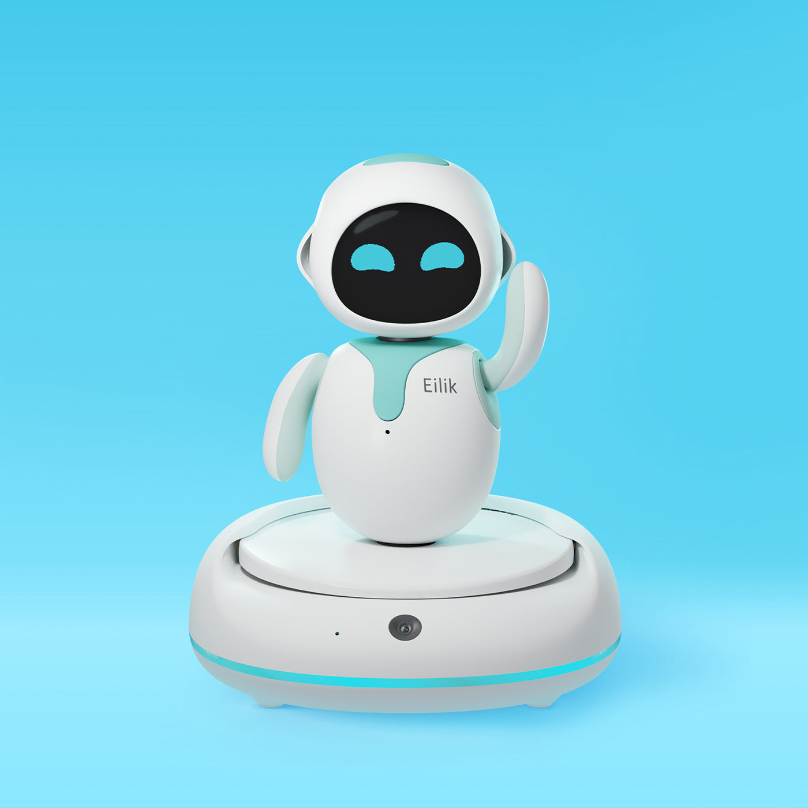
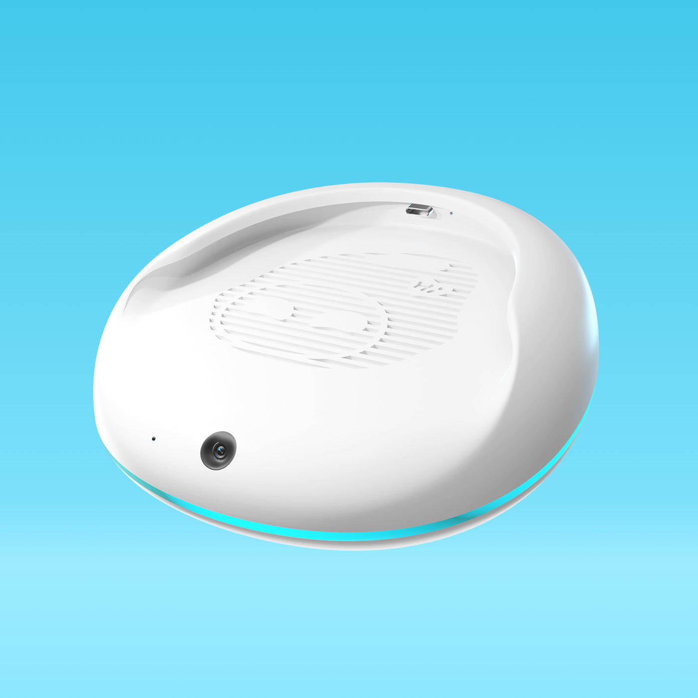
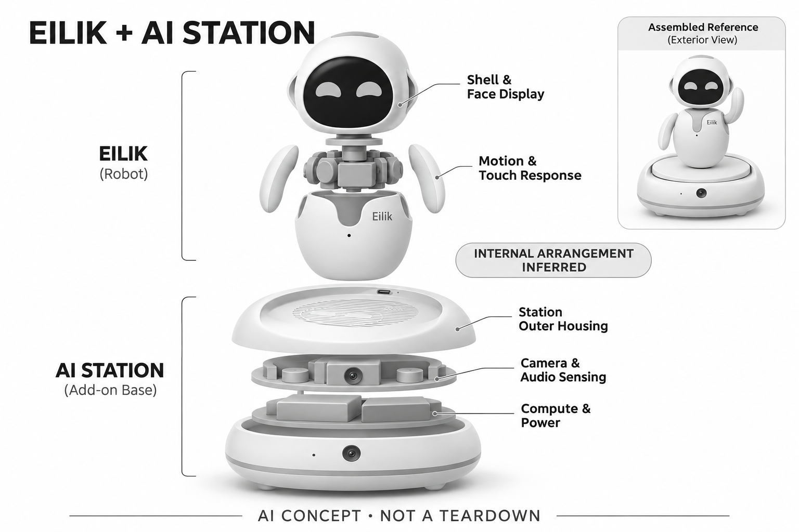

# Eilik + AI Station

**EnergizeLab** · 陪伴与宠物 · 核查 2026-11-04

从触碰表情玩具扩展为可对话的桌面组合

消费渠道：个人零售。

## 产品图片与结构参考

### 产品图

Eilik 与 AI Station 组合官方产品图 · 来源：[EnergizeLab · 官方图片](<https://store.energizelab.com/products/ai-station>) · [原始图片](<https://cdn.shopify.com/s/files/1/0601/5349/5720/files/aistatin-main-blue.jpg?v=1764326651>)

### 参考图

AI Station 底座官方参考图（Eilik本体另售） · 来源：[EnergizeLab · 官方图片](<https://store.energizelab.com/products/ai-station>) · [原始图片](<https://cdn.shopify.com/s/files/1/0601/5349/5720/files/aistation-main.jpg?v=1764326651>)

### AI 生成爆炸示意

**AI 生成 · 非实物拆机。** 内部为概念推断，不能作为元件布局、BOM 或维修依据。[生成提示词](../../content/hardware/prompts/eilik-ai-station.txt)

> 已目视核对产品外形与AI标识；verified不代表内部布局经实物拆机验证。

> 主图明确展示机器人与另购AI Station组合；参考图只展示底座。

> 分析为基于公开资料的案头研究与 AI 辅助判断，未经用户访谈、销量审计或实物拆机。需求、画像、竞争冷门度、审美及商业机会均为研究假设，不是投资结论。

## 销售与购买

- 状态：在售。Eilik和AI Station两个官方商品页均有加购入口。AI Station页面明确需搭配Eilik，本体单独销售；基础Eilik不能被直接描述为具备这套生成式能力。

- 地区：国际官网（配送地区待结算）

- 价格：Eilik US$139.99；AI Station US$99。核查时分别显示的促销价，合计仅为两件标价相加；运税、套装折扣和颜色以实际结算为准。

- 中国大陆：本次核实的是国际美元商店，未核实大陆店铺与国内模型服务；不能把品牌中文背景等同中国版本可用。

- [官方产品 / 商店](<https://store.energizelab.com/products/ai-station>)

## AI 的实际作用

基础Eilik以触碰和预设角色反应为主；加AI Station后，官方描述支持上下文对话、人脸及物体识别和AI生成故事。

服务与联网依赖：需要两件硬件及配套应用；自然对话的模型、云端地域与完整离线边界未充分披露，应按联网服务核查而非假设端侧完成。

## 是否冷门

新兴竞争（研究判断）：桌面陪伴拥挤，但可升级底座是不同于整机替换的切口。

## 需求与市场

需求假设：已有桌面角色的用户可能愿意为更丰富的对话升级，而初次购买者更在意总成本与是否真会持续使用。应分别验证本体用户的升级意愿和新用户对组合价值的理解。

### 产品任务与边界 · 研究判断

Eilik与AI Station的组合把原本以触碰、表情和动作回应的桌面角色，扩展到视觉和上下文会话。需求首先分成已有本体用户的升级与新用户整套购买，两类人对底座价值和总成本的理解不同，不能用同一个兴趣问卷代替。

依据：[Eilik AI Station官方商品](<https://store.energizelab.com/products/ai-station>) · [Eilik本体官方商品](<https://store.energizelab.com/products/eilik>)

### 需求判断 · 研究判断

升级需求可能来自希望熟悉角色有更多可聊内容，而不是需要新的家庭工具。若新增对话不能与原本动作保持连贯，用户会感觉桌面上只是多了一个音箱；组合价值取决于角色体验是否增强，而不是能力清单是否变长。

依据：[Eilik AI Station官方商品](<https://store.energizelab.com/products/ai-station>) · [Eilik本体官方商品](<https://store.energizelab.com/products/eilik>)

### 需求验证 · 待验证

可分别观察已有Eilik和初次接触者完成同一组日常互动，记录是否主动切换到AI Station、对话后是否继续玩本体，以及何时觉得两者割裂。需要比较真实使用频率与升级成本，不把预订意愿直接等同付费后留存。

依据：[Eilik AI Station官方商品](<https://store.energizelab.com/products/ai-station>) · [Eilik本体官方商品](<https://store.energizelab.com/products/eilik>)

## 用户画像

用户画像推断：喜欢表情动画、收藏玩具与桌面互动的人更可能接受固定位置的角色。希望设备主动走动、完成家庭任务或长期不联网的人，可能对这一组合产生不同预期。

### 适用行为与条件 · 研究判断

较匹配者是愿意在固定桌面摆放角色、喜欢表情动画并能接受联网设置的人。组合并不意味着会自主走动或执行家务，若用户期待移动助理，需要在画像阶段排除这种预期，而不是用机器人这个词吸引所有需求。

依据：[Eilik AI Station官方商品](<https://store.energizelab.com/products/ai-station>) · [Eilik本体官方商品](<https://store.energizelab.com/products/eilik>)

### 人群取舍 · 研究判断

已有用户可能重视保留原角色的熟悉感，新用户则更容易与一体式陪伴设备比较外观和总价。两件硬件还涉及购买、配对、供电与保修理解，愿意维护桌面收藏的用户与只想即开即聊的用户可能走向不同选择。

依据：[Eilik AI Station官方商品](<https://store.energizelab.com/products/ai-station>) · [Eilik本体官方商品](<https://store.energizelab.com/products/eilik>)

### 画像验证 · 待验证

画像验证可让参与者不依赖讲解判断本体与底座分别提供什么，再完成安装、关闭相机和恢复连接。应记录误以为单买底座就有完整角色、或误以为本体原生具备新AI功能的情况，检验产品边界是否易于理解。

依据：[Eilik AI Station官方商品](<https://store.energizelab.com/products/ai-station>) · [Eilik本体官方商品](<https://store.energizelab.com/products/eilik>)

## 竞争与替代

竞争判断：固定桌面陪伴已较拥挤，但“旧本体升级AI底座”具有存量用户切入方式。它与一体式新机器人竞争时，需要证明组合后的体验足够连贯，而不是两个产品拼接。

### 比较对象与差异 · 研究判断

竞争对象既有一体式桌面机器人，也有单独智能音箱和原版Eilik自身。AI Station的特殊路径是延长存量本体的能力，而不是重新制造一台完整机器人；这种优势只有在升级体验连贯、旧用户愿意继续使用时才成立。

依据：[Eilik AI Station官方商品](<https://store.energizelab.com/products/ai-station>) · [Eilik本体官方商品](<https://store.energizelab.com/products/eilik>)

### 竞争判断 · 研究判断

一体式设备可能在比例、布线和感知位置上更自然，模块化组合则可能减少重复购买。竞争判断应比较整个拥有过程，包括配对、空间占用和维护，不能把旧本体可以复用简单换算成一定更低成本或更环保。

依据：[Eilik AI Station官方商品](<https://store.energizelab.com/products/ai-station>) · [Eilik本体官方商品](<https://store.energizelab.com/products/eilik>)

### 竞争验证 · 待验证

可以让用户在组合与一体式产品间执行故事、识物和普通触碰互动，观察他们是否在意动作与语音的同步。还需测量桌面摆放和两件产品设置的额外步骤，判断模块化优势是否足以补偿更复杂的拥有体验。

依据：[Eilik AI Station官方商品](<https://store.energizelab.com/products/ai-station>) · [Eilik本体官方商品](<https://store.energizelab.com/products/eilik>)

## 供应链

供应链推断：本体运动机构与新增相机底座分开供应，能够复用存量硬件，也增加线缆、接口和兼容性管理。官方未披露代工厂；两件产品的保修与配对流程应一起评估。

### 功能模块拆分 · 研究判断

功能架构应明确本体的触碰、表情和运动，与底座新增相机、对话及视觉处理之间的边界。现有资料没有完整披露计算分工与内部连接，因此不能把每个动作都称为生成式AI，也不能根据示意图写出确切芯片和内部线路。

依据：[Eilik AI Station官方商品](<https://store.energizelab.com/products/ai-station>) · [Eilik本体官方商品](<https://store.energizelab.com/products/eilik>)

### 制造与供应约束 · 研究判断

供应链上的关键不是简单多做一个底座，而是本体接口、固件、相机位置和声音输出之间的兼容。旧批次本体能否稳定配对、更新失败如何恢复以及两件设备分别如何保修，都会影响升级模式是否真正降低交付负担。

依据：[Eilik AI Station官方商品](<https://store.energizelab.com/products/ai-station>) · [Eilik本体官方商品](<https://store.energizelab.com/products/eilik>)

### 候选与证据缺口 · 研究判断

歌尔可作为语音、视觉及电子整合候选，SIIX可讨论底座与接口板的制造测试，但两者均未被点名采用。运动同步、协议和已有本体兼容仍需品牌掌握，候选制造能力不能替代对两件设备协作方式的公开或实测证据。

依据：[Eilik AI Station官方商品](<https://store.energizelab.com/products/ai-station>) · [Eilik本体官方商品](<https://store.energizelab.com/products/eilik>)

## 技术路径

官方把上下文对话、视觉识别和生成故事归于AI Station。推断系统难点在识别、对话记忆与本体动画的同步，并应区分真实模型输出与预设动作，避免把基础触发动画都称作AI。

### 已披露技术边界 · 研究判断

原目录已核实基础Eilik主要进行触碰和预设角色互动，AI Station才增加上下文对话、人脸及物体相关交互和生成故事。模型与云端地域、完整离线边界未充分披露，应保持联网服务的核查口径，不能假设所有推理都在底座完成。

依据：[Eilik AI Station官方商品](<https://store.energizelab.com/products/ai-station>) · [Eilik本体官方商品](<https://store.energizelab.com/products/eilik>)

### 系统难点判断 · 研究判断

技术难点在视觉输入、会话状态和本体动画之间的协调。相机识别到对象、模型生成了回答，并不意味着角色动作就能准确表达对应内容；若同步延迟或状态失配，原本有趣的桌面角色反而可能显得机械和难以理解。

依据：[Eilik AI Station官方商品](<https://store.energizelab.com/products/ai-station>) · [Eilik本体官方商品](<https://store.energizelab.com/products/eilik>)

### 技术验证 · 待验证

可在固定网络条件下测量相机事件、语音回应与动作发生的先后，再加入中断、遮盖相机和重连场景。记录应区分本体独立可用能力、底座附加能力和需要云服务的能力，不以正常状态下一次完整演示代表整个系统。

依据：[Eilik AI Station官方商品](<https://store.energizelab.com/products/ai-station>) · [Eilik本体官方商品](<https://store.energizelab.com/products/eilik>)

## 产品审美

审美判断：小体积、圆润肢体和屏幕表情保留桌面玩具的亲近感；加入底座后应检查整体比例、线缆和摆位。功能扩展若破坏原有一体感，会削弱用户为角色本身付费的理由。

### 外观与交互语言 · 研究判断

Eilik以小体积、圆润肢体和屏幕表情建立桌面玩具感，AI Station会改变整组物件的高度、基座比例与视觉重心。审美分析应针对组合后的状态，而不是分别把两个单品照片评为好看后就认为放在一起仍然协调。

依据：[Eilik AI Station官方商品](<https://store.energizelab.com/products/ai-station>) · [Eilik本体官方商品](<https://store.energizelab.com/products/eilik>)

### 使用中审美判断 · 研究判断

线缆、相机朝向、扬声器位置和手指触碰本体时的空间都可能影响一体感。用户为了更好识脸而调整底座位置，可能让原本方便的桌面互动变得不自然；因此感知效率与角色摆放之间需要真实环境中的取舍。

依据：[Eilik AI Station官方商品](<https://store.energizelab.com/products/ai-station>) · [Eilik本体官方商品](<https://store.energizelab.com/products/eilik>)

### 设计验证 · 待验证

可在书桌、显示器旁和床头等不同位置试摆，观察用户是否容易触碰、看清表情和理解相机工作方向。还应比较通电及关机时的整体观感，记录线缆和底座是否让用户倾向把设备移开或减少日常使用。

依据：[Eilik AI Station官方商品](<https://store.energizelab.com/products/ai-station>) · [Eilik本体官方商品](<https://store.energizelab.com/products/eilik>)

## 关键风险

风险判断：生成故事和视觉识别会引入家庭图像及语音处理问题，隐私遮盖只覆盖相机而非所有数据路径。基础本体、底座及订阅条件需要清晰说明，避免消费者误买不完整组合。

### 主要失效与依赖 · 研究判断

主要风险是组合能力被混为一谈，消费者可能买到不完整系统，或把相机遮盖误认为关闭全部语音与数据处理。生成故事和视觉识别还会引入家庭资料与内容错误，物理遮盖只解决特定采集路径，并不代表完整隐私控制。

依据：[Eilik AI Station官方商品](<https://store.energizelab.com/products/ai-station>) · [Eilik本体官方商品](<https://store.energizelab.com/products/eilik>)

### 风险传播判断 · 研究判断

两个硬件与应用服务形成更多故障组合：本体正常但底座离线、相机关闭但语音仍工作、更新后配对失效，都可能被用户理解为角色坏了。若能力和状态提示不清晰，售后负担与信任损失可能同时扩大。

依据：[Eilik AI Station官方商品](<https://store.energizelab.com/products/ai-station>) · [Eilik本体官方商品](<https://store.energizelab.com/products/eilik>)

### 风险验证 · 待验证

风险验证可让用户判断不同断网、遮盖和更新状态下哪些功能仍可用，并测试能否自行恢复。购买页面也应进行理解测试，确认用户知道需要本体与底座两件设备，以及没有公开承诺的离线或订阅能力不能被默认期待。

依据：[Eilik AI Station官方商品](<https://store.energizelab.com/products/ai-station>) · [Eilik本体官方商品](<https://store.energizelab.com/products/eilik>)

## 机会与验证

机会假设：给既有玩具或陪伴物增加可选智能模块，可能比重新制造整机更快验证需求。应先确认升级后的实际使用频次和售后复杂度，再扩展角色、应用市场或长期内容服务。

### 可能的机会入口 · 研究判断

可验证的机会是为已有情感物件提供可选升级，让用户保留熟悉的外观与互动习惯，同时逐步尝试新能力。这个方向不必追求替代所有新机器人，而应证明升级能让旧物件重新获得有意义的日常使用。

依据：[Eilik AI Station官方商品](<https://store.energizelab.com/products/ai-station>) · [Eilik本体官方商品](<https://store.energizelab.com/products/eilik>)

### 机会成立条件 · 研究判断

模式成立需要旧本体数量与活跃用户真实存在、接口长期稳定，并且新增服务不会让老功能变得更难使用。若用户只是短暂尝鲜，底座开发、兼容维护和持续AI服务成本可能无法被升级收入覆盖，不能只看配件毛利。

依据：[Eilik AI Station官方商品](<https://store.energizelab.com/products/ai-station>) · [Eilik本体官方商品](<https://store.energizelab.com/products/eilik>)

### 下一步验证 · 待验证

下一步可先对已有用户验证少数高频升级任务，观察使用变化和兼容故障，再评估新增角色或内容生态。若最有价值的是简单对话和故事，应优先把同步与恢复做好，而不是不断扩张识别对象和功能列表。

依据：[Eilik AI Station官方商品](<https://store.energizelab.com/products/ai-station>) · [Eilik本体官方商品](<https://store.energizelab.com/products/eilik>)

## 对应供应链公司

能力候选用于选型研究，不代表本产品实际采用；未公开的供货关系不作推断。

- [goertek](../supply-chain/goertek.md) — **能力候选 · 非已采用** / AI Station语音视觉与本体反馈接口整合：歌尔公开覆盖家庭AI音箱、安防及声学光学电子设计，可讨论AI Station新增视听输入与本体反馈接口。其能力不证明已为Eilik供货，也不保证旧本体协议兼容；需要品牌提供接口和同步验收要求。

- [siix](../supply-chain/siix.md) — **能力候选 · 非已采用** / AI底座与连接控制板的制造测试：SIIX可提供PCB贴装、物料采购和成品装配，适合作为AI Station控制电子与连接接口的制造候选。已有Eilik批次兼容、固件恢复和两件硬件保修并非通用EMS自然覆盖，必须单独验证；无实际采用证据。

[浏览供应链目录](../supply-chain.md)

## 功能分层示意

这是功能关系，不是实物拆机、真实空间结构或已核实 BOM。

1. **基础互动**：Eilik通过触碰、表情与动作进行互动。（官方披露）

2. **新增感知**：AI Station提供相机、熟人识别及物体相关交互。（官方披露）

3. **对话生成**：上下文对话、生成故事与角色扮演。（官方披露）

4. **输出组合**：把语音和生成内容映射至本体动作的功能理解。（分析推断）

5. **隐私与维护**：相机遮盖、Type-C供电和持续功能更新。（官方披露）

## 来源

1. [Eilik AI Station官方商品](<https://store.energizelab.com/products/ai-station>) — 明确单独销售、需配Eilik，以及AI对话与视觉能力。

2. [Eilik本体官方商品](<https://store.energizelab.com/products/eilik>) — 基础触碰互动与另购AI Station的边界有明确说明。

[返回目录](../hardware-market.md) · [网页分析](https://romanagent.github.io/Roman/#hardware/product/eilik-ai-station)
