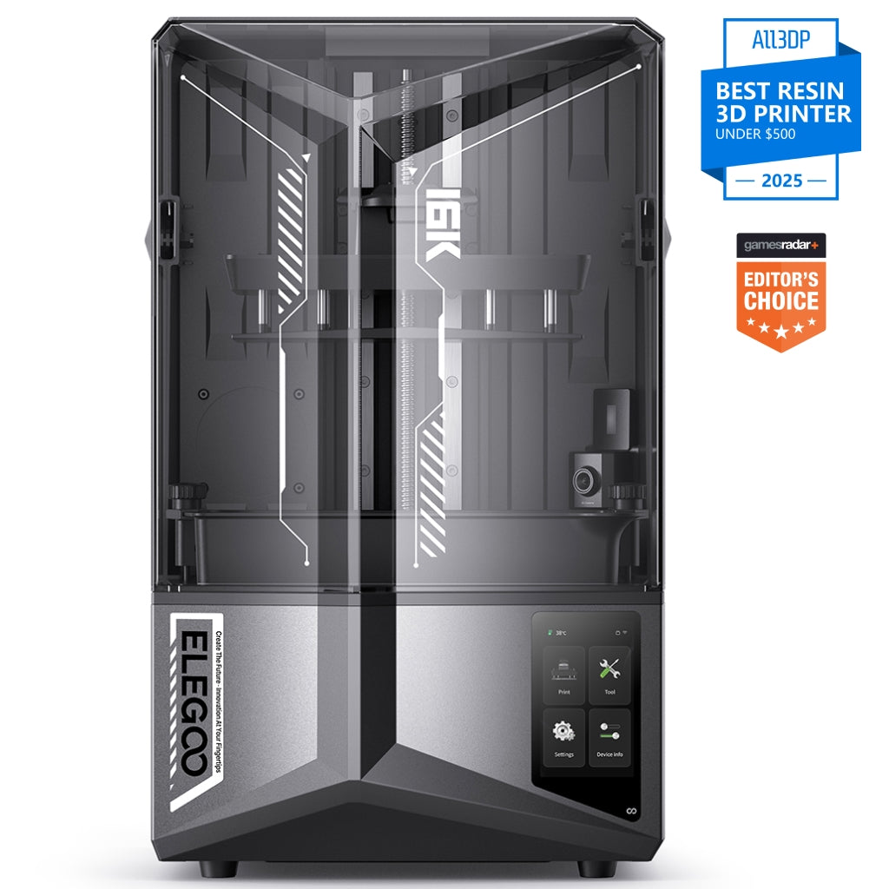
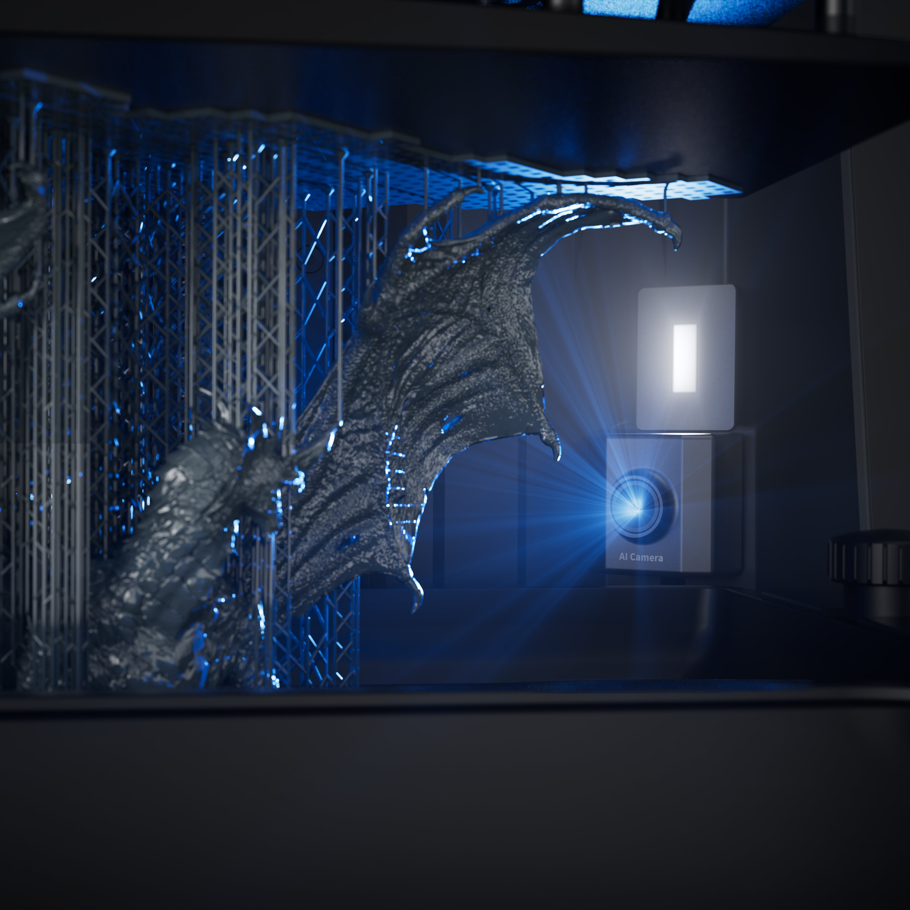
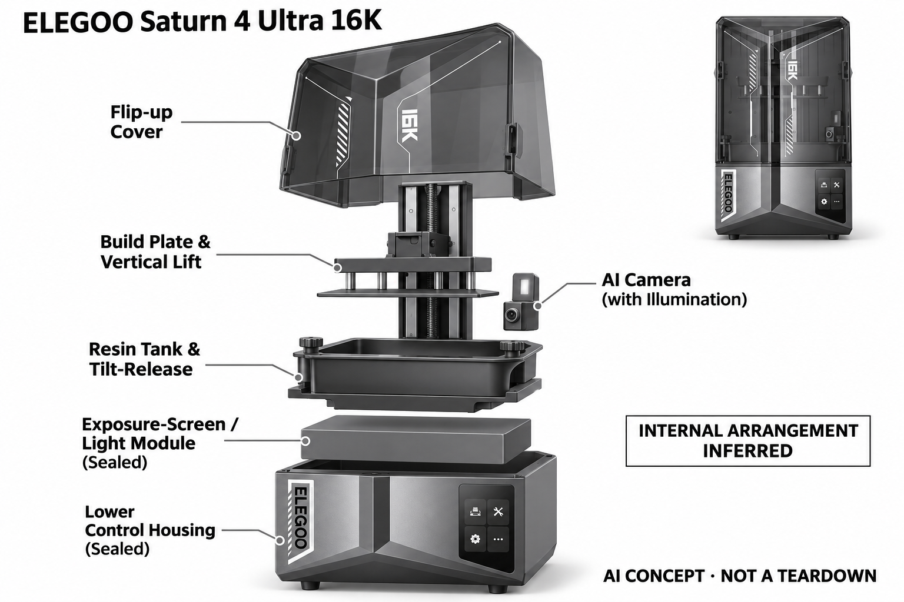

# ELEGOO Saturn 4 Ultra 16K

**ELEGOO** · 专业兴趣工具 · 核查 2026-11-04

用AI相机辅助树脂模型失败监测

消费渠道：个人零售。

## 产品图片与结构参考

### 产品图

ELEGOO Saturn 4 Ultra 16K · 官方产品图 · 来源：[ELEGOO · 官方图片](<https://us.elegoo.com/products/saturn-4-ultra-16k-10inch-monochrome-lcd-resin-3d-printer>) · [原始图片](<https://us.elegoo.com/cdn/shop/files/S4U16K-_01_b0176288-f27d-4f4c-b922-84e67b87acae.jpg?v=1792635383>)

### 参考图

ELEGOO Saturn 4 Ultra 16K · 官方参考图 · 来源：[ELEGOO · 官方图片](<https://us.elegoo.com/products/saturn-4-ultra-16k-10inch-monochrome-lcd-resin-3d-printer>) · [原始图片](<https://us.elegoo.com/cdn/shop/files/AI_4k.jpg?v=1787636436>)

### AI 生成爆炸示意

**AI 生成 · 非实物拆机。** 内部为概念推断，不能作为元件布局、BOM 或维修依据。[生成提示词](../../content/hardware/prompts/elegoo-saturn4-ultra-16k.txt)

> 分析为基于公开资料的案头研究与 AI 辅助判断，未经用户访谈、销量审计或实物拆机。需求、画像、竞争冷门度、审美及商业机会均为研究假设，不是投资结论。

## 销售与购买

- 状态：在售。官方美国店Add to Cart，结构化Offer为InStock且本体报价US$399。原12K版本、清洗固化套装和树脂组合不另计型号。

- 地区：美国官方商店

- 价格：美国官方本体 US$399。核查日页面快照；运费、税费、会员和配送区域按官方结算确认，不视为中国到手价。

- 中国大陆：本轮核实所列区域官方商店；未确认中国大陆官方现货、账户及完整服务，不把境外可购等同大陆可用。

- [官方产品 / 商店](<https://us.elegoo.com/products/saturn-4-ultra-16k-10inch-monochrome-lcd-resin-3d-printer>)

## AI 的实际作用

带照明的AI相机观察成型区域，对空平台和模型翘曲发出提醒；机械残渣检测、加热和自动调平是不同系统，不混同AI视觉。

服务与联网依赖：需要切片软件、树脂与后处理流程；检测受模型、树脂、光照和相机可见范围影响，网络监看与固件兼容按当前软件支持。

## 是否冷门

新兴竞争（研究判断）：面向微缩模型和精细个人创作形成具体使用场景；本轮没有销量与市场份额证据。

## 需求与市场

需求假设：制作微缩模型和精细摆件的人希望尽早发现空平台或翘曲，避免长时间等待后才发现失败。应观察报警时能否采取有效行动，并把清洗固化和废料处理计入完整制作时间。

## 用户画像

画像推断：有合适工作区、愿意学习树脂材料和后处理的个人模型爱好者较匹配。它不是只需放在书桌上按键的日用品，空间、清洁和耗材管理会决定家庭是否能够持续使用。

## 竞争与替代

竞争判断：树脂打印机、FDM设备及模型代打印服务满足不同需求，AI相机只是减少部分观察负担。高分辨率与低促销价并不自动形成优势，使用者更在意实际模型质量、维护与后处理成本。

## 供应链

供应链推断：曝光屏、光源、升降与倾斜机构、树脂槽和相机需共同保持一致性，耗材与易损膜也影响寿命。官方未披露完整工厂及物料表；屏幕更换、树脂适配和配件供货属于长期成本。

## 技术路径

官方说明AI相机可检测空平台和翘曲，并明确结果受环境、模型与树脂影响。技术判断应分别记录可见失败、遮挡和误报，不把机械残渣传感或自动调平归为视觉AI，也不保证所有变形都能发现。

## 产品审美

审美判断：深色翻盖箱体和正面触屏带来整齐的工作台外观，内部照明让过程更可见。开盖高度、树脂槽取放和清洗工具会显著增加空间需求，单机照片不能代表实际使用环境。

## 关键风险

风险判断：树脂接触、清洗和固化需要遵守材料说明，AI相机不能替代操作管理或发现视野外问题。促销套餐可能包含不同后处理设备，购买时应核对真实配置，不把报警宣传当作安全保证。

## 机会与验证

市场观察：用用户常做的微缩模型进行一轮完整制作，记录失败发现时间、人工检查和耗材损失。将精度、生产节奏和AI提醒分开衡量，不以单个漂亮样件或高分辨率数字推算市场需求。

## 功能分层示意

这是功能关系，不是实物拆机、真实空间结构或已核实 BOM。

1. **曝光成型**：光源、曝光屏与树脂槽逐层成型。（官方披露）

2. **机械执行**：升降和倾斜释放机构完成动作。（官方披露）

3. **视觉监测**：带照明AI相机观察空平台与翘曲。（官方披露）

4. **操作管理**：触屏、切片软件与人工后处理。（官方披露）

## 来源

1. [Saturn 4 Ultra 16K美国官方商品](<https://us.elegoo.com/products/saturn-4-ultra-16k-10inch-monochrome-lcd-resin-3d-printer>) — 已实际打开官方页面；功能说明不等于独立性能测量。

2. [ELEGOO官方16K型号与相机介绍](<https://www.elegoo.com/blogs/news/elegoo-unveils-saturn-4-ultra-16k-a-major-leap-in-accuracy-and-user-experience>) — 已实际打开官方页面；功能说明不等于独立性能测量。

[返回目录](../hardware-market.md) · [网页分析](https://romanagent.github.io/Roman/#hardware/product/elegoo-saturn4-ultra-16k)
