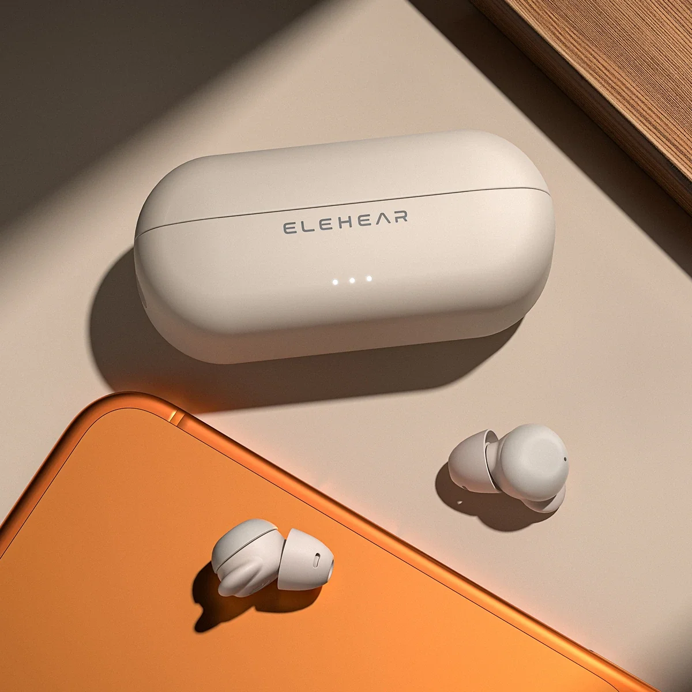
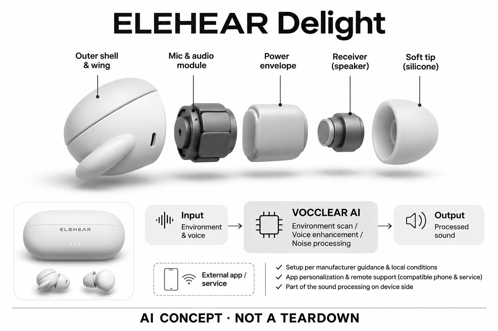

# ELEHEAR Delight

**ELEHEAR** · 助听与听力 · 核查 2026-11-04

带软耳翼的耳塞式OTC助听器与AI个性化听音

消费渠道：个人零售。

## 产品图片与结构参考

### 产品图

ELEHEAR Delight官方产品外形图 · 来源：[ELEHEAR · 官方产品图片](<https://elehear.com/products/elehear-delight>) · [原始图片](<https://cdn.shopify.com/s/files/1/0736/8500/8693/files/Delight-product-1.webp?v=1776406310&width=1200>)

### 参考图

ELEHEAR Delight官方另一角度或使用场景参考 · 来源：[ELEHEAR · 官方产品图片](<https://elehear.com/products/elehear-delight>) · [原始图片](<https://cdn.shopify.com/s/files/1/0736/8500/8693/files/Delight-wear.webp?v=1779092000&width=1200>)

### AI 生成爆炸示意

**AI 生成 · 非实物拆机。** 内部为概念推断，不能作为元件布局、BOM 或维修依据。[生成提示词](../../content/hardware/prompts/elehear-delight.txt)

> 外形依据核验参考图；内部位置、模块形状与装配关系仅作AI概念展示。

> 已逐张查看并核对型号。源图未改色/裁切；场景、界面、附件、优惠及效果文案仅为厂商示意，不作为本目录性能或现价依据。

> 分析为基于公开资料的案头研究与 AI 辅助判断，未经用户访谈、销量审计或实物拆机。需求、画像、竞争冷门度、审美及商业机会均为研究假设，不是投资结论。

## 销售与购买

- 状态：在售。已打开官方具体商品页，显示基础配置价格、Add to Cart/Buy Now及1–2工作日发货说明；未将候补颜色或额外服务算为在售硬件。

- 地区：美国官方OTC零售地区（具体地址结算确认）

- 价格：US$299/对（所见基础配置）。官网另有Dry Box套装和远程服务，不能把套装价视为基础硬件价；促销、税费和配送按结算。

- 中国大陆：本次核实美国官方OTC销售；未确认同型号中国大陆准入、正式销售及应用服务。海外OTC身份不等同在中国无需验配或可直接使用。

- [官方产品 / 商店](<https://elehear.com/products/elehear-delight>)

## AI 的实际作用

VOCCLEAR AI平台用于环境扫描、语音突出和噪声相关处理。

服务与联网依赖：需按厂商说明和当地适用条件设置；App个性化与远程支持需要兼容手机及相应服务，部分核心声音处理在设备侧。

## 是否冷门

细分专业（研究判断）：消费OTC听音辅助是专业细分，已有多家竞品；不把耳塞外形或AI名称当作疗效证据。

## 需求与市场

需求假设：在熟悉的耳塞外形中使用听音辅助，而不愿采用外露耳背连接线。需求要在个人听音场景中检验；易买到和外观熟悉不等于适配所有情况，也不能把购买便利直接转写成医学效果。

## 用户画像

画像推断：符合当地OTC产品适用范围、能够完成App设置并理解使用说明的成年人更匹配。需要专业诊断或复杂验配的人群不能据在线宣传自行套用，本目录不进行个体适配建议。

## 竞争与替代

案头判断：该带软耳翼的耳塞式OTC助听器与其他OTC助听、传统验配方案及辅助听音产品竞争。没有销量、复购或用户访谈依据，不把较低硬件价格理解为更高性价比或相同服务水平。

## 供应链

官网披露带软耳翼的耳塞式OTC助听器及专有声音处理平台，具体芯片制造商、声学器件和装配厂未公开。推断舒适、密封和长期维护与算法同样重要，但不凭厂商自研表述估计物料成本。

## 技术路径

已核实AI机制为VOCCLEAR AI平台用于环境扫描、语音突出和噪声相关处理，而非把普通蓝牙或ANC当成AI。厂商比较数字未经本研究复核，模型细节、不同声音场景的误差与个体体验也不作推定。

## 产品审美

图示观察：圆润耳塞、软耳翼和充电盒接近日常真无线耳机，但功能定位为助听设备。实际耳廓贴合、操作按键和取放充电的便利需要试用；消费电子外观不改变产品适用范围，也不证明长时间佩戴一定舒适。

## 关键风险

主要风险是把OTC零售资格当成对所有听力情况都合适，以及套装、远程服务和配置价格混淆。官网存在不同颜色开放时间，只有可加购物车配置计入在售；本研究不提供疗效或适配保证。

## 机会与验证

市场差异是带软耳翼的耳塞式OTC助听器与AI声音处理、App设置和线上支持的组合。尚待验证的购买理由是个人真实场景体验与长期维护是否可接受，而不是仅由标价或营销准确率决定。

## 功能分层示意

这是功能关系，不是实物拆机、真实空间结构或已核实 BOM。

1. **环境声音**：声学输入进入助听处理链；概念功能架构，非拆机。（官方披露）

2. **个性化设置**：按产品说明通过App配置听音偏好与参数。（官方披露）

3. **AI处理**：VOCCLEAR AI平台用于环境扫描、语音突出和噪声相关处理。（官方披露）

4. **耳道输出**：受话器输出处理后声音，具体内部布置未披露。（分析推断）

5. **管理支持**：应用、充电与可选远程支持构成日常使用系统。（官方披露）

## 来源

1. [ELEHEAR Delight官方商品页](<https://elehear.com/products/elehear-delight>) — 已打开，基础配置、加入购物车与发货说明可见；未采用候补颜色。

2. [ELEHEAR官方型号比较](<https://elehear.com/pages/four-elehear-hearing-aids-compared>) — 已打开，区分不同形态与AI平台。其营销性能数字不作为本研究独立证据。

[返回目录](../hardware-market.md) · [网页分析](https://romanagent.github.io/Roman/#hardware/product/elehear-delight)
