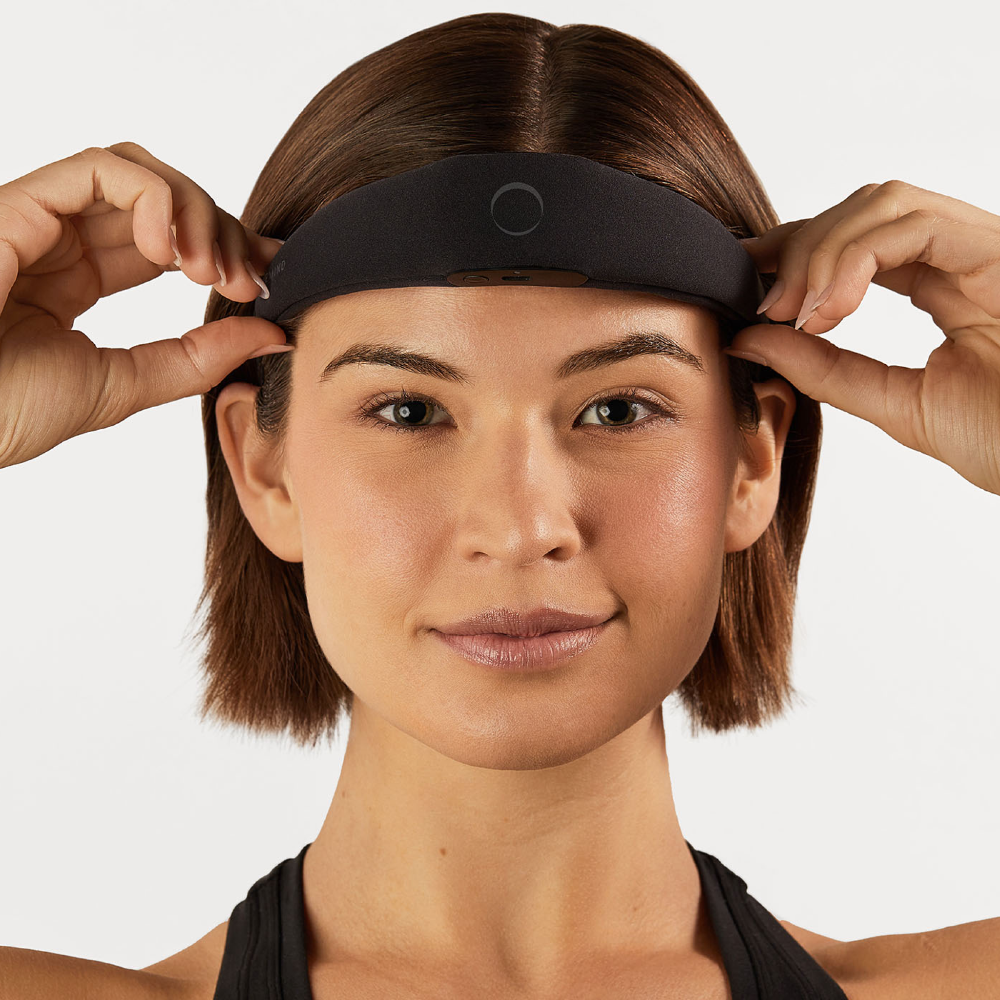
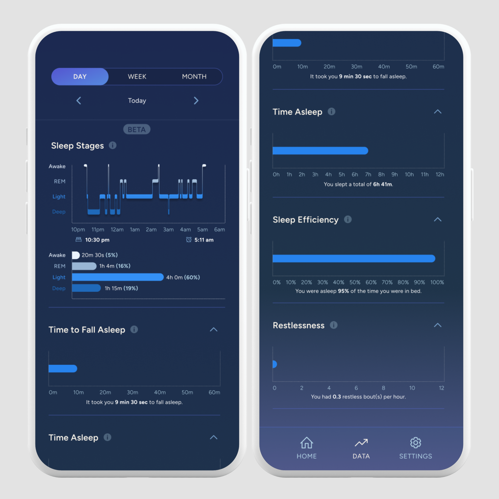
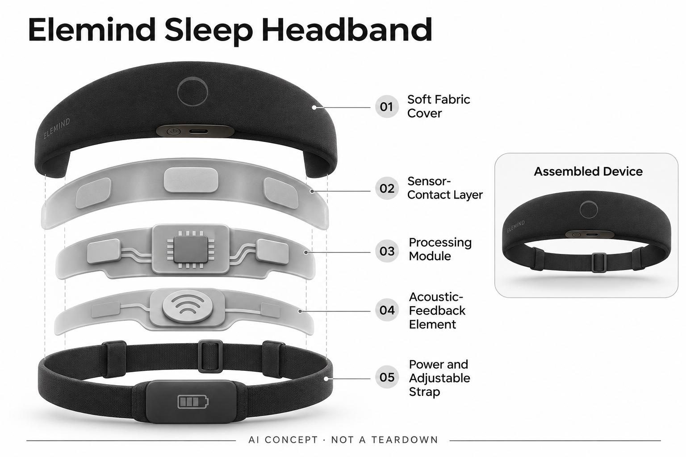

# Elemind Sleep Headband

**Elemind** · 睡眠与放松 · 核查 2026-11-04

把脑电采集与个性化声音反馈放进睡前头带。

消费渠道：个人零售。

## 产品图片与结构参考

### 产品图

Elemind Sleep Headband 官方产品图 · 来源：[Elemind](<https://elemindtech.com/products/elemind>) · [原始图片](<https://cdn.shopify.com/s/files/1/0766/3543/9378/files/PDP_STATIC1_1.png?v=1776640070>)

### 参考图

Elemind 官方App记录界面参考（示例数据） · 来源：[Elemind](<https://elemindtech.com/products/elemind>) · [原始图片](<https://cdn.shopify.com/s/files/1/0766/3543/9378/files/phone_screen_for_website_0c3340ff-8217-49e7-be5e-084ded526cbe.png?v=1746548141>)

### AI 生成爆炸示意

**AI 生成 · 非实物拆机。** 内部为概念推断，不能作为元件布局、BOM 或维修依据。[生成提示词](../../content/hardware/prompts/elemind-sleep-headband.txt)

> 分析为基于公开资料的案头研究与 AI 辅助判断，未经用户访谈、销量审计或实物拆机。需求、画像、竞争冷门度、审美及商业机会均为研究假设，不是投资结论。

## 销售与购买

- 状态：在售。官网实际可见 Buy Now 按钮可用，默认商品数据 available=true；抓取文本中的 Sold out 是模板残留，已用可见页面核对。

- 地区：美国、加拿大（具体结算确认）

- 价格：US$399。为所标地区和配置的核查参考；活动、税费、物流及可选服务以实际结算为准，不进行汇率换算或保证最低价。

- 中国大陆：本轮核查海外官方消费渠道，未验证中国大陆结算、型号、保修与全部AI服务可用性；不因品牌来源或支持中文推定国内可购。

- [官方产品 / 商店](<https://elemindtech.com/products/elemind>)

## AI 的实际作用

厂商称其通过EEG信号分析和AI Sleep Tailor适配声音反馈，用于个人睡眠体验；本目录未独立验证其效果。

服务与联网依赖：基础功能与部分睡眠统计随硬件提供；更细统计等属于可选Premium服务。需兼容手机App，公开标注的未来功能不当作已经交付。

## 是否冷门

细分专业（研究判断）：消费EEG睡眠反馈属于较窄场景，但已有替代设备和非硬件服务，冷门并不等于需求已验证。

## 需求与市场

需求假设：愿意调整睡前习惯的个人希望减少入睡过程中的干扰，并获得比手表更直接的脑电信息。购买动机需和舒适度、实际佩戴频率共同验证，不能由官网成功案例推算总体效果。

### 需求假设：声音反馈随自身信号变化 · 研究判断

Elemind把EEG输入与声音反馈结合，用户可能希望得到比固定音频更贴近当下状态的体验，而不只是再添一个睡眠记录器。需求应询问现有声音或腕表方案缺少什么，不能将对入睡的担忧直接转成购买证明，也不以AI名称假定愿意整夜佩戴。

依据：[Elemind 官方商品页](<https://elemindtech.com/products/elemind>) · [Elemind FAQ](<https://elemindtech.com/pages/faq>)

### 价值判断：实时适配需要覆盖接触负担 · 研究判断

头带的个性化机制可能减少手动选择，但同时需要贴肤、充电与维护，如果用户无法接受触感，算法能力就难以持续发挥。研究应分开观察声音偏好和信号反馈，不将戴得更久或报告更详细直接解释为睡眠改善，更不推断疾病治疗。

依据：[Elemind FAQ](<https://elemindtech.com/pages/faq>)

### 验证方案：从现有睡前音频流程比较 · 待验证

让愿意试用的成年人记录原有音频与准备过程，再在官方允许条件下使用Elemind，观察佩戴调整、夜间取下与晨起查看。重点比较操作与体验，不用设备自评分验证效果，也不要求改变必要医疗安排或制造睡眠不足来测试产品。

依据：[Elemind 官方商品页](<https://elemindtech.com/products/elemind>) · [Elemind FAQ](<https://elemindtech.com/pages/faq>)

## 用户画像

画像推断：对消费神经科技感兴趣、能接受额前传感器接触和手机配套的成年人。对头带触感、声音和头发接触敏感的人，可能比参数更在意长期使用负担；不将其描述成适合所有人的医疗设备。

### 画像假设：能够接受额前接触的成年人 · 研究判断

较匹配者对消费级神经反馈有兴趣，愿意在睡前管理头带和应用，且对额前或头侧触感有可接受范围。长发、侧卧和声音敏感会影响选择，不能把所有睡眠困扰者视为同一用户，也不将愿意试戴理解为长期愿意使用。

依据：[Elemind 官方商品页](<https://elemindtech.com/products/elemind>) · [Elemind FAQ](<https://elemindtech.com/pages/faq>)

### 使用约束：舒适与数据兴趣可能不一致 · 研究判断

有人喜欢脑电统计，却不喜欢躺卧时接触模块，也有人只想听声音而不关心详细报告，二者需要不同验证。研究应了解使用者在一晚中何时取下、为何继续，不把消费神经科技爱好者的好奇泛化为所有成年人对反馈的需求。

依据：[Elemind FAQ](<https://elemindtech.com/pages/faq>)

### 访谈重点：没有详细统计是否仍愿意戴 · 待验证

询问用户只保留基础反馈时是否仍愿意使用，以及哪些高级统计真正值得会员，再观察实际行为。这个问题能区分硬件体验与解释服务，不能仅问是否喜欢更多数据，也不把对报告的兴趣当作医学判断需求或确定疗效期待。

依据：[Elemind 官方商品页](<https://elemindtech.com/products/elemind>) · [Elemind FAQ](<https://elemindtech.com/pages/faq>)

## 竞争与替代

竞争判断：它同时面对EEG头带、普通睡眠音频、腕表记录与非硬件睡眠服务。只有个性化实时反馈对具体用户产生可感知增量，额外佩戴一件设备才有充分理由，品牌研究宣传不等于独立比较。

### 替代方案：固定音频、腕表与其他EEG头带 · 研究判断

Elemind与普通声音方案、记录腕表和其他消费脑电设备形成不同层面的替代，只有固定同一任务才能比较。头带输入更直接并不自动意味着体验更好，也不能把不同产品的疗效宣传当作可直接比较指标，佩戴与持续服务同样重要。

依据：[Elemind 官方商品页](<https://elemindtech.com/products/elemind>) · [Elemind FAQ](<https://elemindtech.com/pages/faq>)

### 差异判断：基础反馈与可选Premium分层 · 研究判断

官方区分基础功能和部分细化统计的Premium服务，用户可以对两层价值分别做选择。这个结构不等于所有未来功能已经交付，研究应核对当前范围，不把网页预告混成现有能力，也不能由可选订阅推断总成本一定低于其他方案。

依据：[Elemind FAQ](<https://elemindtech.com/pages/faq>)

### 比较方法：在相同目标下记录整个流程 · 待验证

让用户比较固定声音与自适应反馈的准备、触感、操作和报告理解，核对硬件与服务费用，记录何时更愿意使用简单方案。不要只比较某一晚分数或主观变化，也不让厂商定义的成功指标替代用户原本想解决的具体问题。

依据：[Elemind 官方商品页](<https://elemindtech.com/products/elemind>) · [Elemind FAQ](<https://elemindtech.com/pages/faq>)

## 供应链

公开页面列出脑电电极、运动传感和骨传导输出，完整芯片和代工信息未披露。供应链分析重点是电极接触一致性、软性材料、贴肤耐久、充电与清洁维护，而非猜测某家工厂或单机成本。

### 功能拆分：电极、运动输入与声音执行 · 研究判断

官方页面列出EEG电极、运动感知和骨传导等反馈，头带、电源与手机共同构成系统。采集、状态分析和声音适配分别承担任务，不能将全部AI都画成某颗未披露芯片，也不能从头带外观推断真实电极材料、供应商或工厂。

依据：[Elemind 官方商品页](<https://elemindtech.com/products/elemind>) · [Elemind FAQ](<https://elemindtech.com/pages/faq>)

### 制造判断：接触一致性与夜间舒适同时成立 · 研究判断

电极需要稳定接触，织物和外壳又要适应头发、枕头及翻身，声音输出也受佩戴位置影响。供应评估应关注完整贴肤与清洁流程，不只看信号技术，本轮没有接触稳定、材料耐久或量产测试，不推断良率和具体采购成本。

依据：[Elemind FAQ](<https://elemindtech.com/pages/faq>)

### 候选选型：小电源与贴肤结构分别测试 · 研究判断

Sunwoda可作为头带电源候选，Protolabs可讨论接触配件和外壳原型，Merry可研究音频工程。EEG与骨传导的具体接口、贴肤材料和耦合仍需专项确认，这些候选没有Elemind采用证据，也不构成生物相容或睡眠效果保证。

依据：[Elemind 官方商品页](<https://elemindtech.com/products/elemind>) · [Elemind FAQ](<https://elemindtech.com/pages/faq>)

## 技术路径

技术路径是信号采集、状态分析与声音反馈的闭环。与纯粹播放固定助眠音频相比，差异在于根据脑电和反馈适配；算法是否稳定识别个体状态，以及脱落接触的影响，仍需要实测。

### 已披露能力：EEG分析与AI Sleep Tailor · 官方资料

厂商描述通过EEG状态分析与AI Sleep Tailor适配声音，运动输入和应用帮助组织使用，不能等同只播放固定助眠内容。机制描述不证明算法对所有人准确，具体模型与部署未完整公开，也不能由报告数字推导诊断或治疗能力。

依据：[Elemind 官方商品页](<https://elemindtech.com/products/elemind>) · [Elemind FAQ](<https://elemindtech.com/pages/faq>)

### 技术判断：信号不足需要可理解的处理 · 研究判断

头带接触变化可能影响输入，用户需要知道什么时候设备获得足够信号、什么时候只是暂时无法判断。研究应先观察接触和提示，再讨论个性化声音，不用流畅的应用解释掩盖输入边界，也不推断算法如何补偿未披露的数据缺失。

依据：[Elemind FAQ](<https://elemindtech.com/pages/faq>)

### 验证方案：把佩戴变化与反馈对应 · 待验证

在支持使用范围中记录头带调整、设备状态、音频和用户感受，检查变化是否能够理解与控制，保留主动取下的情况。报告可辅助回忆但不作为自身准确性的独立证据，本轮没有临床复核、算法测量或睡眠改善测试。

依据：[Elemind 官方商品页](<https://elemindtech.com/products/elemind>) · [Elemind FAQ](<https://elemindtech.com/pages/faq>)

## 产品审美

设计观察：柔软头带和隐藏电子模块让产品更接近寝具配件，而非实验室仪器。长发、侧卧和皮肤接触会影响感知舒适度；外形简洁无法直接证明整夜佩戴的接受度。

### 外形判断：寝具配件式形态仍有触觉存在 · 研究判断

柔软头带和隐藏电子模块弱化实验仪器感，但真正接受度由额前、头侧与枕头接触决定，静态外观无法代替夜间佩戴。设计研究应关注长发、侧卧与清洁，不将看起来轻薄直接解释为整夜舒适，也不把低调外形视为没有准备步骤。

依据：[Elemind 官方商品页](<https://elemindtech.com/products/elemind>)

### 交互判断：用户需要知道何时不用再操作 · 研究判断

睡前设备如果让人持续查信号、看分数和调整声音，可能增加与休息目标相反的管理负担。研究应观察就绪提示、退出和基础设置是否清楚，不把可选项多当作优点，也不以手机界面美观替代贴肤和实际声音体验。

依据：[Elemind FAQ](<https://elemindtech.com/pages/faq>)

### 体验验证：从睡前佩戴到清洁充电 · 待验证

让用户在真实房间用自己的枕头完成佩戴、调整、取下和维护，记录哪些步骤导致下次不愿使用。不要只在白天坐姿体验声音，也不只访问持续使用者，夜间取下和闲置的原因能直接揭示工业设计是否服务真实生活。

依据：[Elemind 官方商品页](<https://elemindtech.com/products/elemind>) · [Elemind FAQ](<https://elemindtech.com/pages/faq>)

## 关键风险

主要风险是效果个体差异、佩戴质量、数据解释与订阅边界。厂商明确消费健康用途，不应由营销文案推导诊断或治疗能力；购买前还需核对支持地区和未来功能是否真正上线。

### 效果边界：消费健康用途不能升级为医疗 · 研究判断

厂商将产品定位于消费健康，目录只说明信号和声音机制，不由营销案例推断疾病治疗或诊断。个人感受、设备评分与医学结果需要区分，本轮未开展临床复核或实机研究，也不提供针对失眠或其他问题的治疗建议。

依据：[Elemind FAQ](<https://elemindtech.com/pages/faq>)

### 服务风险：已交付与未来功能必须区分 · 研究判断

基础功能、可选Premium及公开预告可能有不同状态，用户应核对当前应用与地区支持，不能将未来计划写成已经上线。订阅退出和数据获取也影响拥有体验，硬件仍能充电不代表所有高级统计始终可用，本轮未审核实际账户。

依据：[Elemind 官方商品页](<https://elemindtech.com/products/elemind>) · [Elemind FAQ](<https://elemindtech.com/pages/faq>)

### 验证安排：记录效果不合意与接触负担 · 待验证

试用应纳入不喜欢声音、头带接触不适、报告难理解或主动停用的人，区分体验与服务问题，而不是只保留正面样本。不能把没有持续佩戴都归因于缺乏坚持，也不以少量积极体验推断总体效果和长期商业留存。

依据：[Elemind 官方商品页](<https://elemindtech.com/products/elemind>) · [Elemind FAQ](<https://elemindtech.com/pages/faq>)

## 机会与验证

可验证的市场差异是个性化反馈是否值得硬件与维护成本。适合先观察连续使用、停用原因和真实改善感受，再比较原有方案；本轮没有临床结果复核、用户访谈或留存数据。

### 研究方向：让实时反馈比普通音频多解决一步 · 研究判断

Elemind可用于研究根据自身信号适配声音是否产生值得额外佩戴的增量，机会可能在低打扰设置和明确反馈边界。应先确认用户真正需要什么，再增加报告和订阅内容，避免将消费神经科技标签当作独立购买理由。

依据：[Elemind FAQ](<https://elemindtech.com/pages/faq>)

### 执行计划：分别观察基础与高级服务用户 · 待验证

连续记录佩戴、取下、基础反馈与统计查看，访谈一次继续或停止订阅的事件，并比较原有声音方案。将触感、操作、报告和声音价值分开，不以品牌研究宣传、设备自评分或短期主观改变证明临床效果，也不冒充已做访谈。

依据：[Elemind 官方商品页](<https://elemindtech.com/products/elemind>) · [Elemind FAQ](<https://elemindtech.com/pages/faq>)

### 决策边界：需要长期接受度而非演示成功 · 研究判断

信号和声音闭环说明技术路径，但用户是否愿意持续佩戴、维护与付费仍是开放问题。当前没有访谈、销量、留存或成本报价，不以传感器类别、厂商案例或模型评分预测商业成功，更不将个人体验推广为普遍疗效。

依据：[Elemind 官方商品页](<https://elemindtech.com/products/elemind>) · [Elemind FAQ](<https://elemindtech.com/pages/faq>)

## 对应供应链公司

能力候选用于选型研究，不代表本产品实际采用；未公开的供货关系不作推断。

- [sunwoda](../supply-chain/sunwoda.md) — **能力候选 · 非已采用** / 贴肤脑电头带紧凑电源候选：Sunwoda消费电池能力可用于讨论Elemind头带供电，但贴肤温度、采集噪声、充电保护与空间需要专项验证，不能仅按容量选型。当前没有原机电池采用证据，也不保证通用穿戴电芯可以直接替换或达到具体运行时长。

- [protolabs](../supply-chain/protolabs.md) — **能力候选 · 非已采用** / 电极接触与头带外壳原型候选：Protolabs公开注塑和液态硅胶成型，可作为Elemind接触配件与外壳原型工程候选，但皮肤接触、清洁、材料与电极装配需专项验证，成型能力不等于医疗或生物相容认证。当前无品牌采用证据，也不涉及复制专有电极设计。

- [merry-electronics](../supply-chain/merry-electronics.md) — **能力候选 · 非已采用** / 头带声音反馈与结构协同候选：Merry公开声学系统、仿真与结构协同，可作为Elemind音频反馈工程候选，但本轮未核其具体骨传导单元，耦合方式与睡姿表现须另行确认。该候选不包含EEG或AI Sleep Tailor算法，也不证明实际供应或任何睡眠效果。

[浏览供应链目录](../supply-chain.md)

## 功能分层示意

这是功能关系，不是实物拆机、真实空间结构或已核实 BOM。

1. **贴肤采集**：官网列出的EEG电极与运动感知用于读取状态。（官方披露）

2. **信号处理**：厂商描述AI Sleep Tailor个性化适配。（官方披露）

3. **音频反馈**：骨传导/声音输出用于反馈，效果未独立验证。（官方披露）

4. **头带与供电**：柔软绑带、充电和电源支撑可穿戴使用。（官方披露）

5. **手机与会员**：App承载控制和统计，可选Premium扩展功能。（官方披露）

## 来源

1. [Elemind 官方商品页](<https://elemindtech.com/products/elemind>) — 实际可见购买按钮与公开商品数据均可用；并未完成下单。

2. [Elemind FAQ](<https://elemindtech.com/pages/faq>) — 区分消费用途、会员与基本功能。

3. [Elemind 公开商品状态](<https://elemindtech.com/products/elemind.js>) — 默认商品available=true，补充排除隐藏售罄模板误读。

[返回目录](../hardware-market.md) · [网页分析](https://romanagent.github.io/Roman/#hardware/product/elemind-sleep-headband)
