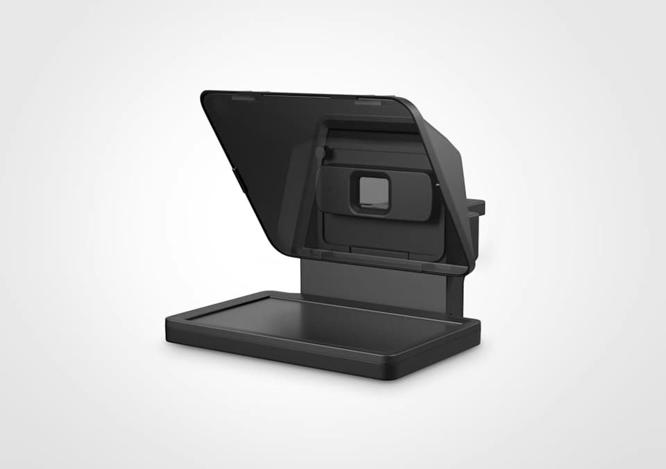
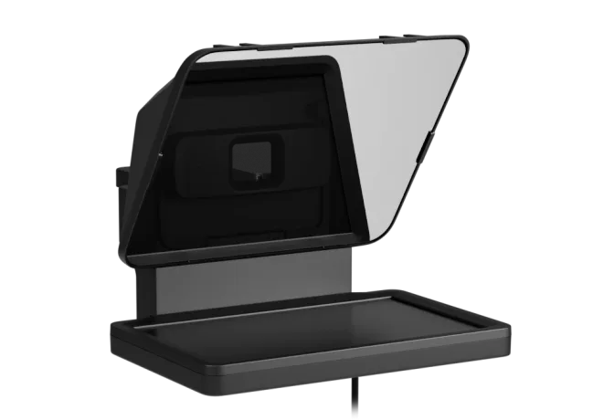
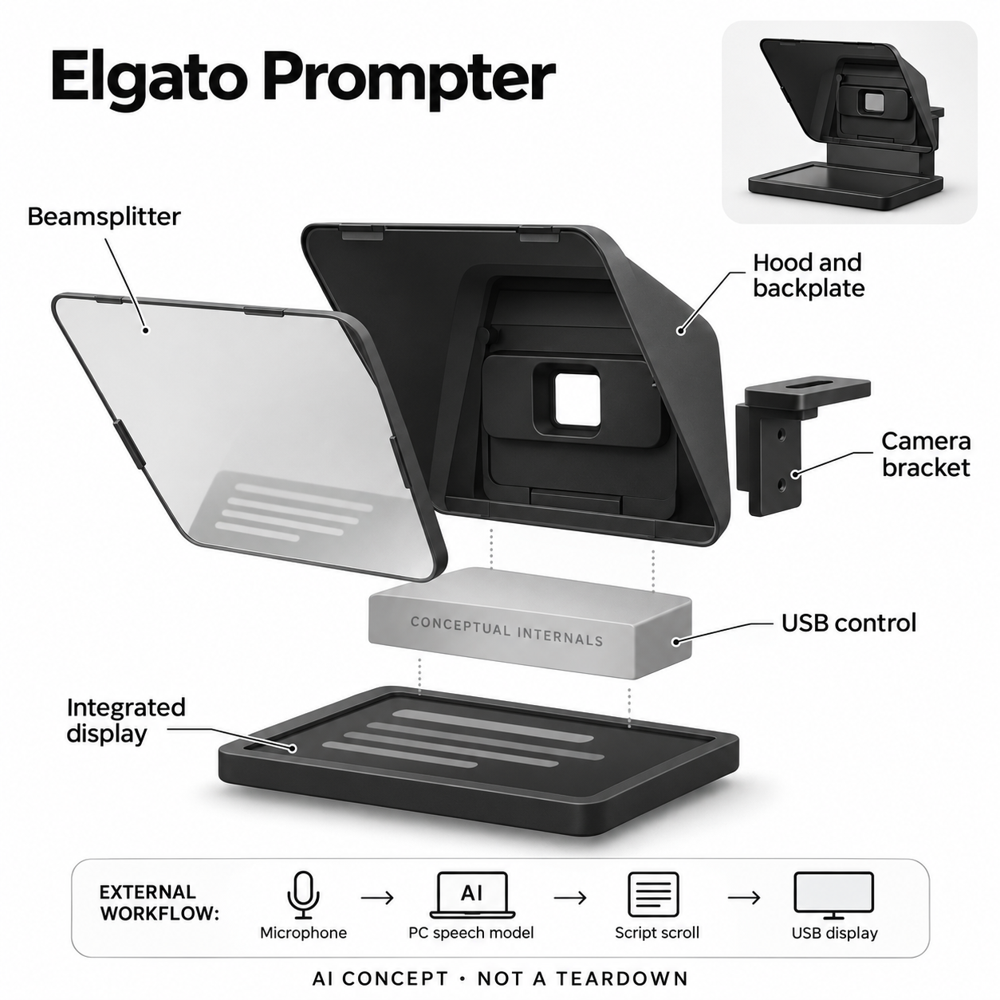

# Elgato Prompter

**Elgato** · 专业兴趣工具 · 核查 2026-11-05

以电脑语音模型同步稿件的集成显示提词器

消费渠道：个人零售。

## 产品图片与结构参考

### 产品图

Elgato Prompter 官方产品图 · 来源：[Elgato · 官方资料](<https://www.elgato.com/us/en/p/prompter>) · [原始图片](<https://elgato-assets.imgix.net/image/upload/f_auto/q_auto/w_960,c_limit/v1783513647/Products/10WAD9901/ATF/New/Prompter_ATF_01.jpg>)

### 参考图

Elgato Prompter 官方外观与使用参考图 · 来源：[Elgato · 官方资料](<https://www.elgato.com/us/en/p/prompter>) · [原始图片](<https://images.ctfassets.net/h50kqpe25yx1/4sV79jrrRaTeHhyojtlNcJ/fb27634cd6d879dc0c04ce3a28aa9cf7/Prompter_Panels_Thumbnail_00.png?q=75&w=3840&fm=webp>)

### AI 生成爆炸示意

**AI 生成 · 非实物拆机。** 内部为概念推断，不能作为元件布局、BOM 或维修依据。[生成提示词](../../content/hardware/prompts/elgato-prompter.txt)

> 以已目视核对的官方图片独立生成并完成目视QA；未知内部只作功能概念，不是实际PCB、拆机或供应商BOM。

> 保留官方图片原貌；其中宣传效果或数据不代表本站独立测量。

> 分析为基于公开资料的案头研究与 AI 辅助判断，未经用户访谈、销量审计或实物拆机。需求、画像、竞争冷门度、审美及商业机会均为研究假设，不是投资结论。

## 销售与购买

- 状态：在售。核查日美国官方商品页原版Prompter显示US$299.99及Add to cart。仅收原版，XL为相同核心任务的尺寸实现，不重复计数；软件按11月4日正式版Studio 2.0说明记录。

- 地区：美国（已核官方商店）及品牌地区渠道

- 价格：美国官网US$299.99。不含相机、麦克风或电脑；Studio 2.0和Voice Sync免费，显示器替代的部分Virtual Prompter功能另有收费，不混作硬件必需订阅。

- 中国大陆：本轮未核大陆授权零售。Studio 2.0当前Voice Sync支持列表不含中文；能买到硬件或显示中文稿件不代表中文语音跟稿可用。

- [官方产品 / 商店](<https://www.elgato.com/us/en/p/prompter>)

## AI 的实际作用

Studio 2.0将麦克风语音转成文字，再与稿件匹配以控制滚动。Windows下载各语言语音模型并在电脑GPU本地运行，macOS调用系统语音识别。

服务与联网依赖：AI在连接的电脑软件中，提词器负责USB显示和分光镜反射。需外接麦克风与相机等拍摄设备；当前版本和支持语言按官方新说明核对，不沿用旧Camera Hub条件。

## 是否冷门

细分专业（研究判断）：个人视频提词是具体工作流，廉价反光架与免费虚拟提词替代直接；优势需要在真实录制中验证。

## 需求与市场

案头需求是独自录制时保持视线接近镜头，同时按自己的节奏读稿。硬件让文字与镜头同轴，语音模型减少手动滚屏；是否省时要看失步恢复和重录次数，不能仅用更自然的宣传判断。

### 事实：任务边界 · 官方资料

Prompter把集成屏幕与分光玻璃组合，让稿件显示在接近相机镜头的方向，电脑软件根据语音匹配控制滚动。官方美国商品页当前可加购，原版与XL共享核心任务；本条选原版个人桌面形态，不以屏幕放大或不同相机组合重复增加产品数量。

依据：[Elgato Prompter官方商店](<https://www.elgato.com/us/en/p/prompter>) · [Elgato Studio 2.0正式版说明](<https://www.elgato.com/us/en/explorer/products/teleprompter/elgato-studio-2-0-prompter-cameras-capture/>)

### 判断：真实需求 · 研究判断

需求判断应聚焦独自面对镜头录制的人：他们需要按自己的节奏讲清稿件，又不想不断低头或操作滚轮。语音跟稿只是减少控制动作的一种方式，如果讲述习惯高度即兴，或者原稿本就不适合口述，硬件和模型都无法自动解决表达问题。

依据：[Elgato Prompter官方商店](<https://www.elgato.com/us/en/p/prompter>) · [Elgato Studio 2.0正式版说明](<https://www.elgato.com/us/en/explorer/products/teleprompter/elgato-studio-2-0-prompter-cameras-capture/>)

### 验证：任务完成 · 待验证

可让创作者使用同一份真实讲解稿，分别以手动、固定速度和语音方式录制，保留重录和恢复过程。记录停顿、改词、跳段后能否继续，询问减少了哪种负担；不只比较成片观感，也不把厂商更快完成的口号当成已测量的效率收益。

依据：[Elgato Prompter官方商店](<https://www.elgato.com/us/en/p/prompter>) · [Elgato Studio 2.0正式版说明](<https://www.elgato.com/us/en/explorer/products/teleprompter/elgato-studio-2-0-prompter-cameras-capture/>)

## 用户画像

适合经常录制讲解、课程或面对镜头演示的个人创作者。即兴聊天或很少照稿的人未必需要；桌面空间、相机镜头匹配和使用语言比关注是否带AI更重要。

### 事实：使用条件 · 官方资料

当前软件正式版适用于连接的电脑，Voice Sync还需要麦克风；Prompter本身不是录音或拍摄相机。产品提供多种后背板和支架以适应不同设备，但镜头尺寸、安装承重和读稿距离仍有限制，不能由兼容手机与相机的描述推断所有机位都适用。

依据：[Elgato Prompter官方商店](<https://www.elgato.com/us/en/p/prompter>) · [Elgato Studio 2.0正式版说明](<https://www.elgato.com/us/en/explorer/products/teleprompter/elgato-studio-2-0-prompter-cameras-capture/>)

### 判断：人群筛选 · 研究判断

潜在人群包括稳定制作课程、评测或脚本讲解的个人创作者，也可能是需要看稿开会的人。两类任务对读稿距离、窗口内容和眼神要求不同；桌面空间、电脑系统和主要语言比主播身份更能决定是否值得买一块专用显示提词硬件。

依据：[Elgato Prompter官方商店](<https://www.elgato.com/us/en/p/prompter>) · [Elgato Studio 2.0正式版说明](<https://www.elgato.com/us/en/explorer/products/teleprompter/elgato-studio-2-0-prompter-cameras-capture/>)

### 验证：参与者差异 · 待验证

访谈应查看用户现有录制位置，问最近一次重录为何发生、稿件是否经常临场修改以及是否已有平板。安装试用时记录换相机、改镜头和收纳耗时，再观察一周后是否留在常用机位；不能用一次顺利演示替代对实际工作频率的了解。

依据：[Elgato Prompter官方商店](<https://www.elgato.com/us/en/p/prompter>) · [Elgato Studio 2.0正式版说明](<https://www.elgato.com/us/en/explorer/products/teleprompter/elgato-studio-2-0-prompter-cameras-capture/>)

## 竞争与替代

替代包括电脑屏幕提词、平板加反光架和人工滚屏。独立显示省去占用手机，但模型本身也能在虚拟提词软件里使用；购买理由应来自光学位置与工作流，而非软件功能被硬件独占。

### 事实：方案范围 · 官方资料

官方新软件也提供无需硬件的虚拟提词功能，语音跟稿因此不是购买Prompter才有的独占能力。硬件差异主要是集成屏幕和反射光路，使文字更靠近镜头；普通电脑窗口、平板反光架和人工操作员都能满足部分任务，需在相同录制条件下比较。

依据：[Elgato Prompter官方商店](<https://www.elgato.com/us/en/p/prompter>) · [Elgato Studio 2.0正式版说明](<https://www.elgato.com/us/en/explorer/products/teleprompter/elgato-studio-2-0-prompter-cameras-capture/>)

### 判断：替代关系 · 研究判断

竞争判断应拆开软件价值与光学价值：如果把稿件放在笔记本摄像头附近已经够用，独立硬件的回报可能有限；如果需要更严格的镜头视线和稳定机位，专用反射结构更有理由。不能把一个免费语音模型的便利全部归功于这台显示器。

依据：[Elgato Prompter官方商店](<https://www.elgato.com/us/en/p/prompter>) · [Elgato Studio 2.0正式版说明](<https://www.elgato.com/us/en/explorer/products/teleprompter/elgato-studio-2-0-prompter-cameras-capture/>)

### 验证：比较方法 · 待验证

可比较相同字体与距离下的普通屏幕、平板架和Prompter，观察观众是否看出视线差异，以及创作者是否更易恢复稿件位置。总成本还应包含支架、相机适配和电脑占用；不按显示尺寸或软件功能列表直接给出胜负结论。

依据：[Elgato Prompter官方商店](<https://www.elgato.com/us/en/p/prompter>) · [Elgato Studio 2.0正式版说明](<https://www.elgato.com/us/en/explorer/products/teleprompter/elgato-studio-2-0-prompter-cameras-capture/>)

## 供应链

硬件涉及分光玻璃、显示、USB控制、遮光罩和相机支架，具体面板和工厂未披露。电脑承担识别算力，不能把GPU画成设备内部BOM；光学反射、结构承重和连接稳定都需验证。

### 事实：功能组成 · 官方资料

公开结构包括分光玻璃、独立显示、遮光罩、后背板、相机支架及USB连接，实际面板、控制芯片和整机工厂没有披露。语音识别运行在外部电脑或系统服务，不能把电脑显卡列成提词器内部元件；本目录的供应关联只做光学、显示和结构能力匹配。

依据：[Elgato Prompter官方商店](<https://www.elgato.com/us/en/p/prompter>) · [Elgato Studio 2.0正式版说明](<https://www.elgato.com/us/en/explorer/products/teleprompter/elgato-studio-2-0-prompter-cameras-capture/>)

### 判断：交付约束 · 研究判断

工程判断，真正影响交付的是反射文字清晰度与相机成像的平衡、不同镜头的遮挡、玻璃安装保护和桌面支撑稳定性。即使显示与语音都正常，机位移动或镜头暗角仍可能使系统不好用；选型不能只比较像素数量和接口是否存在。

依据：[Elgato Prompter官方商店](<https://www.elgato.com/us/en/p/prompter>) · [Elgato Studio 2.0正式版说明](<https://www.elgato.com/us/en/explorer/products/teleprompter/elgato-studio-2-0-prompter-cameras-capture/>)

### 验证：选型缺口 · 待验证

候选厂商需要收到明确的视角、文字亮度、反射与透射要求，以及装配公差和玻璃运输条件，再开展样件验证。没有品牌点名或拆机证据前不声明实际面板来源；同时测试USB重连、休眠唤醒及不同电脑显示设置，覆盖真实录制中断。

依据：[Elgato Prompter官方商店](<https://www.elgato.com/us/en/p/prompter>) · [Elgato Studio 2.0正式版说明](<https://www.elgato.com/us/en/explorer/products/teleprompter/elgato-studio-2-0-prompter-cameras-capture/>)

## 技术路径

官方11月4日说明正式Studio 2.0替代旧Camera Hub，语音模型识别后匹配稿件位置。Windows本地处理与macOS系统路径不同；跟稿不等于生成内容，停顿、改词和环境声仍可能影响对齐。

### 事实：AI机制 · 官方资料

官方11月4日正式版说明写明，Voice Sync听取麦克风语音，转成文字并与稿件比对。Windows为各语言下载模型并在电脑显卡本地处理，macOS调用系统语音识别；当前支持语言列表不含中文，不能因为屏幕可显示中文就声称中文跟稿可用。

依据：[Elgato Prompter官方商店](<https://www.elgato.com/us/en/p/prompter>) · [Elgato Studio 2.0正式版说明](<https://www.elgato.com/us/en/explorer/products/teleprompter/elgato-studio-2-0-prompter-cameras-capture/>)

### 判断：系统边界 · 研究判断

分析上，这是一条语音识别和文本对齐链路，并不负责替用户生成可靠稿件。口音、专有名词、跳句和背景声音都可能影响匹配；模型跟得太紧或太松也会改变讲述节奏。因此自动滚动需要明确的手动接管方式，而不应成为不可解释的黑箱。

依据：[Elgato Prompter官方商店](<https://www.elgato.com/us/en/p/prompter>) · [Elgato Studio 2.0正式版说明](<https://www.elgato.com/us/en/explorer/products/teleprompter/elgato-studio-2-0-prompter-cameras-capture/>)

### 验证：算法与体验 · 待验证

技术验证可准备有数字、缩写和临时插话的稿件，分别测试正常阅读、长停顿、跳段及回读，记录屏幕位置与实际语句的差异。对比不同软件版本时须注明版本和语言，尤其不能把旧Camera Hub的限制或旧测试结果直接套给Studio正式版。

依据：[Elgato Prompter官方商店](<https://www.elgato.com/us/en/p/prompter>) · [Elgato Studio 2.0正式版说明](<https://www.elgato.com/us/en/explorer/products/teleprompter/elgato-studio-2-0-prompter-cameras-capture/>)

## 产品审美

黑色罩体和倾斜玻璃服务相机光路，底部屏幕产生反射，玻璃不是第二块发光屏。分析上，清洁、镜头暗角、桌面支撑和读稿距离影响使用，不能把紧凑外观等同于适配任意机位。

### 事实：外观与交互 · 官方资料

真实图片显示倾斜玻璃与底部横置屏幕，玻璃上的文字来自反射，并非第二块发光显示。黑色罩体和相机开口服务光路，USB负责电源与画面；生成图只拆分这些大类功能，不额外添加麦克风、相机、电池或内部AI处理器来制造想象中的配置。

依据：[Elgato Prompter官方商店](<https://www.elgato.com/us/en/p/prompter>) · [Elgato Studio 2.0正式版说明](<https://www.elgato.com/us/en/explorer/products/teleprompter/elgato-studio-2-0-prompter-cameras-capture/>)

### 判断：使用中的形态 · 研究判断

外观分析需要在拍摄环境中进行：黑色表面可能减轻反光，但玻璃指纹、灯位和支撑高度仍影响可用性。紧凑设备也会增加相机前方体积，换机位时需要重新布置；对于共享桌面用户，是否方便拆装和清洁可能比常驻工作室用户更重要。

依据：[Elgato Prompter官方商店](<https://www.elgato.com/us/en/p/prompter>) · [Elgato Studio 2.0正式版说明](<https://www.elgato.com/us/en/explorer/products/teleprompter/elgato-studio-2-0-prompter-cameras-capture/>)

### 验证：日常接受度 · 待验证

观察创作者装配、调角度、清洁和收起设备的完整过程，记录是否误把玻璃当触控屏或把外部相机当标配。让他们在实际灯光下检查暗角与文字可见性，再询问愿不愿意保持安装；不根据宣传照片直接判断家居美感或所有镜头适配。

依据：[Elgato Prompter官方商店](<https://www.elgato.com/us/en/p/prompter>) · [Elgato Studio 2.0正式版说明](<https://www.elgato.com/us/en/explorer/products/teleprompter/elgato-studio-2-0-prompter-cameras-capture/>)

## 关键风险

风险集中在语音跟稿失步、电脑兼容及支持语言，当前正式版列表未包含中文。选错软件版本会套用旧硬件条件；画面和稿件涉及隐私时也应区分Windows本地识别与系统服务路径。

### 事实：已知限制 · 官方资料

当前正式版与旧帮助文档对系统和语言的条件存在差别，本条以11月4日发布说明为主要软件依据，并保留版本边界。官方支持列表没有中文，海外商店可买也不等于大陆语音场景已验证；外接相机和麦克风还分别有自己的权限与数据路径。

依据：[Elgato Prompter官方商店](<https://www.elgato.com/us/en/p/prompter>) · [Elgato Studio 2.0正式版说明](<https://www.elgato.com/us/en/explorer/products/teleprompter/elgato-studio-2-0-prompter-cameras-capture/>)

### 判断：失效影响 · 研究判断

风险判断包括跟稿失步打断录制、支架不合造成设备不稳、误认为识别必然全平台本地，以及把重要稿件放进不熟悉的软件流程。AI并不能保证表达准确或镜头自然；如果用户无法快速接管，自动功能反而可能延长录制时间。

依据：[Elgato Prompter官方商店](<https://www.elgato.com/us/en/p/prompter>) · [Elgato Studio 2.0正式版说明](<https://www.elgato.com/us/en/explorer/products/teleprompter/elgato-studio-2-0-prompter-cameras-capture/>)

### 验证：风险处理 · 待验证

应在正式拍摄前验证本机的麦克风来源、模型下载与离线行为，并演练失步后的手动滚动或暂停。确认镜头、支架及软件权限后再开始实际项目，保留原稿备份；这些是待验证工作流，不宣称本站已经对所有系统完成隐私或可靠性审计。

依据：[Elgato Prompter官方商店](<https://www.elgato.com/us/en/p/prompter>) · [Elgato Studio 2.0正式版说明](<https://www.elgato.com/us/en/explorer/products/teleprompter/elgato-studio-2-0-prompter-cameras-capture/>)

## 机会与验证

机会假设是降低单人讲解录制的反复重来。可用真实稿件比较手动、定速和语音跟稿，记录打断、跳段和恢复时间，再访谈是否愿意长期保留在机位上，而非用模型分数预测效率。

### 判断：可尝试切口 · 研究判断

机会假设在帮助个人创作者减少单人机位的控制动作，让稿件准备、录制和临时修改更连贯。硬件的可解释差异在光学同轴与常驻显示，而不是给任何屏幕加AI标签；如果虚拟提词已满足需求，继续销售复杂硬件未必是用户最好的选择。

依据：[Elgato Prompter官方商店](<https://www.elgato.com/us/en/p/prompter>) · [Elgato Studio 2.0正式版说明](<https://www.elgato.com/us/en/explorer/products/teleprompter/elgato-studio-2-0-prompter-cameras-capture/>)

### 判断：商业边界 · 研究判断

商业分析应考虑录制频率、镜头组合和现有设备，而不是仅靠低价软件功能吸引硬件购买。扩展服务可能围绕安装适配与稿件工作流，但现有资料没有证明付费意愿或节省时长；不同场景要分别验证，不用模型评分预测内容创作者的收入。

依据：[Elgato Prompter官方商店](<https://www.elgato.com/us/en/p/prompter>) · [Elgato Studio 2.0正式版说明](<https://www.elgato.com/us/en/explorer/products/teleprompter/elgato-studio-2-0-prompter-cameras-capture/>)

### 验证：下一步调研 · 待验证

建议跟踪数名有真实发布计划的创作者，记录一月内使用次数、放弃使用的原因、重录比例和机位调整时间。访谈他们会保留语音、反射屏还是两者组合，再和免费虚拟提词对比；用实际选择决定是否值得继续优化配件和软件提示。

依据：[Elgato Prompter官方商店](<https://www.elgato.com/us/en/p/prompter>) · [Elgato Studio 2.0正式版说明](<https://www.elgato.com/us/en/explorer/products/teleprompter/elgato-studio-2-0-prompter-cameras-capture/>)

## 对应供应链公司

能力候选用于选型研究，不代表本产品实际采用；未公开的供货关系不作推断。

- [tianma](../supply-chain/tianma.md) — **能力候选 · 非已采用** / 集成文字显示模组候选：天马中小尺寸显示模组能力可用于评估提词器文字显示、光学贴合和接口集成，但分光反射后的可读性仍需系统测试。Elgato未披露实际面板来源，本关联不意味着天马供货，也不承诺现成模组可直接替换。

- [protolabs](../supply-chain/protolabs.md) — **能力候选 · 非已采用** / 遮光罩与相机支架打样候选：Protolabs可提供结构件加工和样件验证，用于遮光罩、后背板及相机支架的配合与承重测试。光学玻璃本身需要另核工艺；目录没有证据说明其制造Prompter，本链接仅服务开发选型。

- [jlcpcb](../supply-chain/jlcpcb.md) — **能力候选 · 非已采用** / USB显示控制板开发候选：JLCPCB的电路板制造与装配能力可用于原型阶段的USB显示控制板实现，但必须由设计方先确定接口、电源和显示方案。Prompter实际电路与工厂没有公开，本关联不是其真实BOM或代工确认。

[浏览供应链目录](../supply-chain.md)

## 功能分层示意

这是功能关系，不是实物拆机、真实空间结构或已核实 BOM。

1. **分光反射**：倾斜分光玻璃将底部屏幕文字反射到接近镜头方向。（官方披露）

2. **集成显示**：设备含独立显示模块，通过USB接收电脑画面与供电。（官方披露）

3. **外部语音AI**：电脑Studio 2.0识别麦克风语音并与稿件对齐，非提词器内置模型。（官方披露）

4. **光路及安装**：遮光罩、后背板与相机支架适配不同拍摄设备。（官方披露）

5. **概念边界**：内部USB电路和显示供应商未披露，只作功能模块示意。（分析推断）

## 来源

1. [Elgato Prompter官方商店](<https://www.elgato.com/us/en/p/prompter>) — 实际打开；299.99美元加购、原版结构、外部设备和XL对比。

2. [Elgato Studio 2.0正式版说明](<https://www.elgato.com/us/en/explorer/products/teleprompter/elgato-studio-2-0-prompter-cameras-capture/>) — 实际打开11月4日更新；正式发布、语音识别模型、本地处理边界、当前语言及旧软件替代关系。

3. [Prompter官方常见问题](<https://help.elgato.com/hc/en-us/articles/20470388323597-Elgato-Prompter-Frequently-Asked-Questions>) — 实际打开；集成显示、分光反射、安装与外部设备条件，AI版本以新正式版说明为准。

[返回目录](../hardware-market.md) · [网页分析](https://romanagent.github.io/Roman/#hardware/product/elgato-prompter)
