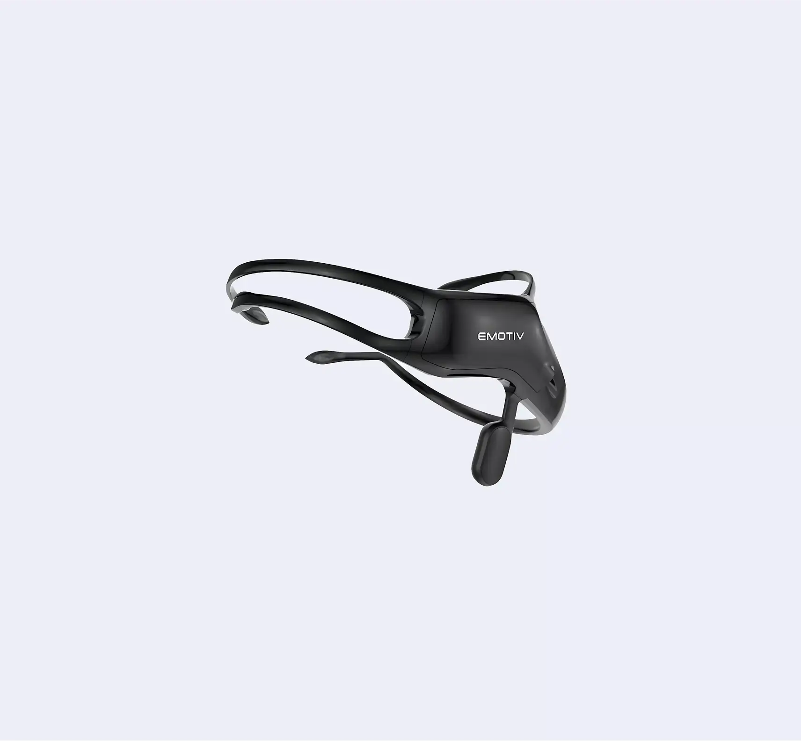
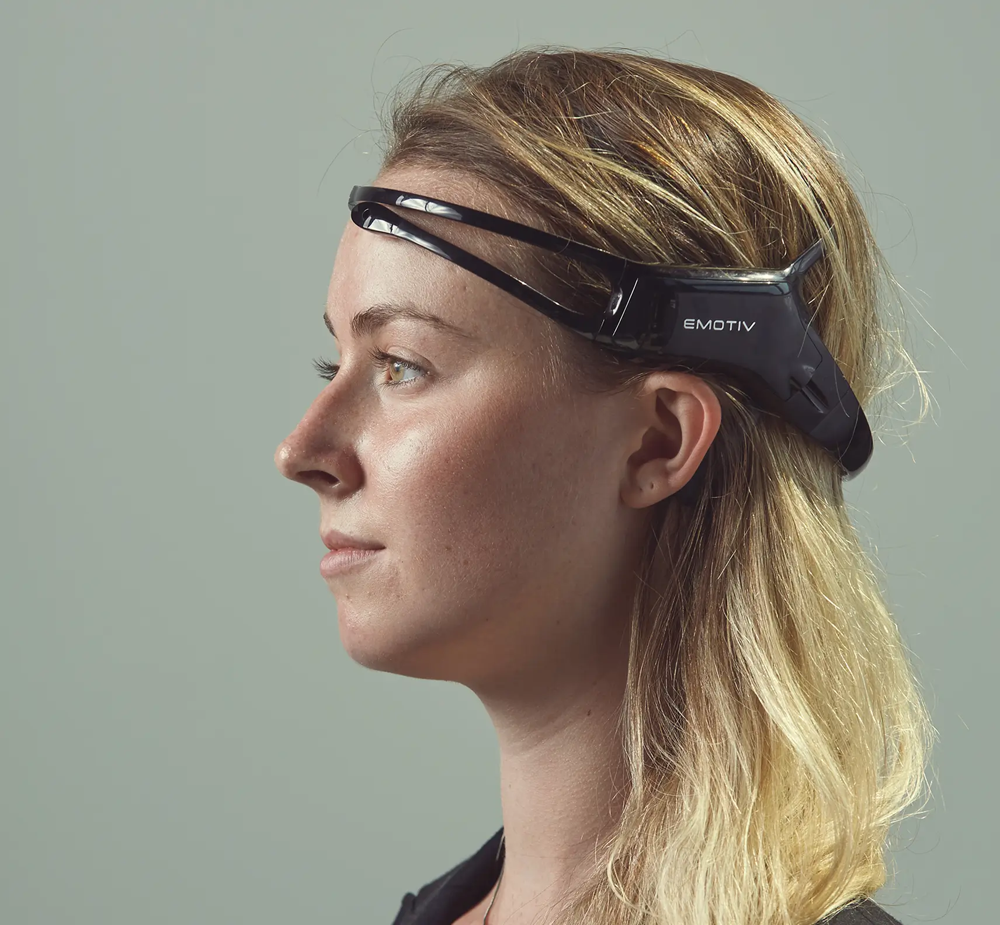
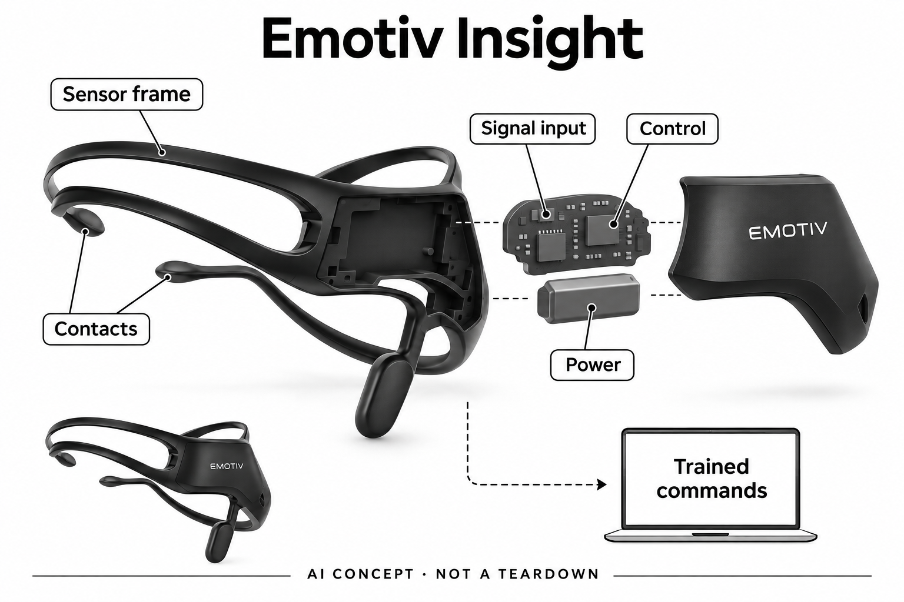

# Emotiv Insight（EmotivBCI训练式控制）

**EMOTIV** · 健康与穿戴 · 核查 2026-11-05

用个人训练的脑电模式映射数字命令

消费渠道：消费预订。

## 产品图片与结构参考

### 产品图

Emotiv Insight当前官方黑色头戴设备与传感臂 · 来源：[EMOTIV · 官方产品图片](<https://shop.emotiv.com/emotiv-insight/>) · [原始图片](<https://horizon-cdn.emotiv.com/horizon-frontend/products/insight/Insight-2.webp>)

### 参考图

Emotiv Insight官方佩戴参考；不从人物推断健康或认知状态 · 来源：[EMOTIV · 官方产品图片](<https://shop.emotiv.com/emotiv-insight/>) · [原始图片](<https://horizon-cdn.emotiv.com/horizon-frontend/products/insight/Insight-1.webp>)

### AI 生成爆炸示意

**AI 生成 · 非实物拆机。** 内部为概念推断，不能作为元件布局、BOM 或维修依据。[生成提示词](../../content/hardware/prompts/emotiv-insight.txt)

> 已视觉检查准确外形、灰阶、标题与概念声明；未知内部模块仅为功能示意，不代表拆机、完整BOM或参数。

> 来源图片已逐张实际查看，确认具体型号；保留原图，不改色裁切。图片不能证明内部BOM、疗效或所有配置可售。

> 分析为基于公开资料的案头研究与 AI 辅助判断，未经用户访谈、销量审计或实物拆机。需求、画像、竞争冷门度、审美及商业机会均为研究假设，不是投资结论。

## 销售与购买

- 状态：预售 / 接受延期订单。实际官方商店显示US$499具体SKU、数量、Add to cart及Checkout，同时写Pre-order/Priority Waitlist和backorder预计6–8周；按具体付费商品预售登记，不写现货，交付仍须确认。

- 地区：官方国际商店；具体国家配送及限制需结算确认

- 价格：US$499硬件预售价。当前页面预计6–8周，软件许可和数据访问计划可能另收费；不保证交付日期或将全部软件写为免费。

- 中国大陆：未核到中国大陆该预售SKU的具体交付、进口与软件服务条件，不把国际商店访问成功当作本地正式销售。

- [官方产品 / 商店](<https://shop.emotiv.com/emotiv-insight/>)

## AI 的实际作用

EmotivBCI明确通过机器学习训练使用者自己的脑电模式，并把识别结果映射成数字命令；不是理解任意思想或自动读心。

服务与联网依赖：需要正确接触、个人训练、兼容电脑及相应软件账户和许可；不同应用的数据处理位置不同，不能将全生态概括为全离线或全云端。

## 是否冷门

细分专业（研究判断）：针对愿意训练和配置的个人脑机交互研究，区别于被动专注评分耳机；缺少独立控制效率及长期使用数据。

## 需求与市场

需求假设是个人希望研究在不用常规按键时，能否通过经过训练的状态模式触发少量命令。它与快捷键或语音不同，学习、接触质量和错误恢复可能占据大量时间；是否有价值取决于具体任务和个人体验，不能由脑机接口的新奇程度推断更快或更自然。

### 官方｜训练脑电模式再映射命令 · 官方资料

Insight是可采集脑电的电子头戴设备，EmotivBCI明确使用机器学习训练使用者自己的模式，并将识别结果用于数字控制。这个工作流需要有意训练和反馈，不是系统自动知道用户任何想法；硬件采集、软件分类与目标应用执行是不同环节，不能仅凭脑电图就声称完成控制。

依据：[Emotiv Insight硬件介绍](<https://www.emotiv.com/insight>) · [EmotivBCI机器学习训练与控制](<https://www.emotiv.com/emotiv-bci>)

### 判断｜新的输入通道是否值得训练 · 研究判断

需求假设是个人希望研究在不用常规按键时，能否通过经过训练的状态模式触发少量命令。它与快捷键或语音不同，学习、接触质量和错误恢复可能占据大量时间；是否有价值取决于具体任务和个人体验，不能由脑机接口的新奇程度推断更快或更自然。

依据：[Emotiv Insight硬件介绍](<https://www.emotiv.com/insight>) · [EmotivBCI机器学习训练与控制](<https://www.emotiv.com/emotiv-bci>)

### 验证｜从可撤销的简单命令比较 · 待验证

可以先定义少量低后果、可撤销动作，记录训练投入、正确触发、误触发与重新训练次数，再与原有输入方式比较。需要保留无意执行命令的时段，避免只记录成功片段；本目录没有脑电控制效率实测，也不为特定身体状况提供适用性或康复效果结论。

依据：[Emotiv Insight硬件介绍](<https://www.emotiv.com/insight>) · [EmotivBCI机器学习训练与控制](<https://www.emotiv.com/emotiv-bci>)

## 用户画像

更可能愿意尝试的人需要接受佩戴调整、训练和软件配置，而不只是希望立即获得一个无学习成本的控制器。个人实验、交互设计和辅助输入探索可能有不同目的，不能合并成一个用户画像；尤其不应把一般研究演示直接转述为所有运动障碍使用者都能独立操作。

### 官方｜个人研究用途与医疗用途分开 · 官方资料

厂家将Insight用于研究和个人使用，并明确不用于医疗诊断或治疗；软件提供训练、数据与不同应用入口，许可和接口范围需要逐项确认。目录采用个人可用的进阶用户定位，不把“脑电”一词等同临床设备，也不将开发文档开放推定为所有功能都包含在硬件价格中。

依据：[Emotiv Insight硬件介绍](<https://www.emotiv.com/insight>) · [EmotivBCI机器学习训练与控制](<https://www.emotiv.com/emotiv-bci>)

### 判断｜配置耐心和任务目标影响采用 · 研究判断

更可能愿意尝试的人需要接受佩戴调整、训练和软件配置，而不只是希望立即获得一个无学习成本的控制器。个人实验、交互设计和辅助输入探索可能有不同目的，不能合并成一个用户画像；尤其不应把一般研究演示直接转述为所有运动障碍使用者都能独立操作。

依据：[Emotiv Insight硬件介绍](<https://www.emotiv.com/insight>) · [EmotivBCI机器学习训练与控制](<https://www.emotiv.com/emotiv-bci>)

### 验证｜核对本人可完成的设置步骤 · 待验证

试用前可列出佩戴、检查接触、登录、训练、绑定命令与退出软件的完整步骤，区分哪些本人能完成、哪些需要帮助。若频繁重戴或恢复配置会中断任务，应把支持成本计入；本研究没有观察真实使用者，用户适配判断需要保持开放而非依据宣传照片决定。

依据：[Emotiv Insight硬件介绍](<https://www.emotiv.com/insight>) · [EmotivBCI机器学习训练与控制](<https://www.emotiv.com/emotiv-bci>)

## 竞争与替代

与Neurable等观察个人专注变化的设备相比，这里主要研究主动训练脑电模式并控制数字动作。共同采集脑电不等于同一体验，前者更关注指标解释，后者必须处理误触发和控制恢复；比较应围绕输入任务，而不是把脑电通道数量作为创新或可用性的简单排名。

### 官方｜当前具体商品为预售而非现货 · 官方资料

当前官方商店展示具体Insight型号、全额价格、数量和购物结算入口，同时标注预售及预计六至八周的缺货交付状态。页面也使用优先候补措辞，因此目录明确记录预售边界，不承诺发货；运输政策的一般时间不能覆盖当前商品专门说明，也没有实际下单验证履约。

依据：[Emotiv Insight当前官方预售商品](<https://shop.emotiv.com/emotiv-insight/>) · [EMOTIV官方运输政策](<https://www.emotiv.com/shipping>)

### 判断｜与被动脑电反馈工具任务不同 · 研究判断

与Neurable等观察个人专注变化的设备相比，这里主要研究主动训练脑电模式并控制数字动作。共同采集脑电不等于同一体验，前者更关注指标解释，后者必须处理误触发和控制恢复；比较应围绕输入任务，而不是把脑电通道数量作为创新或可用性的简单排名。

依据：[Emotiv Insight硬件介绍](<https://www.emotiv.com/insight>) · [EmotivBCI机器学习训练与控制](<https://www.emotiv.com/emotiv-bci>)

### 验证｜以完整控制流程计算代价 · 待验证

可在相同命令任务上比较原有输入和训练式控制，计入佩戴、训练、等待识别及错误恢复的总时间。硬件、软件许可和必要电脑也应合并核算，避免只比较标价；本条没有用户访谈、市场份额或销量证据，不推定新输入方式可以普遍替代键盘或语音。

依据：[Emotiv Insight当前官方预售商品](<https://shop.emotiv.com/emotiv-insight/>) · [EmotivBCI机器学习训练与控制](<https://www.emotiv.com/emotiv-bci>)

## 供应链

同类新设计需要控制电极接触变化、运动伪迹和电源干扰，再考虑低功耗采集与无线传输。单独选择高精度前端不能保证头部真实佩戴信号可用，结构与算法必须一起评估；供应商能力候选仅支持研究某一层，不包含Emotiv训练模型和软件生态。

### 官方｜可见传感结构不等于公开BOM · 官方资料

Insight公开脑电采集、半干式接触、运动和无线功能，图片显示不对称传感臂与主要电子外壳。运输政策称设备从菲律宾工厂发运，但未给出具体厂名、所有权或完整制造链；主控、模拟前端和无线芯片也没有在所引来源点名，不能把发运地点扩写为所有零件产地。

依据：[Emotiv Insight硬件介绍](<https://www.emotiv.com/insight>) · [EMOTIV官方运输政策](<https://www.emotiv.com/shipping>)

### 判断｜接触与微弱信号处理必须协同 · 研究判断

同类新设计需要控制电极接触变化、运动伪迹和电源干扰，再考虑低功耗采集与无线传输。单独选择高精度前端不能保证头部真实佩戴信号可用，结构与算法必须一起评估；供应商能力候选仅支持研究某一层，不包含Emotiv训练模型和软件生态。

依据：[Emotiv Insight硬件介绍](<https://www.emotiv.com/insight>) · [EmotivBCI机器学习训练与控制](<https://www.emotiv.com/emotiv-bci>)

### 验证｜前端与无线分别核对接口 · 待验证

脑电采集候选需检查输入噪声、保护、通道和接触检测条件，无线候选则需测试数据带宽、时间戳与重连。两者都必须适配实际电极和固件，不能由开发板成功连线推定成品性能；没有品牌点名来源时，目录不标现用芯片，也不把候选作为医疗替换建议。

依据：[Emotiv Insight硬件介绍](<https://www.emotiv.com/insight>) · [EmotivBCI机器学习训练与控制](<https://www.emotiv.com/emotiv-bci>)

## 技术路径

同一次训练里的成功不能说明隔天重戴、换姿势或状态变化后仍有相同表现。控制系统需要清楚区分空闲状态和目标模式，否则连续使用时的误触发可能比偶尔漏识别更影响任务；这类差异只能通过有记录的个人试用观察，不能从模型名称得出可靠性结论。

### 官方｜软件训练的模式具有个人性 · 官方资料

EmotivBCI描述用机器学习建立用户训练的Mental Commands，识别结果与指定动作关联。它并未承诺从任意未经训练的思想中直接提取句子或意图；当前条目限定在这种训练式模式分类，不把其他应用中的情绪、认知指标或宣传用语扩大为本工作流已验证的能力。

依据：[EmotivBCI机器学习训练与控制](<https://www.emotiv.com/emotiv-bci>)

### 判断｜跨时间稳定性比单次识别更难 · 研究判断

同一次训练里的成功不能说明隔天重戴、换姿势或状态变化后仍有相同表现。控制系统需要清楚区分空闲状态和目标模式，否则连续使用时的误触发可能比偶尔漏识别更影响任务；这类差异只能通过有记录的个人试用观察，不能从模型名称得出可靠性结论。

依据：[Emotiv Insight硬件介绍](<https://www.emotiv.com/insight>) · [EmotivBCI机器学习训练与控制](<https://www.emotiv.com/emotiv-bci>)

### 验证｜数据处理位置按具体软件核实 · 待验证

应针对实际选择的EmotivBCI及配套接口核对账户、许可、联网和数据保存条件，而不是把全部EMOTIV应用概括成同一种架构。部分产品存在云服务，其他工具可有本地流程，使用者需知道自己启用了什么；目录不以硬件无线连接推定脑电数据绝不离开本机。

依据：[Emotiv Insight硬件介绍](<https://www.emotiv.com/insight>) · [EmotivBCI机器学习训练与控制](<https://www.emotiv.com/emotiv-bci>)

## 产品审美

这种外形容易让旁人知道用户正在进行某种测量或实验，是否愿意在公共环境佩戴与个人偏好有关。更实际的问题是接触臂、发型、眼镜和头部活动能否协调，以及收纳时如何保护传感器；视觉轻巧不等于长时间舒适，也不能用单一模特照片代表所有头型。

### 官方｜非对称头戴结构适配采集位置 · 官方资料

当前官方图片展示主电子外壳和向不同头部位置伸出的接触臂，属于Insight型号，不借用EPOC系列多臂结构。半干式传感器与外观相结合，但照片无法显示实际接触压力或头发影响；示意图保留可见结构，未知内部只画功能模块，不补造芯片和电极材料。

依据：[Emotiv Insight当前官方预售商品](<https://shop.emotiv.com/emotiv-insight/>) · [Emotiv Insight硬件介绍](<https://www.emotiv.com/insight>)

### 判断｜显眼结构与日常使用场景有关 · 研究判断

这种外形容易让旁人知道用户正在进行某种测量或实验，是否愿意在公共环境佩戴与个人偏好有关。更实际的问题是接触臂、发型、眼镜和头部活动能否协调，以及收纳时如何保护传感器；视觉轻巧不等于长时间舒适，也不能用单一模特照片代表所有头型。

依据：[Emotiv Insight当前官方预售商品](<https://shop.emotiv.com/emotiv-insight/>) · [Emotiv Insight硬件介绍](<https://www.emotiv.com/insight>)

### 验证｜分开记录佩戴与信号反馈 · 待验证

可在允许的使用方式下记录佩戴调整时间、接触状态变化、取下再戴后的差异和清洁步骤，同时询问外观接受度。把不舒服与算法识别问题分开，避免为了更好信号持续增加压力；本轮没有真实佩戴、耐久或卫生测试，相关体验保持待验证。

依据：[Emotiv Insight当前官方预售商品](<https://shop.emotiv.com/emotiv-insight/>) · [Emotiv Insight硬件介绍](<https://www.emotiv.com/insight>)

## 关键风险

个人脑电记录具有敏感性，而训练命令输出也可能被误认为系统理解了真实意图。若进一步把其他指标用于评价本人或他人，就会引入本条没有验证的推断；这里限定本人自愿进行输入研究，不支持把这些数据用作诊断、工作考核或对他人心理状态的判断。

### 官方｜预售和软件权益仍有条件 · 官方资料

官方商品目前处于缺货预售，公开交期只是估计，软件许可和数据访问也不能由硬件购买一并推定。运输页面没有提供本次中国大陆地址的实际交付确认；目录因此不写国内正式销售，也不以可以访问网页替代进口、保修和账户服务条件的核查。

依据：[Emotiv Insight当前官方预售商品](<https://shop.emotiv.com/emotiv-insight/>) · [EmotivBCI机器学习训练与控制](<https://www.emotiv.com/emotiv-bci>) · [EMOTIV官方运输政策](<https://www.emotiv.com/shipping>)

### 判断｜脑电数据与解释都可能被误读 · 研究判断

个人脑电记录具有敏感性，而训练命令输出也可能被误认为系统理解了真实意图。若进一步把其他指标用于评价本人或他人，就会引入本条没有验证的推断；这里限定本人自愿进行输入研究，不支持把这些数据用作诊断、工作考核或对他人心理状态的判断。

依据：[Emotiv Insight硬件介绍](<https://www.emotiv.com/insight>) · [EmotivBCI机器学习训练与控制](<https://www.emotiv.com/emotiv-bci>)

### 验证｜先确定停止和数据管理方式 · 待验证

使用前应核对数据导出、删除、账户权限及软件停止采集的方法，并确保命令映射有可见反馈和退出路径。对于有后果的控制，应保留人工确认或原输入方式；本目录仅描述产品研究，不承诺认知提升，也不建议凭设备指标改变医疗或心理照护安排。

依据：[Emotiv Insight硬件介绍](<https://www.emotiv.com/insight>) · [EmotivBCI机器学习训练与控制](<https://www.emotiv.com/emotiv-bci>)

## 机会与验证

值得进一步研究的是哪些个人任务允许有限命令、明确反馈和较低操作频率，使训练成本有可能被接受。追求快速连续输入未必是最合适起点，而可暂停的个人交互实验更容易观察问题；这些是待验证假设，不是已证明存在的市场需求或使用效果。

### 官方｜训练式脑电输入只保留一个场景 · 官方资料

本条将Insight与EmotivBCI组合视为个人训练式脑电控制的硬件工作流，不把不同通道版本或软件订阅拆成新产品需求。其差异在主动建立模式到命令的映射，区别于被动观察专注指标；这既解释收录理由，也保留模型、许可和佩戴条件带来的实际限制。

依据：[Emotiv Insight硬件介绍](<https://www.emotiv.com/insight>) · [EmotivBCI机器学习训练与控制](<https://www.emotiv.com/emotiv-bci>)

### 判断｜寻找可容忍慢速和纠错的任务 · 研究判断

值得进一步研究的是哪些个人任务允许有限命令、明确反馈和较低操作频率，使训练成本有可能被接受。追求快速连续输入未必是最合适起点，而可暂停的个人交互实验更容易观察问题；这些是待验证假设，不是已证明存在的市场需求或使用效果。

依据：[Emotiv Insight硬件介绍](<https://www.emotiv.com/insight>) · [EmotivBCI机器学习训练与控制](<https://www.emotiv.com/emotiv-bci>)

### 验证｜记录数周后的保留与放弃 · 待验证

后续可以跟踪用户是否仍愿意佩戴、哪些命令保持可用、何时需要重训以及何种任务最终回到传统输入。把放弃原因和软件维护一起纳入分析，才能判断工作流是否持续；当前只有官方公开资料，没有长期用户研究，不能用演示成功推断日常采用率。

依据：[Emotiv Insight当前官方预售商品](<https://shop.emotiv.com/emotiv-insight/>) · [Emotiv Insight硬件介绍](<https://www.emotiv.com/insight>) · [EmotivBCI机器学习训练与控制](<https://www.emotiv.com/emotiv-bci>)

## 对应供应链公司

能力候选用于选型研究，不代表本产品实际采用；未公开的供货关系不作推断。

- [texas-instruments](../supply-chain/texas-instruments.md) — **能力候选 · 非已采用** / 同类脑电交互头戴的生物电采集前端候选：TI ADS1299明确面向脑电和生物电采集，可研究多通道微弱信号输入、噪声与接触相关条件，但与Insight实际电极和固件的兼容需要另行设计。该器件不提供Emotiv个人命令模型，也没有本型号采用证据；候选仅用于新硬件前端研究，不是现机换件或医疗适配结论。

- [nordic-semiconductor](../supply-chain/nordic-semiconductor.md) — **能力候选 · 非已采用** / 同类脑电头戴的无线数据连接候选：Nordic低功耗无线平台可比较脑电设备的数据传输、时间戳、重连和电源管理，需结合连续采样带宽与实际主机接口评估。它不提供Emotiv软件许可或脑电分类模型，未发现Insight点名采用来源；无线连接可行不能单独证明整个训练式控制链可靠。

[浏览供应链目录](../supply-chain.md)

## 功能分层示意

这是功能关系，不是实物拆机、真实空间结构或已核实 BOM。

1. **脑电与接触**：半干式电极通过头皮接触采集信号，佩戴质量影响输入。（官方披露）

2. **采集与传输**：头戴装置采集脑电及运动数据，经兼容连接送到软件。（官方披露）

3. **个人训练**：EmotivBCI机器学习训练个人模式，不等于通用思想识别。（官方披露）

4. **命令映射**：识别结果绑定支持的数字动作，需核对软件许可与接口。（官方披露）

5. **反馈与重训**：用户观察结果并调整训练，错误命令需有恢复路径。（分析推断）

## 来源

1. [Emotiv Insight当前官方预售商品](<https://shop.emotiv.com/emotiv-insight/>) — 已实际打开浏览器和公开页面：US$499、具体SKU、购物按钮、backorder6–8周；同时保留Priority Waitlist原文边界，不称现货。

2. [Emotiv Insight硬件介绍](<https://www.emotiv.com/insight>) — 已打开五通道、半干式传感、运动及个人研究定位；非医疗诊断和治疗。

3. [EmotivBCI机器学习训练与控制](<https://www.emotiv.com/emotiv-bci>) — 已打开先进机器学习与个人Mental Commands训练；不将训练式模式分类描述为任意读心。

4. [EMOTIV官方运输政策](<https://www.emotiv.com/shipping>) — 已打开订单交付前付清、Insight从菲律宾工厂发运的厂家表述；未披露具体厂名或所有权。商品页专门预计6–8周优先于一般政策时间。

[返回目录](../hardware-market.md) · [网页分析](https://romanagent.github.io/Roman/#hardware/product/emotiv-insight)
