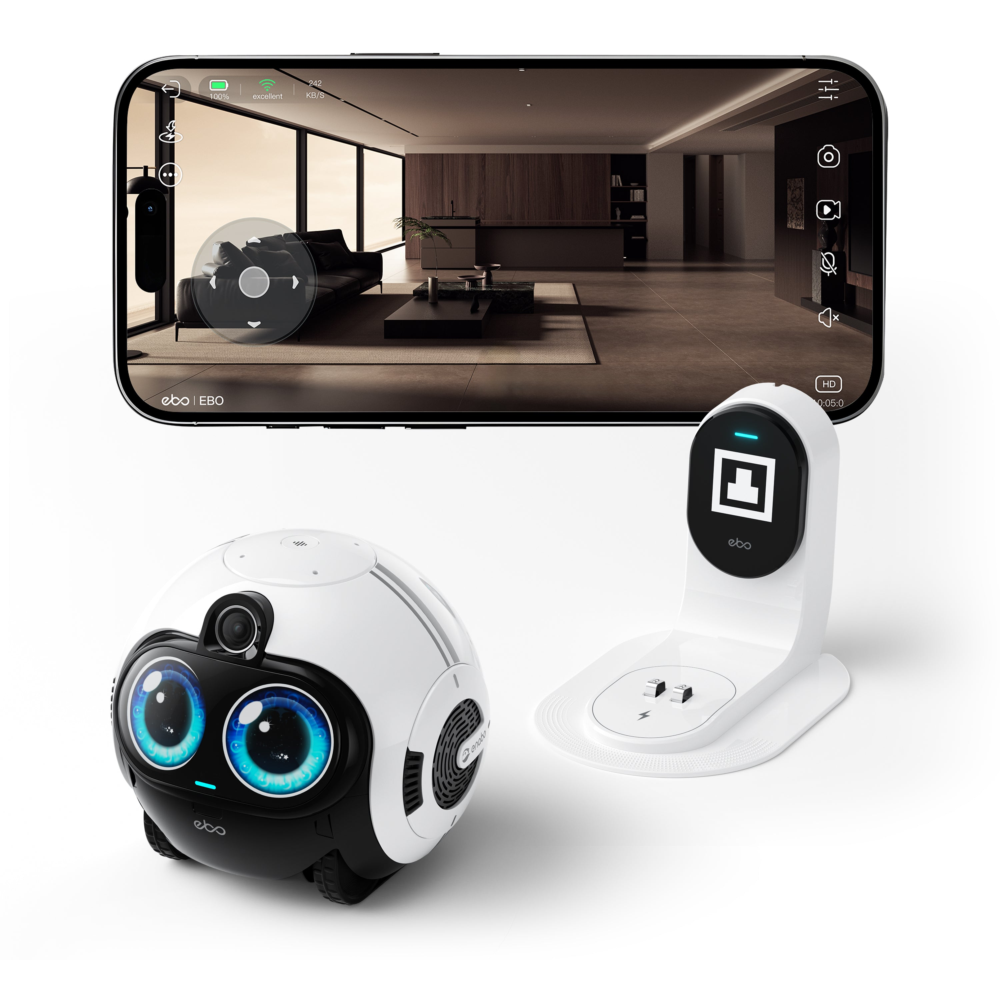
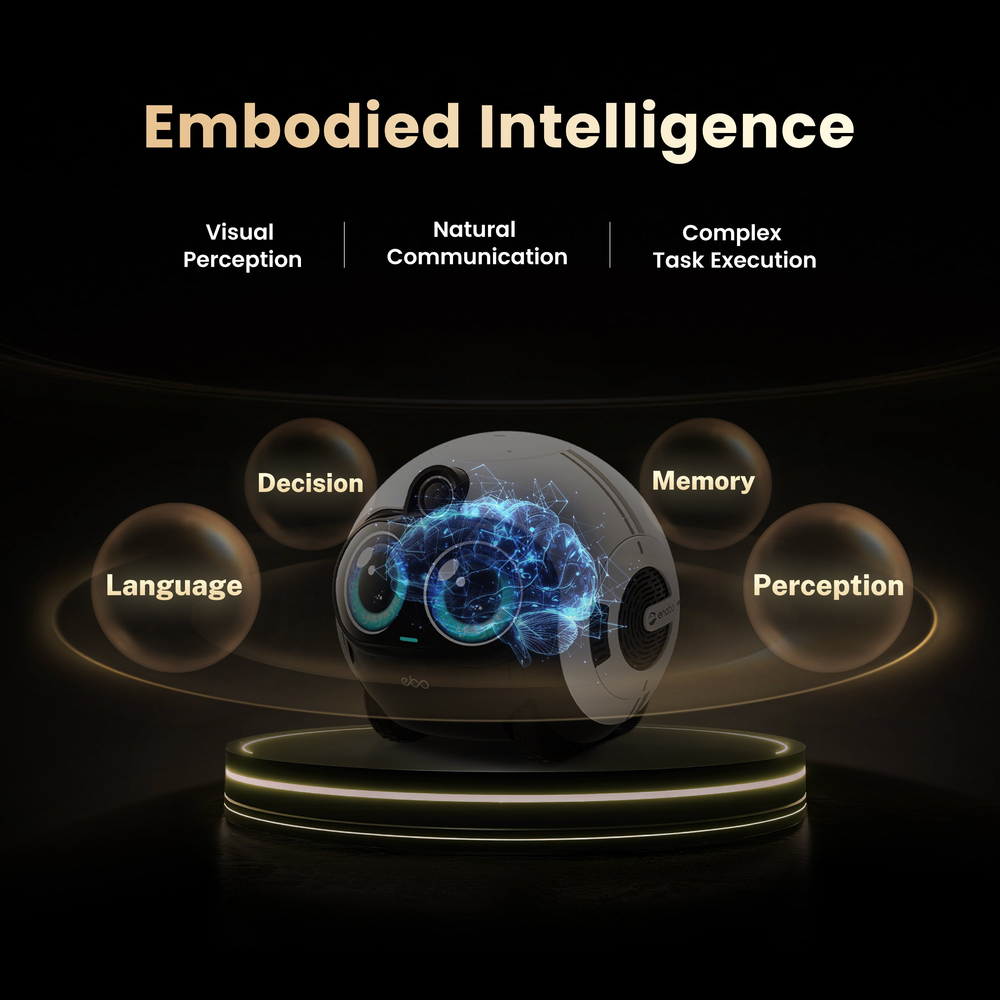
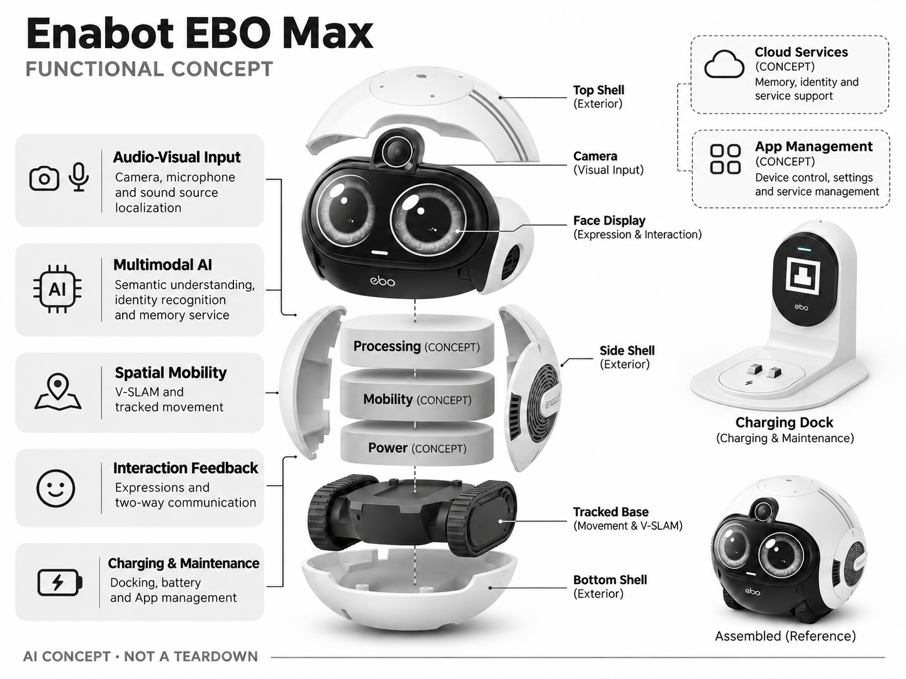

# Enabot EBO Max

**Enabot** · 家庭助手 · 核查 2026-11-04

在家中移动并结合视觉和语音交互的家庭机器人

消费渠道：个人零售。

## 产品图片与结构参考

### 产品图

Enabot EBO Max 官方产品图 · 来源：[Enabot · 官方图片](<https://enabot.sg/products/ebo-max>) · [原始图片](<https://enabot.sg/cdn/shop/files/EBO-Max-00.jpg?v=1775439323>)

### 参考图

Enabot EBO Max 官方外观、结构或使用参考 · 来源：[Enabot · 官方图片](<https://enabot.sg/products/ebo-max>) · [原始图片](<https://enabot.sg/cdn/shop/files/EBO-Max-01.jpg?v=1775439324>)

### AI 生成爆炸示意

**AI 生成 · 非实物拆机。** 内部为概念推断，不能作为元件布局、BOM 或维修依据。[生成提示词](../../content/hardware/prompts/enabot-ebo-max.txt)

> 依据官方外观参考与公开功能生成；未披露的内部布局只作概念模块，不构成BOM或真实结构证据。

> 本图已局部校正：删除错误相机复数与Hub标签。修订提示词：content/hardware/prompts/enabot-ebo-max-revision.txt。

> 保留官方图片原始内容和出处；画面宣传参数不是本轮独立实测。

> 分析为基于公开资料的案头研究与 AI 辅助判断，未经用户访谈、销量审计或实物拆机。需求、画像、竞争冷门度、审美及商业机会均为研究假设，不是投资结论。

## 销售与购买

- 状态：在售。新加坡品牌渠道页面同时含可买和缺货模板，实际读取公开商品JSON available=true；记录新加坡可售，不据此判断美国库存。

- 地区：新加坡品牌渠道

- 价格：S$889。核查时官方地区参考价，保留原币种；订阅、税运、附件及优惠以结账为准，预订定金不等于整机价格。

- 中国大陆：本轮核实所列海外官方渠道；中国大陆同型号现货、保修及服务可用性未确认。进口前需核对供电、网络、配件和地区条款。

- [官方产品 / 商店](<https://enabot.sg/products/ebo-max>)

## AI 的实际作用

多模态AI结合视觉、语音、身份与记忆处理家庭请求，V-SLAM支持移动巡查；会移动的摄像头并不等于具备物理抓取能力。

服务与联网依赖：语音和远程交互需要网络及App，录像与高级服务条件需按地区；官方页面的人脸容量数字互有差异，本目录不采用。

## 是否冷门

新兴竞争（研究判断）：家庭移动视觉助手比固定相机少见，但已有陪伴机器人竞争；实际用途和可靠移动比外形新奇更关键。

## 需求与市场

需求假设：用户希望从固定相机看不到的位置查看宠物和家人，同时通过语音发起简单巡视。应验证移动带来的视角增益是否值得维护成本，机器人有记忆的宣传不能直接证明陪伴需求成立。

## 用户画像

画像推断：有宠物、接受地面移动设备并愿维护地图的家庭，可能同时关注远程查看和互动。多层住宅、门槛和地面杂物会限制覆盖，儿童把它当玩具时还需要明确使用与隐私边界。

## 竞争与替代

竞争判断：与固定云台摄像头、Loona等陪伴机器人和手机视频通话竞争。移动加多模态交互形成组合差异，但如果主要用途是偶尔查看宠物，更简单廉价的固定相机仍是强替代。

## 供应链

供应链分析：履带底盘、相机、麦克风、屏幕、电池与回充系统协同，实际工厂及BOM未披露。毛发缠绕、轮组清洁、充电接触和固件升级是持续维护工作，移动结构增加售后复杂度。

## 技术路径

官方说明视觉语音融合、家庭成员识别、记忆与V-SLAM。技术判断：理解请求、定位和执行需分别验证，不能从自然对话推定通用自主能力；跌倒提示等不应被当成经过临床验证的监护。

## 产品审美

审美判断：小型拟人表情与履带结构具有亲和力，但镜头、静音和记录状态仍应明确。地面视角与实际室内摆设可能显得局促，充电座、清理轮组和避免被宠物啃咬也属于外观使用设计。

## 关键风险

风险判断：页面同时保留库存模板和不同人脸数量说明，采购需按实际变体确认。移动可能卡住，AI识人或跌倒检测会误报漏报；录像、家庭记忆和远程控制权限都需要用户妥善管理。

## 机会与验证

机会假设：挑选固定相机确实覆盖不到的家庭任务，比较到达成功率、接管和回充次数。若交互价值很快下降，可优先做可靠远程巡视与隐私控制，避免把记忆能力包装成真正理解家庭情感。

## 功能分层示意

这是功能关系，不是实物拆机、真实空间结构或已核实 BOM。

1. **视听输入**：相机、麦克风与声源定位。（官方披露）

2. **多模态AI**：语义、身份及记忆服务。（官方披露）

3. **空间移动**：V-SLAM与履带行走。（官方披露）

4. **交互反馈**：表情与双向通信。（官方披露）

5. **回充维护**：停靠、电池和App管理。（官方披露）

## 来源

1. [Enabot EBO Max 官方购买页](<https://enabot.sg/products/ebo-max>) — 实际打开核查当前购买或预订入口，未实际下单；价格与交付按具体地区。

2. [Enabot EBO Max 官方能力](<https://store.enabot.com/products/ebo-max-familybot>) — 实际打开的官方技术与使用资料，宣传效果并非本轮独立实测。

3. [官方公开商品库存数据](<https://enabot.sg/products/ebo-max.js>) — 实际读取商店公开商品JSON，available为true；不是只凭页面存在判断在售。

[返回目录](../hardware-market.md) · [网页分析](https://romanagent.github.io/Roman/#hardware/product/enabot-ebo-max)
