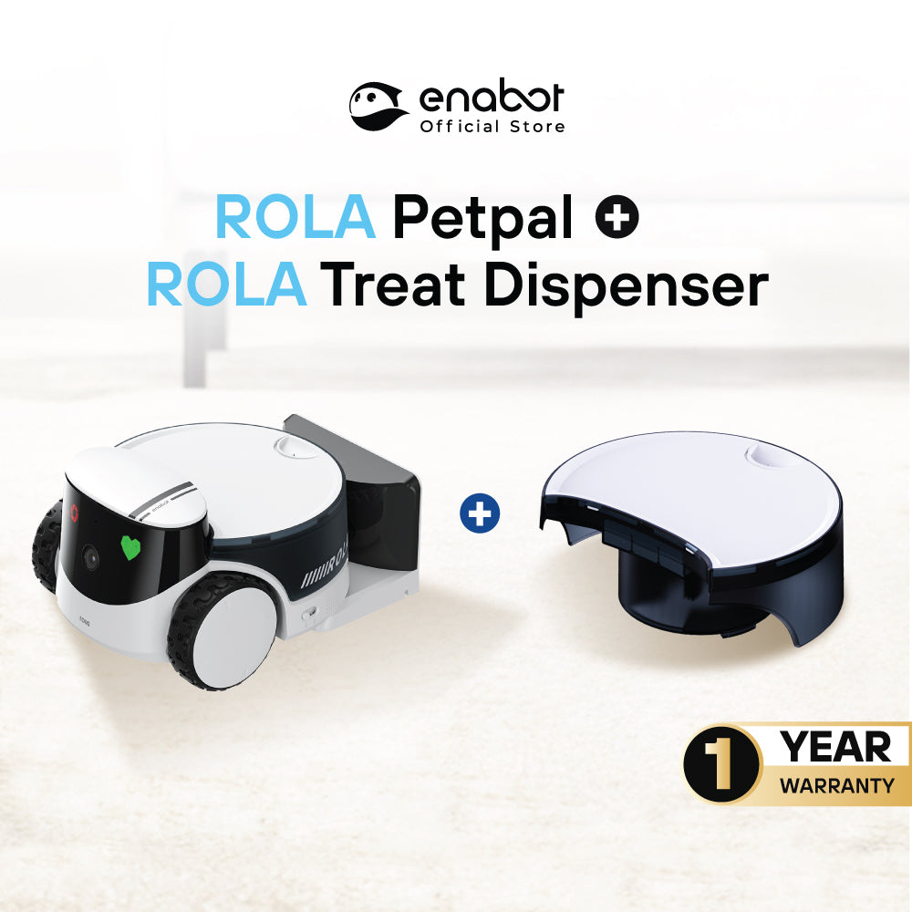
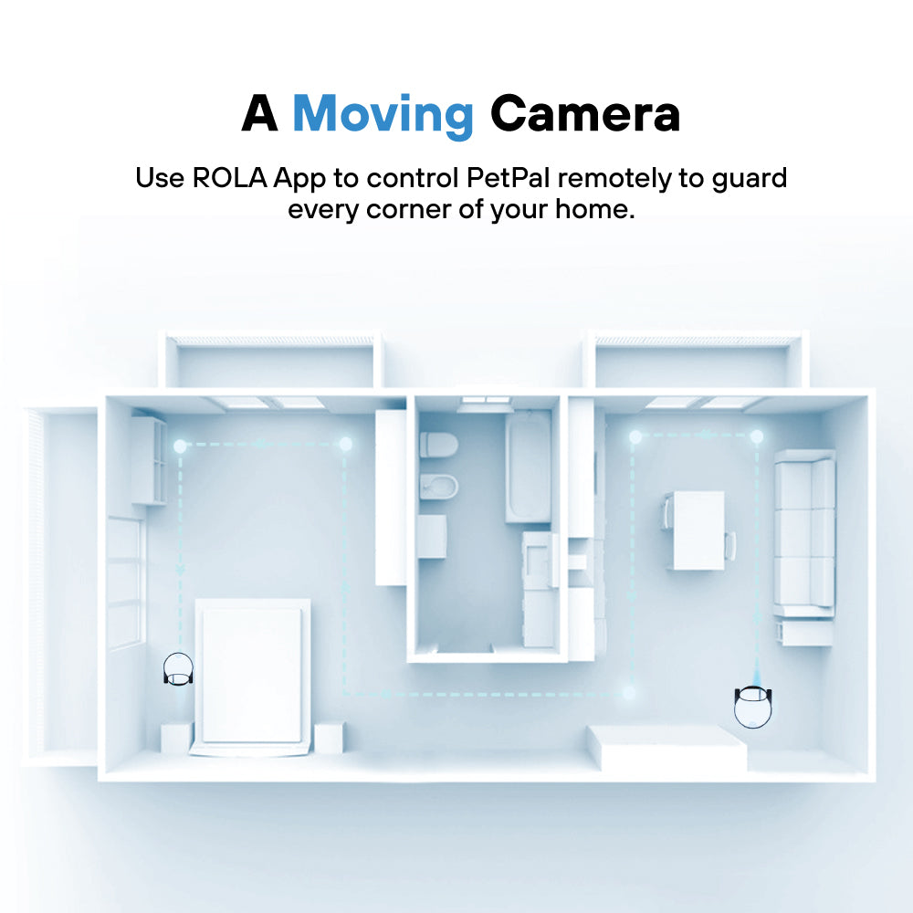
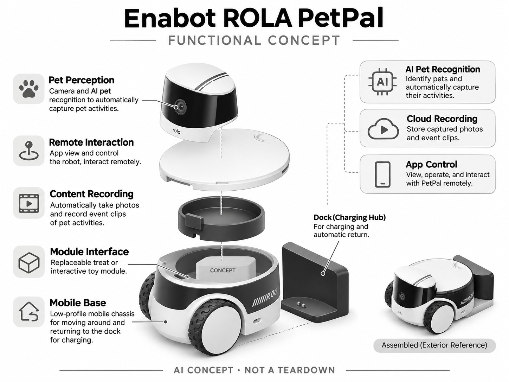

# Enabot ROLA PetPal

**Enabot** · 宠物照护 · 核查 2026-11-04

把移动观察、AI拍宠和模块化互动放在一起

消费渠道：个人零售。

## 产品图片与结构参考

### 产品图

Enabot ROLA PetPal 官方产品图 · 来源：[Enabot · 官方图片](<https://enabot.sg/products/rola-petpal-robot-for-cats-and-dogs>) · [原始图片](<https://cdn.shopify.com/s/files/1/0699/4867/0199/files/ROLA-PETPAL-DISPENSER.jpg?v=1773028682&width=1200>)

### 参考图

Enabot ROLA PetPal 官方外观、结构或使用参考 · 来源：[Enabot · 官方图片](<https://enabot.sg/products/rola-petpal-robot-for-cats-and-dogs>) · [原始图片](<https://cdn.shopify.com/s/files/1/0699/4867/0199/files/ENABOT-PETPAL-ECOM-PDP-03.jpg?v=1771578830&width=1200>)

### AI 生成爆炸示意

**AI 生成 · 非实物拆机。** 内部为概念推断，不能作为元件布局、BOM 或维修依据。[生成提示词](../../content/hardware/prompts/enabot-rola-petpal.txt)

> 依据官方外观参考与公开功能生成；未披露的内部布局只作概念模块，不构成BOM或真实结构证据。

> 保留官方图片原始内容和出处；画面宣传参数不是本轮独立实测。

> 分析为基于公开资料的案头研究与 AI 辅助判断，未经用户访谈、销量审计或实物拆机。需求、画像、竞争冷门度、审美及商业机会均为研究假设，不是投资结论。

## 销售与购买

- 状态：在售。新加坡商品页与公开商品数据核实available=true；按PetPal主体加零食模块计一款，互动玩具附件与其他套装不重复收录。

- 地区：新加坡品牌渠道

- 价格：S$369（含零食模块）。核查时官方地区参考价，保留原币种；订阅、税运、附件及优惠以结账为准，预订定金不等于整机价格。

- 中国大陆：本轮核实所列海外官方渠道；中国大陆同型号现货、保修及服务可用性未确认。进口前需核对供电、网络、配件和地区条款。

- [官方产品 / 商店](<https://enabot.sg/products/rola-petpal-robot-for-cats-and-dogs>)

## AI 的实际作用

AI宠物识别和自动拍摄捕捉宠物活动，配合移动底盘、远程互动和可换零食/玩具模块；定时喂食自身不算AI。

服务与联网依赖：App和家庭网络用于远程查看，自动逗宠需要对应互动玩具模块；本条购买配置为零食模块，不能把所有附件视为标配。

## 是否冷门

细分专业（研究判断）：模块化移动逗宠属于较窄消费场景，但有投食摄像头和普通玩具替代；动物接受度是重要验证点。

## 需求与市场

需求假设：外出主人希望查看宠物并提供少量互动，而固定相机有视角盲区。应验证宠物是否主动接近、零食是否适量，以及移动会不会打扰休息，不能以遥控动作数量代替动物福利和使用价值。

### 产品任务与边界 · 研究判断

需求假设：外出主人希望查看宠物并提供少量互动，而固定相机有视角盲区。应验证宠物是否主动接近、零食是否适量，以及移动会不会打扰休息，不能以遥控动作数量代替动物福利和使用价值。

依据：[Enabot ROLA PetPal 官方购买页](<https://enabot.sg/products/rola-petpal-robot-for-cats-and-dogs>) · [ROLA PetPal 官方AI宠物识别](<https://www.enabot.com/pet-robot/rola-petpal>)

### 需求判断 · 研究判断

移动底盘可能补足固定相机盲区，也会增加卡住、回充和宠物回避的情境。设备提供零食或玩具不等于动物愿意参与，主人希望远程陪伴与宠物实际体验应分别观察，不能仅用应用活跃或投食次数说明价值已经成立。

依据：[Enabot ROLA PetPal 官方购买页](<https://enabot.sg/products/rola-petpal-robot-for-cats-and-dogs>) · [ROLA PetPal 官方AI宠物识别](<https://www.enabot.com/pet-robot/rola-petpal>)

### 需求验证 · 待验证

可记录主人主动查看、宠物自愿接近和离开、设备救援及清洁，比较固定相机加普通玩具。保持零食与玩具模块的配置清楚，观察四周后互动是否仍被主动选择，而不是只依赖首次新奇或食物吸引形成短期使用。

依据：[Enabot ROLA PetPal 官方购买页](<https://enabot.sg/products/rola-petpal-robot-for-cats-and-dogs>) · [ROLA PetPal 官方AI宠物识别](<https://www.enabot.com/pet-robot/rola-petpal>)

## 用户画像

画像推断：家有猫或小中型犬、地面较通畅且愿清洁设备的主人，可能常常离家工作。胆小、会啃咬或对机器应激的宠物未必适合，购买者的娱乐偏好也不等于宠物愿意长期互动。

### 适用行为与条件 · 研究判断

画像推断：家有猫或小中型犬、地面较通畅且愿清洁设备的主人，可能常常离家工作。胆小、会啃咬或对机器应激的宠物未必适合，购买者的娱乐偏好也不等于宠物愿意长期互动。

依据：[Enabot ROLA PetPal 官方购买页](<https://enabot.sg/products/rola-petpal-robot-for-cats-and-dogs>) · [ROLA PetPal 官方AI宠物识别](<https://www.enabot.com/pet-robot/rola-petpal>)

### 人群取舍 · 研究判断

地面通畅和无线覆盖会决定移动价值，多房间并不意味着所有区域都能自动到达。多宠家庭还可能出现竞争和误跟随，实际维护者需管理模块与清洁，画像应按宠物反应、居住结构和主人参与方式划分，而非只看猫狗数量。

依据：[Enabot ROLA PetPal 官方购买页](<https://enabot.sg/products/rola-petpal-robot-for-cats-and-dogs>) · [ROLA PetPal 官方AI宠物识别](<https://www.enabot.com/pet-robot/rola-petpal>)

### 画像验证 · 待验证

画像验证应让家庭在熟悉环境中逐步使用，记录宠物是否回避及主人何时停止互动，不强迫动物接近。再比较主人的娱乐偏好与动物行为，识别哪些用户需要移动记录、哪些只需要固定查看，避免把购买者喜爱当成双向接受。

依据：[Enabot ROLA PetPal 官方购买页](<https://enabot.sg/products/rola-petpal-robot-for-cats-and-dogs>) · [ROLA PetPal 官方AI宠物识别](<https://www.enabot.com/pet-robot/rola-petpal>)

## 竞争与替代

竞争判断：与Furbo等固定投食摄像头、普通宠物玩具和EBO移动相机竞争。可换模块提供任务差异，但增加附件成本与清洁步骤；移动并不自动优于稳定固定视角，需要实际环境对比。

### 比较对象与差异 · 研究判断

竞争判断：与Furbo等固定投食摄像头、普通宠物玩具和EBO移动相机竞争。可换模块提供任务差异，但增加附件成本与清洁步骤；移动并不自动优于稳定固定视角，需要实际环境对比。

依据：[Enabot ROLA PetPal 官方购买页](<https://enabot.sg/products/rola-petpal-robot-for-cats-and-dogs>) · [ROLA PetPal 官方AI宠物识别](<https://www.enabot.com/pet-robot/rola-petpal>)

### 竞争判断 · 研究判断

可换模块增加扩展可能，也增加购买、装卸和清洁，只有用户确实使用多种任务才有平台价值。固定投食摄像头更稳定，普通移动相机更简单，竞争分析应按实际购买的零食模块比较，不能把全部演示附件合成基础能力。

依据：[Enabot ROLA PetPal 官方购买页](<https://enabot.sg/products/rola-petpal-robot-for-cats-and-dogs>) · [ROLA PetPal 官方AI宠物识别](<https://www.enabot.com/pet-robot/rola-petpal>)

### 竞争验证 · 待验证

可在同一家庭比较移动与固定观察的有效片段、盲区和人工操作，并记录附件切换频率。若用户长期只看录像，模块化未必是主要优势；如果宠物不愿互动，更多机械玩法也不能直接改善，需要以真实自愿参与判断。

依据：[Enabot ROLA PetPal 官方购买页](<https://enabot.sg/products/rola-petpal-robot-for-cats-and-dogs>) · [ROLA PetPal 官方AI宠物识别](<https://www.enabot.com/pet-robot/rola-petpal>)

## 供应链

供应链分析：移动轮组、相机、宠物识别处理、零食通道、电池和回充构成系统，工厂及BOM未知。毛发堵塞、食物碎屑、啃咬耐久及可拆洗设计会影响售后，食品接触件需单独管理。

### 功能模块拆分 · 研究判断

功能层包括低矮移动与回充底盘、相机和宠物捕捉、可换零食或玩具接口、应用遥控及自动内容记录。普通定时投食和移动动作不单独算 AI，公开信息没有具体工厂与物料表，也不能把另购玩具模块默认为本次配置。

依据：[Enabot ROLA PetPal 官方购买页](<https://enabot.sg/products/rola-petpal-robot-for-cats-and-dogs>) · [ROLA PetPal 官方AI宠物识别](<https://www.enabot.com/pet-robot/rola-petpal>)

### 制造与供应约束 · 研究判断

供应链分析：移动轮组、相机、宠物识别处理、零食通道、电池和回充构成系统，工厂及BOM未知。毛发堵塞、食物碎屑、啃咬耐久及可拆洗设计会影响售后，食品接触件需单独管理。

依据：[Enabot ROLA PetPal 官方购买页](<https://enabot.sg/products/rola-petpal-robot-for-cats-and-dogs>) · [ROLA PetPal 官方AI宠物识别](<https://www.enabot.com/pet-robot/rola-petpal>)

### 候选与证据缺口 · 研究判断

龙旗可作为移动摄像电子工程候选，RapidDirect 可支持模块接口和零食通道原型。两者未被点名为 PetPal 供方，毛发、碎屑、宠物接触与回充需专门验证，公开能力不代表实际整机方案或动物接受度已经得到证明。

依据：[Enabot ROLA PetPal 官方购买页](<https://enabot.sg/products/rola-petpal-robot-for-cats-and-dogs>) · [ROLA PetPal 官方AI宠物识别](<https://www.enabot.com/pet-robot/rola-petpal>)

## 技术路径

官方披露AI宠物捕捉、自动照片与模块化互动。技术判断：宠物躲藏和快速移动会使识别失败，遥控投食不等于模型懂得合适喂养；路径、拍摄与出粮可靠性需要分别验证。

### 已披露技术边界 · 研究判断

官方披露AI宠物捕捉、自动照片与模块化互动。技术判断：宠物躲藏和快速移动会使识别失败，遥控投食不等于模型懂得合适喂养；路径、拍摄与出粮可靠性需要分别验证。

依据：[Enabot ROLA PetPal 官方购买页](<https://enabot.sg/products/rola-petpal-robot-for-cats-and-dogs>) · [ROLA PetPal 官方AI宠物识别](<https://www.enabot.com/pet-robot/rola-petpal>)

### 系统难点判断 · 研究判断

识别到宠物、移动到合适位置和成功拍摄是不同环节，宠物躲藏或快速变化会让每一环都有失败可能。投食也不能由识别直接推导合适份量，系统应让主人理解操作与 AI 的边界，并在网络延迟时保持可控停止。

依据：[Enabot ROLA PetPal 官方购买页](<https://enabot.sg/products/rola-petpal-robot-for-cats-and-dogs>) · [ROLA PetPal 官方AI宠物识别](<https://www.enabot.com/pet-robot/rola-petpal>)

### 技术验证 · 待验证

验证应分别记录识别、移动、回充和出粮，覆盖毛发、遮挡与受控断网，不通过追逐动物制造风险。对零食和互动玩具模式单独核对，不能以一段自动逗宠视频代表基础配置，也不把精彩片段数量当作可靠识别指标。

依据：[Enabot ROLA PetPal 官方购买页](<https://enabot.sg/products/rola-petpal-robot-for-cats-and-dogs>) · [ROLA PetPal 官方AI宠物识别](<https://www.enabot.com/pet-robot/rola-petpal>)

## 产品审美

审美判断：圆润低矮机身与可换模块降低工具感，但地面滚动、提示音和体量可能影响宠物接受度。接口应易装卸且不留食物死角，清晰显示当前模块比夸张表情更利于日常使用。

### 外观与交互语言 · 研究判断

审美判断：圆润低矮机身与可换模块降低工具感，但地面滚动、提示音和体量可能影响宠物接受度。接口应易装卸且不留食物死角，清晰显示当前模块比夸张表情更利于日常使用。

依据：[Enabot ROLA PetPal 官方购买页](<https://enabot.sg/products/rola-petpal-robot-for-cats-and-dogs>) · [ROLA PetPal 官方AI宠物识别](<https://www.enabot.com/pet-robot/rola-petpal>)

### 使用中审美判断 · 研究判断

对宠物而言，滚动声音、靠近速度和模块体积可能比圆润外壳更重要；对主人而言，食物残留与接口清洁决定长期使用。设计应让当前模块和维护位置清楚，避免夸张表情或灯效增加刺激，却没有帮助理解真实设备状态。

依据：[Enabot ROLA PetPal 官方购买页](<https://enabot.sg/products/rola-petpal-robot-for-cats-and-dogs>) · [ROLA PetPal 官方AI宠物识别](<https://www.enabot.com/pet-robot/rola-petpal>)

### 设计验证 · 待验证

设计验证应观察宠物自主选择距离、主人装卸模块和清理通道，记录回避、误装和清洁死角。还需检查设备停放与回充是否妨碍通行，不从白底产品图的亲和感推断所有动物都接受地面移动机器人。

依据：[Enabot ROLA PetPal 官方购买页](<https://enabot.sg/products/rola-petpal-robot-for-cats-and-dogs>) · [ROLA PetPal 官方AI宠物识别](<https://www.enabot.com/pet-robot/rola-petpal>)

## 关键风险

风险判断：互动玩具与零食模块功能不同，不能把官网所有演示都算进购买配置。自动投食需由主人管理份量，机器不能替代陪伴和照护；网络延迟、卡粮和宠物啃咬都需要有人工处置路径。

### 主要失效与依赖 · 研究判断

风险判断：互动玩具与零食模块功能不同，不能把官网所有演示都算进购买配置。自动投食需由主人管理份量，机器不能替代陪伴和照护；网络延迟、卡粮和宠物啃咬都需要有人工处置路径。

依据：[Enabot ROLA PetPal 官方购买页](<https://enabot.sg/products/rola-petpal-robot-for-cats-and-dogs>) · [ROLA PetPal 官方AI宠物识别](<https://www.enabot.com/pet-robot/rola-petpal>)

### 风险传播判断 · 研究判断

可换模块让商品说明更容易混淆，若用户以为已买到所有互动，实际体验会明显落差。网络、卡粮和啃咬也可能让远程主人无法即时处理，产品需要清楚告知状态与人工路径，不能把短时互动包装成替代日常照护。

依据：[Enabot ROLA PetPal 官方购买页](<https://enabot.sg/products/rola-petpal-robot-for-cats-and-dogs>) · [ROLA PetPal 官方AI宠物识别](<https://www.enabot.com/pet-robot/rola-petpal>)

### 风险验证 · 待验证

风险验证应演练网络延迟、模块未装好、卡粮和回充失败，检查主人能否发现并停止。测试应尊重宠物自愿参与，不能依赖机器安排运动或饮食，所有观察与记录也不作为动物健康或情绪改善的确定证据。

依据：[Enabot ROLA PetPal 官方购买页](<https://enabot.sg/products/rola-petpal-robot-for-cats-and-dogs>) · [ROLA PetPal 官方AI宠物识别](<https://www.enabot.com/pet-robot/rola-petpal>)

## 机会与验证

机会假设：以宠物自愿参与的互动时间、拒绝率和主人实际查看频次验证需求。若主要价值是记录可爱片段，先完善低干扰AI拍摄和清洁设计，可能比扩展更多投食或逗宠附件更有价值。

### 可能的机会入口 · 研究判断

机会假设：以宠物自愿参与的互动时间、拒绝率和主人实际查看频次验证需求。若主要价值是记录可爱片段，先完善低干扰AI拍摄和清洁设计，可能比扩展更多投食或逗宠附件更有价值。

依据：[Enabot ROLA PetPal 官方购买页](<https://enabot.sg/products/rola-petpal-robot-for-cats-and-dogs>) · [ROLA PetPal 官方AI宠物识别](<https://www.enabot.com/pet-robot/rola-petpal>)

### 机会成立条件 · 研究判断

如果主要价值是主人看到宠物日常，低干扰自动拍摄可能比更多投食附件更有效；如果需要互动，应证明移动确实比固定视角好。机会应从一个明确任务开始，避免把主人离家产生的担心直接转化为复杂机器人需求。

依据：[Enabot ROLA PetPal 官方购买页](<https://enabot.sg/products/rola-petpal-robot-for-cats-and-dogs>) · [ROLA PetPal 官方AI宠物识别](<https://www.enabot.com/pet-robot/rola-petpal>)

### 下一步验证 · 待验证

下一步可比较四周移动拍摄、固定查看和普通互动的主动使用、宠物拒绝及清洁劳动，再测试更简单的内容整理。用真实有效片段和自愿参与决定模块投入，不能只根据远程操控时长或可爱演示预测长期留存。

依据：[Enabot ROLA PetPal 官方购买页](<https://enabot.sg/products/rola-petpal-robot-for-cats-and-dogs>) · [ROLA PetPal 官方AI宠物识别](<https://www.enabot.com/pet-robot/rola-petpal>)

## 对应供应链公司

能力候选用于选型研究，不代表本产品实际采用；未公开的供货关系不作推断。

- [longcheer](../supply-chain/longcheer.md) — **能力候选 · 非已采用** / 移动宠物摄像终端电子工程：龙旗智能硬件工程可对应摄像、联网和控制系统评估，但移动回充、宠物接触及模块行为需专项验证；没有 ROLA PetPal 点名合作证据，候选不代表实际制造或算法供应。

- [rapiddirect](../supply-chain/rapiddirect.md) — **能力候选 · 非已采用** / 可换模块与零食通道原型：RapidDirect 的机械原型和模塑服务可支持模块接口、料道和清洁结构比较，但食品接触、啃咬及长期卡料需专项确认；未见 PetPal 供货披露，仅列结构开发候选。

[浏览供应链目录](../supply-chain.md)

## 功能分层示意

这是功能关系，不是实物拆机、真实空间结构或已核实 BOM。

1. **移动主体**：低矮行走与回充底盘。（官方披露）

2. **宠物感知**：相机与AI宠物捕捉。（官方披露）

3. **模块接口**：零食或互动玩具模块。（官方披露）

4. **远程交互**：App查看与操作。（官方披露）

5. **内容记录**：自动拍摄及事件片段。（官方披露）

## 来源

1. [Enabot ROLA PetPal 官方购买页](<https://enabot.sg/products/rola-petpal-robot-for-cats-and-dogs>) — 实际打开核查当前购买或预订入口，未实际下单；价格与交付按具体地区。

2. [ROLA PetPal 官方AI宠物识别](<https://www.enabot.com/pet-robot/rola-petpal>) — 实际打开的官方技术与使用资料，宣传效果并非本轮独立实测。

3. [官方公开商品库存数据](<https://enabot.sg/products/rola-petpal-robot-for-cats-and-dogs.js>) — 实际读取商店公开商品JSON，available为true；不是只凭页面存在判断在售。

[返回目录](../hardware-market.md) · [网页分析](https://romanagent.github.io/Roman/#hardware/product/enabot-rola-petpal)
