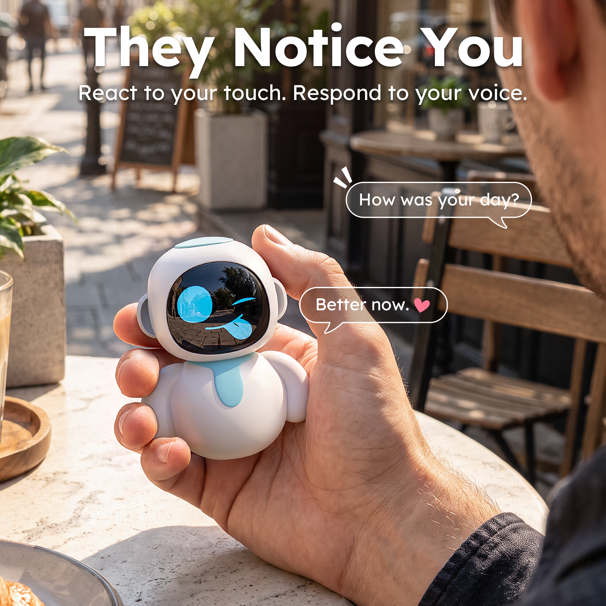
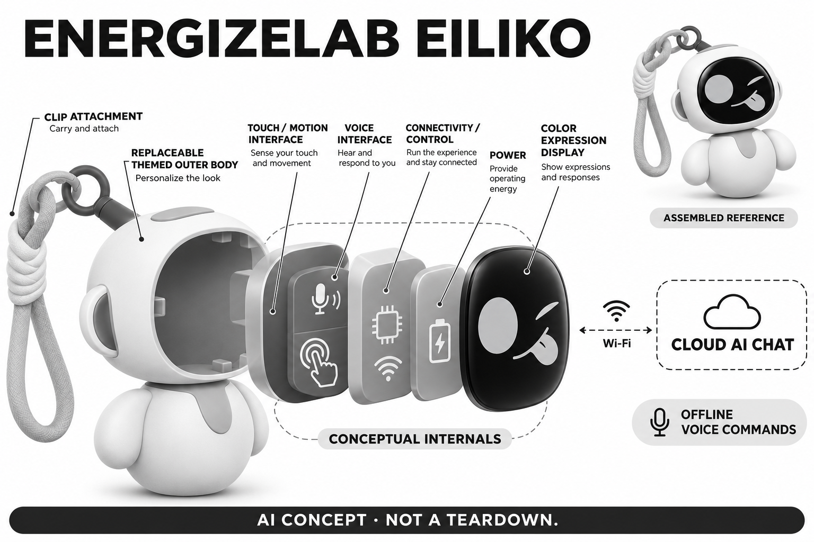

# Eiliko

**EnergizeLab** · AI玩具 · 核查 2026-11-06

可随身挂起的对话角色；联网聊天与短期记忆有明确边界

消费渠道：个人零售。

## 产品图片与结构参考

### 产品图

Eiliko 官方产品图（厂商资料） · 来源：[EnergizeLab 官方资料](<https://store.energizelab.com/products/eiliko>) · [原始图片](<https://cdn.shopify.com/s/files/1/0601/5349/5720/files/eiliko-blue-thum_new_first_01_a1ef9584-f6ca-45a4-96ff-d8510cce21c4.png?v=1793869881>)

### 参考图

Eiliko 官方外形或使用参考（厂商资料） · 来源：[EnergizeLab 官方资料](<https://store.energizelab.com/products/eiliko>) · [原始图片](<https://cdn.shopify.com/s/files/1/0601/5349/5720/files/eilik-blue-with-price_new_3f351915-76aa-463a-9744-a224c3769a49.png?v=1793095849>)

### AI 生成爆炸示意

**AI 生成 · 非实物拆机。** 内部为概念推断，不能作为元件布局、BOM 或维修依据。[生成提示词](../../content/hardware/prompts/energizelab-eiliko.txt)

> 分析为基于公开资料的案头研究与 AI 辅助判断，未经用户访谈、销量审计或实物拆机。需求、画像、竞争冷门度、审美及商业机会均为研究假设，不是投资结论。

## 销售与购买

- 状态：在售。当前US$59.90、Add selected to cart，公开蓝色和粉色变体available=true；不把主题壳另计新产品。

- 地区：官方国际商店服务地区以结算为准

- 价格：US$59.90。核查时促销价；主题外壳、税费与配送另计。官方称对话无订阅，不等于独立验证长期服务可持续。

- 中国大陆：官方FAQ支持普通话，但未核实中国大陆对应订单渠道和服务条款；支持中文不等于已确认本地配送与售后。

- [官方产品 / 商店](<https://store.energizelab.com/products/eiliko>)

## AI 的实际作用

离线语音命令、触摸与运动反馈配合云端生成式聊天；主题外壳关联不同角色表现。

服务与联网依赖：初次需应用与蓝牙配网；AI聊天需Wi-Fi或热点。当前FAQ仅确认短期工作记忆，长期记忆与自接模型属未来计划；安全修复状态需单独核验。

## 是否冷门

新兴竞争（研究判断）：竞争判断应把普通潮玩挂件、电子宠物和手机语音角色放在一起比较。普通挂件没有充电和数据风险，手机角色则拥有更大的界面与更新能力；Eiliko的区别是能随身展示和触摸回应，但模型对话本身并不因此成为独有能力或稳定竞争壁垒。

## 需求与市场

需求判断是把收藏挂件变成随时可短暂回应的物件，而不是要求使用者长期停留在桌边。外出时表达情绪、与朋友展示角色和在家聊天可能是不同动机；如果公共环境无法听清或不适合开口，随身形态的价值就可能主要来自表情与外观。

### 事实与范围 · 官方资料

Eiliko官方商店当前可购，作为可挂在包或衣物上的小型角色，提供触摸表情、离线命令与联网AI聊天。它与需要另配AI Station的桌面Eilik是不同硬件路径：本条只写随身挂件本体，不把更大桌面机器人的摄像头、移动或机械动作移植过来。

依据：[Eiliko官方商店](<https://store.energizelab.com/products/eiliko>) · [Eiliko官方产品与FAQ](<https://energizelab.com/eiliko/>)

### 判断与差异 · 研究判断

需求判断是把收藏挂件变成随时可短暂回应的物件，而不是要求使用者长期停留在桌边。外出时表达情绪、与朋友展示角色和在家聊天可能是不同动机；如果公共环境无法听清或不适合开口，随身形态的价值就可能主要来自表情与外观。

依据：[Eiliko官方商店](<https://store.energizelab.com/products/eiliko>) · [Eiliko官方产品与FAQ](<https://energizelab.com/eiliko/>)

### 验证与限制 · 待验证

验证可让成人参与者在通勤、办公室与家中分别使用，记录真正主动说话的地点，以及因为噪声或尴尬放弃的时刻。询问没有网络时是否仍愿意携带，区分挂件审美与对话价值，不将短视频展示中的互动次数当成现实生活里的使用频率。

依据：[Eiliko官方商店](<https://store.energizelab.com/products/eiliko>) · [Eiliko官方产品与FAQ](<https://energizelab.com/eiliko/>)

## 用户画像

潜在人群是假设性的角色挂件收藏者、喜欢换装表达的用户以及寻求轻量语音陪伴的人。前者对造型和主题外壳敏感，后者更在意联网、回应与记忆；送礼人还要考虑对方是否愿意授权应用，而不能因为价格较低就默认收礼者会长期使用。

### 事实与范围 · 官方资料

官方说明初次设置需手机蓝牙、应用与无线网络，AI聊天使用网络或手机热点，并列出包含普通话在内的语言支持。它并非脱离手机设置就能实现全部功能的普通饰品；本档案以成人收藏和个人娱乐为研究范围，不宣称适合无人看护儿童。

依据：[Eiliko官方商店](<https://store.energizelab.com/products/eiliko>) · [Eiliko官方产品与FAQ](<https://energizelab.com/eiliko/>)

### 判断与差异 · 研究判断

潜在人群是假设性的角色挂件收藏者、喜欢换装表达的用户以及寻求轻量语音陪伴的人。前者对造型和主题外壳敏感，后者更在意联网、回应与记忆；送礼人还要考虑对方是否愿意授权应用，而不能因为价格较低就默认收礼者会长期使用。

依据：[Eiliko官方商店](<https://store.energizelab.com/products/eiliko>) · [Eiliko官方产品与FAQ](<https://energizelab.com/eiliko/>)

### 验证与限制 · 待验证

招募时应询问用户平时是否携带挂件、是否在公共空间使用语音助手，以及是否愿意连接手机热点。让参与者自行完成配网并决定哪些信息不愿告诉角色，记录从装饰到联网设备带来的预期变化，避免按性别、年龄或孤独标签替代真实需求。

依据：[Eiliko官方商店](<https://store.energizelab.com/products/eiliko>) · [Eiliko官方产品与FAQ](<https://energizelab.com/eiliko/>)

## 竞争与替代

竞争判断应把普通潮玩挂件、电子宠物和手机语音角色放在一起比较。普通挂件没有充电和数据风险，手机角色则拥有更大的界面与更新能力；Eiliko的区别是能随身展示和触摸回应，但模型对话本身并不因此成为独有能力或稳定竞争壁垒。

### 事实与范围 · 官方资料

官方将主题外壳、彩色表情和两台设备之间的配对互动作为卖点，同时说明配对是两个Eiliko的情侣标识，而非用户与手机永久绑定。不同颜色和SpinKit外壳不单独计数，它们扩充同一随身角色的表现，不构成新的硬件使用任务。

依据：[Eiliko官方商店](<https://store.energizelab.com/products/eiliko>) · [Eiliko官方产品与FAQ](<https://energizelab.com/eiliko/>)

### 判断与差异 · 研究判断

竞争判断应把普通潮玩挂件、电子宠物和手机语音角色放在一起比较。普通挂件没有充电和数据风险，手机角色则拥有更大的界面与更新能力；Eiliko的区别是能随身展示和触摸回应，但模型对话本身并不因此成为独有能力或稳定竞争壁垒。

依据：[Eiliko官方商店](<https://store.energizelab.com/products/eiliko>) · [Eiliko官方产品与FAQ](<https://energizelab.com/eiliko/>)

### 验证与限制 · 待验证

可以让参与者同样携带普通挂件与电子挂件，比较实际携带、充电和被朋友询问的次数，再单独体验手机对话。访谈要问哪个部分愿意支付，而非让用户在功能越多越好的暗示下选择；主题数量、点赞量和赠送频率均不能代替市场份额证据。

依据：[Eiliko官方商店](<https://store.energizelab.com/products/eiliko>) · [Eiliko官方产品与FAQ](<https://energizelab.com/eiliko/>)

## 供应链

产品化判断是挂在包上比静置桌面多出摆动、碰撞和拉扯，挂点、屏幕保护与外壳锁合会影响长期使用。主题换壳还要保持接触可靠与外观配合，不能只验证一次装上就宣布耐久；微型扬声器在开放噪声环境中的可听性也需要整机评估。

### 事实与范围 · 官方资料

官方规格与图片公开塑料外壳、彩色屏幕、扬声器、充电接口及可替换主题身体，功能还包含触摸和运动响应。没有完整公开的本型号物料清单，概念图只用抽象控制、感知与供电层解释功能，不添加摄像头、腿部驱动或未经证实的芯片型号。

依据：[Eiliko官方商店](<https://store.energizelab.com/products/eiliko>) · [Eiliko官方产品与FAQ](<https://energizelab.com/eiliko/>)

### 判断与差异 · 研究判断

产品化判断是挂在包上比静置桌面多出摆动、碰撞和拉扯，挂点、屏幕保护与外壳锁合会影响长期使用。主题换壳还要保持接触可靠与外观配合，不能只验证一次装上就宣布耐久；微型扬声器在开放噪声环境中的可听性也需要整机评估。

依据：[Eiliko官方商店](<https://store.energizelab.com/products/eiliko>) · [Eiliko官方产品与FAQ](<https://energizelab.com/eiliko/>)

### 验证与限制 · 待验证

可把微型声学和消费电池公司列为能力候选，询样前提供实际空间、音量、工作循环和充电条件。工程样机应检查反复挂取、换壳、口袋误触和电池售后可达性；没有合同或点名证据时不写已采用，也不由售价推测电池成本及毛利水平。

依据：[Eiliko官方商店](<https://store.energizelab.com/products/eiliko>) · [Eiliko官方产品与FAQ](<https://energizelab.com/eiliko/>)

## 技术路径

技术判断需要把触摸动画、离线命令和云端生成回复分开。主题身体可以改变角色表达，却不证明模型经过不同训练或拥有独立人格；网络中断时一个表情仍能出现，也不代表刚才的话已被理解。当前云端服务行为应按实际版本进一步验证。

### 事实与范围 · 官方资料

官方FAQ明确AI聊天需要无线网络，离线只保留一组语音命令与本地互动；当前记忆说明为短期工作记忆，长期记忆仍列开发路线。厂商未给出稳定的模型归属，本条不依据第三方猜测指定供应商，也不将未来自接模型写成已经交付。

依据：[Eiliko官方商店](<https://store.energizelab.com/products/eiliko>) · [Eiliko官方产品与FAQ](<https://energizelab.com/eiliko/>)

### 判断与差异 · 研究判断

技术判断需要把触摸动画、离线命令和云端生成回复分开。主题身体可以改变角色表达，却不证明模型经过不同训练或拥有独立人格；网络中断时一个表情仍能出现，也不代表刚才的话已被理解。当前云端服务行为应按实际版本进一步验证。

依据：[Eiliko官方商店](<https://store.energizelab.com/products/eiliko>) · [Eiliko官方产品与FAQ](<https://energizelab.com/eiliko/>)

### 验证与限制 · 待验证

测试应先关闭网络确认剩余互动，再联网检查多轮对话的短期一致性，并在更换主题后观察提示、声线和动画的真实变化。任何长期记忆、外部模型接入和天气等能力都应由当前固件证明，不能把页面示例气泡或开发计划当成完成交付。

依据：[Eiliko官方商店](<https://store.energizelab.com/products/eiliko>) · [Eiliko官方产品与FAQ](<https://energizelab.com/eiliko/>)

## 产品审美

审美判断是挂件需要在不交互时也值得携带，屏幕关掉后的外观和服饰搭配同样重要。过大的头部可能增强角色辨识，却增加包带摆动；主题外壳可以形成收藏兴趣，但如果换装影响握持和挂点方向，外观变化也可能降低日常便利。

### 事实与范围 · 官方资料

官方主图为白色圆润身体、蓝色局部、黑色圆角面屏和挂环绳，另有手持场景参考；机身没有相机镜头和行走底盘。真实来源图保持原色，概念图将内部抽象分层并保留随身挂点，避免借用Eilik桌面造型造成型号混淆。

依据：[Eiliko官方商店](<https://store.energizelab.com/products/eiliko>) · [Eiliko官方产品与FAQ](<https://energizelab.com/eiliko/>)

### 判断与差异 · 研究判断

审美判断是挂件需要在不交互时也值得携带，屏幕关掉后的外观和服饰搭配同样重要。过大的头部可能增强角色辨识，却增加包带摆动；主题外壳可以形成收藏兴趣，但如果换装影响握持和挂点方向，外观变化也可能降低日常便利。

依据：[Eiliko官方商店](<https://store.energizelab.com/products/eiliko>) · [Eiliko官方产品与FAQ](<https://energizelab.com/eiliko/>)

### 验证与限制 · 待验证

验证可让用户选择自己的包和穿着进行实际携带，观察碰撞、缠绕及屏幕朝向，询问关机状态是否仍愿意挂出。把角色形象、表情节奏和携带舒适分别记录，不让一张精修商品图或萌感评分掩盖公共环境中被注视、误触或声音打扰的问题。

依据：[Eiliko官方商店](<https://store.energizelab.com/products/eiliko>) · [Eiliko官方产品与FAQ](<https://energizelab.com/eiliko/>)

## 关键风险

风险判断不只在聊天内容是否被保存，还包括身份校验、账号与设备关联、删除请求和更新可信性。官网当前短期记忆说明不能反证历史报告，也不保证短期内容完全不留存；可爱外形和无订阅承诺均不能代替安全验证，更不应默认儿童适用。

### 事实与范围 · 官方资料

除了联网依赖，本轮已打开AHA协调发布的Eilik/Eiliko平台安全披露，涉及账户、云服务与设备信任边界。该页面明确其状态来自历史研究与复测，并非当下重新检测，因此只能记录存在公开披露及当前修复状态未核实，不能宣称所有问题已修复。

依据：[Eiliko官方产品与FAQ](<https://energizelab.com/eiliko/>) · [EnergizeLab平台安全协调披露](<https://takeonme.org/cves/multiple-energizelab-eilik-eiliko-platform-vulnerabilities/>)

### 判断与差异 · 研究判断

风险判断不只在聊天内容是否被保存，还包括身份校验、账号与设备关联、删除请求和更新可信性。官网当前短期记忆说明不能反证历史报告，也不保证短期内容完全不留存；可爱外形和无订阅承诺均不能代替安全验证，更不应默认儿童适用。

依据：[Eiliko官方产品与FAQ](<https://energizelab.com/eiliko/>) · [EnergizeLab平台安全协调披露](<https://takeonme.org/cves/multiple-energizelab-eilik-eiliko-platform-vulnerabilities/>)

### 验证与限制 · 待验证

购买或试用前应要求厂商提供与当前版本对应的修复通告、录音保存范围、删除流程及独立复核结果。研究可以先使用不含私人信息的测试对话并记录版本，不进行越权安全测试；未获得后续证据时保持状态限定，不把旧复测结论直接当今天的事实。

依据：[Eiliko官方产品与FAQ](<https://energizelab.com/eiliko/>) · [EnergizeLab平台安全协调披露](<https://takeonme.org/cves/multiple-energizelab-eilik-eiliko-platform-vulnerabilities/>)

## 机会与验证

商业判断应关注低价硬件与持续云调用的关系，以及换装收入是否足以支持长期服务。小团队可以先验证有限、透明的互动任务与数据最小化，再决定是否扩展记忆；免费聊天是销售承诺，不应被当成永久无成本运营或稳定复购的证据。

### 事实与范围 · 官方资料

可研究的机会是将随身角色的情绪表达与可解释的联网状态结合，让用户清楚知道什么时候只是动画、什么时候正在发送语音。这个切口来自产品使用边界与公开风险，不是通过增加更强模型就必然解决的问题，也不是对厂商现有措施的审计结论。

依据：[Eiliko官方商店](<https://store.energizelab.com/products/eiliko>) · [Eiliko官方产品与FAQ](<https://energizelab.com/eiliko/>)

### 判断与差异 · 研究判断

商业判断应关注低价硬件与持续云调用的关系，以及换装收入是否足以支持长期服务。小团队可以先验证有限、透明的互动任务与数据最小化，再决定是否扩展记忆；免费聊天是销售承诺，不应被当成永久无成本运营或稳定复购的证据。

依据：[Eiliko官方商店](<https://store.energizelab.com/products/eiliko>) · [Eiliko官方产品与FAQ](<https://energizelab.com/eiliko/>)

### 验证与限制 · 待验证

下一步可比较用户对不同联网提示和删除流程的理解，记录其实际停止上传、调整设置及继续携带的行为，并询问哪些能力值得持续付费。输出应保留拒绝联网和只当挂件使用的样本，不用模型评分预测需求，也不由漏洞研究中的设备数量推算销售规模。

依据：[Eiliko官方商店](<https://store.energizelab.com/products/eiliko>) · [Eiliko官方产品与FAQ](<https://energizelab.com/eiliko/>)

## 对应供应链公司

能力候选用于选型研究，不代表本产品实际采用；未公开的供货关系不作推断。

- [aac-technologies](../supply-chain/aac-technologies.md) — **能力候选 · 非已采用** / 随身角色微型音频能力候选：瑞声公开微型声学与系统工程，可作为随身对话设备的语音输入和小型扬声器候选。实际噪声、外壳腔体和功耗需要联合验证，没有公开点名材料证明Eiliko已采用其部件。

- [sunwoda](../supply-chain/sunwoda.md) — **能力候选 · 非已采用** / 小型消费电池工程候选：欣旺达公开消费电池业务，可作为小体积挂件的电源工程能力候选。充电管理、冲击环境和售后替换需按整机验证，不能因产品具有电池就认定某个供应商已经供货。

[浏览供应链目录](../supply-chain.md)

## 功能分层示意

这是功能关系，不是实物拆机、真实空间结构或已核实 BOM。

1. **随身形态**：挂环、可替换主题身体和表情屏幕；不是桌面Eilik。（官方披露）

2. **离线输入输出**：触摸、运动响应及有限离线语音命令。（官方披露）

3. **联网控制**：应用与蓝牙辅助配网，Wi-Fi承载AI聊天。（官方披露）

4. **云端角色**：生成回复与短期记忆依赖服务，长期记忆未作为已交付功能。（官方披露）

5. **内部概念层**：控制、感知与供电采用抽象功能层；无已披露PCB布局依据。（分析推断）

## 来源

1. [Eiliko官方商店](<https://store.energizelab.com/products/eiliko>) — 当前US$59.90、Add selected to cart，公开蓝色和粉色变体available=true；不把主题壳另计新产品。

2. [Eiliko官方产品与FAQ](<https://energizelab.com/eiliko/>) — 明确AI聊天需Wi-Fi，离线命令、短期记忆、长期记忆路线图；永久配对指两台Eiliko之间而非用户或手机绑定。

3. [EnergizeLab平台安全协调披露](<https://takeonme.org/cves/multiple-energizelab-eilik-eiliko-platform-vulnerabilities/>) — 实际打开AHA对Sammy Azdoufal研究的协调披露；其状态注明来自历史研究复测，不是11月6日新审计。不复述个人数据、利用步骤或未核实规模，当前修复状态未确认。

[返回目录](../hardware-market.md) · [网页分析](https://romanagent.github.io/Roman/#hardware/product/energizelab-eiliko)
