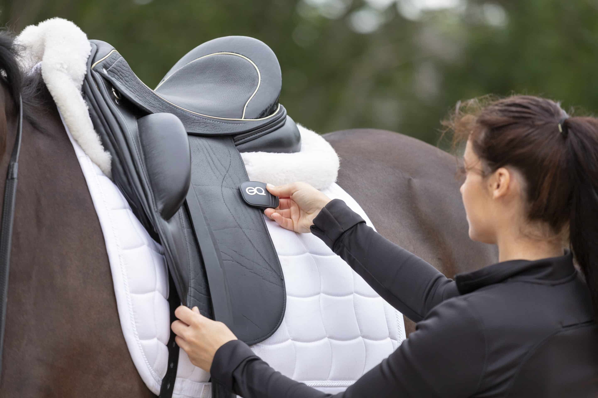
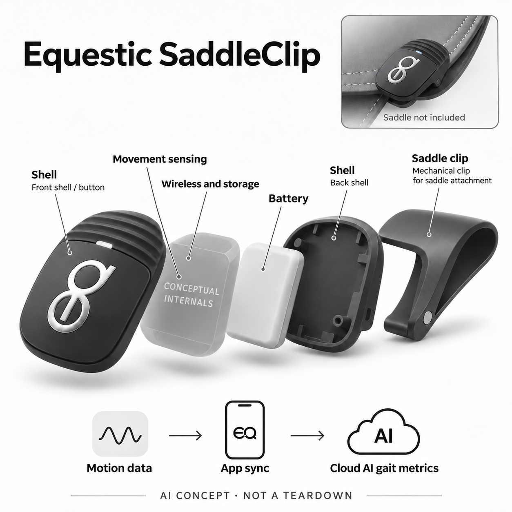

# Equestic SaddleClip Classic

**Equestic / Smart Horse Technologies** · 运动与训练 · 核查 2026-11-05

把马鞍运动同步到云端分析骑乘步态与训练节奏的夹式设备

消费渠道：个人零售。

## 产品图片与结构参考

### 产品图

Equestic SaddleClip Classic 官方产品图 · 来源：[Equestic / Smart Horse Technologies · 官方资料](<https://www.equestic.com/product/clip/>) · [原始图片](<https://d22mkucgvptwps.cloudfront.net/wp-content/uploads/2020/05/Equestic-SaddleClip-4.webp>)

### 参考图

Equestic Classic 官方鞍侧安装参考（马鞍非标配） · 来源：[Equestic / Smart Horse Technologies · 官方资料](<https://www.equestic.com/saddle-clip/>) · [原始图片](<https://d22mkucgvptwps.cloudfront.net/wp-content/uploads/2023/11/2-EQ-on-saddle-to-ride-scaled.jpg>)

### AI 生成爆炸示意

**AI 生成 · 非实物拆机。** 内部为概念推断，不能作为元件布局、BOM 或维修依据。[生成提示词](../../content/hardware/prompts/equestic-saddleclip.txt)

> 以已目视核对的官方图片独立生成并完成目视QA；未知内部只作功能概念，不是实际PCB、拆机或供应商BOM。

> 初稿与修正提示词在主prompt按两阶段保留，单独修正prompt见content/hardware/prompts/equestic-saddleclip-repair.txt；初稿图片仅作修图输入溯源。

> 保留官方图片原貌；其中宣传效果或数据不代表本站独立测量。

> 分析为基于公开资料的案头研究与 AI 辅助判断，未经用户访谈、销量审计或实物拆机。需求、画像、竞争冷门度、审美及商业机会均为研究假设，不是投资结论。

## 销售与购买

- 状态：在售。核查日官方Classic商品页实际浏览器有ADD TO CART，并说明工作日订单发出与配送。只收经典黑色夹子，Vivid配色和其它会员组合不重复计数；不把Alogo同核心骑乘数据任务再作新增。

- 地区：荷兰及官方支持配送地区（地址另核）

- 价格：硬件以官方地区报价为准；有免费基础及付费会员。实际页面未稳定显示地区硬件金额，不猜价。新机赠送3个月Pro试用，后续功能和马匹档案数按会员计划核对。

- 中国大陆：官方称全球配送，但本轮未核大陆地址、App分发和售后；部分手机缺少Google Play可能影响安装，须按当前平台条件确认。

- [官方产品 / 商店](<https://www.equestic.com/product/clip/>)

## AI 的实际作用

夹子记录骑乘中的运动数据，经App同步至Equestic AI Platform，算法分析步态、节奏、推动及对称等训练指标。

服务与联网依赖：核心分析依赖手机与在线平台，部分指标需会员；不是设备本体直接进行兽医诊断。品牌医疗或伤害预防宣传未作为本站结论。

## 是否冷门

细分专业（研究判断）：个人马术训练是明确但窄的场景，器材适配、专业解释和使用频率比大众热度更重要，不推断蓝海。

## 需求与市场

案头需求是在骑乘后了解不同步态、左右方向和节奏的分配，帮助骑手与教练复盘训练。它记录马匹运动而非人的运动手环数据，不能仅凭对称指标判断健康或替代现场观察。

### 事实：任务边界 · 官方资料

官方将SaddleClip定位为消费者可使用的马术运动传感器，夹在马鞍上记录运动，经过手机同步和在线AI平台分析后呈现步态、节奏和对称等指标。当前经典款商品页可加购，目录只选一个代表，不用配色或与其它同任务品牌重复扩张数量。

依据：[Equestic SaddleClip官方商店](<https://www.equestic.com/product/clip/>) · [Equestic产品与AI平台说明](<https://www.equestic.com/about-the-equestic-saddleclip/>)

### 判断：真实需求 · 研究判断

需求判断是骑手希望在结束一堂课后知道练习结构和运动节奏怎样变化，而不只靠记忆和主观感觉。数据可以成为与教练讨论的材料，但不是对马匹健康的直接诊断；只有用户能正确理解这些指标，记录才可能进入实际训练决策。

依据：[Equestic SaddleClip官方商店](<https://www.equestic.com/product/clip/>) · [Equestic产品与AI平台说明](<https://www.equestic.com/about-the-equestic-saddleclip/>)

### 验证：任务完成 · 待验证

验证可围绕同一匹马和固定练习计划，同时保存教练笔记、视频与设备记录，检查它们分别补充什么信息。询问骑手复盘后会提出什么具体问题，再观察下一次是否继续记录；不能仅凭发现对称变化就认定训练或健康状况已经改善。

依据：[Equestic SaddleClip官方商店](<https://www.equestic.com/product/clip/>) · [Equestic产品与AI平台说明](<https://www.equestic.com/about-the-equestic-saddleclip/>)

## 用户画像

潜在人群是稳定骑乘、能正确固定设备且愿意和教练讨论数据的个人马主和骑手。偶尔体验骑乘的人未必需要长期档案；是否持续记录同一匹马、是否有兼容鞍具比兴趣标签更重要。

### 事实：使用条件 · 官方资料

设备需要能固定夹子的鞍具、兼容手机和在线平台，部分分析还与会员级别及马匹档案数有关。官方商品资料有不同年代的手机条件，当前安装渠道需要另核；本轮没有验证大陆支付、App分发或维修，不能把全球配送口号当完整使用保证。

依据：[Equestic SaddleClip官方商店](<https://www.equestic.com/product/clip/>) · [Equestic当前会员说明](<https://www.equestic.com/subscriptions/>)

### 判断：人群筛选 · 研究判断

潜在人群是经常骑同一匹或少数马匹、愿意持续做训练记录的个人骑手和马主，也可能与教练共享信息。偶尔体验骑乘者对长期趋势需求有限，多马场用户又有档案管理问题；不能因为都参与马术就假设他们需要同样的套餐和数据深度。

依据：[Equestic SaddleClip官方商店](<https://www.equestic.com/product/clip/>) · [Equestic当前会员说明](<https://www.equestic.com/subscriptions/>)

### 验证：参与者差异 · 待验证

访谈可从最近几次骑乘的复盘方式开始，询问谁决定训练内容、谁负责装夹和同步、已有记录如何保存。试用时记录是否经常忘记设备或弄错马匹档案，再评估共享是否真正被使用；以这些行为筛选人群，而不是以昂贵运动推断付费能力。

依据：[Equestic SaddleClip官方商店](<https://www.equestic.com/product/clip/>) · [Equestic当前会员说明](<https://www.equestic.com/subscriptions/>)

## 竞争与替代

替代包括教练观察、骑乘日志、视频和其它马术运动传感器。本轮选一个可零售代表，Alogo不再按相近步态需求重复添加；比较重点是记录与复盘工作流，而非宣传的参数数量。

### 事实：方案范围 · 官方资料

已核工作流依赖马鞍运动输入，与教练现场观察、视频和人工日志不同，也与Alogo等马术传感器存在同任务重叠。本轮优先保留可零售的Equestic，避免把不同传感精度、品牌或租赁方式直接算作全新需求；设备只能反映其测量位置的信息。

依据：[Equestic SaddleClip官方商店](<https://www.equestic.com/product/clip/>) · [Equestic产品与AI平台说明](<https://www.equestic.com/about-the-equestic-saddleclip/>)

### 判断：替代关系 · 研究判断

竞争判断应比较记录连续性与解释成本。传感器可以长时间收集数据，却看不到全部环境和人与马的互动；视频提供可回看画面，但需要拍摄组织。更好的结果可能来自相互补充，而非用更多算法指标替代教练和骑手已有的观察经验。

依据：[Equestic SaddleClip官方商店](<https://www.equestic.com/product/clip/>) · [Equestic产品与AI平台说明](<https://www.equestic.com/about-the-equestic-saddleclip/>)

### 验证：比较方法 · 待验证

可让用户用三种方式完成同一次训练复盘，记录哪些问题仅靠某一种资料能回答、哪些仍需现场判断。比较装夹、同步和查找历史的总时间，再问用户愿意保留哪种组合；不要按参数数量、宣传准确率或奖项直接决定胜负。

依据：[Equestic SaddleClip官方商店](<https://www.equestic.com/product/clip/>) · [Equestic产品与AI平台说明](<https://www.equestic.com/about-the-equestic-saddleclip/>)

## 供应链

运动感知、存储、无线、电池和马鞍夹持共同组成系统，真实元件及工厂未披露。夹子位置、振动和鞍具适配会影响输入；候选供应商只表示开发能力，不能由外壳反推出真实BOM。

### 事实：功能组成 · 官方资料

官方公开夹持机身、运动记录、无线连接、电池和App平台，实际传感器、电路及工厂未披露。经典黑色外壳的图片支持外观识别，不支持反推内部结构；本目录供应关联仅匹配运动感知、供电与机械样件能力，不把任何候选公司写成已采用。

依据：[Equestic SaddleClip官方商店](<https://www.equestic.com/product/clip/>) · [Equestic产品与AI平台说明](<https://www.equestic.com/about-the-equestic-saddleclip/>)

### 判断：交付约束 · 研究判断

工程判断，鞍具差异、夹持稳定性、马匹运动振动和汗水环境都可能影响信号与耐用性。数据后端又需要正确关联马匹和训练记录，硬件收集成功不代表分析与档案都正确；交付评估应覆盖完整链路，而不只是传感器的标称规格。

依据：[Equestic SaddleClip官方商店](<https://www.equestic.com/product/clip/>) · [Equestic产品与AI平台说明](<https://www.equestic.com/about-the-equestic-saddleclip/>)

### 验证：选型缺口 · 待验证

选型与测试可以从允许的安装位置和鞍具尺寸开始，记录重复装夹后的数据变化、按键与充电便利，以及异常脱落提示。向候选公司提供明确的环境与结构要求，再讨论器件；未拿到品牌点名证据前，不填写真实BOM、代工厂或采购价格。

依据：[Equestic SaddleClip官方商店](<https://www.equestic.com/product/clip/>) · [Equestic产品与AI平台说明](<https://www.equestic.com/about-the-equestic-saddleclip/>)

## 技术路径

官方明确运动数据由在线AI平台处理成训练指标，本机采集与云分析应分开。公开资料没有完整模型结构，马匹体型、步态与安装差异需要验证；不沿用厂商精度百分比作为本轮实测。

### 事实：AI机制 · 官方资料

官方说明运动数据同步后由在线AI平台计算节奏、推动和对称等指标，并按不同会员提供分析深度。这说明本机主要承担采集与连接，不能把所有AI分析画在夹子内部；模型结构、训练方法和本轮独立误差结果并未公开，不沿用宣传精度数字。

依据：[Equestic SaddleClip官方商店](<https://www.equestic.com/product/clip/>) · [Equestic产品与AI平台说明](<https://www.equestic.com/about-the-equestic-saddleclip/>)

### 判断：系统边界 · 研究判断

分析上，指标把复杂运动简化为可追踪数值，有助于比较，也可能让用户忽视安装、马匹体型和训练条件差异。对称变化可能有多种解释，不能由算法输出直接推导伤病；使用者需要能够回到原始训练情境，而不是只看一个好坏标签。

依据：[Equestic SaddleClip官方商店](<https://www.equestic.com/product/clip/>) · [Equestic产品与AI平台说明](<https://www.equestic.com/about-the-equestic-saddleclip/>)

### 验证：算法与体验 · 待验证

技术验证应让同一匹马在相近条件下重复常规练习，对照视频标记和教练观察，分别核对步态分段、节奏与左右时间。改变鞍具或安装位置时单独记录，报告注明条件和版本；不通过危险或医疗情境试验来证明消费训练工具的价值。

依据：[Equestic SaddleClip官方商店](<https://www.equestic.com/product/clip/>) · [Equestic产品与AI平台说明](<https://www.equestic.com/about-the-equestic-saddleclip/>)

## 产品审美

黑色圆角夹体与银色标志在鞍侧较容易识别，机械夹持减少额外绑带。分析上，戴手套操作、取下充电和鞍具摩擦更重要；真实安装图只支持外观，不证明所有马鞍和骑乘习惯都适配。

### 事实：外观与交互 · 官方资料

真实图片显示黑色圆角夹体、银色标志、侧面夹持曲线与状态灯，安装在鞍侧即可开始记录。产品不是项圈、整鞍压力垫或心率贴片；结构示意因此只分离大类运动、连接、电池与外壳，未知元件保持概念，不添加未经披露的GPS或生理传感器。

依据：[Equestic SaddleClip官方商店](<https://www.equestic.com/product/clip/>) · [Equestic产品与AI平台说明](<https://www.equestic.com/about-the-equestic-saddleclip/>)

### 判断：使用中的形态 · 研究判断

交互判断需要考虑骑乘准备时手套、鞍具皮革和其它装备已经占据注意力，夹子是否容易装到一致位置尤其重要。小而低调可以减少干扰，也容易在结束后被遗忘；是否能清楚确认开机、同步和电量，比外壳的科技感更有实际意义。

依据：[Equestic SaddleClip官方商店](<https://www.equestic.com/product/clip/>) · [Equestic产品与AI平台说明](<https://www.equestic.com/about-the-equestic-saddleclip/>)

### 验证：日常接受度 · 待验证

观察骑手从准备鞍具到训练结束取下设备的全过程，记录何时查看状态、是否需要他人帮助以及是否影响原有装备操作。再看回家后的同步与收纳是否自然发生；不能从官方安装照片推断任何鞍具都稳固、舒适或不会影响运动。

依据：[Equestic SaddleClip官方商店](<https://www.equestic.com/product/clip/>) · [Equestic产品与AI平台说明](<https://www.equestic.com/about-the-equestic-saddleclip/>)

## 关键风险

风险是将算法指标误作伤病诊断、装夹松动和云服务或会员中断。官方支持资料有不同年代的手机条件，购前应核当前App；异常运动或健康疑虑需由专业人员判断，不由目录给疗效承诺。

### 事实：已知限制 · 官方资料

官方资料同时包含训练分析与健康相关宣传，但本目录只确认运动记录和AI指标工作流，不采纳伤害预防或康复效果结论。会员页有免费与付费层级，旧商品页和支持条件也有历史差异；购买前需按当前版本确认实际功能和当地服务。

依据：[Equestic SaddleClip官方商店](<https://www.equestic.com/product/clip/>) · [Equestic产品与AI平台说明](<https://www.equestic.com/about-the-equestic-saddleclip/>) · [Equestic当前会员说明](<https://www.equestic.com/subscriptions/>)

### 判断：失效影响 · 研究判断

风险判断包括错误装夹、档案归错马匹、把算法异常解释为疾病，以及云服务中断或会员变更后数据不可按预期查看。消费运动传感器不能替代兽医或现场专业人员；即使某次数据正常，也不能据此推断马匹健康或适合增加训练强度。

依据：[Equestic SaddleClip官方商店](<https://www.equestic.com/product/clip/>) · [Equestic产品与AI平台说明](<https://www.equestic.com/about-the-equestic-saddleclip/>) · [Equestic当前会员说明](<https://www.equestic.com/subscriptions/>)

### 验证：风险处理 · 待验证

验证应确认设备故障、离线采集、换手机和退订后历史数据的处理，模拟错误档案选择如何纠正。对于实际健康疑虑，把记录交给专业人员结合现场判断，而不是让目录给诊断；这些核查仍是建议计划，未被写成本站完成的可靠性验证。

依据：[Equestic SaddleClip官方商店](<https://www.equestic.com/product/clip/>) · [Equestic产品与AI平台说明](<https://www.equestic.com/about-the-equestic-saddleclip/>) · [Equestic当前会员说明](<https://www.equestic.com/subscriptions/>)

## 机会与验证

可验证机会是把一次课后的主观印象变成可追踪的训练讨论。用同一马匹和固定练习同步录像、教练记录及设备结果，比较能否发现值得讨论的变化，再问骑手持续记录的成本与意愿。

### 判断：可尝试切口 · 研究判断

机会假设在让骑手和教练围绕真实训练历史进行更具体的讨论，例如步态时间分配是否符合计划。不是把每次骑乘都变成指标竞赛，也不是用更复杂图表替代人与马的反馈；如果数据能帮助问对问题，就有清楚的小众任务价值。

依据：[Equestic SaddleClip官方商店](<https://www.equestic.com/product/clip/>) · [Equestic产品与AI平台说明](<https://www.equestic.com/about-the-equestic-saddleclip/>)

### 判断：商业边界 · 研究判断

商业边界包括持续骑乘频率、同一马匹的记录周期、会员档案成本和服务可达性。高价运动场景并不保证设备留存，用户可能因为装夹和同步麻烦而停用；本轮没有独立销量、市场份额或健康收益证据，不根据厂商累计记录规模推导成功。

依据：[Equestic SaddleClip官方商店](<https://www.equestic.com/product/clip/>) · [Equestic产品与AI平台说明](<https://www.equestic.com/about-the-equestic-saddleclip/>)

### 验证：下一步调研 · 待验证

建议跟踪一个训练阶段，记录每次采集是否完整、复盘由谁完成、数据是否被教练引用，以及用户停用时的具体原因。结束访谈分别评价硬件、历史档案和深度分析的价值，再与普通日志和视频对照；不用模型评分预测马术训练结果或商业回报。

依据：[Equestic SaddleClip官方商店](<https://www.equestic.com/product/clip/>) · [Equestic产品与AI平台说明](<https://www.equestic.com/about-the-equestic-saddleclip/>)

## 对应供应链公司

能力候选用于选型研究，不代表本产品实际采用；未公开的供货关系不作推断。

- [tdk-invensense](../supply-chain/tdk-invensense.md) — **能力候选 · 非已采用** / 鞍侧运动采集候选：TDK InvenSense具有运动传感与穿戴处理相关能力，可用于评估鞍侧持续运动输入，但安装振动、动态范围与分析算法需要专门验证。Equestic未公开传感器品牌，本关联不能作为实际芯片、精度或采购关系的证明。

- [grepow](../supply-chain/grepow.md) — **能力候选 · 非已采用** / 夹式运动记录供电候选：Grepow提供小型和定制形状电池能力，可作为夹式记录器空间、充电保护与使用周期的评估方向；实际电池布局没有披露。目录不根据壳体大小推算容量，也不将候选公司的能力写成Equestic已采用的方案。

- [protolabs](../supply-chain/protolabs.md) — **能力候选 · 非已采用** / 鞍侧夹持与外壳样件候选：Protolabs可提供结构样件加工以验证夹持曲线、壳体配合和不同鞍具上的安装，但皮革接触和反复运动下的保持力仍须实际测试。没有公开资料指向该公司参与Equestic量产，本关联只用于开发阶段能力匹配。

[浏览供应链目录](../supply-chain.md)

## 功能分层示意

这是功能关系，不是实物拆机、真实空间结构或已核实 BOM。

1. **马鞍夹持**：经典黑色夹体固定在马鞍侧，避免把它画成项圈或整张压力垫。（官方披露）

2. **运动记录**：采集并保存骑乘运动数据，具体惯性芯片未披露。（官方披露）

3. **无线与电源**：蓝牙连接App，可充电电池支持记录过程。（官方披露）

4. **在线AI分析**：Equestic Platform从同步数据计算步态、节奏和对称等训练指标。（官方披露）

5. **用户复盘**：App显示历史与变化，部分深度分析取决于会员，不等于医疗诊断。（官方披露）

## 来源

1. [Equestic SaddleClip官方商店](<https://www.equestic.com/product/clip/>) — 实际浏览器核对Classic加购、赠送试用、配送与公开功能；硬件金额未稳定显示，未猜测。

2. [Equestic产品与AI平台说明](<https://www.equestic.com/about-the-equestic-saddleclip/>) — 实际打开；消费马术运动定位、运动记录与在线AI节奏和对称分析，未采用宣传精度或伤害预防结论。

3. [Equestic当前会员说明](<https://www.equestic.com/subscriptions/>) — 实际打开；免费Essential与付费Professional、档案与试用边界，旧页单一月价不直接沿用。

4. [Equestic SaddleClip安装与流程](<https://www.equestic.com/saddle-clip/>) — 实际打开；鞍侧安装、App同步及官方产品图，不把健康宣传当独立验证。

[返回目录](../hardware-market.md) · [网页分析](https://romanagent.github.io/Roman/#hardware/product/equestic-saddleclip)
