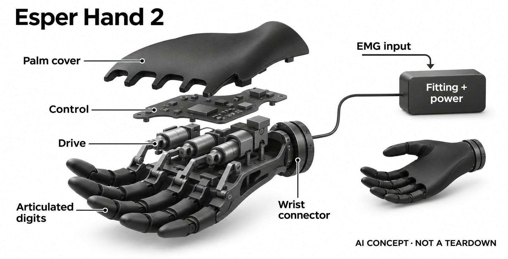

# Esper Hand 2

**Esper Bionics** · 无障碍与辅助沟通 · 核查 2026-11-05

通过个体肌电适配支持日常抓握的电子假手

消费渠道：个人适配 / 验配。

## 产品图片与结构参考

### 产品图

Esper Hand 2官方掌部与五指外形；红光为拍摄光线 · 来源：[Esper Bionics · 官方产品图片](<https://www.esperbionics.com/blog/esper-hand-2-technical-specifications>) · [原始图片](<https://framerusercontent.com/images/0uFPXv1uWcsVgXNSfvGQCz0CsA.jpg?scale-down-to=1024&width=4272&height=2848>)

### 参考图

Esper Hand 2官方持物场景；水滴照片不证明允许浸泡 · 来源：[Esper Bionics · 官方产品图片](<https://www.esperbionics.com/esper-hand>) · [原始图片](<https://framerusercontent.com/images/q5hjFi7GRQxn48d3Ge5klFWJU.png?scale-down-to=1024&width=3912&height=2184>)

### AI 生成爆炸示意

**AI 生成 · 非实物拆机。** 内部为概念推断，不能作为元件布局、BOM 或维修依据。[生成提示词](../../content/hardware/prompts/esper-hand-2.txt)

> 已视觉检查准确外形、灰阶、标题与概念声明；未知内部模块仅为功能示意，不代表拆机、完整BOM或参数。

> 来源图片已逐张实际查看，确认具体型号；保留原图，不改色裁切。图片不能证明内部BOM、疗效或所有配置可售。

> 分析为基于公开资料的案头研究与 AI 辅助判断，未经用户访谈、销量审计或实物拆机。需求、画像、竞争冷门度、审美及商业机会均为研究假设，不是投资结论。

## 销售与购买

- 状态：在售。现行官方FAQ说明美国和乌克兰可经处方及认证假肢师进行个人适配；2026年7月27日Hand 2技术页对应当前型号。属于个人验配渠道，非直接买一只手即可使用。

- 地区：美国：个人假肢适配、乌克兰：个人假肢适配

- 价格：按个人适配报价。假手、接受腔、传感器、供电、训练及维护可能分别影响完整费用；无统一公开价，不承诺保险报销。

- 中国大陆：未核到中国大陆针对Hand 2的官方个人适配购买渠道；欧洲和英国也仍列为扩展计划，不推定全球可交付。

- [官方产品 / 商店](<https://www.esperbionics.com/esper-hand>)

## AI 的实际作用

Hand 2官方规格明确基于机器学习的信号适应与个性化，结合肌电输入控制动作；比例控制与可选COAPT集成不等于所有配置相同。

服务与联网依赖：须由假肢师完成接受腔、传感器和控制训练；设置完成可独立使用，Esper+用于配置和训练支持，模型训练位置及具体版本未充分披露。

## 是否冷门

细分专业（研究判断）：面向特定肢体条件下的个人抓握，适配服务和维护决定可用性；属于案头研究，无用户访谈、销量或功能疗效实测。

## 需求与市场

需求假设是用户在本人生活中更稳定地取放、保持和释放物体，而不是追求更多预设手势。拿杯子、整理衣物和移动轻物各有接触与姿态条件，控制切换和穿脱设备可能影响是否愿意持续使用；这些任务价值需要本人判断，不能从机器学习名称推定功能改善。

### 官方｜肌电信号进入个体控制 · 官方资料

Hand 2规格明确机器学习信号适应和个性化，肌肉活动经适配传感器进入控制系统，再驱动手指抓握。它面向需要完整假手的个人，不是局部缺指的通用配件；单独的机械手照片也没有包含接受腔、传感器和训练，不能据此理解为开箱即用的消费附件。

依据：[Esper当前FAQ：个人适配和可用地区](<https://www.esperbionics.com/faq>) · [Esper Hand 2技术规格，2026-07-27](<https://www.esperbionics.com/blog/esper-hand-2-technical-specifications>)

### 判断｜抓住物体之外还要完成日常流程 · 研究判断

需求假设是用户在本人生活中更稳定地取放、保持和释放物体，而不是追求更多预设手势。拿杯子、整理衣物和移动轻物各有接触与姿态条件，控制切换和穿脱设备可能影响是否愿意持续使用；这些任务价值需要本人判断，不能从机器学习名称推定功能改善。

依据：[Esper当前FAQ：个人适配和可用地区](<https://www.esperbionics.com/faq>) · [Esper Hand 2技术规格，2026-07-27](<https://www.esperbionics.com/blog/esper-hand-2-technical-specifications>)

### 验证｜由适配人员协助定义目标 · 待验证

可在认证假肢师指导下选出使用者最在意的低风险日常任务，记录佩戴、选择动作、保持及释放的完整过程。需要同时记录残肢接触、疲劳和重新校准的反馈，并保留原有方式作为比较；目录不安排医疗训练，也没有实测抓握能力或承诺个体收益。

依据：[Esper当前FAQ：个人适配和可用地区](<https://www.esperbionics.com/faq>) · [Esper Hand 2技术规格，2026-07-27](<https://www.esperbionics.com/blog/esper-hand-2-technical-specifications>)

## 用户画像

这类产品的实际用户范围取决于残肢条件、可获得的肌电信号、适配服务和本人意愿，不能仅按年龄或技术熟悉程度划分。即便可以产生控制信号，也可能在穿脱、清洁或长时间佩戴中遇到不同问题；用户和专业人员应共同判断，而不是由目录代替适配结论。

### 官方｜处方与认证假肢师属于购买路径 · 官方资料

官方FAQ列出的流程始于处方和认证假肢师评估，随后选择接受腔、传感器及配套组件，完成配置和训练。美国与乌克兰为明确可用地区，欧洲和英国仍在扩展计划中；因此这里记录的是面向个人的验配销售，不把联系表单或全球宣传当作每个地区都能交付。

依据：[Esper当前FAQ：个人适配和可用地区](<https://www.esperbionics.com/faq>)

### 判断｜适配条件比科技兴趣更关键 · 研究判断

这类产品的实际用户范围取决于残肢条件、可获得的肌电信号、适配服务和本人意愿，不能仅按年龄或技术熟悉程度划分。即便可以产生控制信号，也可能在穿脱、清洁或长时间佩戴中遇到不同问题；用户和专业人员应共同判断，而不是由目录代替适配结论。

依据：[Esper当前FAQ：个人适配和可用地区](<https://www.esperbionics.com/faq>) · [Esper Hand 2技术规格，2026-07-27](<https://www.esperbionics.com/blog/esper-hand-2-technical-specifications>)

### 验证｜完整费用与后续服务一并询证 · 待验证

购买前应由服务方列出假手、接受腔、传感器、供电、训练、保修及后续调整分别包含什么，并确认更换和维修期间如何处理。报价和保险覆盖须按个人、地区与具体方案核实；本轮未取得个体报价，也没有把厂家介绍中的潜在报销机会写成必然结果。

依据：[Esper当前FAQ：个人适配和可用地区](<https://www.esperbionics.com/faq>)

## 竞争与替代

同核心日常抓握需求下，不宜用多个品牌或上一代手型重复计为新场景。应比较使用者已有假肢、身体代偿或其他辅助工具在具体任务中的步骤、反馈和维护要求；更多驱动自由度可能增加灵活性，也可能增加学习和服务成本，不能预设复杂系统一定更适合本人。

### 官方｜不同控制配置不能混作一个性能 · 官方资料

官方允许不同肌电传感配置，并列出可选的COAPT模式识别集成；Hand 2自身也明确机器学习适应，不能因为存在外部选件就否认基本AI依据。另一方面，比例控制、内置个性化和选装识别系统并不相同，比较时必须明确各套方案，避免把最高配置能力归给所有用户。

依据：[Esper当前FAQ：个人适配和可用地区](<https://www.esperbionics.com/faq>) · [Esper Hand 2技术规格，2026-07-27](<https://www.esperbionics.com/blog/esper-hand-2-technical-specifications>)

### 判断｜与原有辅助方式比较任务负担 · 研究判断

同核心日常抓握需求下，不宜用多个品牌或上一代手型重复计为新场景。应比较使用者已有假肢、身体代偿或其他辅助工具在具体任务中的步骤、反馈和维护要求；更多驱动自由度可能增加灵活性，也可能增加学习和服务成本，不能预设复杂系统一定更适合本人。

依据：[Esper当前FAQ：个人适配和可用地区](<https://www.esperbionics.com/faq>) · [Esper Hand 2技术规格，2026-07-27](<https://www.esperbionics.com/blog/esper-hand-2-technical-specifications>)

### 验证｜把控制失误和恢复列入比较 · 待验证

试配记录不仅包括成功抓取，还应描述选错动作、物体滑移、需要重新定位和中断后恢复的情况。比较应使用同类物品和由专业人员确定的安全条件，避免只展示熟练演示；本目录没有临床效果、长期依从性或销量证据，不能为品牌之间作疗效排序。

依据：[Esper当前FAQ：个人适配和可用地区](<https://www.esperbionics.com/faq>) · [Esper Hand 2技术规格，2026-07-27](<https://www.esperbionics.com/blog/esper-hand-2-technical-specifications>)

## 供应链

同类新设计既要处理狭小手部的驱动、传动和维护，也要考虑接受腔内肌电接触随姿势和佩戴而变化。仅提高电机力矩或分类模型精度不等于日常任务更可靠，接口、结构和服务流程必须共同验证；供应商候选只能支持某个能力层，不能自动组成可适配成品。

### 官方｜手部与完整假肢是不同供应边界 · 官方资料

公开资料列明五个电动手指、六个电机与控制配置，但没有点名所有驱动、主控、传感器和电池供应商。完整假肢还包含接受腔及适配组件，手部本体的重量或外形不能代表全套；实际代工厂与完整BOM不明，概念图只表达功能层，不复刻未知的传动机构。

依据：[Esper当前FAQ：个人适配和可用地区](<https://www.esperbionics.com/faq>) · [Esper Hand 2技术规格，2026-07-27](<https://www.esperbionics.com/blog/esper-hand-2-technical-specifications>)

### 判断｜机械可靠性和信号稳定须协同 · 研究判断

同类新设计既要处理狭小手部的驱动、传动和维护，也要考虑接受腔内肌电接触随姿势和佩戴而变化。仅提高电机力矩或分类模型精度不等于日常任务更可靠，接口、结构和服务流程必须共同验证；供应商候选只能支持某个能力层，不能自动组成可适配成品。

依据：[Esper当前FAQ：个人适配和可用地区](<https://www.esperbionics.com/faq>) · [Esper Hand 2技术规格，2026-07-27](<https://www.esperbionics.com/blog/esper-hand-2-technical-specifications>)

### 验证｜候选模块需在适配系统内评估 · 待验证

微型驱动可从公开电机与定制机构能力出发比较，生物电前端则需核对输入范围、噪声、保护和传感接口。这里的候选并非现用零件或临床替代方案，任何新设计仍须完成系统评估；在没有品牌点名合作前，不把常见电机外形或芯片类别写成供应链事实。

依据：[Esper当前FAQ：个人适配和可用地区](<https://www.esperbionics.com/faq>) · [Esper Hand 2技术规格，2026-07-27](<https://www.esperbionics.com/blog/esper-hand-2-technical-specifications>)

## 技术路径

使用者某次校准后的信号分布可能与再次穿戴、不同姿势或疲劳时有所差异，个性化控制的价值在于如何处理这种变化。必须区分模型能分类、动作能执行和用户能完成任务三个层次；没有公开测试过程时，不能用手势数量或电机数量替代这些关键证据。

### 官方｜个性化不等于读取想法 · 官方资料

Hand 2公开的是肌电输入、信号适应及动作控制，机器学习用于与使用者相关的控制模式，不是直接获取思想内容。设置完成后手可独立工作，Esper+支持配置、备份和训练；所引资料没有完整公开模型版本、训练数据或每个算法的执行位置，不能自行补充为全云端或全本地。

依据：[Esper当前FAQ：个人适配和可用地区](<https://www.esperbionics.com/faq>) · [Esper Hand 2技术规格，2026-07-27](<https://www.esperbionics.com/blog/esper-hand-2-technical-specifications>)

### 判断｜控制一致性需要跨佩戴状态观察 · 研究判断

使用者某次校准后的信号分布可能与再次穿戴、不同姿势或疲劳时有所差异，个性化控制的价值在于如何处理这种变化。必须区分模型能分类、动作能执行和用户能完成任务三个层次；没有公开测试过程时，不能用手势数量或电机数量替代这些关键证据。

依据：[Esper当前FAQ：个人适配和可用地区](<https://www.esperbionics.com/faq>) · [Esper Hand 2技术规格，2026-07-27](<https://www.esperbionics.com/blog/esper-hand-2-technical-specifications>)

### 验证｜明确校准、退出和维护责任 · 待验证

服务方案应说明什么时候需要重新训练或调节传感接触、用户能自行完成哪些设置，以及何种情况应联系假肢师。可核对配置保存、版本更新与故障处理步骤，避免把AI自适应理解为永不需要人工支持；目录只提出核查方法，不提供未经适配的设备操作建议。

依据：[Esper当前FAQ：个人适配和可用地区](<https://www.esperbionics.com/faq>) · [Esper Hand 2技术规格，2026-07-27](<https://www.esperbionics.com/blog/esper-hand-2-technical-specifications>)

## 产品审美

有些使用者可能愿意明显展示机械结构，有些更在意衣物搭配、物体接触感和清洁便利，两种偏好都不能由产品照片代替。接受腔与手部组合后的整体比例也不同于孤立渲染图；审美研究应让本人表达使用场景，而不是把仿生程度作为唯一衡量标准。

### 官方｜掌部和手指外观可分开理解 · 官方资料

官方照片显示黑色手指、掌部外壳与腕部连接，部分掌盖可更换，其他配色或手套计划不等于全部现售。带水或持物照片有助于识别外形，却不能说明内部密封、材质触感或所有动作限制；所引防护说明也不允许把耐水宣传扩展为浸泡使用。

依据：[Esper Hand 2技术规格，2026-07-27](<https://www.esperbionics.com/blog/esper-hand-2-technical-specifications>) · [Esper Hand当前型号展示](<https://www.esperbionics.com/esper-hand>)

### 判断｜外观选择同时影响社会和维护体验 · 研究判断

有些使用者可能愿意明显展示机械结构，有些更在意衣物搭配、物体接触感和清洁便利，两种偏好都不能由产品照片代替。接受腔与手部组合后的整体比例也不同于孤立渲染图；审美研究应让本人表达使用场景，而不是把仿生程度作为唯一衡量标准。

依据：[Esper当前FAQ：个人适配和可用地区](<https://www.esperbionics.com/faq>) · [Esper Hand当前型号展示](<https://www.esperbionics.com/esper-hand>)

### 验证｜以完整佩戴方案看外形 · 待验证

可以在试配时核对腕部连接、衣袖通过、收纳与清洁路径，并分别记录外观喜好和实际触感。更换外壳是否影响维修、防护或费用，应由服务方按具体配置说明；本轮只查看官方图片，没有触摸、耐磨或长期佩戴测试，无法据照片评价舒适程度。

依据：[Esper当前FAQ：个人适配和可用地区](<https://www.esperbionics.com/faq>) · [Esper Hand当前型号展示](<https://www.esperbionics.com/esper-hand>)

## 关键风险

抓握失误可能造成物体跌落，结构损坏或不合适的接触也会影响继续佩戴；这些风险不能只靠模型分类准确率概括。对依赖设备完成日常任务的人，维修时间、备件和就近支持同样重要，尤其跨境购买时，远程App不能替代线下接受腔与机械调整。

### 官方｜耐水与使用范围都有明确边界 · 官方资料

Hand 2技术资料给出耐水等级并强调不应把它当作可浸泡设备，完整接受腔及外部供电还可能具有各自限制。它也并非面向所有缺损类型的单一解决方案；目录不将注册、编码或厂家关于合规的介绍改写为疗效审批，更不以此推定中国大陆可合法适配交付。

依据：[Esper当前FAQ：个人适配和可用地区](<https://www.esperbionics.com/faq>) · [Esper Hand 2技术规格，2026-07-27](<https://www.esperbionics.com/blog/esper-hand-2-technical-specifications>)

### 判断｜错误控制与服务中断都需考虑 · 研究判断

抓握失误可能造成物体跌落，结构损坏或不合适的接触也会影响继续佩戴；这些风险不能只靠模型分类准确率概括。对依赖设备完成日常任务的人，维修时间、备件和就近支持同样重要，尤其跨境购买时，远程App不能替代线下接受腔与机械调整。

依据：[Esper当前FAQ：个人适配和可用地区](<https://www.esperbionics.com/faq>) · [Esper Hand 2技术规格，2026-07-27](<https://www.esperbionics.com/blog/esper-hand-2-technical-specifications>)

### 验证｜把异常处理写进个人方案 · 待验证

适配前应由专业人员说明设备限制、异常时的停用与联系路径、保修范围和服务周期，并确认使用者能理解相关信息。对于高后果抓握或未经训练的环境，应遵循个人适配建议；本研究不承诺设备避免跌落、恢复身体功能或替代专业随访。

依据：[Esper当前FAQ：个人适配和可用地区](<https://www.esperbionics.com/faq>) · [Esper Hand 2技术规格，2026-07-27](<https://www.esperbionics.com/blog/esper-hand-2-technical-specifications>)

## 机会与验证

后续值得研究的是用户在哪些原本困难的日常步骤中愿意主动使用，以及哪些场景仍更适合原有方式。这个问题需要结合控制、穿脱、清洁和维护投入，不能用一次展示代替长期价值；服务可达性和选择权可能与硬件功能同样决定是否持续采用。

### 官方｜本条保留肌电抓握一个核心需求 · 官方资料

本目录将Hand 2作为个体肌电适应与电子抓握的一个代表，不再按手指配置、外壳或同类品牌拆成多个创新场景。它的可研究差异是信号个性化、机械执行和长期适配服务共同形成的使用流程，而不是单独的机器人手外形或未经验证的人工智能标签。

依据：[Esper当前FAQ：个人适配和可用地区](<https://www.esperbionics.com/faq>) · [Esper Hand 2技术规格，2026-07-27](<https://www.esperbionics.com/blog/esper-hand-2-technical-specifications>)

### 判断｜优先看哪些步骤减少依赖 · 研究判断

后续值得研究的是用户在哪些原本困难的日常步骤中愿意主动使用，以及哪些场景仍更适合原有方式。这个问题需要结合控制、穿脱、清洁和维护投入，不能用一次展示代替长期价值；服务可达性和选择权可能与硬件功能同样决定是否持续采用。

依据：[Esper当前FAQ：个人适配和可用地区](<https://www.esperbionics.com/faq>) · [Esper Hand 2技术规格，2026-07-27](<https://www.esperbionics.com/blog/esper-hand-2-technical-specifications>)

### 验证｜跟踪本人选择而非展示次数 · 待验证

可以在取得合适同意和专业支持后，记录用户自选任务、放弃或切换方式的原因及维护需求，再评估哪部分流程需要改进。公开案头资料不足以估计用户规模、销量或疗效；本条提供可验证的研究框架，保留不适用和不选择该设备的结果空间。

依据：[Esper当前FAQ：个人适配和可用地区](<https://www.esperbionics.com/faq>) · [Esper Hand 2技术规格，2026-07-27](<https://www.esperbionics.com/blog/esper-hand-2-technical-specifications>) · [Esper Hand当前型号展示](<https://www.esperbionics.com/esper-hand>)

## 对应供应链公司

能力候选用于选型研究，不代表本产品实际采用；未公开的供货关系不作推断。

- [faulhaber](../supply-chain/faulhaber.md) — **能力候选 · 非已采用** / 同类电子假手的微型驱动与传动研究：FAULHABER公开微型电机、齿轮与定制项目能力，可作为同类假手驱动层的工程候选，但手指空间、回驱、噪声、寿命和维修结构需具体评估。未发现Esper点名采用证据，不能由外形猜测电机型号，更不能把通用驱动方案视作个人假肢的适配完成。

- [texas-instruments](../supply-chain/texas-instruments.md) — **能力候选 · 非已采用** / 同类肌电控制链的生物电前端研究：TI的ADS1299公开生物电采集前端能力，可供研究外部肌电传感链的输入、噪声和多通道条件；它不包含Esper的个性化控制模型，也不证明满足该接受腔和控制器接口。这里只是新设计研究候选，无本产品采用证据或直接替换、临床适配结论。

[浏览供应链目录](../supply-chain.md)

## 功能分层示意

这是功能关系，不是实物拆机、真实空间结构或已核实 BOM。

1. **肌电采集**：接受腔相关传感器采集肌肉活动，数量及配置依个人方案。（官方披露）

2. **信号适应**：官方明确机器学习适应和个性化；不等于直接读取思想。（官方披露）

3. **动作控制**：控制系统将选定信号转换为手指和抓握动作。（官方披露）

4. **机械执行**：五个电动手指及内部驱动，概念图不代表实际传动布局。（官方披露）

5. **个人适配与供电**：接受腔、外部配套供电和训练共同构成可用系统。（官方披露）

## 来源

1. [Esper当前FAQ：个人适配和可用地区](<https://www.esperbionics.com/faq>) — 已打开：美国和乌克兰可用、处方与假肢师流程、App与配套条件；计划扩展市场不作现售。

2. [Esper Hand 2技术规格，2026-07-27](<https://www.esperbionics.com/blog/esper-hand-2-technical-specifications>) — 已打开：机器学习信号适应、五个驱动手指和六个电机、配置与防水边界；未据此声称完整假肢重量或医疗疗效。

3. [Esper Hand当前型号展示](<https://www.esperbionics.com/esper-hand>) — 已打开当前产品和个人适配入口；图片用于外形，不将有水场景当作允许浸泡的证明。

[返回目录](../hardware-market.md) · [网页分析](https://romanagent.github.io/Roman/#hardware/product/esper-hand-2)
