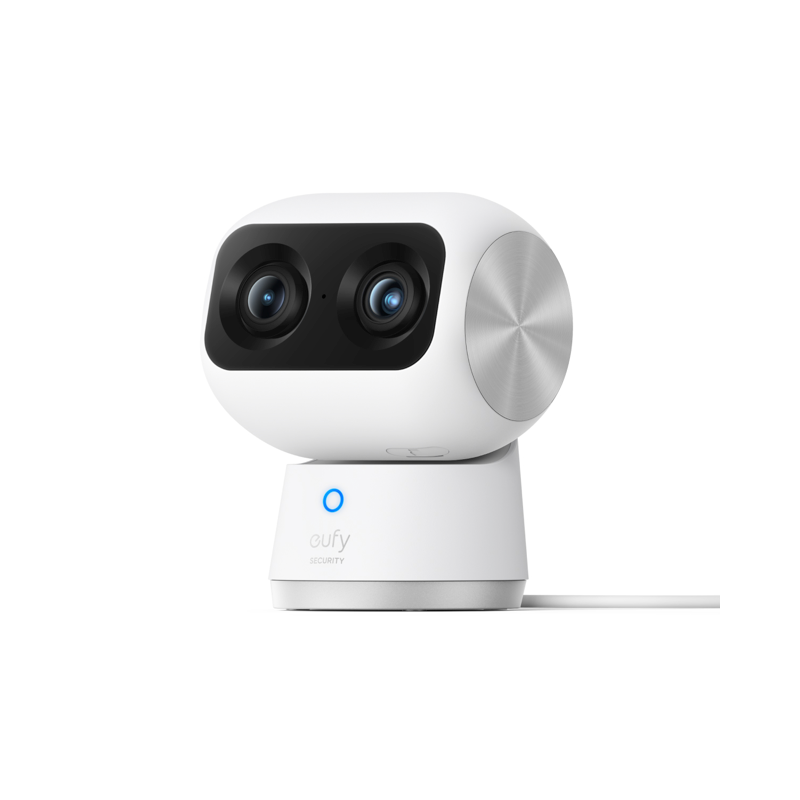
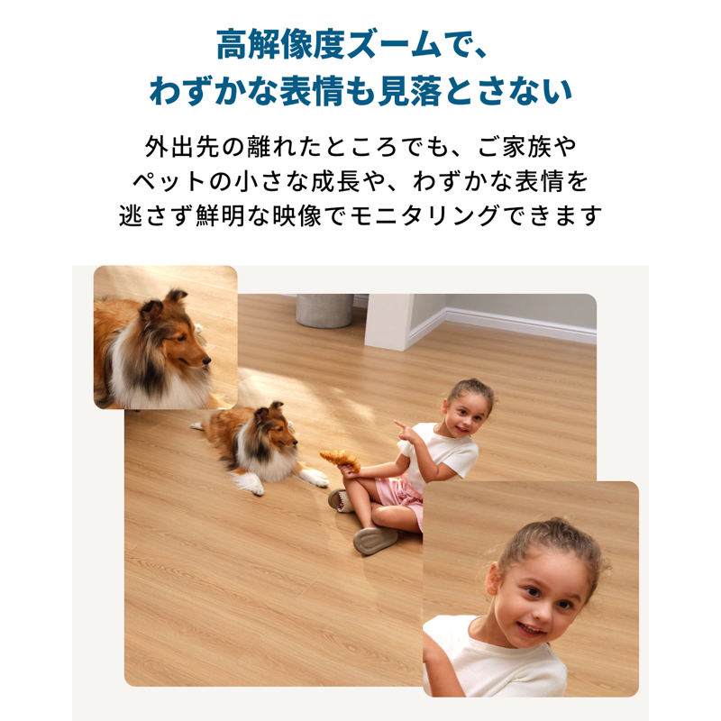
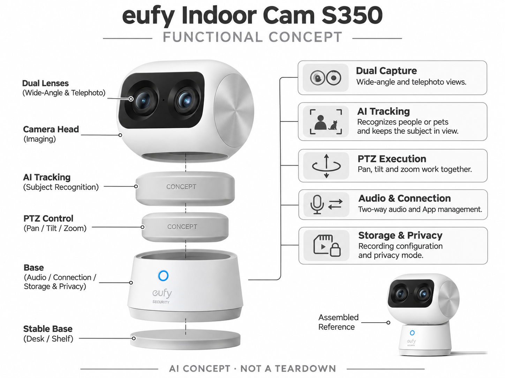

# eufy Indoor Cam S350

**eufy** · 家庭安防 · 核查 2026-11-04

用双镜头和AI跟随观察家庭活动

消费渠道：个人零售。

## 产品图片与结构参考

### 产品图

eufy Indoor Cam S350 官方产品图 · 来源：[eufy · 官方图片](<https://www.ankerjapan.com/products/t8416>) · [原始图片](<https://cdn.shopify.com/s/files/1/0508/4381/2001/files/T8416_MAIN.png?v=1698630275&width=1200>)

### 参考图

eufy Indoor Cam S350 官方外观、结构或使用参考 · 来源：[eufy · 官方图片](<https://www.ankerjapan.com/products/t8416>) · [原始图片](<https://cdn.shopify.com/s/files/1/0508/4381/2001/files/T8416_1.png?v=1698630275&width=1200>)

### AI 生成爆炸示意

**AI 生成 · 非实物拆机。** 内部为概念推断，不能作为元件布局、BOM 或维修依据。[生成提示词](../../content/hardware/prompts/eufy-indoor-cam-s350.txt)

> 依据官方外观参考与公开功能生成；未披露的内部布局只作概念模块，不构成BOM或真实结构证据。

> 保留官方图片原始内容和出处；画面宣传参数不是本轮独立实测。

> 分析为基于公开资料的案头研究与 AI 辅助判断，未经用户访谈、销量审计或实物拆机。需求、画像、竞争冷门度、审美及商业机会均为研究假设，不是投资结论。

## 销售与购买

- 状态：在售。Anker日本官方商店显示在庫わずか、カートに入れる和价格，按单机收录；其他地区库存需另查。

- 地区：日本官方商店

- 价格：¥14,990（日元）。核查时官方地区参考价，保留原币种；订阅、税运、附件及优惠以结账为准，预订定金不等于整机价格。

- 中国大陆：本轮核实所列海外官方渠道；中国大陆同型号现货、保修及服务可用性未确认。进口前需核对供电、网络、配件和地区条款。

- [官方产品 / 商店](<https://www.ankerjapan.com/products/t8416>)

## AI 的实际作用

双镜头结合AI主体跟踪，云台与变焦保持家人或宠物在画面内；普通转动、录像和网络连接不作为AI证据。

服务与联网依赖：App用于配置和远程查看，可结合HomeBase 3；云备份和带缩略图通知可能上传内容，不能笼统声称全部数据只在本地。

## 是否冷门

竞争密集（研究判断）：室内AI摄像头竞争激烈，双镜跟随是特定交互路线，不能仅因硬件复杂就判断为冷门。

## 需求与市场

需求假设：固定室内摄像头容易丢失移动宠物或家人，用户希望回看时能看清主体。应测试跟随是否及时、是否频繁切错目标，以及用户是否需要全景背景，不能只看自动变焦演示。

## 用户画像

画像推断：有宠物或需要查看共享空间的家庭，愿意把摄像头固定在可供电位置。多人同时活动时需求不同，购买者也需要取得其他住户对录像的理解，不能默认全天跟随被所有人接受。

## 竞争与替代

竞争判断：与Tapo、小米和Aqara云台摄像头竞争，双镜头加跟随是具体差异。较高价格需要由成像和实际事件记录支撑，已有家庭生态、存储方式和隐私开关也会影响更换决策。

## 供应链

供应链分析：广角与长焦模组、云台电机、音频、无线和本地存储需协调，工厂及BOM未披露。镜头标定、机械耐久、回声处理和固件维护是持续成本，双镜头并非简单把两个模组相加。

## 技术路径

官方明确AI跟踪控制平移、俯仰和变焦。技术判断：遮挡、多人交叉和宠物快速移动可能使跟踪切换，保持目标在画面不等于理解行为；不能将无关HomeBase功能自动归给单机。

## 产品审美

审美判断：双眼式镜头结构很容易被注意到，放在家庭书架时要兼顾视野和被观察感。隐私模式转向与状态提示应直观，电源线、底座稳定和清洁方便程度也影响长期接受度。

## 关键风险

风险判断：跟随可能离开用户关心的原始视角，不能保证同时覆盖多个事件。云备份与缩略图服务涉及上传，账号共享、家庭隐私和网络中断需要管理，设备不能替代照护或安全责任。

## 机会与验证

机会假设：研究宠物快速走动或大客厅的实际拍摄遗漏，比较单镜头广角与双镜跟随的有效片段。若用户常关闭自动跟踪，优化固定视角和事件回放可能比更多运动控制更有效。

## 功能分层示意

这是功能关系，不是实物拆机、真实空间结构或已核实 BOM。

1. **双镜采集**：广角与长焦视角。（官方披露）

2. **AI跟踪**：识别人或宠物并保持主体。（官方披露）

3. **云台执行**：平移、俯仰和变焦配合。（官方披露）

4. **音频连接**：双向声音与App管理。（官方披露）

5. **存储隐私**：录像配置与隐私模式。（官方披露）

## 来源

1. [eufy Indoor Cam S350 官方购买页](<https://www.ankerjapan.com/products/t8416>) — 实际打开核查当前购买或预订入口，未实际下单；价格与交付按具体地区。

2. [eufy S350 官方AI跟踪说明](<https://us.eufy.com/pages/indoorcam-s350>) — 实际打开的官方技术与使用资料，宣传效果并非本轮独立实测。

[返回目录](../hardware-market.md) · [网页分析](https://romanagent.github.io/Roman/#hardware/product/eufy-indoor-cam-s350)
