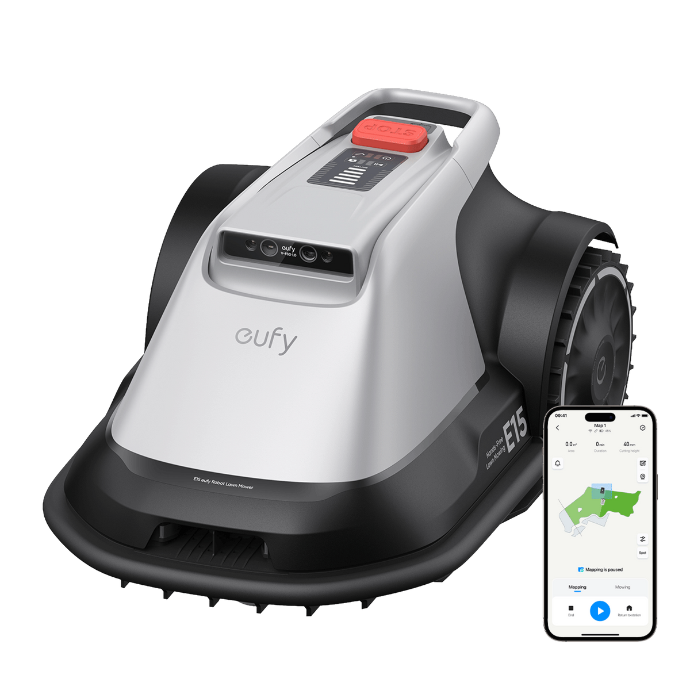
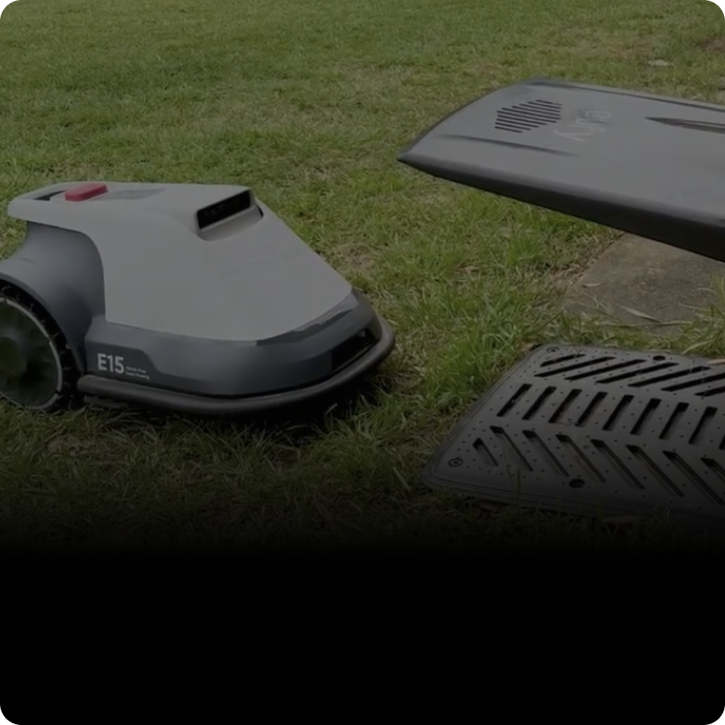
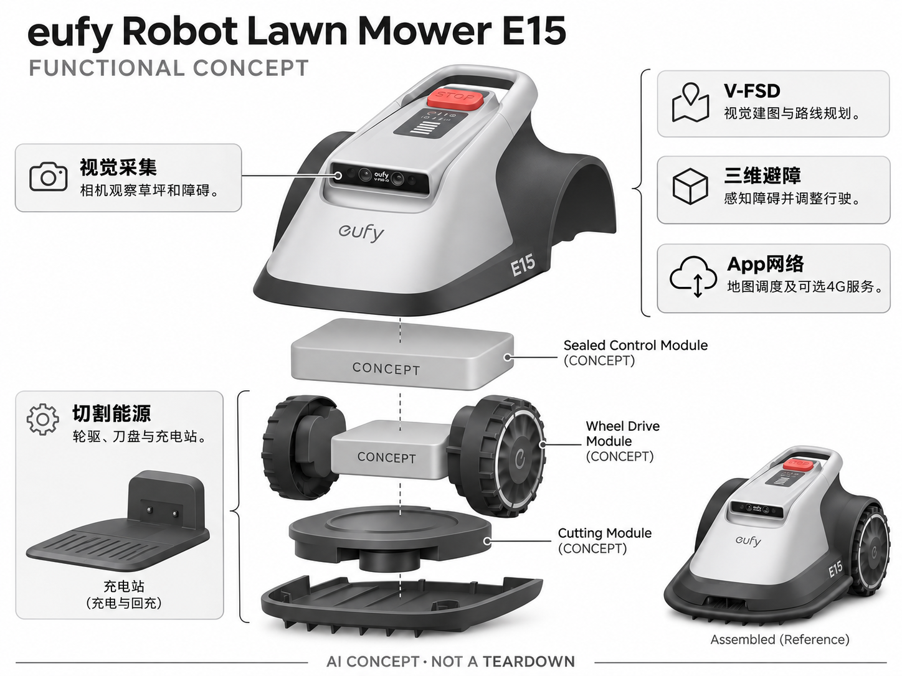

# eufy Robot Lawn Mower E15

**eufy** · 庭院与自然 · 核查 2026-11-04

用纯视觉降低家庭机器人割草的安装负担

消费渠道：个人零售。

## 产品图片与结构参考

### 产品图

eufy Robot Lawn Mower E15 官方产品图 · 来源：[eufy · 官方图片](<https://www.eufy.com/eu-en/products/t2880ga1>) · [原始图片](<https://cdn.shopify.com/s/files/1/0555/1167/9128/files/E15_-_-12001.png?v=1773714865&width=1200>)

### 参考图

eufy Robot Lawn Mower E15 官方外观、结构或使用参考 · 来源：[eufy · 官方图片](<https://www.eufy.com/products/t28801a1?ref=robot-lawn-mower-e-series>) · [原始图片](<https://cdn.shopify.com/s/files/1/0521/9411/5753/files/Frame_2121236203_3840x.png?alt=eufy+E15+robotic+mower+with+charging+pads+for+grass&v=1750142724&width=1200>)

### AI 生成爆炸示意

**AI 生成 · 非实物拆机。** 内部为概念推断，不能作为元件布局、BOM 或维修依据。[生成提示词](../../content/hardware/prompts/eufy-lawn-mower-e15-assist-creative-repair.txt)

> 已目视核对型号、外形、功能标签与非拆机声明；内部模块为概念，不代表实测结构。

> 使用更正后的E15官方主图；AI规划在外部说明，机内仅标概念控制模块。功能说明采用中英标签。

> 保留官方图片原始内容和出处；画面宣传参数不是本轮独立实测。

> 分析为基于公开资料的案头研究与 AI 辅助判断，未经用户访谈、销量审计或实物拆机。需求、画像、竞争冷门度、审美及商业机会均为研究假设，不是投资结论。

## 销售与购买

- 状态：在售。官方E15商品页显示Add to Cart、Buy Now及价格；本条只计E15，不把覆盖面积不同的E18另计一款。

- 地区：美国官方商店

- 价格：US$1,799.99。核查时官方地区参考价，保留原币种；订阅、税运、附件及优惠以结账为准，预订定金不等于整机价格。

- 中国大陆：本轮核实所列海外官方渠道；中国大陆同型号现货、保修及服务可用性未确认。进口前需核对供电、网络、配件和地区条款。

- [官方产品 / 商店](<https://www.eufy.com/products/t28801a1?ref=robot-lawn-mower-e-series>)

## AI 的实际作用

V-FSD纯视觉路线使用相机进行环境理解、三维障碍感知、自动建图与割草路径规划，不需要埋边界线或RTK基站。

服务与联网依赖：仍需App配置、合适草种与草坪条件；网络覆盖不足时可选4G订阅，弱光或雨天回站不等于全天候自主。

## 是否冷门

细分专业（研究判断）：纯视觉割草在家庭庭院中相对细分，但已有多品牌；草坪适配与维护服务决定真实门槛。

## 需求与市场

需求假设：房主希望自动割草，但不愿埋线或安装卫星定位天线。应测试开箱建图、季节变化和地图恢复所需劳动，免RTK不意味着所有庭院都无需准备或任何边界都能识别。

## 用户画像

画像推断：有较平整小庭院、草种符合限制并愿意按App管理的家庭，可能第一次尝试机器人割草。高坡、密草和复杂边缘用户需要其他方案，不能把最大面积参数等同所有地形的适用性。

## 竞争与替代

竞争判断：与TerraMow纯视觉、Navimow融合定位及传统手推工具竞争。安装简单是价值主张，但光线、边界和草种限制需要一同比较，用户最终购买的是稳定的庭院维护而不是导航名词。

## 供应链

供应链分析：相机、处理单元、轮驱、刀盘、电池和充电站构成系统，实际工厂及BOM未知。镜头污染、户外密封、刀片供应和季节保养关系到交付质量，不能只按室内机器人经验估算。

## 技术路径

官方将E15称为视觉AI割草机，披露V-FSD和三维障碍感知。技术判断：草坪边缘、阴影和低矮物体增加识别挑战，应验证低置信时的安全行为；不能把免RTK等同完全不依赖环境条件。

## 产品审美

审美判断：较简洁机身和无需定位天线降低庭院设备感，但充电站、线缆和安全停止按钮仍需清晰。泥草附着后是否易清洁、提取和冬季收纳，比宣传图中的平滑外壳更影响日常体验。

## 关键风险

风险判断：官网明确草高、坡度、草种与地面条件限制，必须按实际院落核对。刀盘与自主移动不能只依靠AI避开孩子或动物，4G服务、雨天中断和低光回站也会改变维护频率。

## 机会与验证

机会假设：在小而规则的住宅草坪验证纯视觉是否减少安装成本，记录边缘补割和接管次数。若大部分麻烦来自维护，完善草种选型与季节指导可能比增加覆盖面积更有实际竞争力。

## 功能分层示意

这是功能关系，不是实物拆机、真实空间结构或已核实 BOM。

1. **视觉采集**：相机观察草坪和障碍。（官方披露）

2. **V-FSD**：视觉建图与路线规划。（官方披露）

3. **三维避障**：感知障碍并调整行驶。（官方披露）

4. **切割能源**：轮驱、刀盘与充电站。（官方披露）

5. **App网络**：地图调度及可选4G服务。（官方披露）

## 来源

1. [eufy Robot Lawn Mower E15 官方购买页](<https://www.eufy.com/products/t28801a1?ref=robot-lawn-mower-e-series>) — 实际打开核查当前购买或预订入口，未实际下单；价格与交付按具体地区。

2. [eufy E系列官方视觉导航说明](<https://www.eufy.com/robot-lawn-mower-e-series?wvideo=akzb57a5z3>) — 实际打开的官方技术与使用资料，宣传效果并非本轮独立实测。

[返回目录](../hardware-market.md) · [网页分析](https://romanagent.github.io/Roman/#hardware/product/eufy-lawn-mower-e15)
