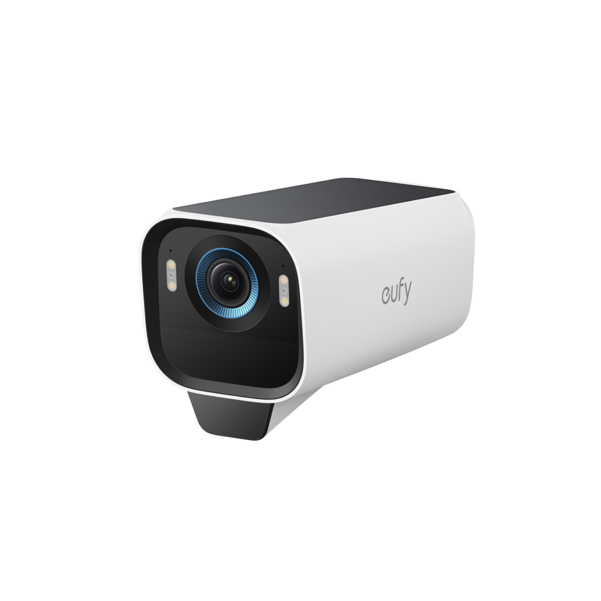
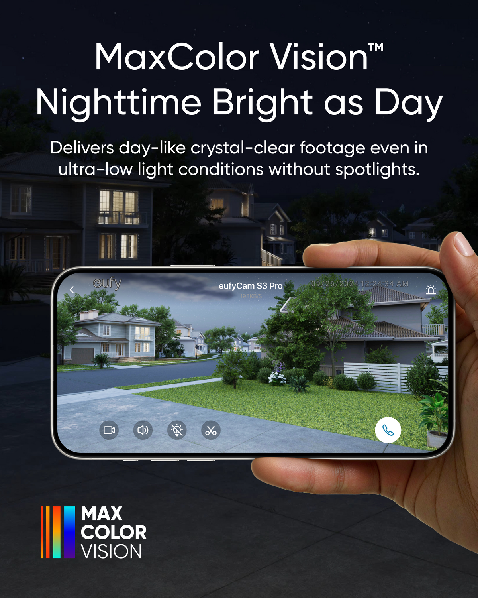
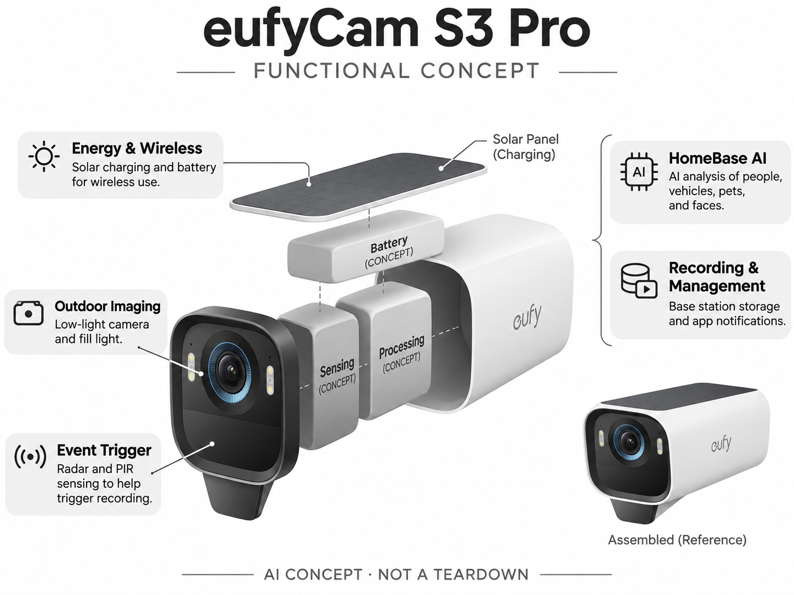

# eufyCam S3 Pro

**eufy** · 家庭安防 · 核查 2026-11-04

以低光成像和家庭本地识别连接户外事件

消费渠道：个人零售。

## 产品图片与结构参考

### 产品图

eufyCam S3 Pro 官方产品图 · 来源：[eufy · 官方图片](<https://www.eufy.com/eu-en/products/t81623w1>) · [原始图片](<https://cdn.shopify.com/s/files/1/0555/1167/9128/files/T8162.png?v=1727237553&width=1200>)

### 参考图

eufyCam S3 Pro 官方外观、结构或使用参考 · 来源：[eufy · 官方图片](<https://www.eufy.com/eu-en/products/t81623w1>) · [原始图片](<https://cdn.shopify.com/s/files/1/0504/7094/4954/files/T8162_T8892_T8893_T8894_US_TD02_V1.png?v=1727150321&width=1200>)

### AI 生成爆炸示意

**AI 生成 · 非实物拆机。** 内部为概念推断，不能作为元件布局、BOM 或维修依据。[生成提示词](../../content/hardware/prompts/eufycam-s3-pro-assist-creative.txt)

> 已目视核对型号、外形、功能标签与非拆机声明；内部模块为概念，不代表实测结构。

> 保留官方图片原始内容和出处；画面宣传参数不是本轮独立实测。

> 分析为基于公开资料的案头研究与 AI 辅助判断，未经用户访谈、销量审计或实物拆机。需求、画像、竞争冷门度、审美及商业机会均为研究假设，不是投资结论。

## 销售与购买

- 状态：在售。欧洲官网单摄像头页显示Add to Cart、Buy Now和€279；对应整套配置另售，不把不同摄像头数量套装重复收录。

- 地区：欧洲官方商店

- 价格：€279单摄像头；HomeBase需另配。核查时官方地区参考价，保留原币种；订阅、税运、附件及优惠以结账为准，预订定金不等于整机价格。

- 中国大陆：本轮核实所列海外官方渠道；中国大陆同型号现货、保修及服务可用性未确认。进口前需核对供电、网络、配件和地区条款。

- [官方产品 / 商店](<https://www.eufy.com/eu-en/products/t81623w1>)

## AI 的实际作用

HomeBase系统结合AI识别人脸、人物、车辆与宠物，摄像头提供低光画面，雷达与PIR辅助触发；太阳能充电本身不是AI。

服务与联网依赖：单摄像头需要兼容HomeBase系统；本地存储与云备份选项不同，太阳能补能取决于安装光照。

## 是否冷门

竞争密集（研究判断）：家庭户外安防是成熟拥挤赛道，太阳能低光加本地AI是系统路线，不代表没有替代。

## 需求与市场

需求假设：房主希望在夜间看清门廊和庭院活动，同时减少风吹树动导致的提醒。应分别测量夜间图像可辨认性和AI事件判断，亮画面并不代表每次目标都能被识别或通知。

## 用户画像

画像推断：有庭院、门廊或车道且愿布置HomeBase的家庭，尤其想减少电源布线者。太阳能条件、网络距离和季节光照不同，公寓内或长期遮阴位置未必适合相同方案。

## 竞争与替代

竞争判断：与Arlo电池相机、Ring和有线PoE设备竞争，本地系统与低光成像提供差异。用户需要比较整套基站成本、扩展和维修，不能拿单摄像头价格对比别人可独立工作的完整方案。

## 供应链

供应链分析：光学成像、补光、雷达/PIR、太阳能、电池和无线系统共同工作，工厂及BOM未知。户外密封、充电温度、基站兼容和长期电池更换决定售后负担，不能只计算摄像模组。

## 技术路径

官方说明人脸与对象AI识别及自学习系统。技术判断：事件触发、目标识别和身份判断是不同步骤，应验证跨摄像头一致性；低光增强可能改变细节，不能把宣传样片当作任意夜间条件的保证。

## 产品审美

审美判断：白色机身与深色前脸具有明确安防属性，太阳能与支架安装会影响外墙观感。清晰状态、适当补光和简洁走线比装饰性设计更实际，设备位置也要兼顾维护时的可达性。

## 关键风险

风险判断：单机需要HomeBase，未配齐系统无法获得完整功能；日照不足可能需要人工补电。人脸误判、邻居隐私和服务变化需管理，AI告警不能作为防盗或人身安全的保证。

## 机会与验证

机会假设：以住宅安装条件和夜间误报为研究入口，比较用户整季维护投入。若核心痛点是联网和补电，可优先做选址、安装与电池维护服务，而非不断增加更难解释的识别类别。

## 功能分层示意

这是功能关系，不是实物拆机、真实空间结构或已核实 BOM。

1. **户外成像**：低光相机与补光。（官方披露）

2. **事件触发**：雷达及PIR感知。（官方披露）

3. **HomeBase AI**：人物、车辆、宠物与人脸分析。（官方披露）

4. **能源无线**：太阳能补能和电池。（官方披露）

5. **记录管理**：基站存储与App通知。（官方披露）

## 来源

1. [eufyCam S3 Pro 官方购买页](<https://www.eufy.com/eu-en/products/t81623w1>) — 实际打开核查当前购买或预订入口，未实际下单；价格与交付按具体地区。

2. [eufy S3 Pro 官方识别与系统说明](<https://www.eufy.com/eufycam-pro>) — 实际打开的官方技术与使用资料，宣传效果并非本轮独立实测。

[返回目录](../hardware-market.md) · [网页分析](https://romanagent.github.io/Roman/#hardware/product/eufycam-s3-pro)
