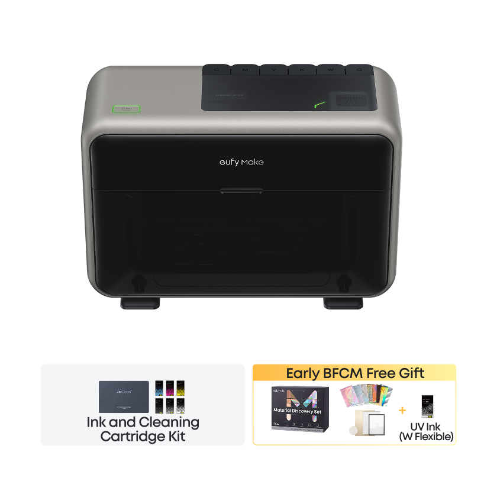
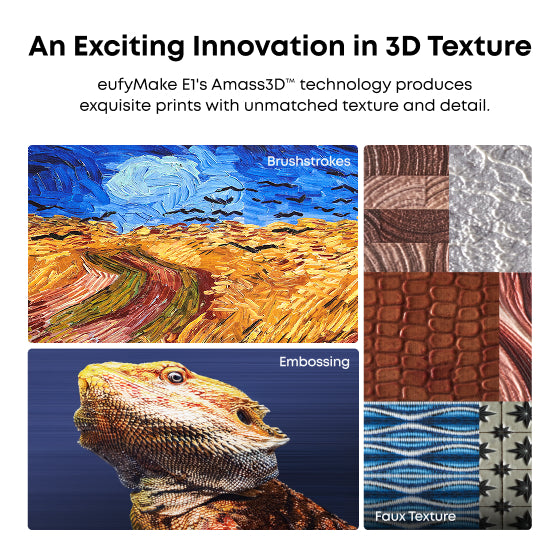
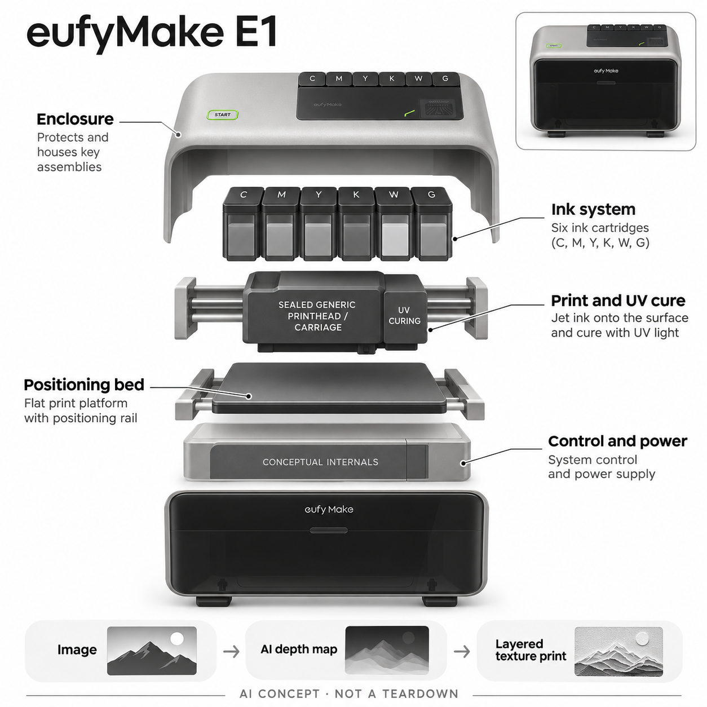

# eufyMake E1

**eufyMake** · 专业兴趣工具 · 核查 2026-11-05

将图片深度图变成可触摸纹理的桌面UV打印机

消费渠道：个人零售。

## 产品图片与结构参考

### 产品图

eufyMake E1 官方基础组合图（下方含当期促销赠品，按实际订单核对） · 来源：[eufyMake · 官方资料](<https://www.eufymake.com/products/eufymake-e1>) · [原始图片](<https://cdn.shopify.com/s/files/1/0606/0323/6501/files/V8260_TD013_V1_a78d78f5-414e-4ab2-b3f9-646996530a16_3838x.png?v=1793245618&width=1600>)

### 参考图

eufyMake E1 官方纹理输出示例（厂商展示，非本站实测） · 来源：[eufyMake · 官方资料](<https://www.eufymake.com/products/eufymake-e1>) · [原始图片](<https://cdn.shopify.com/s/files/1/0606/0323/6501/files/V8260_TD03_V1_ab6711c7-a985-40de-8435-08111c4a0d8a_3838x.jpg?v=1792374945&width=1600>)

### AI 生成爆炸示意

**AI 生成 · 非实物拆机。** 内部为概念推断，不能作为元件布局、BOM 或维修依据。[生成提示词](../../content/hardware/prompts/eufymake-e1.txt)

> 以已目视核对的官方图片独立生成并完成目视QA；未知内部只作功能概念，不是实际PCB、拆机或供应商BOM。

> 保留官方图片原貌；其中宣传效果或数据不代表本站独立测量。

> 分析为基于公开资料的案头研究与 AI 辅助判断，未经用户访谈、销量审计或实物拆机。需求、画像、竞争冷门度、审美及商业机会均为研究假设，不是投资结论。

## 销售与购买

- 状态：在售。核查日美国官方商品页Basic Bundle显示US$2,409、In stock and ready to ship及Add to Cart；基础组合为E1与墨水套装。旋转配件、覆膜机和卷材配件属于其它组合，不混写为标配。

- 地区：美国（已核官方商店）

- 价格：美国官网Basic Bundle促销US$2,409。核查日页面与优惠码WS24e1basic对应价；区域、税费、材料及后续耗材成本另计。

- 中国大陆：本轮未确认中国大陆官方零售、耗材和喷头服务；海外站现货不能证明国内送达与保修。

- [官方产品 / 商店](<https://www.eufymake.com/products/eufymake-e1>)

## AI 的实际作用

官方Wiki说明软件用AI从原图生成深度图，再按用户指定纹理高度计算层数与颜色图，驱动UV喷墨逐层形成表面起伏。

服务与联网依赖：AI属于印前软件流程，需与打印、材料定位、白墨及光油叠层配合；具体模型和处理部署未披露。普通相机定位与激光测高不单独当成AI。

## 是否冷门

新兴竞争（研究判断）：个人纹理UV打印有明确输出差异，但专业UV服务和其它桌面制造已形成替代；冷门不能推断低交付难度。

## 需求与市场

案头需求是让个人设计师把插画或照片变成小批量带触感的实体作品。价值不只是生成一张图，而是稳定地把深度、颜色和材料结合；重复打印成本及返工率比演示样片更有判断力。

### 事实：任务边界 · 官方资料

官方把E1定位为个人使用的纹理UV打印机，印前软件将图片转为深度图，再通过分层喷墨和固化形成表面起伏。当前基础套装有正式购买与现货信息；旋转加工、覆膜和卷材功能对应另购组合，不能当作同一价格的默认能力。

依据：[eufyMake E1美国官方商店](<https://www.eufymake.com/products/eufymake-e1>) · [eufyMake UV打印官方技术介绍](<https://wiki.eufymake.com/en/uvprinter-introduction>)

### 判断：真实需求 · 研究判断

案头判断，它主要满足小批量作品的颜色与触感同时定制，而非制作承重立体零件。对个人创作者，购买理由可能来自重复打样速度和掌握交付时间；若每月只做少量纪念品，外包加工仍可能更合理，不能由桌面化推断人人需要自购。

依据：[eufyMake E1美国官方商店](<https://www.eufymake.com/products/eufymake-e1>) · [eufyMake UV打印官方技术介绍](<https://wiki.eufymake.com/en/uvprinter-introduction>)

### 验证：任务完成 · 待验证

验证应让参与者带自己的插画和目标材料，完成印前、首件、重复件及清洁全过程。记录失败位置、重新设计次数和材料耗用，询问愿意为哪些触感效果支付差价，并与外包同类样品比较交期；仅观察展会演示不足以判断持续需求。

依据：[eufyMake E1美国官方商店](<https://www.eufymake.com/products/eufymake-e1>) · [eufyMake UV打印官方技术介绍](<https://wiki.eufymake.com/en/uvprinter-introduction>)

## 用户画像

潜在用户是有独立操作空间、持续做定制礼物或样品的个人创作者。只偶尔打印一件纪念品的人可能外包更合算；是否接受耗材管理、设备清洁和材料测试影响购买适配。

### 事实：使用条件 · 官方资料

商品页展示创作和定制用途，基础机器需要搭配墨水、工作材料与软件操作，售后还区分主机和喷头条款。它属于个人可购买的创作设备，但当前已核零售是美国站；本轮没有确认大陆耗材、喷头更换和授权维修服务，不能写成国内即买即用。

依据：[eufyMake E1美国官方商店](<https://www.eufymake.com/products/eufymake-e1>) · [eufyMake UV打印官方技术介绍](<https://wiki.eufymake.com/en/uvprinter-introduction>)

### 判断：人群筛选 · 研究判断

更适合有稳定工作台、持续项目和材料试验意愿的个人设计师或小型工作室操作者。只有绘图能力不一定能完成物料管理与维护；反过来，已有打印服务经验的人也可能缺少可收费的原创内容，用户筛选应看整个交付任务而非职业名片。

依据：[eufyMake E1美国官方商店](<https://www.eufymake.com/products/eufymake-e1>) · [eufyMake UV打印官方技术介绍](<https://wiki.eufymake.com/en/uvprinter-introduction>)

### 验证：参与者差异 · 待验证

访谈可询问过去三次定制作品如何制作、哪一步最慢、能否接受一次失败损失和多久愿意清理设备。让偶尔手作、持续接单和专业印刷背景的人分别试用，比较谁能独立恢复错误状态，避免把厂商面向新手的定位当成已验证的人群结论。

依据：[eufyMake E1美国官方商店](<https://www.eufymake.com/products/eufymake-e1>) · [eufyMake UV打印官方技术介绍](<https://wiki.eufymake.com/en/uvprinter-introduction>)

## 竞争与替代

它与普通彩色打印、外包UV服务和桌面制造工具竞争，输出是表面图像与触感而非任意立体零件。和激光雕刻相比材料作用方式不同，不宜按同为创客设备直接比较价格。

### 事实：方案范围 · 官方资料

已核原理是UV喷墨逐层固化，和热塑丝材挤出的三维打印、用能量去除材料的雕刻机有明显区别。E1的AI进入图片到纹理层的准备环节；普通彩色图案输出以及相机定位本身，不能单独证明它比其它加工路线更适合具体作品。

依据：[eufyMake E1美国官方商店](<https://www.eufymake.com/products/eufymake-e1>) · [eufyMake UV打印官方技术介绍](<https://wiki.eufymake.com/en/uvprinter-introduction>)

### 判断：替代关系 · 研究判断

竞争分析应围绕输出要求展开：若客户只需要平面色彩，普通印刷和外包就可能足够；若强调切割或结构零件，其他工具更直接。可触纹理是值得验证的差异，但消费者是否在礼品、模型或装饰品中持续重视它，现有资料没有答案。

依据：[eufyMake E1美国官方商店](<https://www.eufymake.com/products/eufymake-e1>) · [eufyMake UV打印官方技术介绍](<https://wiki.eufymake.com/en/uvprinter-introduction>)

### 验证：比较方法 · 待验证

选择同一张设计稿，分别做平面彩印、E1纹理样品和外包UV版本，盲测用户是否能说出有用差异及愿付价格。比较必须包含图像修正、材料准备和返工成本，不只比较机器标价；也不把更高凸起或更多宣传材料种类直接视作优势。

依据：[eufyMake E1美国官方商店](<https://www.eufymake.com/products/eufymake-e1>) · [eufyMake UV打印官方技术介绍](<https://wiki.eufymake.com/en/uvprinter-introduction>)

## 供应链

系统涉及喷墨、UV固化、定位运动、相机测高与墨路维护，喷头和工厂未披露。候选电机或视觉公司仅供工程匹配；耗材稳定供应与清洗停机时间也应进入交付评估。

### 事实：功能组成 · 官方资料

官方技术介绍披露压电喷墨、UV固化、相机和测高配合定位，以及墨路清洁等功能组成；没有披露实际喷头厂商、运动电机或整机工厂。目录中关联的视觉、运动和结构公司属于能力候选，不能据此声称它们给E1供货或参与联合开发。

依据：[eufyMake E1美国官方商店](<https://www.eufymake.com/products/eufymake-e1>) · [eufyMake UV打印官方技术介绍](<https://wiki.eufymake.com/en/uvprinter-introduction>)

### 判断：交付约束 · 研究判断

工程判断，交付难点横跨墨水化学、喷头可靠性、运动一致性和材料表面处理。即使机电部分可采购，断墨、喷头闲置维护和不同批次材料的附着变化仍会影响交付；供应链评估需把耗材补货与维修时效放进总成本，而非只估一次性部件。

依据：[eufyMake E1美国官方商店](<https://www.eufymake.com/products/eufymake-e1>) · [eufyMake UV打印官方技术介绍](<https://wiki.eufymake.com/en/uvprinter-introduction>)

### 验证：选型缺口 · 待验证

样机阶段应确认墨水储存与更换流程、清洁废料处理、长时间停用后恢复及喷头更换价格。对候选厂商提供明确的运动范围、视觉对象和结构公差再询价，要求验证记录；未拿到实际拆机或品牌采购披露前，始终保留候选关系标记。

依据：[eufyMake E1美国官方商店](<https://www.eufymake.com/products/eufymake-e1>) · [eufyMake UV打印官方技术介绍](<https://wiki.eufymake.com/en/uvprinter-introduction>)

## 技术路径

已核AI机制是图片生成深度图并转化为纹理层，不把所有自动校准统称智能。机器仍需正确材料、摆放和印前参数；AI生成的凹凸不必然符合原物体真实几何或用户触感预期。

### 事实：AI机制 · 官方资料

官方Wiki说明软件从原始图像生成深度图，再依据用户选择的纹理高度计算打印层和颜色数据，机器将白墨、颜色与光油逐层落实。这里的AI作用是把二维素材转成印前深度信息；成品高度并不是从真实物体直接测得的三维几何真值。

依据：[eufyMake E1美国官方商店](<https://www.eufymake.com/products/eufymake-e1>) · [eufyMake UV打印官方技术介绍](<https://wiki.eufymake.com/en/uvprinter-introduction>)

### 判断：系统边界 · 研究判断

分析上，模型可能把阴影、反光或绘画笔触误判成高低关系，导致视觉上合理但触摸不自然的纹理。用户仍需要预览和修改深度，对照原稿决定何处保留平面；机械定位和固化质量也可能掩盖算法收益，因此不能把整个流程改善都归因于AI。

依据：[eufyMake E1美国官方商店](<https://www.eufymake.com/products/eufymake-e1>) · [eufyMake UV打印官方技术介绍](<https://wiki.eufymake.com/en/uvprinter-introduction>)

### 验证：算法与体验 · 待验证

技术验证可用照片、平面插画、文字和已有人工深度图分别打印，保存输入、自动深度和人工修正版本。检查文字边缘、渐变与重复纹理是否出现伪影，再比较触感和返工时间；报告应标注模型版本和材料条件，避免用厂商精选样片代替实测。

依据：[eufyMake E1美国官方商店](<https://www.eufymake.com/products/eufymake-e1>) · [eufyMake UV打印官方技术介绍](<https://wiki.eufymake.com/en/uvprinter-introduction>)

## 产品审美

灰色圆角机壳与深色前窗接近桌面家电，但打印床、进料和清洁需要工作台空间。分析上，设计的关键是让用户看懂加工状态与耗材剩余，不能仅凭封闭外观判断适合任何房间。

### 事实：外观与交互 · 官方资料

真实官方图显示灰色圆角机身、深色前窗和顶部墨盒区域，产品以封闭桌面形态呈现加工过程。页面也展示纹理输出样品，帮助解释机器用途；这些厂商素材不是拆机证据，因此生成图只分离大类功能，不声称内部导轨与墨路真实布置。

依据：[eufyMake E1美国官方商店](<https://www.eufymake.com/products/eufymake-e1>) · [eufyMake UV打印官方技术介绍](<https://wiki.eufymake.com/en/uvprinter-introduction>)

### 判断：使用中的形态 · 研究判断

外观分析应关注用户能否看清状态、识别需要维护的位置，以及工作台是否留出上料和开门空间。接近家电的外壳可能减少操作畏惧，也可能让人低估耗材与加工条件；设计若能解释准备、打印、固化和清洁阶段，会比装饰灯光更有价值。

依据：[eufyMake E1美国官方商店](<https://www.eufymake.com/products/eufymake-e1>) · [eufyMake UV打印官方技术介绍](<https://wiki.eufymake.com/en/uvprinter-introduction>)

### 验证：日常接受度 · 待验证

现场观察时让初次使用者在不额外讲解的情况下找到材料入口、墨水状态和停止操作的方法，记录疑惑发生的位置。再观察连续数次任务后的工作台布置和清洁动作，询问设备是否愿意保持可见；不能仅依据渲染图判断家居融入或长期可维护性。

依据：[eufyMake E1美国官方商店](<https://www.eufymake.com/products/eufymake-e1>) · [eufyMake UV打印官方技术介绍](<https://wiki.eufymake.com/en/uvprinter-introduction>)

## 关键风险

主要风险是材料附着失败、喷头维护、墨料暴露及误把装饰纹理当结构件。官方主机与喷头保修期限不同，购买前需读当前条款；不由厂商环保宣传推导无需通风或任意接触安全。

### 事实：已知限制 · 官方资料

当前商品页对主机与喷头给出不同保修期限，说明需要逐项阅读现行条款；耗材和材料也有独立条件。官方提到清洁系统，但并没有由此承诺无需维护；对墨水、固化与材料使用的安全边界，应以实际说明书和供应条件确认，不能自行扩大。

依据：[eufyMake E1美国官方商店](<https://www.eufymake.com/products/eufymake-e1>) · [eufyMake UV打印官方技术介绍](<https://wiki.eufymake.com/en/uvprinter-introduction>)

### 判断：失效影响 · 研究判断

风险判断包括不合适材料导致附着失败、墨水消耗超出预期、闲置造成恢复成本，以及把装饰涂层当作可受力或可任意接触的结构件。AI生成深度图还可能破坏细文字和原图含义；一次漂亮样片无法覆盖这些长期运营和作品交付风险。

依据：[eufyMake E1美国官方商店](<https://www.eufymake.com/products/eufymake-e1>) · [eufyMake UV打印官方技术介绍](<https://wiki.eufymake.com/en/uvprinter-introduction>)

### 验证：风险处理 · 待验证

应建立不同失败状态的恢复记录，确认退换货是否涵盖已使用耗材、喷头怎样判定损坏及跨境维修运费。测试作品按实际使用情境核查耐磨和附着，未经对应验证不声明食品接触、儿童接触或其它安全用途；这属于验证计划而非已完成认证。

依据：[eufyMake E1美国官方商店](<https://www.eufymake.com/products/eufymake-e1>) · [eufyMake UV打印官方技术介绍](<https://wiki.eufymake.com/en/uvprinter-introduction>)

## 机会与验证

机会假设在小批量定制与模板化材料工作流。可让创作者连续制作一组同图不同材质样片，记录设计修正、失败、清洗及总成本，再核验是否比外包更快且愿意持续付费。

### 判断：可尝试切口 · 研究判断

机会假设在为个人创作者提供可复用的材料参数、深度编辑模板和清晰维护指引，帮助他们把一次效果演示变成可重复作品。更具体的切口是客户确实愿意为触感付费的小批量定制，而不是把所有彩色印刷需求都重新包装成必须购买新设备。

依据：[eufyMake E1美国官方商店](<https://www.eufymake.com/products/eufymake-e1>) · [eufyMake UV打印官方技术介绍](<https://wiki.eufymake.com/en/uvprinter-introduction>)

### 判断：商业边界 · 研究判断

商业分析应同时考虑机器利用率、墨水与清洁耗用、喷头维护、软件依赖和作品获客。若售价只能覆盖材料却无法覆盖失败和停机，增加销量也不等于模式成立；案头资料没有证明利润率或市场份额，不能用供应商参数或模型评分预测成功。

依据：[eufyMake E1美国官方商店](<https://www.eufymake.com/products/eufymake-e1>) · [eufyMake UV打印官方技术介绍](<https://wiki.eufymake.com/en/uvprinter-introduction>)

### 验证：下一步调研 · 待验证

建议先招募已有真实订单的创作者，用一月项目日志记录每件作品的设计、准备、打印、清洁与售后时间。访谈客户选择触感样品的原因，并核对退货与再次购买；达到可重复交付之后，再讨论设备服务、材料包或内容模板哪一种值得继续投入。

依据：[eufyMake E1美国官方商店](<https://www.eufymake.com/products/eufymake-e1>) · [eufyMake UV打印官方技术介绍](<https://wiki.eufymake.com/en/uvprinter-introduction>)

## 对应供应链公司

能力候选用于选型研究，不代表本产品实际采用；未公开的供货关系不作推断。

- [dings-motion](../supply-chain/dings-motion.md) — **能力候选 · 非已采用** / 平板定位运动候选：DINGS提供精密运动相关能力，可作为小型打印平台运动路线的询价候选；需要结合喷墨走位、重复定位和负载验证。官方没有点名E1电机来源，因此本关联不代表现有供货或任何具体型号兼容。

- [arducam](../supply-chain/arducam.md) — **能力候选 · 非已采用** / 印前定位视觉候选：Arducam有相机模组与定制工程能力，可用于评估桌面打印材料定位的视觉方案；光照、反光材料和视野仍需测试。E1未披露使用该品牌相机，本目录不把相似功能当作实际供应证明。

- [protolabs](../supply-chain/protolabs.md) — **能力候选 · 非已采用** / 外壳与平台结构打样候选：Protolabs的结构加工与快速打样能力可匹配机壳、支架及平台样件验证，不能覆盖UV墨水和喷头工艺本身。候选关联针对开发阶段的机械实现，未有证据说明其制造E1量产零件。

[浏览供应链目录](../supply-chain.md)

## 功能分层示意

这是功能关系，不是实物拆机、真实空间结构或已核实 BOM。

1. **印前AI**：原图生成深度图，结合纹理高度转为层与颜色数据。（官方披露）

2. **喷墨及固化**：压电喷墨配UV光固化，叠加白墨、颜色和光油形成纹理。（官方披露）

3. **定位与运动**：相机、测高及平板运动辅助准确落图；不是据此断言全部为AI。（官方披露）

4. **墨路维护**：墨水及自动清洁系统配合打印；喷头实际供应商未披露。（官方披露）

5. **内部示意边界**：结构图只拆分功能模块，不表示真实墨路、导轨或PCB布局。（分析推断）

## 来源

1. [eufyMake E1美国官方商店](<https://www.eufymake.com/products/eufymake-e1>) — 实际打开；核对基础组合现货、2409美元、选配区别和当前保修提示。

2. [eufyMake UV打印官方技术介绍](<https://wiki.eufymake.com/en/uvprinter-introduction>) — 实际在浏览器打开并读取；AI深度图、层计算、压电喷墨、UV固化和自动定位机制。

[返回目录](../hardware-market.md) · [网页分析](https://romanagent.github.io/Roman/#hardware/product/eufymake-e1)
