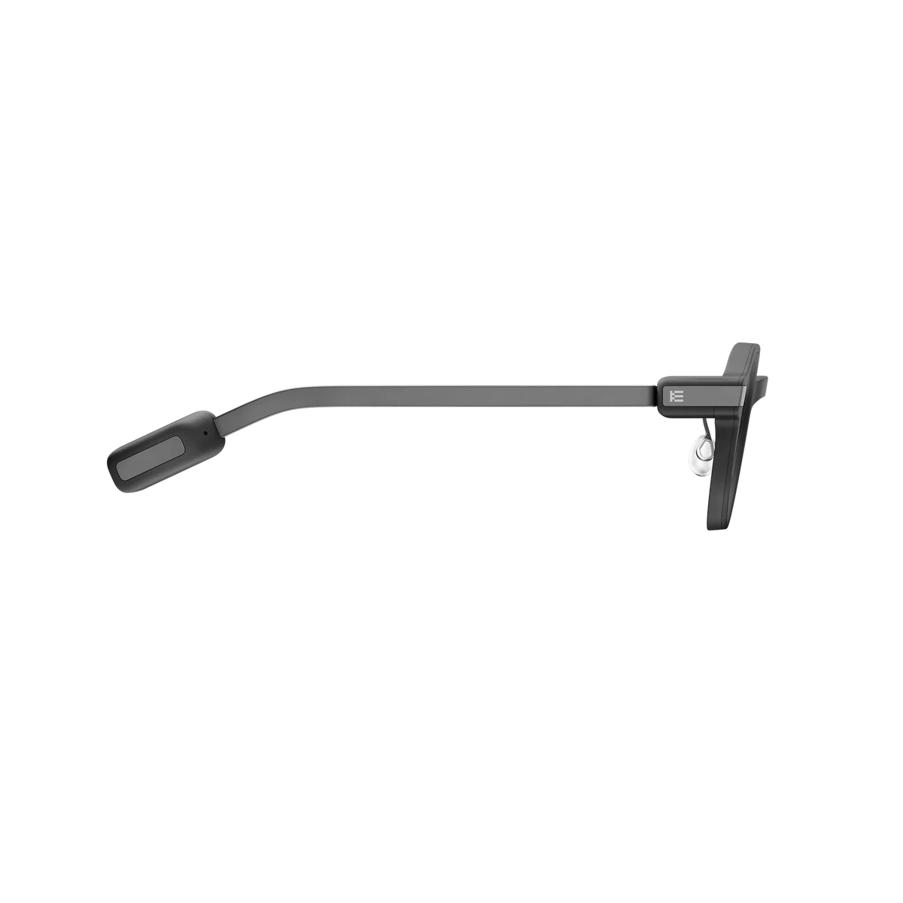
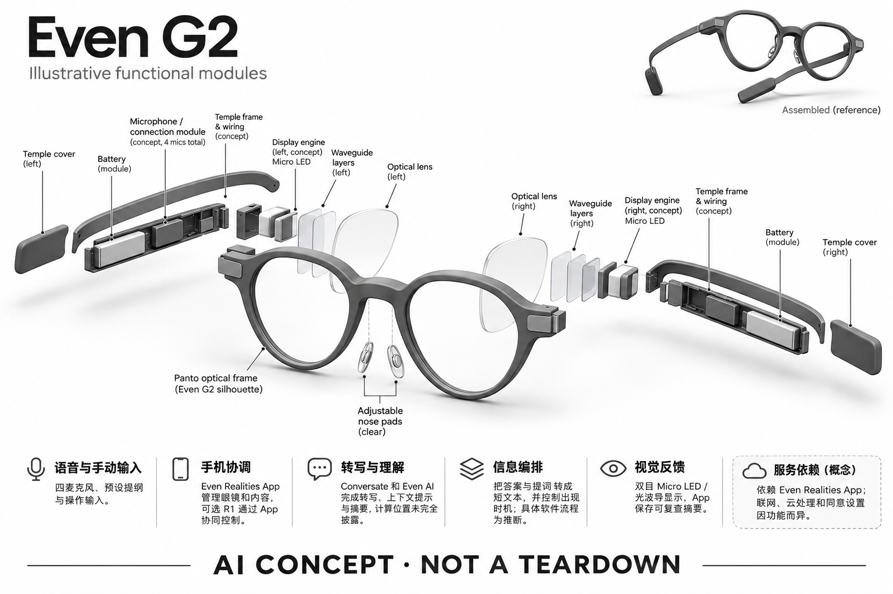

# Even G2

**Even Realities** · AI 眼镜 · 核查 2026-11-04

不用摄像头，以文字提示辅助真实对话

消费渠道：个人零售。

## 产品图片与结构参考

### 产品图

官方 Even G2 A 灰色镜框三分之四视图 · 来源：[Even Realities · 官方产品图片](<https://www.evenrealities.com/products/g2-a>) · [原始图片](<https://cdn.shopify.com/s/files/1/0600/4513/1891/files/even-g2-a-smart-glasses-three-quarter-view-grey.png?v=1762242843&width=1200>)

### 参考图

官方 Even G2 A 同色侧视图 · 来源：[Even Realities · 官方产品图片](<https://www.evenrealities.com/products/g2-a>) · [原始图片](<https://cdn.shopify.com/s/files/1/0600/4513/1891/files/even-g2-a-smart-glasses-side-view-grey.png?v=1762242843&width=1200>)

### AI 生成爆炸示意

**AI 生成 · 非实物拆机。** 内部为概念推断，不能作为元件布局、BOM 或维修依据。[生成提示词](../../content/hardware/prompts/even-g2.txt)

> 外形依据核验参考图；内部位置、模块形状与装配关系仅作AI概念展示。

> 图片按源站提供格式保存，未裁切或改色；厂商渲染/场景示意不代表实机测试。

> 分析为基于公开资料的案头研究与 AI 辅助判断，未经用户访谈、销量审计或实物拆机。需求、画像、竞争冷门度、审美及商业机会均为研究假设，不是投资结论。

## 销售与购买

- 状态：在售。已打开 G2 A 官方配置页，显示 US$599、Buy now、镜片选项与 Add to cart；处方镜片为定制订单，交付时间随配置变化。

- 地区：美国官网、官网支持配送地区与授权眼镜店（逐地确认）

- 价格：US$599 起。G2 A 非处方配置起价；官网单光处方镜片 US$159 起，R1 等配件另计。特殊框色和地区价格以结算为准。

- 中国大陆：本次未取得大陆官方销售/配送确认。官网中文文字、镜片生产来源或支持翻译中文，均不能证明大陆渠道与应用服务已正式开放。

- [官方产品 / 商店](<https://www.evenrealities.com/smart-glasses>)

## AI 的实际作用

Conversate 通过语音转写提供对话提示与摘要，并支持 Even AI、翻译和提词等功能。

服务与联网依赖：依赖 Even Realities App；联网、云处理与同意设置因功能而异。没有摄像头不代表不处理谈话数据。

## 是否冷门

新兴竞争（研究判断）：无摄像头的文字辅助定位有辨识度，但需求和竞争程度仍需用户研究验证。

## 需求与市场

需求假设：会议、外语交流或演讲时，用户想获得提示却不愿低头看手机。与拍摄眼镜不同，这里应验证眼前文字是否减少遗忘，还是增加阅读负担，并比较提词器与手机字幕。

## 用户画像

画像推断：已有配镜习惯、频繁演讲或跨语言沟通的人更值得访谈。实时字幕也可能吸引听力困难用户，但本研究没有临床验证，不能把消费级显示功能写成医疗辅助效果承诺。

## 竞争与替代

案头判断：无摄像头、低干扰的文字辅助属于正在形成的细分，仍与手机字幕、耳机翻译和其他显示眼镜竞争。没有访谈或销量数据支持其需求强度，较少曝光不等于市场空白。

## 供应链

官方披露 Micro LED、双目光波导，并列出三井化学镜片材料；整机代工厂、光机供应商和光学校准良率仍不明。推断光学一致性、处方适配与返修流程比单纯电子装配更关键。

## 技术路径

官方明确四麦克风输入、无摄像头及文字显示功能；Conversate 结合转写、提示与摘要。详细端云计算比例、模型供应商和任务延迟未完整公开，不能把眼前显示误认为全部离线推理。

## 产品审美

图示观察：细框、透明镜片与克制的显示形式接近日常光学眼镜。无摄像头能降低部分社交疑虑，但不能消除录音问题；显示清晰度、焦点舒适与他人是否看见光影仍需实际试戴。

## 关键风险

关键风险是谈话识别错误后生成不准确提示、注意力被字幕牵引，以及处方定制后的退换限制。还需确认不同网络地区的可用性；官方光学参数不等同个人连续阅读的舒适保证。

## 机会与验证

市场差异是无摄像头的文字显示与对话提示，而非第一视角摄影。尚待验证的购买理由是提示时机、字数与阅读舒适是否帮助交流，以及用户在不看手机的情况下是否仍能保持注意力。

## 功能分层示意

这是功能关系，不是实物拆机、真实空间结构或已核实 BOM。

1. **语音与手动输入**：四麦克风、预设提纲与操作输入；功能示意，非真实拆机。（官方披露）

2. **手机协调**：Even Realities App 管理眼镜和内容，可选 R1 通过 App 协同控制。（官方披露）

3. **转写与理解**：Conversate 和 Even AI 完成转写、上下文提示与摘要，计算位置未完全披露。（官方披露）

4. **信息编排**：把答案与提词转成短文本，并控制出现时机；具体软件流程为推断。（分析推断）

5. **视觉反馈**：双目 Micro LED / 光波导显示，App 保存可复查摘要。（官方披露）

## 来源

1. [Even Realities · G2 A 官方配置商店](<https://www.evenrealities.com/products/g2-a>) — 已打开，US$599、Buy now 和 Add to cart；处方与配件加价单列。

2. [Even Realities · G2 规格与 FAQ](<https://www.evenrealities.com/smart-glasses>) — 已打开，明确无摄像头、Micro LED、光波导、四麦克风及 Conversate。

[返回目录](../hardware-market.md) · [网页分析](https://romanagent.github.io/Roman/#hardware/product/even-g2)
