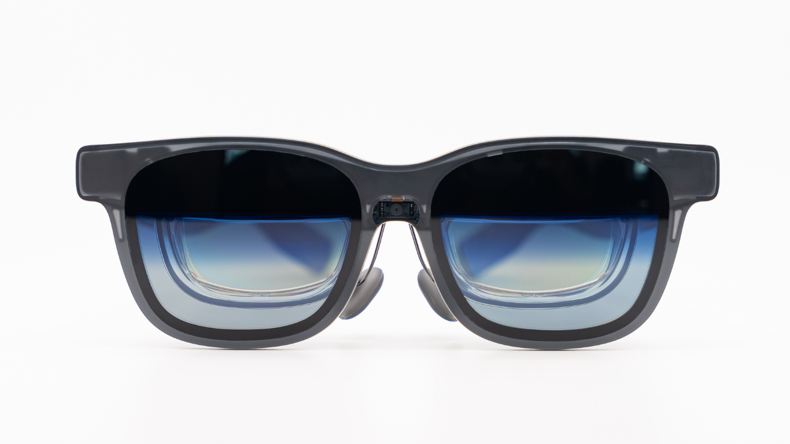
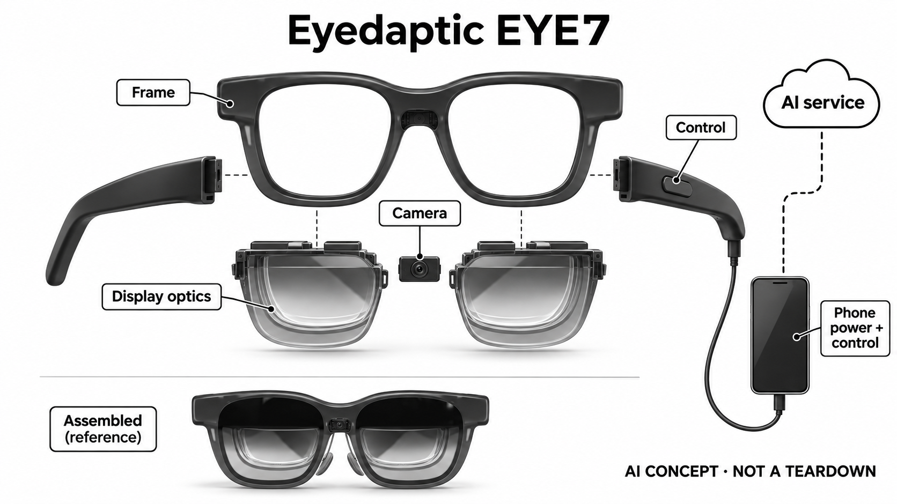

# Eyedaptic EYE7

**Eyedaptic** · 无障碍与辅助沟通 · 核查 2026-11-05

把低视力图像增强与可调节设置的AI助手结合

消费渠道：个人适配 / 验配。

## 产品图片与结构参考

### 产品图

Eyedaptic EYE7当前官方正面外形与中央摄像区域 · 来源：[Eyedaptic · 官方产品图片](<https://eyedaptic.com/eye7/>) · [原始图片](<https://eyedaptic.com/wp-content/uploads/2025/10/COMING-SOON-1.png>)

### 参考图

EYE7官方阅读场景，保留遥控手机与连接线参考 · 来源：[Eyedaptic · 官方产品图片](<https://eyedaptic.com/eyedaptic-unveils-eye7-smart-glasses-the-only-platform-combining-vision-enhancement-and-ai-visual-assistant-family/>) · [原始图片](<https://eyedaptic.com/wp-content/uploads/2025/10/Screenshot-2025-10-20-at-1.37.37-PM-1024x709.png>)

### AI 生成爆炸示意

**AI 生成 · 非实物拆机。** 内部为概念推断，不能作为元件布局、BOM 或维修依据。[生成提示词](../../content/hardware/prompts/eyedaptic-eye7.txt)

> 已视觉检查准确外形、灰阶、标题与概念声明；未知内部模块仅为功能示意，不代表拆机、完整BOM或参数。

> 明确保留外接手机供电控制和AI服务关系；镜腿内部与显示层分离为概念，不推定独立电池或真实堆叠。

> 来源图片已逐张实际查看，确认具体型号；保留原图，不改色裁切。图片不能证明内部BOM、疗效或所有配置可售。

> 主图源文件名残留COMING-SOON，但当前EYE7官网使用该准确型号图；状态另以现行页面、FAQ及最新发布核查。

> 分析为基于公开资料的案头研究与 AI 辅助判断，未经用户访谈、销量审计或实物拆机。需求、画像、竞争冷门度、审美及商业机会均为研究假设，不是投资结论。

## 销售与购买

- 状态：在售。当前EYE7产品页、2026年3月发布及11月2日Eva正式上线资料均对应已使用设备；官方FAQ明确个人通过眼科实践方或经销商付费购买、退货和保修流程，按个人验配渠道登记。

- 地区：美国为主的眼科实践方及经销渠道；具体地区需适配确认

- 价格：经销及个人适配报价，未核到统一现价。不借EYE5硬件价或旧助手订阅图作EYE7当前价格；Ivy/Eva方案、网络及升级权益需按订单确认。

- 中国大陆：厂家链接的中国网站当前可见EYE5，未核到EYE7正式购买和Eva服务条件；不因品牌有中国网站就判本型号已在大陆销售。

- [官方产品 / 商店](<https://eyedaptic.com/eye7/>)

## AI 的实际作用

AI视觉助手支持阅读和场景问答；最新Eva发布说明还支持以自然语言调节视觉增强设置，结合摄像与显示辅助。

服务与联网依赖：官方FAQ明确眼镜需始终通过线缆连接遥控手机并由其供电；助手账户、网络、订阅和语言区域条件需确认，不等于眼镜独立离线运行。

## 是否冷门

细分专业（研究判断）：针对仍利用视觉信息的人，将增强画面与AI操作结合；不同于仅朗读或导航眼镜，缺少本研究独立效果及用户访谈。

## 需求与市场

需求假设是使用者在不同材料和环境中需要反复调整画面，而不希望每次都寻找复杂菜单。语音请求若能正确对应设置，可能减少操作中断，但理解请求与改善可见画面是两件事；实际价值仍取决于个人视觉条件、语言表达和设备反馈，不能由助手名称直接推定。

### 官方｜增强画面与视觉助手合并 · 官方资料

EYE7将低视力图像增强和AI视觉助手放在同一套眼镜与手机系统中，支持阅读、视觉问答及相关操作。最新Eva发布说明增加通过自然语言调节增强设置的能力；这里的AI不只是普通放大，也不能反过来把所有光学显示功能都称为生成式模型，更不意味着恢复视力。

依据：[Eyedaptic EYE7当前产品页](<https://eyedaptic.com/eye7/>) · [Eyedaptic Eva正式推出，2026-11-02](<https://eyedaptic.com/eyedaptic-launches-eva/>) · [EYE7发布与视觉助手系列，2026-03-24](<https://eyedaptic.com/eyedaptic-unveils-eye7-smart-glasses-the-only-platform-combining-vision-enhancement-and-ai-visual-assistant-family/>)

### 判断｜设置调节可能影响任务连续性 · 研究判断

需求假设是使用者在不同材料和环境中需要反复调整画面，而不希望每次都寻找复杂菜单。语音请求若能正确对应设置，可能减少操作中断，但理解请求与改善可见画面是两件事；实际价值仍取决于个人视觉条件、语言表达和设备反馈，不能由助手名称直接推定。

依据：[Eyedaptic EYE7当前产品页](<https://eyedaptic.com/eye7/>) · [Eyedaptic Eva正式推出，2026-11-02](<https://eyedaptic.com/eyedaptic-launches-eva/>)

### 验证｜用本人常读内容观察调整过程 · 待验证

可在适配人员支持下选择本人常见文字和物体，记录手动调节、语音调节及实际辨认之间的步骤。应同时记录误答、不合适设置和恢复原状态的方法，不只观察一次成功演示；本研究没有视力测量或临床试验，不承诺辨认改善或适合所有低视力人群。

依据：[Eyedaptic EYE7当前产品页](<https://eyedaptic.com/eye7/>) · [Eyedaptic Eva正式推出，2026-11-02](<https://eyedaptic.com/eyedaptic-launches-eva/>) · [EYE7发布与视觉助手系列，2026-03-24](<https://eyedaptic.com/eyedaptic-unveils-eye7-smart-glasses-the-only-platform-combining-vision-enhancement-and-ai-visual-assistant-family/>)

## 用户画像

与完全依赖语音读物的需求相比，使用者可能希望继续看文字布局、物体轮廓或熟悉环境，因此画面增强与语音信息的比例很个人化。是否愿意同时携带手机和眼镜也影响接受程度；用户画像应围绕实际任务和试用反馈，而不是仅用某个视力诊断名称概括。

### 官方｜经个人经销适配购买 · 官方资料

官方FAQ说明用户经眼科实践方或经销商付费购买，并按相应流程处理退货与保修；这属于个人使用设备的销售渠道。当前型号信息为EYE7，不应借EYE5报价或其他代次的配套条件填空，也不能把地区代理存在等同该型号在所有市场都已可适配和获得助手服务。

依据：[Eyedaptic EYE7当前产品页](<https://eyedaptic.com/eye7/>) · [Eyedaptic官方FAQ：购买和手机连接](<https://eyedaptic.com/faqs/>)

### 判断｜保留视觉任务的人需要不同入口 · 研究判断

与完全依赖语音读物的需求相比，使用者可能希望继续看文字布局、物体轮廓或熟悉环境，因此画面增强与语音信息的比例很个人化。是否愿意同时携带手机和眼镜也影响接受程度；用户画像应围绕实际任务和试用反馈，而不是仅用某个视力诊断名称概括。

依据：[Eyedaptic EYE7当前产品页](<https://eyedaptic.com/eye7/>) · [EYE7发布与视觉助手系列，2026-03-24](<https://eyedaptic.com/eyedaptic-unveils-eye7-smart-glasses-the-only-platform-combining-vision-enhancement-and-ai-visual-assistant-family/>)

### 验证｜把整套佩戴和支持纳入试用 · 待验证

适配时需要核对镜架、显示体验、线缆、遥控手机及语音操作是否适合本人，并明确哪些设置可自行调整。还应询问助手方案、语言和网络条件，确认售后与退货范围；目录没有取得个人适配结果，也不把官方成功案例推广为所有使用者都会得到相同收益。

依据：[Eyedaptic EYE7当前产品页](<https://eyedaptic.com/eye7/>) · [Eyedaptic官方FAQ：购买和手机连接](<https://eyedaptic.com/faqs/>)

## 竞争与替代

普通电子放大器强调看清材料，朗读眼镜强调把内容变成声音，而EYE7试图在增强视觉与助手操作间切换。它的差异不在多一个摄像头或换镜框，而在使用者能否更连续完成任务；也可能因为设备和订阅更复杂而增加负担，不能预设组合功能一定胜过单一工具。

### 官方｜Eva最新发布与旧页面时间不同 · 官方资料

三月发布EYE7时，Ivy已作为助手提供而Eva仍处测试阶段；十一月二日官方说明Eva已正式推出并可向EYE7用户升级。产品页仍残留早期Beta字样，因此本条按更新公告描述当前能力，并保留具体方案待确认，不将旧订阅图片或发布日期差异隐去。

依据：[Eyedaptic EYE7当前产品页](<https://eyedaptic.com/eye7/>) · [Eyedaptic Eva正式推出，2026-11-02](<https://eyedaptic.com/eyedaptic-launches-eva/>) · [EYE7发布与视觉助手系列，2026-03-24](<https://eyedaptic.com/eyedaptic-unveils-eye7-smart-glasses-the-only-platform-combining-vision-enhancement-and-ai-visual-assistant-family/>)

### 判断｜与朗读眼镜及普通放大器分工不同 · 研究判断

普通电子放大器强调看清材料，朗读眼镜强调把内容变成声音，而EYE7试图在增强视觉与助手操作间切换。它的差异不在多一个摄像头或换镜框，而在使用者能否更连续完成任务；也可能因为设备和订阅更复杂而增加负担，不能预设组合功能一定胜过单一工具。

依据：[Eyedaptic EYE7当前产品页](<https://eyedaptic.com/eye7/>) · [Eyedaptic Eva正式推出，2026-11-02](<https://eyedaptic.com/eyedaptic-launches-eva/>)

### 验证｜在同一任务比较不同信息入口 · 待验证

可以让使用者用原有放大或朗读工具和EYE7完成相同阅读任务，记录找设置、获得结果、纠错和退出所需过程。价格比较须包含手机、服务方案和适配支持，不能只看镜框；本目录没有市场份额、长期用户访谈或独立效果数据，不对各品牌作疗效排名。

依据：[Eyedaptic EYE7当前产品页](<https://eyedaptic.com/eye7/>) · [Eyedaptic官方FAQ：购买和手机连接](<https://eyedaptic.com/faqs/>) · [Eyedaptic Eva正式推出，2026-11-02](<https://eyedaptic.com/eyedaptic-launches-eva/>)

## 供应链

新设计要协调摄像输入、处理延迟、增强显示、语音交互和手机电源预算，线缆可靠性与接口也会影响日常使用。选择更强应用处理器并不能自动解决近眼显示和个人视觉适配；候选供应商只提供部分能力，不能由其通用平台推定已经实现Eyedaptic的软件和效果。

### 官方｜供电和计算不能都画进镜框 · 官方资料

FAQ明确所有型号必须通过线缆连接遥控手机，并由手机给眼镜供电。眼镜可见摄像和显示结构，但主控、光学模块及制造厂未在所引来源完整点名；示意图因此保留外接手机，不能随意增加镜腿电池或宣称眼镜独立运行全部AI，也不能从手机照片猜测内部芯片。

依据：[Eyedaptic EYE7当前产品页](<https://eyedaptic.com/eye7/>) · [Eyedaptic官方FAQ：购买和手机连接](<https://eyedaptic.com/faqs/>)

### 判断｜同类方案需要手机和显示共同设计 · 研究判断

新设计要协调摄像输入、处理延迟、增强显示、语音交互和手机电源预算，线缆可靠性与接口也会影响日常使用。选择更强应用处理器并不能自动解决近眼显示和个人视觉适配；候选供应商只提供部分能力，不能由其通用平台推定已经实现Eyedaptic的软件和效果。

依据：[Eyedaptic EYE7当前产品页](<https://eyedaptic.com/eye7/>) · [Eyedaptic官方FAQ：购买和手机连接](<https://eyedaptic.com/faqs/>) · [Eyedaptic Eva正式推出，2026-11-02](<https://eyedaptic.com/eyedaptic-launches-eva/>)

### 验证｜候选研究先确认系统接口 · 待验证

光学候选需确认近眼显示、成像和结构条件是否在其实际服务范围内，应用平台候选则需核对外部控制器的功耗、接口和软件支持。这里仅研究相近新设计，没有本型号采用证据，也不建议替换封闭手机内部器件；供应商链接不是完整BOM或可直接复制的产品方案。

依据：[Eyedaptic EYE7当前产品页](<https://eyedaptic.com/eye7/>) · [Eyedaptic官方FAQ：购买和手机连接](<https://eyedaptic.com/faqs/>)

## 技术路径

一句关于画面的问题可能包含模糊偏好，助手若误解并改变多个设置，用户可能难以知道发生了什么。技术价值在于把请求、实际改动和结果反馈连起来，同时允许恢复原状态；这种可理解性比单次回答流畅更重要，也不能仅凭生成文本质量判断视觉辅助是否可靠。

### 官方｜AI回答与增强设置是两个输出 · 官方资料

视觉助手可以围绕摄像内容提供阅读和问答，而Eva的新增定位还包括理解用户语言并调整画面增强。回答是否准确、调整是否符合意图以及用户是否更容易使用，分别需要验证；官方发布并未完整披露模型、训练数据或每层处理位置，目录不补充为全部离线或固定芯片执行。

依据：[Eyedaptic EYE7当前产品页](<https://eyedaptic.com/eye7/>) · [Eyedaptic Eva正式推出，2026-11-02](<https://eyedaptic.com/eyedaptic-launches-eva/>)

### 判断｜自然语言控制要有可见恢复路径 · 研究判断

一句关于画面的问题可能包含模糊偏好，助手若误解并改变多个设置，用户可能难以知道发生了什么。技术价值在于把请求、实际改动和结果反馈连起来，同时允许恢复原状态；这种可理解性比单次回答流畅更重要，也不能仅凭生成文本质量判断视觉辅助是否可靠。

依据：[Eyedaptic Eva正式推出，2026-11-02](<https://eyedaptic.com/eyedaptic-launches-eva/>)

### 验证｜区分识别失败与设置不适合 · 待验证

试用可保留原始场景、用户请求、助手回应和实际设置变化，分别记录读错内容、理解错请求和画面不适合的情况。还需检查网络中断或服务不可用时保留哪些基本功能；本研究只核公开资料，没有独立算法测试，不承诺特定光线、距离或语言下的表现。

依据：[Eyedaptic EYE7当前产品页](<https://eyedaptic.com/eye7/>) · [Eyedaptic Eva正式推出，2026-11-02](<https://eyedaptic.com/eyedaptic-launches-eva/>)

## 产品审美

使用者除了是否喜欢镜框，还要考虑手机放在哪里、线缆如何避开衣物，以及摘戴时能否保持连接。更轻的视觉印象不代表鼻梁压力或显示舒适，镜架也可能影响社交时的自我感受；审美讨论应听取本人偏好，不把隐蔽或像普通眼镜作为唯一优点。

### 官方｜宽镜框与外接手机构成可见外形 · 官方资料

官方EYE7图片显示宽厚镜框、中央摄像区域和双侧显示结构，使用场景中可见线缆与遥控手机。当前图像资产文件名含早期宣传字样，但实际来自现行EYE7页面；目录按具体外形核对，不借其他代次、普通眼镜头像或助手插画作为产品照片。

依据：[Eyedaptic EYE7当前产品页](<https://eyedaptic.com/eye7/>) · [EYE7发布与视觉助手系列，2026-03-24](<https://eyedaptic.com/eyedaptic-unveils-eye7-smart-glasses-the-only-platform-combining-vision-enhancement-and-ai-visual-assistant-family/>)

### 判断｜外观接受度和线缆管理分不开 · 研究判断

使用者除了是否喜欢镜框，还要考虑手机放在哪里、线缆如何避开衣物，以及摘戴时能否保持连接。更轻的视觉印象不代表鼻梁压力或显示舒适，镜架也可能影响社交时的自我感受；审美讨论应听取本人偏好，不把隐蔽或像普通眼镜作为唯一优点。

依据：[Eyedaptic EYE7当前产品页](<https://eyedaptic.com/eye7/>) · [Eyedaptic官方FAQ：购买和手机连接](<https://eyedaptic.com/faqs/>) · [EYE7发布与视觉助手系列，2026-03-24](<https://eyedaptic.com/eyedaptic-unveils-eye7-smart-glasses-the-only-platform-combining-vision-enhancement-and-ai-visual-assistant-family/>)

### 验证｜在完整携带状态检查动作 · 待验证

试配可观察拿取手机、戴上眼镜、坐下阅读和收纳的整个过程，记录线缆牵拉、控制器位置和需要帮助的步骤。把外观评价、佩戴舒适和视觉效果分开记录；本轮没有真实触摸、重量分布或长期耐久测试，不能凭官方人物照片断言适合全天佩戴。

依据：[Eyedaptic EYE7当前产品页](<https://eyedaptic.com/eye7/>) · [Eyedaptic官方FAQ：购买和手机连接](<https://eyedaptic.com/faqs/>)

## 关键风险

AI读错文字或误解物体时，使用者可能把流畅回答当作可靠信息；画面增强也可能在某些条件下不合适。重要内容应保留可核对方式，设备不应被描述为保证安全导航或替代专业眼科照护；视觉助手与真实场景之间的误差需要被清楚呈现，而非被宣传语遮盖。

### 官方｜国内入口不证明本型号已交付 · 官方资料

厂家链接的中国网站当前可见EYE5资料，未核到EYE7的大陆正式购买、适配及Eva服务条件。美国经销购买和远程升级说明也不能自动跨地区适用；因此本条将国内状态保留为不明，且不借旧型号硬件价格或带早期测试脚注的订阅图作为当前订单报价。

依据：[Eyedaptic官方FAQ：购买和手机连接](<https://eyedaptic.com/faqs/>) · [Eyedaptic中国站当前产品范围](<https://eyedaptic.cn/>)

### 判断｜错误解释可能影响后续判断 · 研究判断

AI读错文字或误解物体时，使用者可能把流畅回答当作可靠信息；画面增强也可能在某些条件下不合适。重要内容应保留可核对方式，设备不应被描述为保证安全导航或替代专业眼科照护；视觉助手与真实场景之间的误差需要被清楚呈现，而非被宣传语遮盖。

依据：[Eyedaptic EYE7当前产品页](<https://eyedaptic.com/eye7/>) · [Eyedaptic Eva正式推出，2026-11-02](<https://eyedaptic.com/eyedaptic-launches-eva/>)

### 验证｜确认服务停止时的使用边界 · 待验证

购买前应询问网络、账户、订阅或软件升级异常时哪些功能仍能使用，以及支持人员如何帮助恢复设置。语音和视觉数据的处理条件也需按实际方案核实；本研究不承诺恢复视力或避免意外，只提出产品选择时应由本人和服务方确认的具体问题。

依据：[Eyedaptic EYE7当前产品页](<https://eyedaptic.com/eye7/>) · [Eyedaptic官方FAQ：购买和手机连接](<https://eyedaptic.com/faqs/>) · [Eyedaptic Eva正式推出，2026-11-02](<https://eyedaptic.com/eyedaptic-launches-eva/>)

## 机会与验证

后续研究可以把重点放在用户是否知道如何表达需求、理解设置变化并自行恢复，而不是只看助手回答多少问题。若减少操作负担的同时失去对画面的掌控，价值可能有限；因此更有意义的结果是本人能否持续完成常见任务，并保留选择其他辅助方式的自由。

### 官方｜同一低视力显示任务不按代次重复 · 官方资料

本条将EYE7作为视觉增强与AI设置助手结合的代表，不另收同品牌旧代次、套餐或助手名字来增加场景数量。它区别于仅朗读或纯导航的主要任务在于继续使用增强画面，并用语言辅助调节；这种差异必须与手机依赖和个人适配条件一起说明，不能只保留新功能标题。

依据：[Eyedaptic EYE7当前产品页](<https://eyedaptic.com/eye7/>) · [Eyedaptic Eva正式推出，2026-11-02](<https://eyedaptic.com/eyedaptic-launches-eva/>)

### 判断｜关注用户能否主动掌控画面 · 研究判断

后续研究可以把重点放在用户是否知道如何表达需求、理解设置变化并自行恢复，而不是只看助手回答多少问题。若减少操作负担的同时失去对画面的掌控，价值可能有限；因此更有意义的结果是本人能否持续完成常见任务，并保留选择其他辅助方式的自由。

依据：[Eyedaptic EYE7当前产品页](<https://eyedaptic.com/eye7/>) · [Eyedaptic Eva正式推出，2026-11-02](<https://eyedaptic.com/eyedaptic-launches-eva/>)

### 验证｜跟踪实际保留的使用场景 · 待验证

可在适当支持下记录数周后仍常用的增强模式、助手请求、失败情境和改用其他工具的原因，再判断组合方案是否值得。地区支持与软件更新也应计入观察；本目录没有销量或独立临床证据，不以功能数量、发布日期或官方展示推断市场需求和个人效果。

依据：[Eyedaptic EYE7当前产品页](<https://eyedaptic.com/eye7/>) · [Eyedaptic官方FAQ：购买和手机连接](<https://eyedaptic.com/faqs/>) · [Eyedaptic Eva正式推出，2026-11-02](<https://eyedaptic.com/eyedaptic-launches-eva/>)

## 对应供应链公司

能力候选用于选型研究，不代表本产品实际采用；未公开的供货关系不作推断。

- [aac-technologies](../supply-chain/aac-technologies.md) — **能力候选 · 非已采用** / 同类视觉增强设备的光学工程能力候选：瑞声公开光学与精密集成能力，可作为同类摄像及光学结构开发的询证入口，但近眼显示、个人视觉适配和实际接口是否适用仍需专项确认。没有Eyedaptic点名采用证据，不能将一般光学模组能力等同本款显示系统，也不能据候选链接推断成像或辅助效果。

- [mediatek](../supply-chain/mediatek.md) — **能力候选 · 非已采用** / 同类外接视觉控制器的应用平台研究：MediaTek Genio平台可用于研究相近外接视觉控制器的摄像、显示和应用处理，但需要核对功耗、接口、系统支持与服务接入。EYE7采用封闭手机配套，未公开此平台为现用方案；此处不主张替换手机芯片，也不把通用算力视为已有视觉增强与Eva模型。

[浏览供应链目录](../supply-chain.md)

## 功能分层示意

这是功能关系，不是实物拆机、真实空间结构或已核实 BOM。

1. **环境采集**：眼镜摄像区域采集视野，实际成像条件影响结果。（官方披露）

2. **手机与控制**：外接遥控手机供电、控制并承载配套软件。（官方披露）

3. **视觉增强**：处理后的画面通过眼镜显示，需个人试用调整。（官方披露）

4. **AI助手**：Ivy与Eva方案提供视觉问答等功能，Eva可按请求调节设置。（官方披露）

5. **个人反馈**：使用者判断结果是否有帮助，误答和显示不适须可退出。（分析推断）

## 来源

1. [Eyedaptic EYE7当前产品页](<https://eyedaptic.com/eye7/>) — 已打开当前型号、视觉增强及助手；页面残留Eva早期Beta字样，与更新的正式发布说明分开记录。

2. [Eyedaptic官方FAQ：购买和手机连接](<https://eyedaptic.com/faqs/>) — 已打开个人经眼科实践方或经销商购买、退货保修；所有型号需线缆连接遥控手机并由手机供电。

3. [Eyedaptic Eva正式推出，2026-11-02](<https://eyedaptic.com/eyedaptic-launches-eva/>) — 已打开最新发布：Eva已推出，可向EYE7用户远程提供升级，能按自然语言调整增强；方案地区和个人权益仍须确认。

4. [EYE7发布与视觉助手系列，2026-03-24](<https://eyedaptic.com/eyedaptic-unveils-eye7-smart-glasses-the-only-platform-combining-vision-enhancement-and-ai-visual-assistant-family/>) — 已打开EYE7与Ivy发布、当时Eva Beta；不将旧测试状态覆盖11月的新正式信息。

5. [Eyedaptic中国站当前产品范围](<https://eyedaptic.cn/>) — 已公开打开中国站，所见产品为EYE5；仅支持品牌地区入口存在，不证明EYE7已在大陆正式销售。

[返回目录](../hardware-market.md) · [网页分析](https://romanagent.github.io/Roman/#hardware/product/eyedaptic-eye7)
