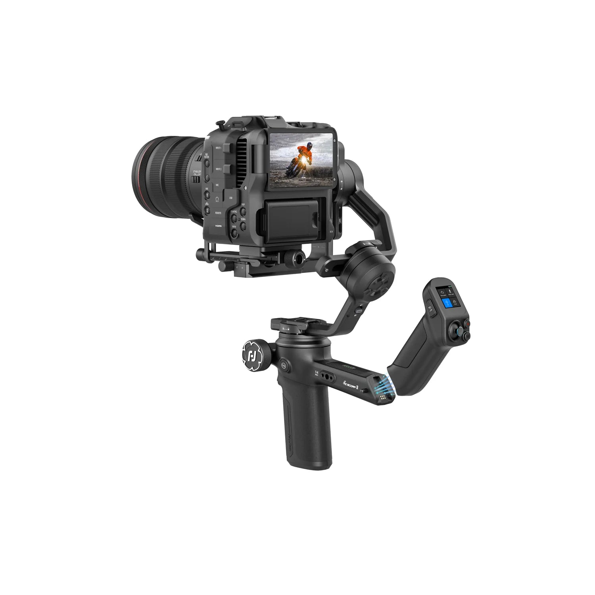
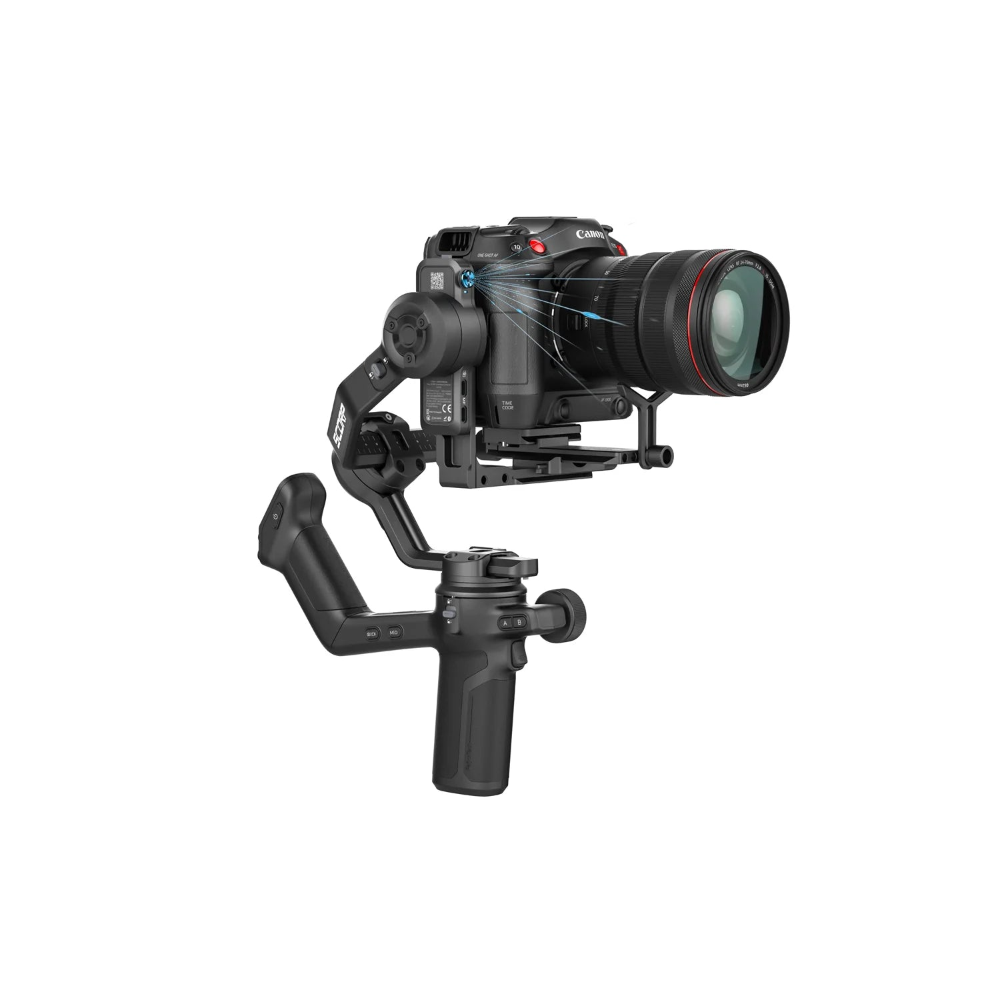
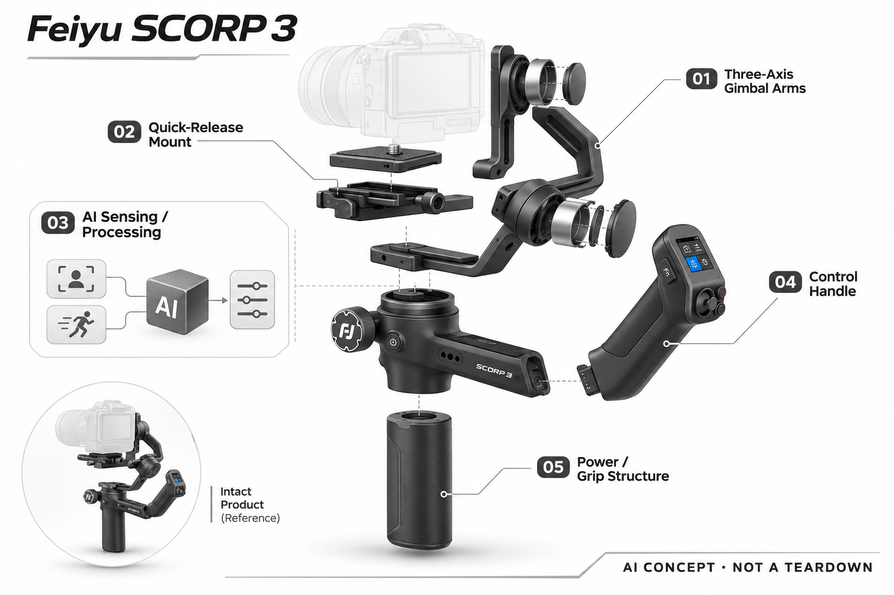

# Feiyu SCORP 3

**FeiyuTech 飞宇** · 智能云台 · 核查 2026-11-04

将无需额外App的AI人脸跟踪放进个人相机云台。

消费渠道：个人零售。

## 产品图片与结构参考

### 产品图

Feiyu SCORP 3 官方产品图（相机/手机用于展示，非默认随附） · 来源：[FeiyuTech 飞宇](<https://store.feiyu-tech.com/products/feiyu-scorp-3>) · [原始图片](<https://cdn.shopify.com/s/files/1/1759/9593/files/FeiyuSCORP3CameraGimbal_2_98159952-91a4-4a05-92a3-a72dabb0cf0c.webp?v=1773822434>)

### 参考图

Feiyu SCORP 3 官方外观 / 使用参考图（相机/手机用于展示，非默认随附） · 来源：[FeiyuTech 飞宇](<https://store.feiyu-tech.com/products/feiyu-scorp-3>) · [原始图片](<https://cdn.shopify.com/s/files/1/1759/9593/files/FeiyuSCORP3CameraGimbal_3.webp?v=1773822434>)

### AI 生成爆炸示意

**AI 生成 · 非实物拆机。** 内部为概念推断，不能作为元件布局、BOM 或维修依据。[生成提示词](../../content/hardware/prompts/feiyu-scorp-3.txt)

> 分析为基于公开资料的案头研究与 AI 辅助判断，未经用户访谈、销量审计或实物拆机。需求、画像、竞争冷门度、审美及商业机会均为研究假设，不是投资结论。

## 销售与购买

- 状态：在售。官方商品页有Add to cart，基础款公开商品数据available=true。Kit为附件组合，不另计数；相机需自行配备。

- 地区：美国、英国、欧盟部分地区、加拿大

- 价格：US$339.15（美国页面促销）。为所标地区和配置的核查参考；活动、税费、物流及可选服务以实际结算为准，不进行汇率换算或保证最低价。

- 中国大陆：本轮核查海外官方消费渠道，未验证中国大陆结算、型号、保修与全部AI服务可用性；不因品牌来源或支持中文推定国内可购。

- [官方产品 / 商店](<https://store.feiyu-tech.com/products/feiyu-scorp-3>)

## AI 的实际作用

官方规格注明内置AI追踪模块和手势控制，不需额外App或配件。对象能力以官方当前说明为准，不能把人脸跟踪扩展成任意物体识别。

服务与联网依赖：相机和镜头的重量、配平与控制兼容需要分别确认，部分相机控制需线缆。AI模块不会自动解决相机本身的对焦与曝光。

## 是否冷门

细分专业（研究判断）：个人相机创作是专业兴趣场景，已有强竞争，内置AI需要通过实际流程优势获得购买理由。

## 需求与市场

需求假设：个人相机作者想在对镜讲解或独立拍摄时保持构图，减少额外助手和手机控制环节。内置模块的价值应体现在准备更少，而不是把每个自动拍摄模式都理解为一种新增需求。

## 用户画像

画像推断：拥有微单或单反并愿意学习配平的个人影像爱好者和创作者。设备重量、持握和镜头组合决定其接受范围，拍摄频率较低的人可能更愿意使用三脚架或轻量手机方案。

## 竞争与替代

竞争判断：它面对其他相机云台及独立追踪机位，竞争基础包括兼容、手感、自动识别和售后。人脸追踪更适合明确人物场景，不能因为内置AI就认为能覆盖所有体育或宠物任务。

## 供应链

公开规格披露主要机身材料、载荷和内置追踪模块，未披露具体主控与供应商。分析应看电机一致性、结构刚性、快装和线缆管理，真实成本与故障率仍需要供应与实测证据。

## 技术路径

内置视觉追踪将感知与机械执行组合，但拍摄系统还包含镜头和相机控制。厂商的响应时间描述有条件，本目录不将它换算成真实场景成功率，也不猜测内部模型或芯片架构。

## 产品审美

设计观察：双手持握与快装结构强调个人创作工具属性，整洁走线和低学习成本比外壳装饰更重要。云台长期会经历背包运输、配重和多机位切换，这些都应计入审美与体验评价。

## 关键风险

关键风险是相机兼容、AI追踪对象范围和套装配件的误读。产品页说的内置识别不能替代相机对焦，操作负担和电池维护也可能使设备闲置；尚无本轮独立使用数据。

## 机会与验证

值得验证的差异是内置模块能否使个人拍摄更可靠省时。应采用固定脚本对照普通三脚架和竞品，记录构图恢复、配平与有效片段，而不是根据宣传追踪距离判断商业前景。

## 功能分层示意

这是功能关系，不是实物拆机、真实空间结构或已核实 BOM。

1. **视觉输入**：AI跟踪模块或应用视觉输入识别目标。（官方披露）

2. **跟踪计算**：将目标位置转换为构图和运动决策。（官方披露）

3. **三轴执行**：电机和关节保持拍摄方向，实际表现需测试。（官方披露）

4. **控制与连接**：屏幕、按键或App提供个人操作入口。（官方披露）

5. **电池与结构**：供电、夹具与配重影响持续拍摄。（分析推断）

## 来源

1. [SCORP 3 官方商品页](<https://store.feiyu-tech.com/products/feiyu-scorp-3>) — 美国页面基础款可加购，促销价339.15美元。

2. [SCORP 3 官方规格](<https://store.feiyu-tech.com/pages/scorp-3-specs>) — 明确内置AI跟踪与无需额外App的能力边界。

[返回目录](../hardware-market.md) · [网页分析](https://romanagent.github.io/Roman/#hardware/product/feiyu-scorp-3)
