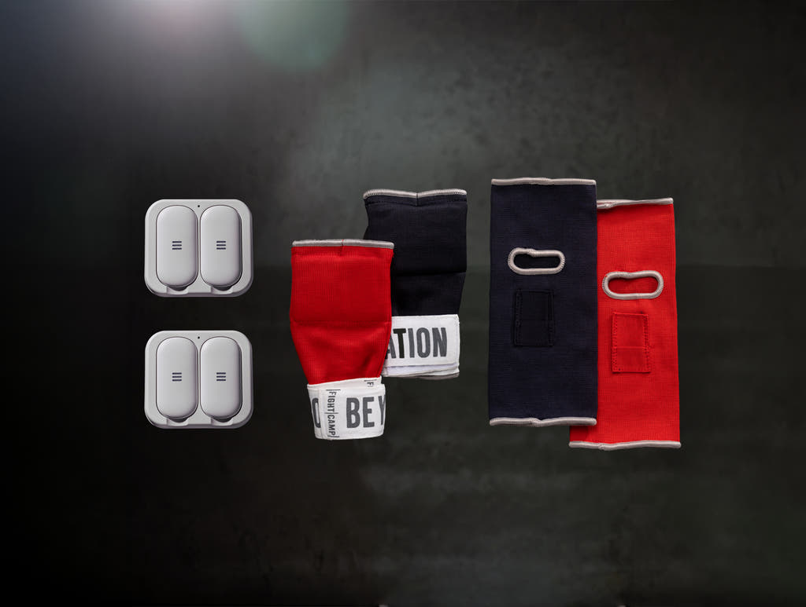
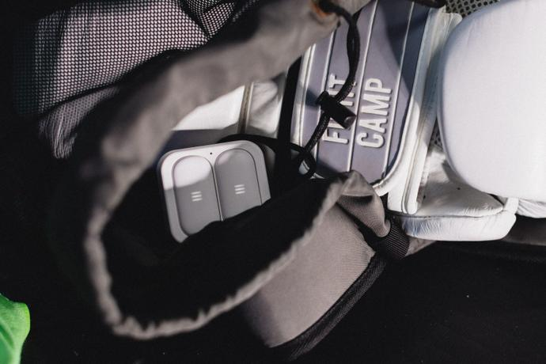
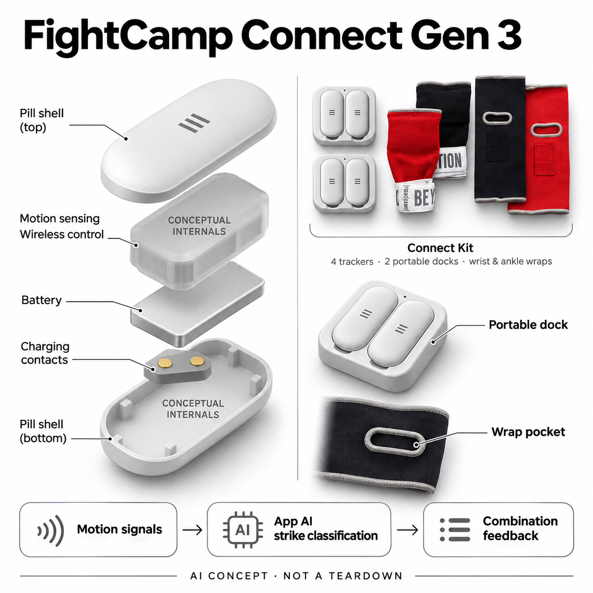

# FightCamp Connect Gen 3

**FightCamp** · 运动与训练 · 核查 2026-11-05

把拳脚运动签名分类为组合训练反馈的四传感器套装

消费渠道：个人零售。

## 产品图片与结构参考

### 产品图

FightCamp Connect Gen 3 官方产品图 · 来源：[FightCamp · 官方资料](<https://joinfightcamp.com/shop>) · [原始图片](<https://cdn.shopify.com/s/files/1/2510/5836/files/CONNECT_GEN3.jpg?format=jpeg&height=1024&quality=75&width=1024>)

### 参考图

FightCamp Gen 3 官方便携充电座实物场景（手套和包为使用情境） · 来源：[FightCamp · 官方资料](<https://blog.joinfightcamp.com/for-members/the-evolution-of-fightcamp/>) · [原始图片](<https://a.storyblok.com/f/115220/1600x1067/5c053d2ca9/on-road.jpg/m/690x460/filters:focal():format(jpeg):quality(75)>)

### AI 生成爆炸示意

**AI 生成 · 非实物拆机。** 内部为概念推断，不能作为元件布局、BOM 或维修依据。[生成提示词](../../content/hardware/prompts/fightcamp-connect-gen3.txt)

> 以已目视核对的官方图片独立生成并完成目视QA；未知内部只作功能概念，不是实际PCB、拆机或供应商BOM。

> 保留官方图片原貌；其中宣传效果或数据不代表本站独立测量。

> 分析为基于公开资料的案头研究与 AI 辅助判断，未经用户访谈、销量审计或实物拆机。需求、画像、竞争冷门度、审美及商业机会均为研究假设，不是投资结论。

## 销售与购买

- 状态：在售。核查日官方商店Connect显示US$269及Select购买入口，含4枚传感器、2个便携充电座、手腕和脚踝固定带。官方11月3日文章确认Gen 3与移动充电座发布；不同含沙袋套餐只计这一实现。

- 地区：美国、加拿大部分地区（官方说明，地址另核）

- 价格：Connect促销US$269；会员US$44.99/月。核查日商店价，会员为必需且与设备费用分开。Connect基础不含沙袋，手套可能是当期赠品，按订单确认。

- 中国大陆：已核配送说明覆盖美国与加拿大部分地区，未确认大陆官方销售和服务；跨境取得硬件仍需核App、会员与售后。

- [官方产品 / 商店](<https://joinfightcamp.com/shop>)

## AI 的实际作用

官方说明专有AI从运动信号学习出拳和踢击特征，区分移动与实际击打类型，再结合时间、速度及专有输出指标进行组合训练反馈。

服务与联网依赖：四枚传感器经蓝牙配手机或平板App与会员服务；可镜像电视。Gen 3便携充电座不等于旧版大Console，旧说明中的功能兼容限制不能直接沿用。

## 是否冷门

细分专业（研究判断）：拳脚动作训练有明确任务和既有设备替代；硬件与内容会员需共同形成持续使用，而非靠排行榜热度。

## 需求与市场

案头需求是在独立练习时记录拳脚组合是否按要求完成，而不只是播放跟练视频。硬件将真实运动转成反馈，价值取决于识别和提示是否帮助理解动作；专有分数不是冲击力实测或安全保证。

### 事实：任务边界 · 官方资料

当前Connect包含四枚运动传感器、两个便携充电座及手腕和脚踝固定带，结合App提供拳脚组合练习反馈。官方技术页明确算法学习击打的运动特征，而不仅是播放课程；套装可正式购买，沙袋另属其它组合，不把配件增加当作新AI设备。

依据：[FightCamp当前官方商店](<https://joinfightcamp.com/shop>) · [FightCamp运动识别技术](<https://joinfightcamp.com/work/technology>)

### 判断：真实需求 · 研究判断

需求判断是让独自练习者知道自己是否完成指定动作和节奏，降低只看视频却没有反馈的落差。自动记录有助于回看，但专有输出分数并不是击中目标的实际受力；如果识别错误频繁或提示难理解，数据增加也不一定改善练习体验。

依据：[FightCamp当前官方商店](<https://joinfightcamp.com/shop>) · [FightCamp运动识别技术](<https://joinfightcamp.com/work/technology>)

### 验证：任务完成 · 待验证

验证可选择一组固定组合，让参与者同步录制视频并使用传感器，逐次核对动作类型与记录。统计错误发生在转换、假动作还是佩戴变化，询问用户接下来如何调整；不能仅因累计次数变多或分数变高，就宣称训练质量与运动安全改善。

依据：[FightCamp当前官方商店](<https://joinfightcamp.com/shop>) · [FightCamp运动识别技术](<https://joinfightcamp.com/work/technology>)

## 用户画像

适合有练习空间、愿意遵循课程且稳定进行拳击或踢拳训练的人。已有沙袋和手套者可选Connect；初学者仍需理解动作和场地条件，不能由自动计数推断可以省去所有现场指导。

### 事实：使用条件 · 官方资料

Connect针对已有部分拳击装备的人，当前页面将含沙袋的Core与更多配件的Elite单列，软件会员则是所有组合的持续费用。新一代传感器可与手机或平板直接训练，电视只是镜像输出；本轮确认美国和加拿大部分地区说明，没有大陆官方服务证据。

依据：[FightCamp当前官方商店](<https://joinfightcamp.com/shop>) · [FightCamp运动识别技术](<https://joinfightcamp.com/work/technology>)

### 判断：人群筛选 · 研究判断

潜在用户应按练习频率、已有装备和可用空间区分。常去训练场的人可能看重便携座，家庭固定机位者则可能更在乎沙袋和屏幕；新手即使能跟着计数，也仍需理解动作基础，不能把“有AI反馈”当作不需要现场学习的充分理由。

依据：[FightCamp当前官方商店](<https://joinfightcamp.com/shop>) · [FightCamp运动识别技术](<https://joinfightcamp.com/work/technology>)

### 验证：参与者差异 · 待验证

访谈可问最近一个月实际练习次数、怎样判断动作做对，以及在家中是否能伸展开拳脚。试用后观察手腕和脚踝固定是否需要协助、是否愿意在出门时带走充电座，再区分对训练内容的兴趣与对数据硬件的真实需求。

依据：[FightCamp当前官方商店](<https://joinfightcamp.com/shop>) · [FightCamp运动识别技术](<https://joinfightcamp.com/work/technology>)

## 竞争与替代

替代包括普通沙袋、手机跟练、教练和视频回看。四传感器减少对机位的依赖，但不能观察全部姿态与周围空间；本目录不把Core和Elite的更多配件当作不同AI产品。

### 事实：方案范围 · 官方资料

产品以佩戴传感器获得运动输入，不依赖固定相机机位，和普通跟练视频、同伴拍摄及教练观察的路径不同。当前第四枚传感器并不是第二套独立产品；不同套餐共用核心追踪系统，目录只保留Connect代表，并明确旧Console属于前一代实现。

依据：[FightCamp当前官方商店](<https://joinfightcamp.com/shop>) · [FightCamp运动识别技术](<https://joinfightcamp.com/work/technology>)

### 判断：替代关系 · 研究判断

竞争判断要看一个具体组合的反馈质量。传感器能持续收集运动，但无法看到脚下障碍、全身位置和目标周围的人；教练和视频能补充这些信息。优势可能在自主练习时的即时提示，而不是全面替代人类观察，更不能按训练样本数字宣布领先。

依据：[FightCamp当前官方商店](<https://joinfightcamp.com/shop>) · [FightCamp运动识别技术](<https://joinfightcamp.com/work/technology>)

### 验证：比较方法 · 待验证

可让参与者在相同课程中比较普通视频、传感器提示与一次教练复盘，记录哪条建议真正改变下一轮练习。对新手和已有基础的人分别观察，再把佩戴、充电和纠错用时纳入比较；不把识别类型数量直接当作用户价值或付费理由。

依据：[FightCamp当前官方商店](<https://joinfightcamp.com/shop>) · [FightCamp运动识别技术](<https://joinfightcamp.com/work/technology>)

## 供应链

小型运动感知、无线、电池、充电座和穿戴固定共同决定系统体验。芯片与工厂未披露；腕带和脚踝位置变化、汗水及重复冲击比单纯采样指标更需要工程验证。

### 事实：功能组成 · 官方资料

公开硬件结构包含小型传感器、无线连接、电池、便携充电座以及可穿戴固定带，具体运动器件和代工厂没有披露。Gen 3文章说明新的便携座可兼容Gen 2传感器，不能由此推断所有旧功能和软件限制相同；真实供应关系仍需品牌点名证据。

依据：[FightCamp当前官方商店](<https://joinfightcamp.com/shop>) · [FightCamp运动识别技术](<https://joinfightcamp.com/work/technology>)

### 判断：交付约束 · 研究判断

工程判断，佩戴位置和固定稳定性会改变模型收到的运动信号，汗水、反复冲击和清洗流程又影响长期使用。小型化的难点不是单独放入传感器，而是让用户反复正确固定与补能；腕带和脚踝带虽然简单，也可能决定数据能否连续可靠。

依据：[FightCamp当前官方商店](<https://joinfightcamp.com/shop>) · [FightCamp运动识别技术](<https://joinfightcamp.com/work/technology>)

### 验证：选型缺口 · 待验证

样机测试应覆盖左右与手脚配对、固定带松紧、取出清洗和电量不足的状态提示，再与视频核对数据。向候选公司明确实际运动及环境条件后再讨论器件，未取得品牌资料前不填芯片型号、工厂和采购价格，避免把候选目录当成拆机清单。

依据：[FightCamp当前官方商店](<https://joinfightcamp.com/shop>) · [FightCamp运动识别技术](<https://joinfightcamp.com/work/technology>)

## 技术路径

官方将运动轨迹输入学习式算法，输出拳脚类型、时点、速度和专有输出。运动输出与真实目标受力不同，不能画成直接测力计；当前Gen 3的软件与旧Console路径应分别核对。

### 事实：AI机制 · 官方资料

官方技术页把击打运动输入专有AI分类，得到动作类型、发生时点、速度和专有输出等信息，并明确区分移动与实际出拳踢击。这里的输出是基于运动的指标，不是安装在沙袋上的直接力传感测量，不能用同一个词把估计值当成物理真值。

依据：[FightCamp当前官方商店](<https://joinfightcamp.com/shop>) · [FightCamp运动识别技术](<https://joinfightcamp.com/work/technology>)

### 判断：系统边界 · 研究判断

分析上，假动作、转身、跨步和佩戴旋转可能给分类带来不同干扰；用户完成规定组合时，需要系统区别漏动作与不同动作。模型若只给总分而不解释错在哪，反馈可能变成追分游戏；具体估计方法未披露，不能自行补充神经网络结构。

依据：[FightCamp当前官方商店](<https://joinfightcamp.com/shop>) · [FightCamp运动识别技术](<https://joinfightcamp.com/work/technology>)

### 验证：算法与体验 · 待验证

验证应由独立观察者按录像标记实际动作，再计算各类误记和漏记，而不是只与系统自己的总数比较。先在常规练习范围测试，再记录不同基础参与者的差异；发布结果时说明固件、软件、固定方式与动作条件，不把厂商数据规模作为准确率。

依据：[FightCamp当前官方商店](<https://joinfightcamp.com/shop>) · [FightCamp运动识别技术](<https://joinfightcamp.com/work/technology>)

## 产品审美

白色细长传感器藏入固定带，两只小充电座比旧家用Console便于带走。分析上，左右或手脚配对、洗带前取出和训练前充电影响留存；套装图中的赠品不写成永久标配。

### 事实：外观与交互 · 官方资料

真实官方套装图显示四枚白色圆角长条传感器放在两个小方形座中，手腕和脚踝带提供不同固定方式。新便携座能装入训练包，和旧的大Console外观不同；生成图因此只拆一枚传感器，其余显示为套装参照，不额外加入沙袋或心率设备。

依据：[FightCamp当前官方商店](<https://joinfightcamp.com/shop>) · [FightCamp运动识别技术](<https://joinfightcamp.com/work/technology>)

### 判断：使用中的形态 · 研究判断

审美与交互判断在于设备能否自然进入训练前后的准备流程。白色小件容易辨认，却可能在取下和清洗时遗失；两个充电座需要用户理解配对与归位。比配色更重要的是快速确认四个位置已准备好，以及练习中无需频繁停下看手机。

依据：[FightCamp当前官方商店](<https://joinfightcamp.com/shop>) · [FightCamp运动识别技术](<https://joinfightcamp.com/work/technology>)

### 验证：日常接受度 · 待验证

观察用户从包里取出、装带、开始训练到结束补能的全过程，记录错误配对与漏充电。试用中允许用户选择关闭部分反馈，询问何时觉得数据打扰；不能只根据整齐的产品图推断佩戴舒适，也不将厂商人物展示当成已完成的人体工学验证。

依据：[FightCamp当前官方商店](<https://joinfightcamp.com/shop>) · [FightCamp运动识别技术](<https://joinfightcamp.com/work/technology>)

## 关键风险

风险在误分类、佩戴松动、为了分数忽视技术和长期会员成本。部分旧帮助页仍限定Console，需按当前Gen 3说明确认；数据反馈不替代对身体能力或训练环境的判断。

### 事实：已知限制 · 官方资料

核查日商店明确会员每月收费并与设备费用分开，设备归购买者保留；配送只确认美国和加拿大部分地区。部分旧支持页仍把动作准确性或踢击限定在Console，本条采用当前商店与代际说明，同时提醒具体客户端兼容需要按新硬件确认。

依据：[FightCamp当前官方商店](<https://joinfightcamp.com/shop>) · [FightCamp运动识别技术](<https://joinfightcamp.com/work/technology>)

### 判断：失效影响 · 研究判断

风险判断包括误分类让用户练习错误动作、为了排行榜忽略身体反馈，以及会员停止后系统价值变化。传感器不会判断所有周围危险，也不替代个人训练能力评估；自动记录应当帮助复盘，不应被包装成训练安全或健康效果的认证。

依据：[FightCamp当前官方商店](<https://joinfightcamp.com/shop>) · [FightCamp运动识别技术](<https://joinfightcamp.com/work/technology>)

### 验证：风险处理 · 待验证

应在正常训练前确认配对、电量与固定状态，了解丢失传感器、取消会员和换手机后数据如何处理。对有争议的动作反馈优先回看录像或请教练核对，记录系统限制；这是一组验证建议，不代表本站已对所有人群和训练强度开展测试。

依据：[FightCamp当前官方商店](<https://joinfightcamp.com/shop>) · [FightCamp运动识别技术](<https://joinfightcamp.com/work/technology>)

## 机会与验证

可验证机会是将一个真实组合练习转成可复盘记录。让参与者同步视频与传感器反馈，记录误判、修正和再次练习意愿，再比较教练或普通跟练方式，不以厂商训练数据量预测效果。

### 判断：可尝试切口 · 研究判断

机会假设在把个人练习从“跟完一段视频”转成“能核对一个组合”的反馈任务，尤其适合已经有装备和基础习惯的人。新的便携座扩展了训练地点，但能否形成习惯仍取决于用户是否看懂并采取反馈，不能由可携带就推断使用频率增加。

依据：[FightCamp当前官方商店](<https://joinfightcamp.com/shop>) · [FightCamp运动识别技术](<https://joinfightcamp.com/work/technology>)

### 判断：商业边界 · 研究判断

商业边界应把设备、持续会员、固定带耗损和实际练习天数放在一起考虑。对偶尔运动的人，普通视频和现有沙袋可能更合适；对频繁训练的人，数据的可靠性比课程数量更重要。公开资料没有本轮可核留存或销量，不能推导市场份额。

依据：[FightCamp当前官方商店](<https://joinfightcamp.com/shop>) · [FightCamp运动识别技术](<https://joinfightcamp.com/work/technology>)

### 验证：下一步调研 · 待验证

建议跟踪一组真实用户的连续训练，记录每次目标、系统提示、人工核对与下一次选择。结束访谈时询问愿意为课程、记录还是组合纠错支付费用，并核对他们实际使用的功能；以这些证据决定下一轮产品实验，不用模型评分预测商业成功。

依据：[FightCamp当前官方商店](<https://joinfightcamp.com/shop>) · [FightCamp运动识别技术](<https://joinfightcamp.com/work/technology>)

## 对应供应链公司

能力候选用于选型研究，不代表本产品实际采用；未公开的供货关系不作推断。

- [tdk-invensense](../supply-chain/tdk-invensense.md) — **能力候选 · 非已采用** / 拳脚惯性采集候选：TDK InvenSense的运动感知和穿戴相关能力可用于讨论击打运动采集，但采样范围、固定方式及冲击条件必须针对本任务验证。FightCamp没有公开采用该公司器件，本关联只是工程路线候选，不将其写成现有传感器BOM。

- [grepow](../supply-chain/grepow.md) — **能力候选 · 非已采用** / 小型追踪器及充电座电池候选：Grepow提供小型与定制电池能力，可作为传感器及便携充电座供电的评估对象；汗水防护、重复充放和接触结构仍须独立设计。实际电池供应方没有披露，不从设备尺寸估计容量或宣称可直接替换。

- [protolabs](../supply-chain/protolabs.md) — **能力候选 · 非已采用** / 传感器外壳与固定口袋样件候选：Protolabs的结构样件加工可帮助验证传感器外壳、充电座配合与固定带口袋尺寸，但软性接触和反复冲击还要另行测试。没有资料显示其参与FightCamp量产，本链接仅表示原型阶段可考虑的结构服务。

[浏览供应链目录](../supply-chain.md)

## 功能分层示意

这是功能关系，不是实物拆机、真实空间结构或已核实 BOM。

1. **穿戴固定**：四枚传感器放入手腕和脚踝固定带，采集拳脚运动。（官方披露）

2. **动作感知**：运动数据用于识别击打，不直接测量沙袋受力。（官方披露）

3. **AI分类**：专有模型识别运动签名并生成类型与组合反馈，具体模型未披露。（官方披露）

4. **连接与充电**：蓝牙连接App，两个便携充电座服务四枚传感器。（官方披露）

5. **训练内容**：App与会员提供练习和数据记录，外部手机、沙袋与电视不是传感器内部模块。（官方披露）

## 来源

1. [FightCamp当前官方商店](<https://joinfightcamp.com/shop>) — 实际打开；Gen 3 Connect四枚传感器与双座、269美元、44.99美元月费、配送及App连接。

2. [FightCamp运动识别技术](<https://joinfightcamp.com/work/technology>) — 实际打开；AI运动签名分类及专有输出指标，不把宣传训练样本量视为实测准确率。

3. [FightCamp代际更新](<https://blog.joinfightcamp.com/for-members/the-evolution-of-fightcamp/>) — 实际打开并读取官方公开HTML；11月3日Gen 3、便携座和Gen 2兼容，避免用旧Console图片。

[返回目录](../hardware-market.md) · [网页分析](https://romanagent.github.io/Roman/#hardware/product/fightcamp-connect-gen3)
