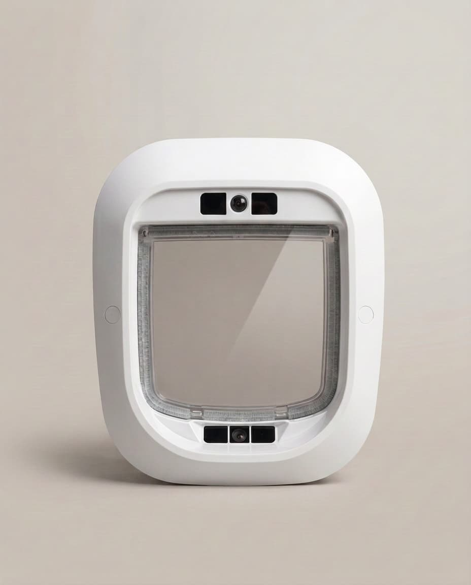
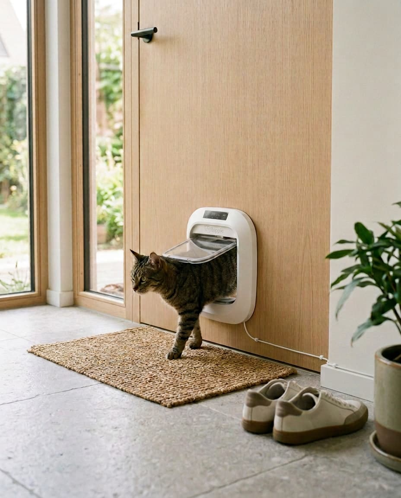
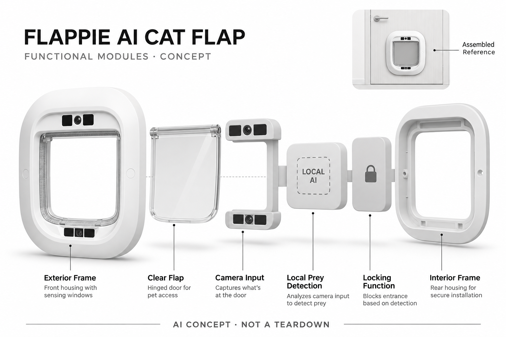

# Flappie AI Cat Flap

**Flappie** · 宠物照护 · 核查 2026-11-04

识别嘴中猎物并在猫入口处执行拦截的家用猫门

消费渠道：个人零售。

## 产品图片与结构参考

### 产品图

官方猫门外侧视角 · 来源：[Flappie · 官方图片](<https://flappiedoors.com/en/products/flappie>) · [原始图片](<https://cdn.shopify.com/s/files/1/0577/6539/6578/files/gallery-01b-studio-outside.jpg?v=1792157853>)

### 参考图

官方室内安装与猫通行场景 · 来源：[Flappie · 官方图片](<https://flappiedoors.com/en/products/flappie>) · [原始图片](<https://cdn.shopify.com/s/files/1/0577/6539/6578/files/gallery-02-in-action-v2-wood-door.jpg?v=1792157853>)

### AI 生成爆炸示意

**AI 生成 · 非实物拆机。** 内部为概念推断，不能作为元件布局、BOM 或维修依据。[生成提示词](../../content/hardware/prompts/flappie-ai-cat-flap.txt)

> 依据已核验官方外形与公开功能生成；未知内部仅为概念功能块，不代表原机电路板、芯片或实际布局。

> 实际查看并核对对应型号，原图未经改色或语义编辑；厂商标注不等同本研究实测。

> 分析为基于公开资料的案头研究与 AI 辅助判断，未经用户访谈、销量审计或实物拆机。需求、画像、竞争冷门度、审美及商业机会均为研究假设，不是投资结论。

## 销售与购买

- 状态：在售。官方商品页显示 In stock、Ships in a few days 与 Add to cart，公开商品数据 available=true；2026-10-13更新的配送政策明确已结束预约、从常规库存零售。

- 地区：瑞士及列支敦士登、欧洲经济区

- 价格：当前页面 CHF 449。页面当前所选为 Refurbished 翻新品，原价显示CHF479；新机条件、价格及地区税费须另选确认，不把翻新品报价当新机报价。

- 中国大陆：官网配送政策明确仅瑞士及欧洲经济区，英国与其他地区暂不配送；未确认中国大陆官方销售。

- [官方产品 / 商店](<https://flappiedoors.com/en/products/flappie>)

## AI 的实际作用

摄像画面在猫门端进行AI猎物检测，检测到嘴中猎物时保持入口锁闭；官方另展示外观Cat ID识别，但不把宣传准确率作为实测。

服务与联网依赖：猎物检测与锁闭官方明确可离线运行；远程控制、视频与应用功能需要对应连接和服务。

## 是否冷门

细分专业（研究判断）：针对自由外出猫带猎物回家的明确小场景，购买与安装条件收窄受众；独特任务不等于已证实大规模需求。

## 需求与市场

需求假设：有自由外出猫的家庭希望阻止老鼠或鸟被带进室内，同时保留日常通行。价值发生在入口拦截而非看视频，应记录真实带猎物事件、误拒与人工放行，不能把设备宣传计数或准确率当成独立效果证明。

### 产品任务与边界 · 研究判断

需求假设：有自由外出猫的家庭希望阻止老鼠或鸟被带进室内，同时保留日常通行。价值发生在入口拦截而非看视频，应记录真实带猎物事件、误拒与人工放行，不能把设备宣传计数或准确率当成独立效果证明。

依据：[Flappie官方商品页](<https://flappiedoors.com/en/products/flappie>) · [Flappie官方机制说明](<https://flappiedoors.com/en>)

### 需求判断 · 研究判断

真正需求来自猫已经把猎物带到门口的短暂时刻，事后录像很难减少主人寻找和清理的工作。入口判断因此有明确执行价值，但频率不高的家庭可能只需要普通门；需求应由实际事件和人工介入证明，而不是把所有自由外出的猫都视为同样痛点。

依据：[Flappie官方商品页](<https://flappiedoors.com/en/products/flappie>) · [Flappie官方机制说明](<https://flappiedoors.com/en>)

### 需求验证 · 待验证

验证可在不诱导捕猎的自然日常中记录携物入门、拒绝和人工放行，比较安装前后的处理劳动。不能为了测试主动让动物接触危险猎物，也不把厂商累积计数或自报准确率视为独立样本；应特别记录误拒给猫和主人增加的等待。

依据：[Flappie官方商品页](<https://flappiedoors.com/en/products/flappie>) · [Flappie官方机制说明](<https://flappiedoors.com/en>)

## 用户画像

画像推断：住宅允许安装猫门、猫有户外活动且主人经常处理猎物的家庭较匹配。室内猫、租房不许开孔和很少带猎物的家庭收益不同，猫的体型与习惯也要适配，不能只按养猫人群总量预测需求。

### 适用行为与条件 · 研究判断

画像推断：住宅允许安装猫门、猫有户外活动且主人经常处理猎物的家庭较匹配。室内猫、租房不许开孔和很少带猎物的家庭收益不同，猫的体型与习惯也要适配，不能只按养猫人群总量预测需求。

依据：[Flappie官方商品页](<https://flappiedoors.com/en/products/flappie>) · [Flappie官方机制说明](<https://flappiedoors.com/en>)

### 人群取舍 · 研究判断

可开孔的自住房、猫习惯使用翻门且入口附近有电源，是比收入更实际的筛选条件。玻璃门、厚墙和较大体型可能需要额外施工与适配，用户还要愿意清洁镜头和检查锁闭原因；自由外出并不自动等于会带猎物或需要视觉拦截。

依据：[Flappie官方商品页](<https://flappiedoors.com/en/products/flappie>) · [Flappie官方机制说明](<https://flappiedoors.com/en>)

### 画像验证 · 待验证

画像验证应记录住处限制、猫实际通过方式以及主人是否接受机器偶尔需要人工纠正。多猫家庭需分开观察个体适应，不从某只猫快速通过推定其他猫也会接受；租户无法安装或主人不愿维护时，应明确列为不匹配而不是扩张潜在市场。

依据：[Flappie官方商品页](<https://flappiedoors.com/en/products/flappie>) · [Flappie官方机制说明](<https://flappiedoors.com/en>)

## 竞争与替代

竞争判断：与普通猫门、芯片识别猫门和人工开门竞争，差异是视觉判断嘴中物体后执行入口限制。外观身份识别是补充能力，不将颜色或翻新品当新类别；应比较误拒、安装与清理，而非只看AI功能数量。

### 比较对象与差异 · 研究判断

竞争判断：与普通猫门、芯片识别猫门和人工开门竞争，差异是视觉判断嘴中物体后执行入口限制。外观身份识别是补充能力，不将颜色或翻新品当新类别；应比较误拒、安装与清理，而非只看AI功能数量。

依据：[Flappie官方商品页](<https://flappiedoors.com/en/products/flappie>) · [Flappie官方机制说明](<https://flappiedoors.com/en>)

### 竞争判断 · 研究判断

芯片猫门解决的是谁可以进，猎物检测解决的是带着什么能进，两种任务不能混同。把它与普通摄像头比较时也要算入执行机构带来的收益和误拦代价，不能仅凭有本地AI就判断比人工开门更优，仍需看真实事件频次与安装成本。

依据：[Flappie官方商品页](<https://flappiedoors.com/en/products/flappie>) · [Flappie官方机制说明](<https://flappiedoors.com/en>)

### 竞争验证 · 待验证

竞争验证可比较普通翻门、身份识别门和视觉拦截的日常操作，区分陌生猫、空口回家及带物回家的结果。当前翻新品和新机不应形成两个创新条目，英国页面的等待名单也不能替代瑞士常规库存证据；应按具体地区记录可购状态。

依据：[Flappie官方商品页](<https://flappiedoors.com/en/products/flappie>) · [Flappie官方机制说明](<https://flappiedoors.com/en>)

## 供应链

供应链分析：门体密封、锁闩、摄像、夜间观察、端侧计算和电源共同形成系统，实际代工与BOM未披露。户外污渍、猫爪和门体尺寸影响寿命，不能以软件识别为由忽略机构可清洁、可回退和安装服务成本。

### 功能模块拆分 · 研究判断

功能模块包括耐用门框和密封、透明翻片、摄像与夜间观察、本地识别处理、锁闭执行及应用连接。室外污渍、猫爪冲击和门洞误差会影响整套表现，公开图片不能支撑精确机构还原，供应选择应先明确清洁、回退及安装维护要求。

依据：[Flappie官方商品页](<https://flappiedoors.com/en/products/flappie>) · [Flappie官方机制说明](<https://flappiedoors.com/en>)

### 制造与供应约束 · 研究判断

供应链分析：门体密封、锁闩、摄像、夜间观察、端侧计算和电源共同形成系统，实际代工与BOM未披露。户外污渍、猫爪和门体尺寸影响寿命，不能以软件识别为由忽略机构可清洁、可回退和安装服务成本。

依据：[Flappie官方商品页](<https://flappiedoors.com/en/products/flappie>) · [Flappie官方机制说明](<https://flappiedoors.com/en>)

### 候选与证据缺口 · 研究判断

歌尔可作为视觉与嵌入式整合的工程候选，HLH可支持门框、翻片接口和装配试制，两者没有Flappie点名供货证据。端侧模型、户外耐久及猫通行安全仍需专项验证，不能把通用模组或加工能力等同已经验证的完整猫门方案。

依据：[Flappie官方商品页](<https://flappiedoors.com/en/products/flappie>) · [Flappie官方机制说明](<https://flappiedoors.com/en>)

## 技术路径

技术判断：官方明确猎物检测和锁闭在设备本地执行，无网仍可使用核心功能。遮挡、物体尺寸与猫转头会影响判断，Cat ID与猎物识别也不是同一任务，模型结构和独立准确度未披露，不沿用营销百分比为事实。

### 已披露技术边界 · 研究判断

技术判断：官方明确猎物检测和锁闭在设备本地执行，无网仍可使用核心功能。遮挡、物体尺寸与猫转头会影响判断，Cat ID与猎物识别也不是同一任务，模型结构和独立准确度未披露，不沿用营销百分比为事实。

依据：[Flappie官方商品页](<https://flappiedoors.com/en/products/flappie>) · [Flappie官方机制说明](<https://flappiedoors.com/en>)

### 系统难点判断 · 研究判断

嘴部物体只占画面一小部分，转头、逆光、毛发遮挡和猎物姿态都可能影响判断。本地执行减少对网络的核心依赖，但不能消除误检；外观Cat ID是另一个识别问题，不能用其中一项表现代替另一项，也不应自行补写未公开模型结构。

依据：[Flappie官方商品页](<https://flappiedoors.com/en/products/flappie>) · [Flappie官方机制说明](<https://flappiedoors.com/en>)

### 技术验证 · 待验证

技术验证应在自然使用里标记可见程度、照明和进门动作，观察识别后锁闭与恢复是否对应正确事件。记录网络断开时核心功能及应用功能分别怎样变化，不能将无网可检测扩大为所有视频、远程控制和更新服务也能离线工作。

依据：[Flappie官方商品页](<https://flappiedoors.com/en/products/flappie>) · [Flappie官方机制说明](<https://flappiedoors.com/en>)

## 产品审美

审美判断：白色门框与透明翻门接近普通宠物入口，额外镜头需要保持清洁和可观察。室内外面板、门洞收边及电源走线决定真实观感，不能只看白底图，也不应为了低存在感让主人看不懂当前锁闭原因。

### 外观与交互语言 · 研究判断

审美判断：白色门框与透明翻门接近普通宠物入口，额外镜头需要保持清洁和可观察。室内外面板、门洞收边及电源走线决定真实观感，不能只看白底图，也不应为了低存在感让主人看不懂当前锁闭原因。

依据：[Flappie官方商品页](<https://flappiedoors.com/en/products/flappie>) · [Flappie官方机制说明](<https://flappiedoors.com/en>)

### 使用中审美判断 · 研究判断

白框与透明翻门延续宠物用品形态，减少新设备陌生感，但外侧镜头窗口与室内控制面板各有用途。原图应区分内外视角而不混成同一面，家居安装后的收边、电源线与泥爪痕迹也影响审美，不能只用白底新品判断长期融入程度。

依据：[Flappie官方商品页](<https://flappiedoors.com/en/products/flappie>) · [Flappie官方机制说明](<https://flappiedoors.com/en>)

### 设计验证 · 待验证

设计验证可观察不同身高主人能否读懂状态、擦到镜头以及快速手动处理，记录猫是否被光反射或翻片阻力影响。界面应说明为什么暂时拒绝进入，而非只显示锁图标；不要为了隐藏设备存在而让人和动物承担更难理解的通行变化。

依据：[Flappie官方商品页](<https://flappiedoors.com/en/products/flappie>) · [Flappie官方机制说明](<https://flappiedoors.com/en>)

## 关键风险

风险判断：误拒可能让猫等待，漏检则无法阻止猎物入屋，主人仍需观察与人工处理。需要核对猫体型、门型和供电条件，不能将AI门锁当作动物安全保障；配送仅限官方明确地区，跨境转运不等于大陆售后成立。

### 主要失效与依赖 · 研究判断

风险判断：误拒可能让猫等待，漏检则无法阻止猎物入屋，主人仍需观察与人工处理。需要核对猫体型、门型和供电条件，不能将AI门锁当作动物安全保障；配送仅限官方明确地区，跨境转运不等于大陆售后成立。

依据：[Flappie官方商品页](<https://flappiedoors.com/en/products/flappie>) · [Flappie官方机制说明](<https://flappiedoors.com/en>) · [Flappie配送政策](<https://flappiedoors.com/en/policies/shipping-policy>)

### 风险传播判断 · 研究判断

误检可能让猫在门外等待，漏检又会保留室内猎物问题，因此不宜把它描述成绝对动物安全或卫生防线。临时断电、泥污和机构卡滞需要可理解的人工回退，原厂五年更新承诺也不等于每次识别都准确或实际售后全球覆盖。

依据：[Flappie官方商品页](<https://flappiedoors.com/en/products/flappie>) · [Flappie官方机制说明](<https://flappiedoors.com/en>) · [Flappie配送政策](<https://flappiedoors.com/en/policies/shipping-policy>)

### 风险验证 · 待验证

风险验证应遵照安装和使用说明检查门型、体型与供电，观察拒绝后能否安全恢复正常出入，不进行夹碰极限试验。配送政策明确的地区边界要保留，转运方案不作为官方支持；如动物异常行为持续，应由主人判断而非只信任门锁记录。

依据：[Flappie官方商品页](<https://flappiedoors.com/en/products/flappie>) · [Flappie官方机制说明](<https://flappiedoors.com/en>) · [Flappie配送政策](<https://flappiedoors.com/en/policies/shipping-policy>)

## 机会与验证

机会假设：高频带猎物的家庭是具体切口，下一步应比较拦截与误拒对日常出入的整体影响。若事件很少，普通猫门可能更合理；应先验证任务频次与动物适应，再决定身份识别、视频分享等附加功能的投入。

### 可能的机会入口 · 研究判断

机会假设：高频带猎物的家庭是具体切口，下一步应比较拦截与误拒对日常出入的整体影响。若事件很少，普通猫门可能更合理；应先验证任务频次与动物适应，再决定身份识别、视频分享等附加功能的投入。

依据：[Flappie官方商品页](<https://flappiedoors.com/en/products/flappie>) · [Flappie官方机制说明](<https://flappiedoors.com/en>)

### 机会成立条件 · 研究判断

机会在于将少数高负担的入户事件变成可解释拦截，并让主人容易纠正，未必需要不断增加视频社交功能。若真实使用显示带猎物很少，产品价值应收窄；若误拒频繁，优先改进恢复流程比扩大猫身份或行为分类更重要。

依据：[Flappie官方商品页](<https://flappiedoors.com/en/products/flappie>) · [Flappie官方机制说明](<https://flappiedoors.com/en>)

### 下一步验证 · 待验证

下一步可跟踪事件频率、误拒、清洁和人工处理的完整周期，对比普通猫门方案，再评估人愿意为哪部分付费。将猫的适应和家庭安装限制纳入分析，不用全体宠物数量、厂商传播或模型百分比推导细分产品已经具有广泛需求。

依据：[Flappie官方商品页](<https://flappiedoors.com/en/products/flappie>) · [Flappie官方机制说明](<https://flappiedoors.com/en>)

## 对应供应链公司

能力候选用于选型研究，不代表本产品实际采用；未公开的供货关系不作推断。

- [goertek](../supply-chain/goertek.md) — **能力候选 · 非已采用** / 视觉输入与端侧电子整合评估：歌尔公开光学及智能硬件工程能力可对应猫门摄像输入和嵌入式整合，但猎物模型、户外耐久及动物通行仍需专项验证；未见Flappie点名供货关系，不将其列作实际模组或整机供应商。

- [hlh-prototypes](../supply-chain/hlh-prototypes.md) — **能力候选 · 非已采用** / 门框翻片与安装适配原型：HLH的原型和机械加工服务可用于门框、翻片和密封接口可装配性评估，但通行安全、材料耐候和长期锁闭机构需要独立验证；没有Flappie实际采用披露，候选只说明工程能力匹配。

[浏览供应链目录](../supply-chain.md)

## 功能分层示意

这是功能关系，不是实物拆机、真实空间结构或已核实 BOM。

1. **猫门与门闩**：形成猫出入路径并执行锁闭。（官方披露）

2. **视觉与夜间观察**：摄像输入用于观察靠近入口的猫及嘴部物体。（官方披露）

3. **本地识别**：官方明确猎物AI位于猫门端，可在无互联网时识别并锁闭。（官方披露）

4. **交互与连接**：实体控制和应用提供开闭、计划及视频查看。（官方披露）

5. **安装和供电**：门洞适配、密封及电源形成家庭部署约束，内部布置未完整披露。（分析推断）

## 来源

1. [Flappie官方商品页](<https://flappiedoors.com/en/products/flappie>) — 实际打开，库存和加入购物车明确；当前价格对应页面选择的翻新品，未下单。

2. [Flappie官方机制说明](<https://flappiedoors.com/en>) — 明确AI位于猫门端，猎物识别及锁闭离线执行；宣传准确率未作为独立事实。

3. [Flappie配送政策](<https://flappiedoors.com/en/policies/shipping-policy>) — 实际打开，2026-10-13更新，当前库存零售，配送仅瑞士及欧洲经济区，其他地区未开放。

[返回目录](../hardware-market.md) · [网页分析](https://romanagent.github.io/Roman/#hardware/product/flappie-ai-cat-flap)
