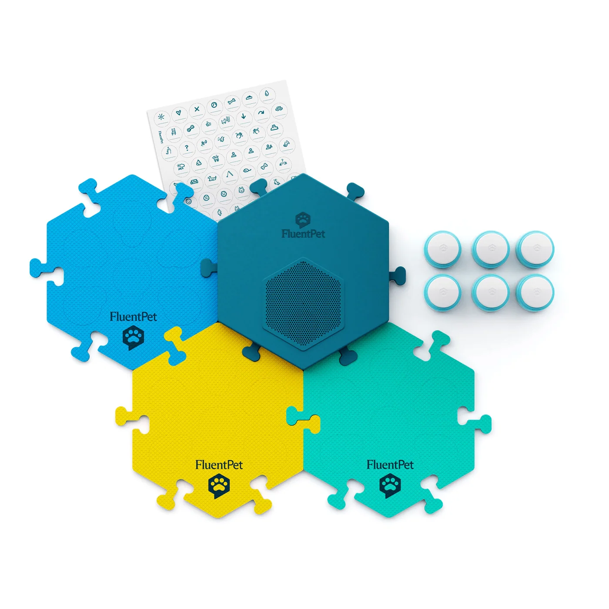
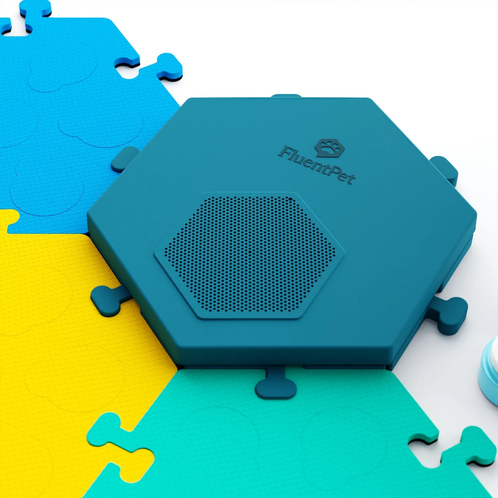
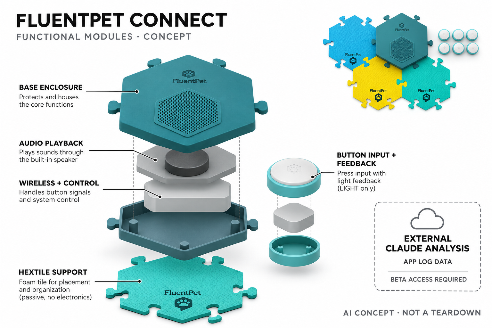

# FluentPet Connect Get Started Kit

**FluentPet** · 宠物照护 · 核查 2026-11-05

记录宠物按键互动，并可申请外部Claude分析训练日志的Beta连接

消费渠道：个人零售。

## 产品图片与结构参考

### 产品图

官方Connect入门套装 · 来源：[FluentPet · 官方图片](<https://fluent.pet/products/connect-get-started-kit-bold-with-base>) · [原始图片](<https://fluent.pet/cdn/shop/files/FluentPet-Connect-Get-Started-Kit-Top.png?v=1760472280&width=1400>)

### 参考图

官方同型号Base近景 · 来源：[FluentPet · 官方图片](<https://fluent.pet/products/connect-get-started-kit-bold-with-base>) · [原始图片](<https://fluent.pet/cdn/shop/products/Connect-Get-Started-Kit-Closeup.jpg?v=1760472555&width=1400>)

### AI 生成爆炸示意

**AI 生成 · 非实物拆机。** 内部为概念推断，不能作为元件布局、BOM 或维修依据。[生成提示词](../../content/hardware/prompts/fluentpet-connect.txt)

> 依据已核验官方外形与公开功能生成；未知内部仅为概念功能块，不代表原机电路板、芯片或实际布局。

> 已目视核对准确型号，保持官方图片未编辑；营销场景与界面示意不构成性能或医疗效果验证。

> 分析为基于公开资料的案头研究与 AI 辅助判断，未经用户访谈、销量审计或实物拆机。需求、画像、竞争冷门度、审美及商业机会均为研究假设，不是投资结论。

## 销售与购买

- 状态：在售。官方当前Connect入门套装美区US$200、Add to cart可用，注明美国含Connect订单11月5日发货；已浏览器核对。硬件在售不代表AI Beta自动开通，逐账户申请条件另列。

- 地区：美国、其他地区以结算确认

- 价格：美区官方 US$200。当前入门套装含Base与六个Connect按钮；颜色、按钮扩展包不重复收录。AI自定义连接依赖FluentPet逐账户Beta开通，Claude相应付费计划或可用客户端成本不包含在硬件价中。

- 中国大陆：官方有全球货币地区选择，但当前配送政策主要明确美国；未验证大陆配送、售后以及Claude服务可达性。地区下拉框出现China不等同确认能购买并使用AI连接。

- [官方产品 / 商店](<https://fluent.pet/products/connect-get-started-kit-bold-with-base>)

## AI 的实际作用

官方2026年10月文档提供MCP到Claude的Beta连接，对Connect硬件产生的按钮记录和训练备注进行查询、模式总结与笔记生成；不声称按钮本体内置大模型或翻译犬猫语言。

服务与联网依赖：必须先由FluentPet为该账户开启Beta，再授权外部Claude连接；官方仅测试Claude，自定义连接需适用方案。没有开通时只是联网记录与声音播放硬件，不应承诺所有买家即买即用AI。

## 是否冷门

细分专业（研究判断）：宠物按钮教学本身是细分兴趣，专属硬件日志连接生成式分析具有不同工作流；AI仍为需逐账户启用的外部Beta，成熟度和可达性受限。

## 需求与市场

需求假设：长期教宠物使用按钮的家庭会积累大量零散记录，可能需要整理时间、组合与训练备注。AI价值在减少人工翻阅，而非证明动物真正表达了某种复杂想法；若训练尚未形成记录，额外分析也难产生可靠帮助。

### 产品任务与边界 · 研究判断

需求假设：长期教宠物使用按钮的家庭会积累大量零散记录，可能需要整理时间、组合与训练备注。AI价值在减少人工翻阅，而非证明动物真正表达了某种复杂想法；若训练尚未形成记录，额外分析也难产生可靠帮助。

依据：[FluentPet Connect当前官方商品页](<https://fluent.pet/products/connect-get-started-kit-bold-with-base>) · [FluentPet官方Claude连接文档](<https://support.fluent.pet/app/claude/>)

### 需求判断 · 研究判断

判断：生成式分析适合整理已经存在且有上下文的训练记录，不会自动填补主人没有记录的情境。按钮次数、时间或组合只能支持观察假设，不能独立证明宠物理解了词义；硬件的自动记录价值和AI解释价值应分别衡量。

依据：[FluentPet Connect当前官方商品页](<https://fluent.pet/products/connect-get-started-kit-bold-with-base>) · [FluentPet官方Claude连接文档](<https://support.fluent.pet/app/claude/>)

### 需求验证 · 待验证

验证：让训练者先人工回顾一段带情境备注的记录，再对照获准Beta连接生成的总结，检查是否节省时间和是否误读。保留原始按压与人工判断的区别，不以故事生动程度评价分析质量，也不把无日志的新用户算作已有分析需求。

依据：[FluentPet Connect当前官方商品页](<https://fluent.pet/products/connect-get-started-kit-bold-with-base>) · [FluentPet官方Claude连接文档](<https://support.fluent.pet/app/claude/>)

## 用户画像

画像推断：愿意耐心教学、持续记录背景并审阅生成解释的宠物主人较匹配。家庭成员需要一致记录谁按了按钮和当时情境，宠物不愿参与也应尊重；不能因为主人喜欢拟人化表达，就把任何随机按压理解成语言学习成果。

### 适用行为与条件 · 研究判断

画像推断：愿意耐心教学、持续记录背景并审阅生成解释的宠物主人较匹配。家庭成员需要一致记录谁按了按钮和当时情境，宠物不愿参与也应尊重；不能因为主人喜欢拟人化表达，就把任何随机按压理解成语言学习成果。

依据：[FluentPet Connect当前官方商品页](<https://fluent.pet/products/connect-get-started-kit-bold-with-base>) · [FluentPet官方Claude连接文档](<https://support.fluent.pet/app/claude/>)

### 人群取舍 · 研究判断

判断：愿意持续教学和反复核对的人，比只想听到宠物说话的人更接近该连接的目标。家庭中的记录者、按钮操作者和宠物可能混杂，多个宠物共用板面时尤其需要明确事件归属，不能从一个账户的统计自动推断个体学习情况。

依据：[FluentPet Connect当前官方商品页](<https://fluent.pet/products/connect-get-started-kit-bold-with-base>) · [FluentPet官方Claude连接文档](<https://support.fluent.pet/app/claude/>)

### 画像验证 · 待验证

验证：观察家庭成员能否一致记录训练背景、区分误触与有意按压，并接受模型有时无法解释。让潜在用户理解逐账户开通和外部付费方案后再判断兴趣，避免以看到短视频后的冲动购买意愿代替长期教学及数据审阅能力。

依据：[FluentPet Connect当前官方商品页](<https://fluent.pet/products/connect-get-started-kit-bold-with-base>) · [FluentPet官方Claude连接文档](<https://support.fluent.pet/app/claude/>)

## 竞争与替代

竞争判断：与普通录音按钮、纸笔记录及人工查看应用统计竞争，差异在无线自动记录和官方外部AI数据连接。Beta依赖意味着当前门槛高于即用硬件，不以同一Base的按钮数量、颜色或套装拆出多款创新产品。

### 比较对象与差异 · 研究判断

竞争判断：与普通录音按钮、纸笔记录及人工查看应用统计竞争，差异在无线自动记录和官方外部AI数据连接。Beta依赖意味着当前门槛高于即用硬件，不以同一Base的按钮数量、颜色或套装拆出多款创新产品。

依据：[FluentPet Connect当前官方商品页](<https://fluent.pet/products/connect-get-started-kit-bold-with-base>) · [FluentPet官方Claude连接文档](<https://support.fluent.pet/app/claude/>)

### 竞争判断 · 研究判断

判断：普通录音按钮已经能提供声音反馈，应用统计也能显示次数，Connect加外部AI的差异在减少查询和整理步骤。若用户只是想知道最常按哪个按钮，简单列表可能更直接，生成式解释需要在更复杂回顾任务中证明额外价值。

依据：[FluentPet Connect当前官方商品页](<https://fluent.pet/products/connect-get-started-kit-bold-with-base>) · [FluentPet官方Claude连接文档](<https://support.fluent.pet/app/claude/>)

### 竞争验证 · 待验证

验证：比较纸笔记录、Connect应用统计和获准AI连接三种方式处理同一训练问题的耗时与错误。将Base、不同按钮数量及颜色视为同一核心任务，单独计入外部账户费用和申请门槛，不把扩展包或兼容摄像配件算成新的场景。

依据：[FluentPet Connect当前官方商品页](<https://fluent.pet/products/connect-get-started-kit-bold-with-base>) · [FluentPet官方Claude连接文档](<https://support.fluent.pet/app/claude/>)

## 供应链

供应链分析：按压开关、反馈灯、无线电路、Base扬声器、电源及拼接板形成系统，制造工厂与BOM未披露。耐踩、易清洁和丢失事件处理影响日志质量，外部大模型能力不能补偿按钮触发不稳定或家庭记录语义不一致。

### 功能模块拆分 · 研究判断

模块拆分：圆形按键负责触发和灯光反馈，Base集中播放录音并把互动送到应用，拼接板只承担位置组织。官方连接让外部模型访问应用记录而非直接读取动物思维，概念图应将被动泡棉板、实体电路和云端分析明确分开。

依据：[FluentPet Connect当前官方商品页](<https://fluent.pet/products/connect-get-started-kit-bold-with-base>) · [FluentPet官方Claude连接文档](<https://support.fluent.pet/app/claude/>)

### 制造与供应约束 · 研究判断

供应链分析：按压开关、反馈灯、无线电路、Base扬声器、电源及拼接板形成系统，制造工厂与BOM未披露。耐踩、易清洁和丢失事件处理影响日志质量，外部大模型能力不能补偿按钮触发不稳定或家庭记录语义不一致。

依据：[FluentPet Connect当前官方商品页](<https://fluent.pet/products/connect-get-started-kit-bold-with-base>) · [FluentPet官方Claude连接文档](<https://support.fluent.pet/app/claude/>)

### 候选与证据缺口 · 研究判断

候选判断：歌尔公开声学和智能硬件能力可评估Base声音播放与整合，PCH的产品开发到制造服务可评估按钮与拼接板的量产流程。没有两家公司参与FluentPet该型号的公开证据，实际按压寿命、材料及事件丢失率仍需产品验证。

依据：[FluentPet Connect当前官方商品页](<https://fluent.pet/products/connect-get-started-kit-bold-with-base>) · [FluentPet官方Claude连接文档](<https://support.fluent.pet/app/claude/>)

## 技术路径

技术判断：硬件负责采集按键与播放声音，MCP提供读取记录及写备注权限，Claude在外部做生成式分析。官方逐账户启用Beta且只验证Claude，不能把接入标准当成已内置AI，更不能将相关性总结解释为动物语言翻译或医学判断。

### 已披露技术边界 · 研究判断

技术判断：硬件负责采集按键与播放声音，MCP提供读取记录及写备注权限，Claude在外部做生成式分析。官方逐账户启用Beta且只验证Claude，不能把接入标准当成已内置AI，更不能将相关性总结解释为动物语言翻译或医学判断。

依据：[FluentPet Connect当前官方商品页](<https://fluent.pet/products/connect-get-started-kit-bold-with-base>) · [FluentPet官方Claude连接文档](<https://support.fluent.pet/app/claude/>)

### 系统难点判断 · 研究判断

判断：MCP是数据与工具连接方式，实际生成推理由外部Claude完成，硬件不会因此变成端侧大模型设备。官方允许查询互动和编辑备注，但限制改动按钮及账户，权限边界应与用户对AI能做什么的理解保持一致，而非宣传完全自治训练。

依据：[FluentPet Connect当前官方商品页](<https://fluent.pet/products/connect-get-started-kit-bold-with-base>) · [FluentPet官方Claude连接文档](<https://support.fluent.pet/app/claude/>)

### 技术验证 · 待验证

验证：在厂商已开通的测试账户里核对时间过滤、事件计数和组合查询是否可追溯原始记录，并检查生成备注标记。测试撤销连接后的访问变化，分别评估记录缺失与模型误解；本次案头研究未替任何账户申请或授权，不能假称已实机验证。

依据：[FluentPet Connect当前官方商品页](<https://fluent.pet/products/connect-get-started-kit-bold-with-base>) · [FluentPet官方Claude连接文档](<https://support.fluent.pet/app/claude/>)

## 产品审美

审美判断：六边形拼接板和圆按钮像家庭训练玩具，Base集中扬声器减少每个按键的声学体积。色彩与词语贴纸便于主人整理，却不证明宠物按人类语义分类；布局需要兼顾清洁、空间和脚爪操作，不只看社交媒体展示。

### 外观与交互语言 · 研究判断

审美判断：六边形拼接板和圆按钮像家庭训练玩具，Base集中扬声器减少每个按键的声学体积。色彩与词语贴纸便于主人整理，却不证明宠物按人类语义分类；布局需要兼顾清洁、空间和脚爪操作，不只看社交媒体展示。

依据：[FluentPet Connect当前官方商品页](<https://fluent.pet/products/connect-get-started-kit-bold-with-base>) · [FluentPet官方Claude连接文档](<https://support.fluent.pet/app/claude/>)

### 使用中审美判断 · 研究判断

判断：模块化六边形布局鼓励主人按场景组织按钮，也可能逐渐占据家中主要活动区。词语贴纸和颜色是人的整理工具，不能假定宠物依赖相同分类；可清洁、防滑和容易触发的实际体验，比摆成漂亮图案更影响持续使用。

依据：[FluentPet Connect当前官方商品页](<https://fluent.pet/products/connect-get-started-kit-bold-with-base>) · [FluentPet官方Claude连接文档](<https://support.fluent.pet/app/claude/>)

### 设计验证 · 待验证

验证：在不同地面观察板面滑动、脚爪触发和清洁步骤，记录多人经过时的误碰。让主人解释按钮灯光与Base出声的区别，并检查新增按钮后布局记忆是否受影响；外观评估应同时考虑宠物参与意愿，而不只是主人分享照片的效果。

依据：[FluentPet Connect当前官方商品页](<https://fluent.pet/products/connect-get-started-kit-bold-with-base>) · [FluentPet官方Claude连接文档](<https://support.fluent.pet/app/claude/>)

## 关键风险

风险判断：误触、多人多宠混用和遗漏情境可能让AI从不可靠日志推断过多，生成笔记又会影响后续解释。Beta服务变化、外部账户费用与授权范围是实际依赖，购入硬件不保证获准连接，也不能用按钮记录替代宠物专业照护。

### 主要失效与依赖 · 研究判断

风险判断：误触、多人多宠混用和遗漏情境可能让AI从不可靠日志推断过多，生成笔记又会影响后续解释。Beta服务变化、外部账户费用与授权范围是实际依赖，购入硬件不保证获准连接，也不能用按钮记录替代宠物专业照护。

依据：[FluentPet Connect当前官方商品页](<https://fluent.pet/products/connect-get-started-kit-bold-with-base>) · [FluentPet官方Claude连接文档](<https://support.fluent.pet/app/claude/>)

### 风险传播判断 · 研究判断

判断：一段生成式解释若被写回训练历史，后续总结可能再引用它，从而让推测越来越像事实。官方AI笔记标记有助于区分来源，但仍需要人工审阅；宠物出现身体异常时，按键模式分析不能代替直接观察或专业照护。

依据：[FluentPet Connect当前官方商品页](<https://fluent.pet/products/connect-get-started-kit-bold-with-base>) · [FluentPet官方Claude连接文档](<https://support.fluent.pet/app/claude/>)

### 风险验证 · 待验证

验证：对包含误触、多宠混用和缺少背景的日志检查模型是否承认不确定，追踪生成笔记在后续分析中的引用。核对外部授权、共享家庭范围及删除流程，确认用户理解Beta可能变化，购入硬件本身不保证立即获得该AI功能。

依据：[FluentPet Connect当前官方商品页](<https://fluent.pet/products/connect-get-started-kit-bold-with-base>) · [FluentPet官方Claude连接文档](<https://support.fluent.pet/app/claude/>)

## 机会与验证

机会假设：可先验证训练者是否更容易回顾真实互动并发现记录缺口，而不是宣传宠物开始说完整句子。若简单统计已足够，生成式解释可能增加误读；可追溯原始按压与人工备注的审阅流程比人格化故事更有持续价值。

### 可能的机会入口 · 研究判断

机会假设：可先验证训练者是否更容易回顾真实互动并发现记录缺口，而不是宣传宠物开始说完整句子。若简单统计已足够，生成式解释可能增加误读；可追溯原始按压与人工备注的审阅流程比人格化故事更有持续价值。

依据：[FluentPet Connect当前官方商品页](<https://fluent.pet/products/connect-get-started-kit-bold-with-base>) · [FluentPet官方Claude连接文档](<https://support.fluent.pet/app/claude/>)

### 机会成立条件 · 研究判断

判断：可追溯的训练回顾比夸张的动物语言翻译更有可持续机会，让用户快速找到真实事件和下一步观察问题。若多数价值仅来自记录而非生成解释，产品也应允许保留简单流程，避免为了AI标签增加成本、权限和理解负担。

依据：[FluentPet Connect当前官方商品页](<https://fluent.pet/products/connect-get-started-kit-bold-with-base>) · [FluentPet官方Claude连接文档](<https://support.fluent.pet/app/claude/>)

### 下一步验证 · 待验证

验证：跟踪训练者一个周期内实际提出的问题、采纳的建议及纠正的错误，观察AI是否帮助改善记录完整性。分别测量硬件持续使用和外部连接续用，不用社群人数或热门宠物视频直接推算AI付费市场，也不承诺所有宠物都能学会。

依据：[FluentPet Connect当前官方商品页](<https://fluent.pet/products/connect-get-started-kit-bold-with-base>) · [FluentPet官方Claude连接文档](<https://support.fluent.pet/app/claude/>)

## 对应供应链公司

能力候选用于选型研究，不代表本产品实际采用；未公开的供货关系不作推断。

- [goertek](../supply-chain/goertek.md) — **能力候选 · 非已采用** / Base音频播放及电子集成：歌尔公开声学与智能硬件能力可对应Connect Base的录音播放、声学结构与电子集成需求。未发现该型号采购或制造披露，因此仅是候选匹配；不能把其声学能力推定为实际采用，更不能据此推断宠物学习效果。

- [pch-international](../supply-chain/pch-international.md) — **能力候选 · 非已采用** / 按钮与Base系统的制造准备：PCH公开从产品开发到制造供应链的服务可作为按钮、Base和配件协同量产的工程候选。未确认FluentPet合作关系，材料耐踩、按压一致性和记录完整性仍须针对家庭宠物场景验证，不能由通用服务范围直接保证。

[浏览供应链目录](../supply-chain.md)

## 功能分层示意

这是功能关系，不是实物拆机、真实空间结构或已核实 BOM。

1. **实体按钮**：按下发送事件并显示反馈，不假造内置语言模型。（官方披露）

2. **Base扬声器**：集中播放用户录制的词语或声音。（官方披露）

3. **无线与供电**：按钮、Base与应用之间的连接和电源功能。（官方披露）

4. **HexTiles定位板**：可拼接的按钮摆放基底，非电子AI部件。（官方披露）

5. **外部数据与AI Beta**：按键日志进入应用，获准账户可通过MCP授权Claude分析。（官方披露）

## 来源

1. [FluentPet Connect当前官方商品页](<https://fluent.pet/products/connect-get-started-kit-bold-with-base>) — 2026-11-05实际打开US$200与加购，浏览器确认当前商品及发货提示；不同本地货币显示不混同美元价。

2. [FluentPet官方Claude连接文档](<https://support.fluent.pet/app/claude/>) — 实际阅读2026-10-23文档，逐账户Beta、适用Claude连接方案、查询范围、仅备注写入及AI标记；未替用户申请或授权。

3. [FluentPet官方Connect说明](<https://support.fluent.pet/connect/>) — 实际打开Base播放、无线按钮发送记录至应用的机制；不把原始声板自动算作AI。

4. [FluentPet官方配送政策](<https://fluent.pet/policies/shipping-policy>) — 实际打开美国配送条件；全球地区选择未作为大陆配送与AI可用性证据。

[返回目录](../hardware-market.md) · [网页分析](https://romanagent.github.io/Roman/#hardware/product/fluentpet-connect)
