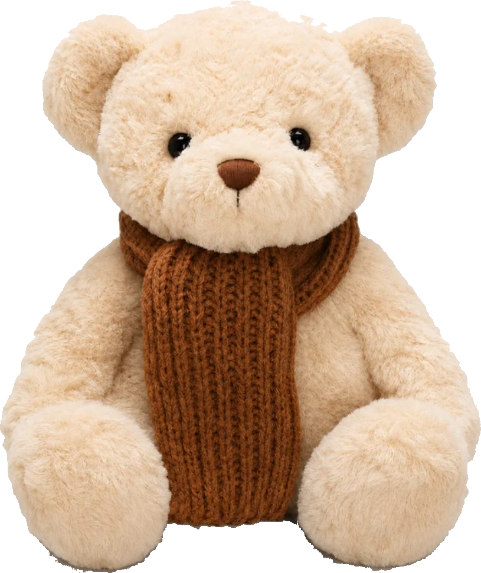
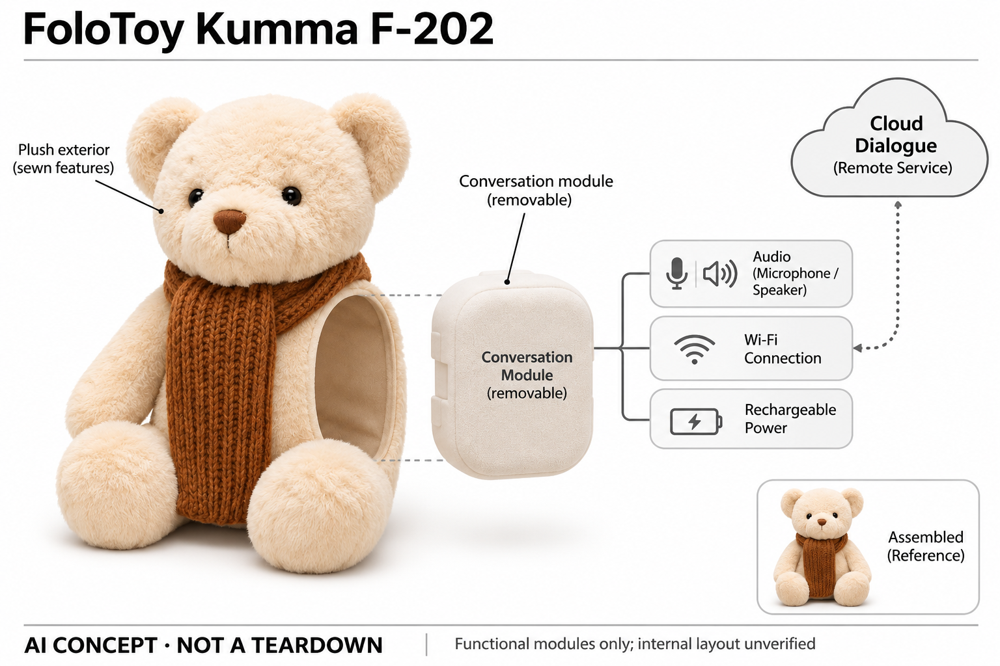

# FoloToy Kumma F-202

**FoloToy** · AI玩具 · 核查 2026-11-06

把可拆语音模块放进传统泰迪熊，提供按键式云端聊天。

消费渠道：个人零售。

## 产品图片与结构参考

### 产品图

FoloToy Kumma F-202 官方产品图 · 来源：[FoloToy · 官方图片](<https://store.folotoy.com/products/folotoy-ai-teddy>) · [原始图片](<https://cdn.shopify.com/s/files/1/0586/6058/5547/files/kumma-overseas-cutout.png?v=1793542438>)

### 参考图

FoloToy Kumma F-202 官方参考图（含厂商展示场景） · 来源：[FoloToy · 官方图片](<https://store.folotoy.com/products/folotoy-ai-teddy>) · [原始图片](<https://cdn.shopify.com/s/files/1/0586/6058/5547/files/b363db57ccaf7b36813ed705912d9e09.png?v=1781179930>)

### AI 生成爆炸示意

**AI 生成 · 非实物拆机。** 内部为概念推断，不能作为元件布局、BOM 或维修依据。[生成提示词](../../content/hardware/prompts/folotoy-kumma.txt)

> 单独内置ImageGen生成并目视核验；云端与机内功能分开，未知结构为抽象功能层，不代表原厂PCB或真实装配。

> 保留官方原图内容；场景或宣传文字不代表本研究实测，Kumma两张为同款外观展示。

> 分析为基于公开资料的案头研究与 AI 辅助判断，未经用户访谈、销量审计或实物拆机。需求、画像、竞争冷门度、审美及商业机会均为研究假设，不是投资结论。

## 销售与购买

- 状态：在售。官方商品页可加购，公开商品JSON available=true；35厘米泰迪熊F-202独立成品，不把Momo同模块换壳另外计数。

- 地区：海外官方商店（具体配送范围以结算为准）

- 价格：US$99。价格为海外官方整机参考；旧介绍页另有试用及会员措辞，本次未验证当前结算套餐，不能写永久免费。

- 中国大陆：官方海外商店国家选择器包含China，但运输政策仅写标准配送免费，没有明确中国大陆可送达承诺；未验证大陆地址结算、税费、售后或云服务，因此国内购买情况待确认。

- [官方产品 / 商店](<https://store.folotoy.com/products/folotoy-ai-teddy>)

## AI 的实际作用

用户按键录入语音，经联网服务理解话语并生成回复，再由玩具播音。静态毛绒面部、洗涤和普通按钮本身不是AI；本轮不承诺某个底层模型或永久记忆。

服务与联网依赖：需要2.4GHz Wi-Fi及云服务，热点可作为网络方式；开箱须配置连接，会员与内容规则以实际销售版本为准。

## 是否冷门

新兴竞争（研究判断）：对话毛绒已出现多家竞争者，模块化维护是可比较特点，不等于无人竞争。

## 需求与市场

Kumma把手机里的语音交谈移到一只可以抱住的泰迪熊上，主要任务是闲聊、问答和共同讲故事。需求可能来自喜欢毛绒触感又希望获得回应的用户，而不是需要更大屏幕或更多课程的人；是否有持续价值，要看实体接触是否改变互动习惯，不能把第一次会说话的新鲜感当作长期陪伴需求。

### 任务判断 · 研究判断

Kumma把手机里的语音交谈移到一只可以抱住的泰迪熊上，主要任务是闲聊、问答和共同讲故事。需求可能来自喜欢毛绒触感又希望获得回应的用户，而不是需要更大屏幕或更多课程的人；是否有持续价值，要看实体接触是否改变互动习惯，不能把第一次会说话的新鲜感当作长期陪伴需求。

依据：[Kumma F-202官方商品页](<https://store.folotoy.com/products/folotoy-ai-teddy>) · [FoloToy商店与使用FAQ](<https://store.folotoy.com/>)

### 触发场景 · 研究判断

按住说话再松开听回答的方式适合一问一答，也让录音的起止相对可见。睡前或家庭活动中，用户可能希望把内容讨论留在玩具上，但每轮都要操作按钮，不能直接等同自然多人聊天；购买动机还应区分礼物外观、角色喜爱和实际经常使用的对话任务。

依据：[Kumma F-202官方商品页](<https://store.folotoy.com/products/folotoy-ai-teddy>) · [FoloToy商店与使用FAQ](<https://store.folotoy.com/>)

### 需求验证 · 待验证

可用同一段原创故事分别通过普通毛绒加家长讲述、手机语音助手和Kumma完成，记录使用者主动开启次数、等待与求助次数。测试应持续到开箱热度下降之后，并把成人配置网络所花的时间计入，而不是只统计设备回答了多少问题或输出多少故事内容。

依据：[Kumma F-202官方商品页](<https://store.folotoy.com/products/folotoy-ai-teddy>) · [FoloToy商店与使用FAQ](<https://store.folotoy.com/>)

## 用户画像

画像推断：愿意使用按键语音、家中有稳定无线网络且有人管理账户与充电的家庭，更容易完成Kumma的使用闭环。喜爱泰迪熊的成人也可能购买，不能仅凭商品有儿童场景就忽略年龄指引；实际适用年龄、监护和服务条件应按具体包装与当前条款确认。

### 适用画像 · 研究判断

画像推断：愿意使用按键语音、家中有稳定无线网络且有人管理账户与充电的家庭，更容易完成Kumma的使用闭环。喜爱泰迪熊的成人也可能购买，不能仅凭商品有儿童场景就忽略年龄指引；实际适用年龄、监护和服务条件应按具体包装与当前条款确认。

依据：[Kumma F-202官方商品页](<https://store.folotoy.com/products/folotoy-ai-teddy>) · [FoloToy商店与使用FAQ](<https://store.folotoy.com/>)

### 购买与使用分离 · 研究判断

送礼者可能只看到熊的外形，接收者却需要安装配置和理解云端服务。因此用户画像应至少区分付款人、设置人和每日使用者，尤其关注家庭成员是否愿意承担维护；如果设备故障后只有送礼者懂如何处理，表面友好的毛绒形态会掩盖真实的技术门槛。

依据：[Kumma F-202官方商品页](<https://store.folotoy.com/products/folotoy-ai-teddy>) · [FoloToy商店与使用FAQ](<https://store.folotoy.com/>)

### 画像验证 · 待验证

招募时可分别观察成人自用、成人送礼和家长陪同三个场景，检查他们能否独立解释按钮、联网状态和不能回答的问题。若使用者不愿按键或对长回答没有耐心，应记录为不适配，不把年龄、购买能力或对可爱外观的评价直接当成产品成功的人群标签。

依据：[Kumma F-202官方商品页](<https://store.folotoy.com/products/folotoy-ai-teddy>) · [FoloToy商店与使用FAQ](<https://store.folotoy.com/>)

## 竞争与替代

Kumma与普通泰迪熊、儿童音频播放器和手机聊天应用竞争，优势候选是实体触感与直接语音入口，代价是联网和充电。FoloToy的Momo也采用MagicBox毛绒方案，本目录不把换成熊猫外形视为新的核心需求；比较重点应是对话控制、可维护性与服务稳定。

### 替代方案 · 研究判断

Kumma与普通泰迪熊、儿童音频播放器和手机聊天应用竞争，优势候选是实体触感与直接语音入口，代价是联网和充电。FoloToy的Momo也采用MagicBox毛绒方案，本目录不把换成熊猫外形视为新的核心需求；比较重点应是对话控制、可维护性与服务稳定。

依据：[Kumma F-202官方商品页](<https://store.folotoy.com/products/folotoy-ai-teddy>) · [FoloToy商店与使用FAQ](<https://store.folotoy.com/>)

### 与挂件区别 · 研究判断

已有BubblePal可以附着在用户喜欢的玩具上，Kumma则交付一只完整泰迪熊，减少选择载体的步骤，却限制了外形自由。可拆模块降低清洁冲突，但不自动说明兼容所有第三方毛绒；其差异是整机交付和模块维护，不是仅凭同样会聊天就宣称替代所有陪伴机器人。

依据：[Kumma F-202官方商品页](<https://store.folotoy.com/products/folotoy-ai-teddy>) · [FoloToy商店与使用FAQ](<https://store.folotoy.com/>)

### 比较验证 · 待验证

可统一网络环境和提问脚本，对比Kumma、手机助手与传统录音故事机的操作负担、内容可预测性和停止能力。对不适合生成式回答的任务，要允许固定内容方案胜出；不以语种数量、云端模型名或角色宣传代替对具体使用体验的测量。

依据：[Kumma F-202官方商品页](<https://store.folotoy.com/products/folotoy-ai-teddy>) · [FoloToy商店与使用FAQ](<https://store.folotoy.com/>)

## 供应链

公开信息可拆为毛绒外套、可移除对话模块、语音输入输出、无线连接和充电供电。云端模型属于外部服务，不能按整只熊的体积估计本地算力；厂家没有公开完整主板、代工厂或采购表，图中的功能块仅帮助理解职责，不代表已经验证的装配顺序或物料清单。

### 功能拆分 · 研究判断

公开信息可拆为毛绒外套、可移除对话模块、语音输入输出、无线连接和充电供电。云端模型属于外部服务，不能按整只熊的体积估计本地算力；厂家没有公开完整主板、代工厂或采购表，图中的功能块仅帮助理解职责，不代表已经验证的装配顺序或物料清单。

依据：[Kumma F-202官方商品页](<https://store.folotoy.com/products/folotoy-ai-teddy>) · [FoloToy商店与使用FAQ](<https://store.folotoy.com/>)

### 制造约束 · 研究判断

Kumma的软外壳需要和硬电子盒共存，缝线、模块固定以及用户取出后能否正确装回都会影响耐用性。扬声器穿过填充物后的音量、麦克风被抱住后的拾音与清洁误操作，需要整机样品验证；不能把标准模块价格直接换算成可售成品成本。

依据：[Kumma F-202官方商品页](<https://store.folotoy.com/products/folotoy-ai-teddy>) · [FoloToy商店与使用FAQ](<https://store.folotoy.com/>)

### 候选选择 · 研究判断

Seeed Studio可作为语音联网原型及电子装联的工程候选，瑞声可作为小型扬声器与声学调试候选。两者公开能力并不证明为Kumma供货，毛绒工艺、儿童使用条件、模块封装和云端服务还要分别评估；实际订单数量、测试责任与返修方式均需项目询价确认。

依据：[Kumma F-202官方商品页](<https://store.folotoy.com/products/folotoy-ai-teddy>) · [FoloToy商店与使用FAQ](<https://store.folotoy.com/>)

## 技术路径

官方说明Kumma通过无线网络连接云端对话，按键控制语音输入，再播放系统回复。可确认的是语言理解与生成参与交互，而非单纯固定录音；但当前商品页没有足够证据确认所有语种、模型版本、长期记忆策略或本地离线推理，不应把旧推广页的技术名称写成当前硬事实。

### 已知链路 · 研究判断

官方说明Kumma通过无线网络连接云端对话，按键控制语音输入，再播放系统回复。可确认的是语言理解与生成参与交互，而非单纯固定录音；但当前商品页没有足够证据确认所有语种、模型版本、长期记忆策略或本地离线推理，不应把旧推广页的技术名称写成当前硬事实。

依据：[Kumma F-202官方商品页](<https://store.folotoy.com/products/folotoy-ai-teddy>) · [FoloToy商店与使用FAQ](<https://store.folotoy.com/>)

### 系统难点 · 研究判断

毛绒玩具常被贴近胸口或放进被子，材料遮挡会改变拾音和播放，按键虽然明确轮次，却可能截断迟疑或低声表达。云端生成的内容还需要适应短注意力和不同表达方式，因此硬件响应、语音识别和回答策略必须一起观察，不能单测文本模型后推断整机效果。

依据：[Kumma F-202官方商品页](<https://store.folotoy.com/products/folotoy-ai-teddy>) · [FoloToy商店与使用FAQ](<https://store.folotoy.com/>)

### 技术验证 · 待验证

建议使用短句、含糊指代、背景电视声与网络中断等条件测试，记录输入被截断、回答延迟和恢复流程。清晰区分语音未识别、模型答错和播放失败，检查按钮释放后是否仍有输入提示；这些是建议验证步骤，本轮没有拿到实物或声学测试数据。

依据：[Kumma F-202官方商品页](<https://store.folotoy.com/products/folotoy-ai-teddy>) · [FoloToy商店与使用FAQ](<https://store.folotoy.com/>)

## 产品审美

米色泰迪熊与针织围巾接近传统毛绒礼物，技术隐藏在可拆模块中，能降低电子设备的视觉存在感。这样的设计也可能让使用者忽略设备需要联网与充电；审美评价应同时包含抱持舒适、按钮寻找和维护可理解性，而不是只看摄影棚里柔软可爱的外观。

### 外观判断 · 研究判断

米色泰迪熊与针织围巾接近传统毛绒礼物，技术隐藏在可拆模块中，能降低电子设备的视觉存在感。这样的设计也可能让使用者忽略设备需要联网与充电；审美评价应同时包含抱持舒适、按钮寻找和维护可理解性，而不是只看摄影棚里柔软可爱的外观。

依据：[Kumma F-202官方商品页](<https://store.folotoy.com/products/folotoy-ai-teddy>) · [FoloToy商店与使用FAQ](<https://store.folotoy.com/>)

### 交互可见性 · 研究判断

没有屏幕让熊的眼睛保持普通玩具的静态表情，使用者不能靠面部判断正在录音、思考还是断网。声音提示与按键反馈因此承担更多状态表达责任，既要能被理解，也不能在夜间过分打扰；这种克制外观的代价应在产品分析中明确说明。

依据：[Kumma F-202官方商品页](<https://store.folotoy.com/products/folotoy-ai-teddy>) · [FoloToy商店与使用FAQ](<https://store.folotoy.com/>)

### 审美验证 · 待验证

把样机放进真实沙发、床边与玩具收纳空间，观察围巾、毛绒和电子盒是否影响抱持，记录充电时是否难看或难操作。清洁后重新装回的外观和触感同样重要，不能只用全新状态下的照片评价长期品质，也不把广告里的亲密姿态视为用户接受度证据。

依据：[Kumma F-202官方商品页](<https://store.folotoy.com/products/folotoy-ai-teddy>) · [FoloToy商店与使用FAQ](<https://store.folotoy.com/>)

## 关键风险

Kumma的回应依赖云服务，停服、网络问题或套餐变化会改变玩具功能，购买硬件不等于买断所有未来内容。官网安全支持期限是品牌声明，不代表每个回答适龄或不存在隐私风险；需要在使用时检查最新账户、数据和监护设置，而非把柔软外观当作安全保证。

### 云端风险 · 研究判断

Kumma的回应依赖云服务，停服、网络问题或套餐变化会改变玩具功能，购买硬件不等于买断所有未来内容。官网安全支持期限是品牌声明，不代表每个回答适龄或不存在隐私风险；需要在使用时检查最新账户、数据和监护设置，而非把柔软外观当作安全保证。

依据：[Kumma F-202官方商品页](<https://store.folotoy.com/products/folotoy-ai-teddy>) · [FoloToy商店与使用FAQ](<https://store.folotoy.com/>)

### 清洁与误用 · 研究判断

可拆电子模块帮助清洗毛绒，但也带来忘记取出、湿件装回和丢失模块等风险。商品说明要求保持电子部件干燥，应把实际维护步骤纳入成人设置；如果儿童把设备当成普通可以随意水洗的玩具，外观与电子属性之间的认知差距就是重要设计问题。

依据：[Kumma F-202官方商品页](<https://store.folotoy.com/products/folotoy-ai-teddy>) · [FoloToy商店与使用FAQ](<https://store.folotoy.com/>)

### 风险验证 · 待验证

应检查无法联网和云端拒答时的反馈是否容易理解，测试关机、清除账户与转赠设备的流程，并确认使用者知道何时要请真人帮助。评估内容边界可用常见困惑与不适龄话题进行受控测试，不让儿童承担探测错误的任务，也不声称本轮已经完成安全认证。

依据：[Kumma F-202官方商品页](<https://store.folotoy.com/products/folotoy-ai-teddy>) · [FoloToy商店与使用FAQ](<https://store.folotoy.com/>)

## 机会与验证

机会可能在于把可维护的对话模块和熟悉毛绒结合，让已有故事与家庭交流有一个稳定入口。若使用者只需要固定儿歌和短故事，传统播放器可能更合适，因此创业验证应先证明生成式互动带来的新增行为，而不是不断更换毛绒外壳扩大型号数量。

### 机会判断 · 研究判断

机会可能在于把可维护的对话模块和熟悉毛绒结合，让已有故事与家庭交流有一个稳定入口。若使用者只需要固定儿歌和短故事，传统播放器可能更合适，因此创业验证应先证明生成式互动带来的新增行为，而不是不断更换毛绒外壳扩大型号数量。

依据：[Kumma F-202官方商品页](<https://store.folotoy.com/products/folotoy-ai-teddy>) · [FoloToy商店与使用FAQ](<https://store.folotoy.com/>)

### 服务机会 · 研究判断

模块可拆使维修、换洗与礼物重新配置有机会形成更清楚的服务流程，但这需要备件、账户解绑和持续支持共同成立。当前没有公开数据证明此类服务已经带来收入或留存，目录仅将它作为可验证方向，不按硬件销量宣传推导订阅收入或用户忠诚。

依据：[Kumma F-202官方商品页](<https://store.folotoy.com/products/folotoy-ai-teddy>) · [FoloToy商店与使用FAQ](<https://store.folotoy.com/>)

### 商业验证 · 待验证

建议用小规模真实付费试用比较整机售价、服务费与替代工具成本，记录一个月后愿意继续用的具体理由。把送礼后的闲置、配置失败、清洁需求和回答不满意都计入结果；只有确认反复发生的使用价值，才有理由扩大角色与内容投入。

依据：[Kumma F-202官方商品页](<https://store.folotoy.com/products/folotoy-ai-teddy>) · [FoloToy商店与使用FAQ](<https://store.folotoy.com/>)

## 对应供应链公司

能力候选用于选型研究，不代表本产品实际采用；未公开的供货关系不作推断。

- [seeed-studio](../supply-chain/seeed-studio.md) — **能力候选 · 非已采用** / 对话模块原型与电子装联：可利用其公开硬件原型与电子装联能力验证语音联网模块，但Kumma现有供应商未披露；需另行核实软外壳固定、充电保护及批量测试，不能视为已经采用其方案。

- [aac-technologies](../supply-chain/aac-technologies.md) — **能力候选 · 非已采用** / 小型扬声器与毛绒声学路径：公开小型声学单元与整机调音能力可用于评估毛绒遮挡后的声音效果；本条只是重新选型候选，不是Kumma供货关系，实际尺寸、功耗、音量及最低订单条件尚需确认。

[浏览供应链目录](../supply-chain.md)

## 功能分层示意

这是功能关系，不是实物拆机、真实空间结构或已核实 BOM。

1. **毛绒载体**：静态泰迪熊造型，电子模块取出后按说明手洗或局部清洁。（官方披露）

2. **语音交互**：按住说话、松开听回复；麦克风和播放构成输入输出。（官方披露）

3. **可拆对话模块**：公开说明可拆模块与Wi-Fi，内部主板和安装位置未披露。（官方披露）

4. **外部云服务**：理解与生成依赖联网云端；不把大模型画进毛绒内部。（官方披露）

5. **充电与保护**：可充电供电；电池封装及保护电路仅作功能层概念。（分析推断）

## 来源

1. [Kumma F-202官方商品页](<https://store.folotoy.com/products/folotoy-ai-teddy>) — 实际打开有99美元和Add to cart；另GET同页公开product.js，available=true，区分隐藏Sold out模板。

2. [FoloToy商店与使用FAQ](<https://store.folotoy.com/>) — 实际打开说明云端对话需Wi-Fi，按住对话按钮说话并释放听回答；未把静态FAQ当效果测试。

3. [FoloToy当前中文产品矩阵](<https://folotoy.com/zh/products/>) — 官方把Kumma/Momo归内置MagicBox毛绒，区分海外款和中国小葵2.0。

4. [官方配送政策](<https://store.folotoy.com/policies/shipping-policy>) — 页面地区选择含China，标准配送免费；没有实际提交大陆收货地址或验证云服务。

5. [FoloToy安全与支持声明](<https://folotoy.com/compliance/>) — 品牌自述一次性码认证与2030年底最低安全更新期；不当作独立认证或对话无风险保证。

[返回目录](../hardware-market.md) · [网页分析](https://romanagent.github.io/Roman/#hardware/product/folotoy-kumma)
