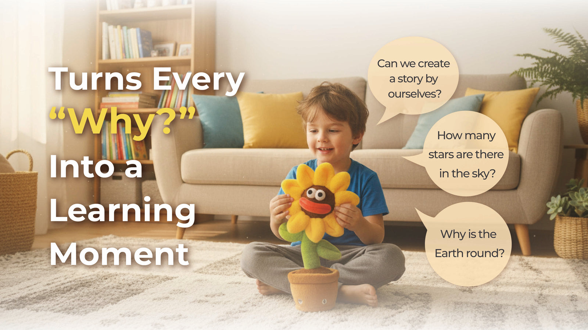
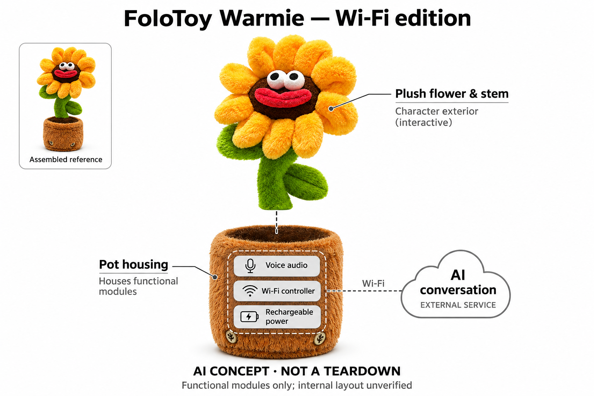

# FoloToy Sunflower Warmie（海外 Wi-Fi 版）

**FoloToy** · AI玩具 · 核查 2026-11-06

以桌面向日葵造型承载语音问答和故事创作。

消费渠道：个人零售。

## 产品图片与结构参考

### 产品图

FoloToy Warmie海外Wi-Fi版 官方产品图 · 来源：[FoloToy · 官方图片](<https://store.folotoy.com/products/folotoy-ai-toy-ai-sunflower>) · [原始图片](<https://cdn.shopify.com/s/files/1/0586/6058/5547/files/11.png?v=1781180761>)

### 参考图

FoloToy Warmie海外Wi-Fi版 官方参考图（含厂商展示场景） · 来源：[FoloToy · 官方图片](<https://store.folotoy.com/products/folotoy-ai-toy-ai-sunflower>) · [原始图片](<https://cdn.shopify.com/s/files/1/0586/6058/5547/files/2_b300abdf-94f1-42d0-9fdf-8881383a8fe1.jpg?v=1767700714&width=1600>)

### AI 生成爆炸示意

**AI 生成 · 非实物拆机。** 内部为概念推断，不能作为元件布局、BOM 或维修依据。[生成提示词](../../content/hardware/prompts/folotoy-warmie.txt)

> 单独内置ImageGen生成并目视核验；云端与机内功能分开，未知结构为抽象功能层，不代表原厂PCB或真实装配。

> 保留官方原图内容；场景或宣传文字不代表本研究实测，Kumma两张为同款外观展示。

> 分析为基于公开资料的案头研究与 AI 辅助判断，未经用户访谈、销量审计或实物拆机。需求、画像、竞争冷门度、审美及商业机会均为研究假设，不是投资结论。

## 销售与购买

- 状态：在售。官方商品页显示加购，公开product.js返回available=true与7900美分价格；按海外Wi-Fi商品记录。

- 地区：海外官方商店（具体配送范围以结算为准）

- 价格：US$79。核查为官方促销参考价；中国小葵2.0的移动网络和服务套餐不适用于本海外SKU，费用以结算为准。

- 中国大陆：官方海外商店国家选择器包含China，但运输政策仅写标准配送免费，没有明确中国大陆可送达承诺；未验证大陆地址结算、税费、售后或云服务，因此国内购买情况待确认。本海外Wi-Fi版不能套用中国小葵2.0的4G及服务套餐。

- [官方产品 / 商店](<https://store.folotoy.com/products/folotoy-ai-toy-ai-sunflower>)

## AI 的实际作用

借助联网语音系统理解问题、生成对话和共同编故事，再通过玩具播音。向日葵外观、按钮及充电是承载交互的硬件；未据海外页证明4G、语音闹钟或主动提醒。

服务与联网依赖：本SKU公开标注Wi-Fi和USB-C充电；对话依赖云端，实际会员、语言和账户条件需按海外服务版本确认。

## 是否冷门

新兴竞争（研究判断）：植物角色较细分，但生成式聊天与传统声控玩具都有成熟替代，需要验证持续使用。

## 需求与市场

Warmie把对话伙伴设计成可以立在桌上的向日葵，适合在书桌和家庭活动区进行短问答与故事游戏。其需求不只是让毛绒会发声，而是提供一个无需打开手机屏幕的回应对象；是否值得购买，需要验证用户是否会在这些固定位置反复主动交流，而不是仅因花朵造型有趣。

### 需求判断 · 研究判断

Warmie把对话伙伴设计成可以立在桌上的向日葵，适合在书桌和家庭活动区进行短问答与故事游戏。其需求不只是让毛绒会发声，而是提供一个无需打开手机屏幕的回应对象；是否值得购买，需要验证用户是否会在这些固定位置反复主动交流，而不是仅因花朵造型有趣。

依据：[Warmie海外Wi-Fi版官方商品](<https://store.folotoy.com/products/folotoy-ai-toy-ai-sunflower>) · [FoloToy商店与联网FAQ](<https://store.folotoy.com/>)

### 使用时机 · 研究判断

花盆底座提供明确的摆放位置，与需要抱住的泰迪熊形成不同使用姿势。用户可能在画画或玩玩具时顺便提问，也可能只把它当装饰；两种行为对应不同价值，不能把桌面摆放天数当成对话活跃，更不能从官方家庭场景图推断真实学习收益。

依据：[Warmie海外Wi-Fi版官方商品](<https://store.folotoy.com/products/folotoy-ai-toy-ai-sunflower>) · [FoloToy商店与联网FAQ](<https://store.folotoy.com/>)

### 需求验证 · 待验证

建议在儿童有成人陪同的游戏和成人桌面闲聊两种场景记录实际提问、共同编故事及停止互动的原因。应对比同一位置放普通装饰花加手机助手的情况，核实独立玩具是否减少操作负担，同时记录噪声、充电和回答等待带来的打断。

依据：[Warmie海外Wi-Fi版官方商品](<https://store.folotoy.com/products/folotoy-ai-toy-ai-sunflower>) · [FoloToy商店与联网FAQ](<https://store.folotoy.com/>)

## 用户画像

适合人群可能愿意接受夸张卡通花朵作为日常陪伴，并能够在固定空间保持无线网络与充电。海外页面提供多语言说明，但本轮没有验证中文效果或适龄边界，因此不能按外观可爱就覆盖所有儿童，购买者应先核实具体版本、内容规则与实际设置流程。

### 用户判断 · 研究判断

适合人群可能愿意接受夸张卡通花朵作为日常陪伴，并能够在固定空间保持无线网络与充电。海外页面提供多语言说明，但本轮没有验证中文效果或适龄边界，因此不能按外观可爱就覆盖所有儿童，购买者应先核实具体版本、内容规则与实际设置流程。

依据：[Warmie海外Wi-Fi版官方商品](<https://store.folotoy.com/products/folotoy-ai-toy-ai-sunflower>) · [FoloToy商店与联网FAQ](<https://store.folotoy.com/>)

### 家庭角色 · 研究判断

家庭中的付款人、负责联网的人和与花朵说话的人可能不同，底座放置也需要其他成员接受。若把它放在公共客厅，电视和多人说话会影响互动，若放在卧室又涉及夜间声音；画像需要包括空间与共同居住者，而不只是年龄和是否喜欢玩具。

依据：[Warmie海外Wi-Fi版官方商品](<https://store.folotoy.com/products/folotoy-ai-toy-ai-sunflower>) · [FoloToy商店与联网FAQ](<https://store.folotoy.com/>)

### 画像验证 · 待验证

可请用户在家中自行选择摆放位置，并在几天后解释为什么保留或移动它，记录是否有人主动关闭声音。分别观察会主动提问的人和只跟随故事的人，检查谁需要成人帮助；这些行为能帮助判断适配范围，本轮尚无用户访谈或长期使用数据。

依据：[Warmie海外Wi-Fi版官方商品](<https://store.folotoy.com/products/folotoy-ai-toy-ai-sunflower>) · [FoloToy商店与联网FAQ](<https://store.folotoy.com/>)

## 竞争与替代

Warmie与会唱歌的普通向日葵、故事机和智能音箱在外观与声音入口上重叠，生成式问答是需要单独证明的差异。普通声控摇摆或重复录音不等于AI，本目录只依据本商品的云端对话介绍收录；不把桌面摆件这一形态本身视为技术门槛。

### 替代方案 · 研究判断

Warmie与会唱歌的普通向日葵、故事机和智能音箱在外观与声音入口上重叠，生成式问答是需要单独证明的差异。普通声控摇摆或重复录音不等于AI，本目录只依据本商品的云端对话介绍收录；不把桌面摆件这一形态本身视为技术门槛。

依据：[Warmie海外Wi-Fi版官方商品](<https://store.folotoy.com/products/folotoy-ai-toy-ai-sunflower>) · [FoloToy商店与联网FAQ](<https://store.folotoy.com/>)

### 版本差异 · 研究判断

中国官网的小葵2.0写有移动网络、闹钟与主动碎碎念，而海外Warmie商品只确认无线网络和语音互动。两者即使外观近似也不能混用功能宣传，本条选择具有公开零售证据的海外SKU作为代表，并保留版本差异供比较，不通过换地区名称重复增加产品数量。

依据：[Warmie海外Wi-Fi版官方商品](<https://store.folotoy.com/products/folotoy-ai-toy-ai-sunflower>) · [FoloToy商店与联网FAQ](<https://store.folotoy.com/>)

### 比较验证 · 待验证

应与普通故事机、手机语音助手以及可抱持毛绒比较相同故事任务，记录用户的操作、等待和重复使用。若用户主要喜欢固定舞蹈或儿歌，简单产品可能更合适；比较时还要把账户、服务费用和网络条件对齐，不能仅按初次开机的趣味程度排序。

依据：[Warmie海外Wi-Fi版官方商品](<https://store.folotoy.com/products/folotoy-ai-toy-ai-sunflower>) · [FoloToy商店与联网FAQ](<https://store.folotoy.com/>)

## 供应链

从公开页面可确认花头茎叶、花盆底座、语音交互、无线联网和充电功能，云端理解与生成在机外完成。内部电路板、电机数量、驱动方式和电池位置未充分披露，概念图只拆功能块；不能依据其他会跳舞向日葵的拆机，给Warmie补出未经证实的结构。

### 功能划分 · 研究判断

从公开页面可确认花头茎叶、花盆底座、语音交互、无线联网和充电功能，云端理解与生成在机外完成。内部电路板、电机数量、驱动方式和电池位置未充分披露，概念图只拆功能块；不能依据其他会跳舞向日葵的拆机，给Warmie补出未经证实的结构。

依据：[Warmie海外Wi-Fi版官方商品](<https://store.folotoy.com/products/folotoy-ai-toy-ai-sunflower>) · [FoloToy商店与联网FAQ](<https://store.folotoy.com/>)

### 制造难点 · 研究判断

高花头与小底座的组合需要验证摆放稳定、拉扯茎叶以及线材弯折耐久，毛绒材料也可能影响麦克风和扬声器。具体代工厂与零件清单未知，工程评价应关注整机在被拿起、放倒和充电时的表现，不能用通用玩具机构或单一电子模块成本估算全部交付。

依据：[Warmie海外Wi-Fi版官方商品](<https://store.folotoy.com/products/folotoy-ai-toy-ai-sunflower>) · [FoloToy商店与联网FAQ](<https://store.folotoy.com/>)

### 候选选择 · 研究判断

Seeed可作为联网语音控制和样机电子装联候选，瑞声可研究底座和毛绒覆盖下的声学输出。两家公司没有点名Warmie供货证据，后续仍需确认结构固定、材料清洁及声音通道设计；供应商能力介绍不能替代本产品的整机验证，也不构成已采用的关系。

依据：[Warmie海外Wi-Fi版官方商品](<https://store.folotoy.com/products/folotoy-ai-toy-ai-sunflower>) · [FoloToy商店与联网FAQ](<https://store.folotoy.com/>)

## 技术路径

本款AI作用集中于理解用户语音并生成回答或故事，普通无线连接和USB充电只是基础设施。官网海外商品未证明具备中国小葵2.0全部功能，也没有公开可核对的精确模型版本，分析应围绕已确认交互链路，不把同品牌的开发资料直接当作本机固件实现。

### 技术边界 · 研究判断

本款AI作用集中于理解用户语音并生成回答或故事，普通无线连接和USB充电只是基础设施。官网海外商品未证明具备中国小葵2.0全部功能，也没有公开可核对的精确模型版本，分析应围绕已确认交互链路，不把同品牌的开发资料直接当作本机固件实现。

依据：[Warmie海外Wi-Fi版官方商品](<https://store.folotoy.com/products/folotoy-ai-toy-ai-sunflower>) · [FoloToy商店与联网FAQ](<https://store.folotoy.com/>)

### 技术难点 · 研究判断

桌面花朵的使用距离和朝向比手持玩具更不固定，用户可能边玩边说话，家庭噪声又会改变录音质量。模型即使文本回答正确，也可能因起止时间、声音太小或回答太长而难用，所以技术评估需要把语音入口、网络等待和播放理解一起纳入。

依据：[Warmie海外Wi-Fi版官方商品](<https://store.folotoy.com/products/folotoy-ai-toy-ai-sunflower>) · [FoloToy商店与联网FAQ](<https://store.folotoy.com/>)

### 验证方法 · 待验证

可在安静书桌、电视开启的客厅和较弱无线信号环境重复同一组问题，检查断网提示、恢复行为与停止播放是否清楚。共同编故事时应记录是否承接用户的角色和情节修改，区分真正的上下文互动与固定内容播放；本轮未进行这些实物测试。

依据：[Warmie海外Wi-Fi版官方商品](<https://store.folotoy.com/products/folotoy-ai-toy-ai-sunflower>) · [FoloToy商店与联网FAQ](<https://store.folotoy.com/>)

## 产品审美

大眼睛、红嘴唇和向日葵花瓣把产品定位为夸张的卡通伙伴，花盆底座使它更像桌面装饰而非移动机器人。造型容易表达亲近和幽默，也可能与成年人的工作空间不协调；审美评价应包含长期可接受程度，不仅看展示照片中的鲜艳配色。

### 审美判断 · 研究判断

大眼睛、红嘴唇和向日葵花瓣把产品定位为夸张的卡通伙伴，花盆底座使它更像桌面装饰而非移动机器人。造型容易表达亲近和幽默，也可能与成年人的工作空间不协调；审美评价应包含长期可接受程度，不仅看展示照片中的鲜艳配色。

依据：[Warmie海外Wi-Fi版官方商品](<https://store.folotoy.com/products/folotoy-ai-toy-ai-sunflower>) · [FoloToy商店与联网FAQ](<https://store.folotoy.com/>)

### 状态表达 · 研究判断

表情主要由固定外观呈现，用户仍需声音或按钮反馈判断设备是否接收到话语。充电口、底座按键和毛绒花头之间的关系应容易理解，避免可爱外观遮蔽操作入口；若需要近距离寻找按键，原本无屏幕的轻松感会被反复操作抵消。

依据：[Warmie海外Wi-Fi版官方商品](<https://store.folotoy.com/products/folotoy-ai-toy-ai-sunflower>) · [FoloToy商店与联网FAQ](<https://store.folotoy.com/>)

### 体验验证 · 待验证

可以在实际桌面摆放后观察视线遮挡、倒伏、拿取和充电线走向，记录家中其他人是否觉得声音或造型打扰。再检查局部清洁后的花瓣和嘴部形态，不依据广告拍摄的完好状态推断耐久，也不把造型带来的短暂笑声视为长期满意度。

依据：[Warmie海外Wi-Fi版官方商品](<https://store.folotoy.com/products/folotoy-ai-toy-ai-sunflower>) · [FoloToy商店与联网FAQ](<https://store.folotoy.com/>)

## 关键风险

海外SKU与中国小葵2.0功能差异是主要购买风险：中文官网的4G和提醒不能无条件套用。用户如果依据混合宣传购买，可能在开机后才发现网络和服务不匹配；目录因此明确保留版本名称、购买来源和未验证事项，不以同名向日葵保证跨地区体验一致。

### 风险判断 · 研究判断

海外SKU与中国小葵2.0功能差异是主要购买风险：中文官网的4G和提醒不能无条件套用。用户如果依据混合宣传购买，可能在开机后才发现网络和服务不匹配；目录因此明确保留版本名称、购买来源和未验证事项，不以同名向日葵保证跨地区体验一致。

依据：[Warmie海外Wi-Fi版官方商品](<https://store.folotoy.com/products/folotoy-ai-toy-ai-sunflower>) · [FoloToy商店与联网FAQ](<https://store.folotoy.com/>)

### 服务与内容 · 研究判断

云端对话存在服务变化、误答和不适龄输出的可能，固定花脸不会显示系统的不确定程度。家庭应理解玩具回复不等于可信指导，也要确认账户、数据删除和停止使用路径；硬件充电和毛绒维护的风险同样需要处理，不能只关注模型能否说得自然。

依据：[Warmie海外Wi-Fi版官方商品](<https://store.folotoy.com/products/folotoy-ai-toy-ai-sunflower>) · [FoloToy商店与联网FAQ](<https://store.folotoy.com/>)

### 风险验证 · 待验证

应先由成人检查错误问题、拒答与网络异常时的反馈，再确认儿童能否识别玩具不知道的事情。建议核实购买地区可用服务、售后和当前费用，保存版本信息与说明书；这些属于使用前的验证任务，不能因商品有加购按钮就推定全部功能已经在大陆实测。

依据：[Warmie海外Wi-Fi版官方商品](<https://store.folotoy.com/products/folotoy-ai-toy-ai-sunflower>) · [FoloToy商店与联网FAQ](<https://store.folotoy.com/>)

## 机会与验证

桌面植物角色可以承接画画时的故事伙伴或短时问答，差异在于固定空间中容易被看见和再次触发。真正机会应来自形成具体的互动习惯，而不是把普通声控花升级成更多宣传词；若用户只需装饰和音乐，昂贵的持续云端服务未必能带来额外价值。

### 机会判断 · 研究判断

桌面植物角色可以承接画画时的故事伙伴或短时问答，差异在于固定空间中容易被看见和再次触发。真正机会应来自形成具体的互动习惯，而不是把普通声控花升级成更多宣传词；若用户只需装饰和音乐，昂贵的持续云端服务未必能带来额外价值。

依据：[Warmie海外Wi-Fi版官方商品](<https://store.folotoy.com/products/folotoy-ai-toy-ai-sunflower>) · [FoloToy商店与联网FAQ](<https://store.folotoy.com/>)

### 设计方向 · 研究判断

创业团队可以研究更明确的录音提示、更短的回答与适合共同创作的回合设计，让花朵成为家庭活动的一部分。此处是产品机会假设，不代表Warmie已经实现全部方案；尤其应先厘清海外与国内版本的控制能力，避免把新功能列表当成现有收入证据。

依据：[Warmie海外Wi-Fi版官方商品](<https://store.folotoy.com/products/folotoy-ai-toy-ai-sunflower>) · [FoloToy商店与联网FAQ](<https://store.folotoy.com/>)

### 市场验证 · 待验证

可围绕家庭桌面和成人礼物分别做小规模试用，记录使用频率、主动开启原因、服务成本与不满意的回答。把闲置、送礼后无法配网和返修都纳入，而不是只看电商评论数量；验证完成前，不把植物外形的细分市场称为没有竞争的蓝海。

依据：[Warmie海外Wi-Fi版官方商品](<https://store.folotoy.com/products/folotoy-ai-toy-ai-sunflower>) · [FoloToy商店与联网FAQ](<https://store.folotoy.com/>)

## 对应供应链公司

能力候选用于选型研究，不代表本产品实际采用；未公开的供货关系不作推断。

- [seeed-studio](../supply-chain/seeed-studio.md) — **能力候选 · 非已采用** / 桌面语音联网原型：公开原型工程和电子装联能力可服务花盆式联网语音装置，但Warmie当前采购来源未知；仍需核实底座固定、接口防护、整机测试及软件服务，不能把候选能力写成已供货。

- [aac-technologies](../supply-chain/aac-technologies.md) — **能力候选 · 非已采用** / 花盆底座声学单元与调试：瑞声的扬声器和整机声学能力可用于重新评估小空间播放与毛绒遮挡影响；没有Warmie点名采用证据，尺寸、耗电、失真、声音通道及采购条件需以样机和商务确认。

[浏览供应链目录](../supply-chain.md)

## 功能分层示意

这是功能关系，不是实物拆机、真实空间结构或已核实 BOM。

1. **向日葵外形**：毛绒花头、茎叶和花盆式底座形成桌面玩具。（官方披露）

2. **语音输入输出**：通过语音问答和故事互动呈现云端内容。（官方披露）

3. **无线与控制**：海外商品只确认Wi-Fi；主板布局及具体器件未知。（官方披露）

4. **外部对话服务**：模型理解与内容生成由联网服务支持。（官方披露）

5. **充电供电**：USB-C充电；内部封装与保护方案为未知。（官方披露）

## 来源

1. [Warmie海外Wi-Fi版官方商品](<https://store.folotoy.com/products/folotoy-ai-toy-ai-sunflower>) — 实际打开79美元商品及加购，公开product.js返回available=true；页面规格是Wi-Fi版本。

2. [FoloToy商店与联网FAQ](<https://store.folotoy.com/>) — 官方说明对话依赖Wi-Fi和云服务；品牌通用FAQ不当作各型号全部功能证明。

3. [FoloToy中文产品矩阵](<https://folotoy.com/zh/products/>) — 中国小葵2.0另有4G、闹钟和主动碎碎念；本档海外SKU未证明具备这些功能，不合并技术承诺。

4. [Warmie官方图文介绍](<https://store.folotoy.com/products/folotoy-ai-toy-ai-sunflower>) — 商品页的原厂说明图展示问答与共同创作故事场景，仅为官方功能说明，不是学习效果证据。

5. [FoloToy配送政策](<https://store.folotoy.com/policies/shipping-policy>) — 商店地区列表有China，政策列标准配送免费；未完成大陆地址结算及云服务试用。

[返回目录](../hardware-market.md) · [网页分析](https://romanagent.github.io/Roman/#hardware/product/folotoy-warmie)
